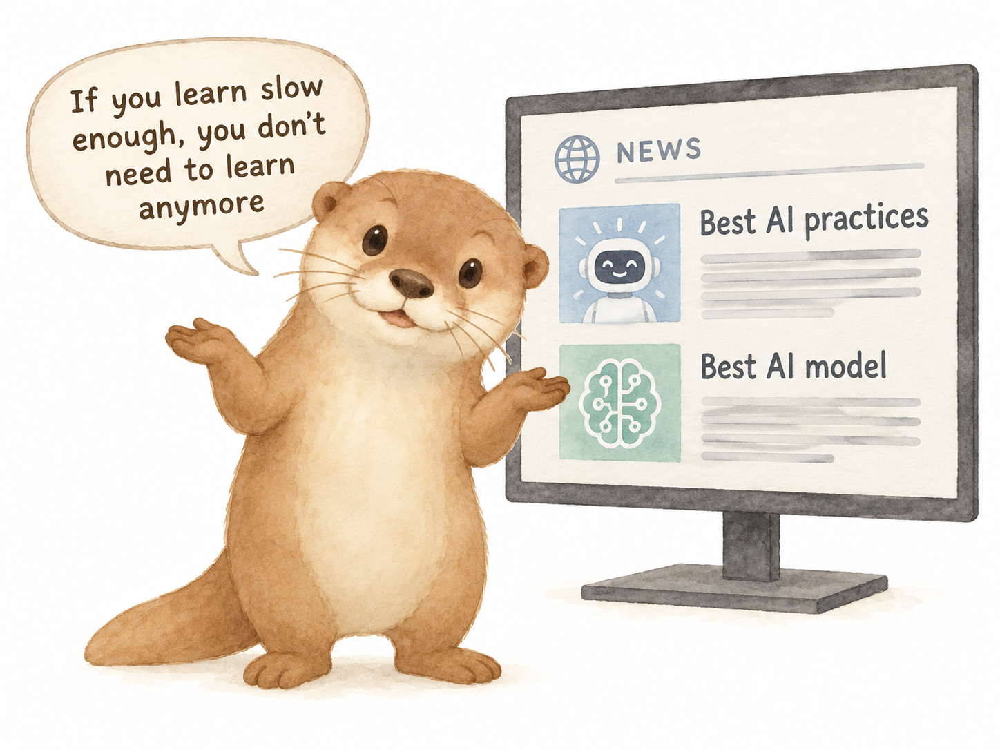
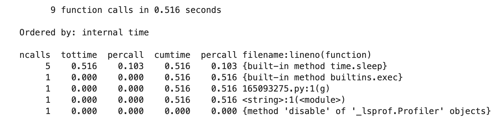
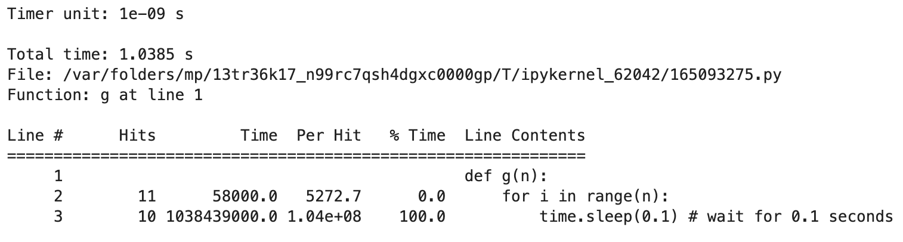
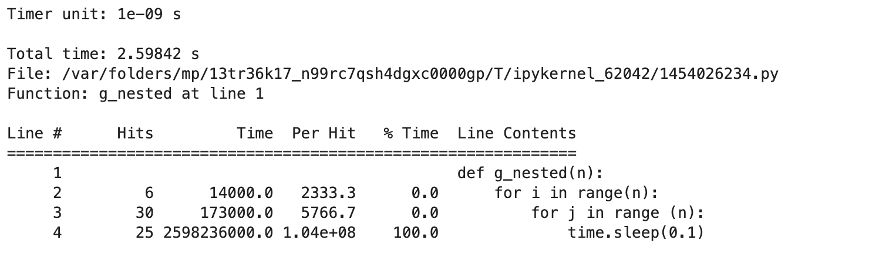
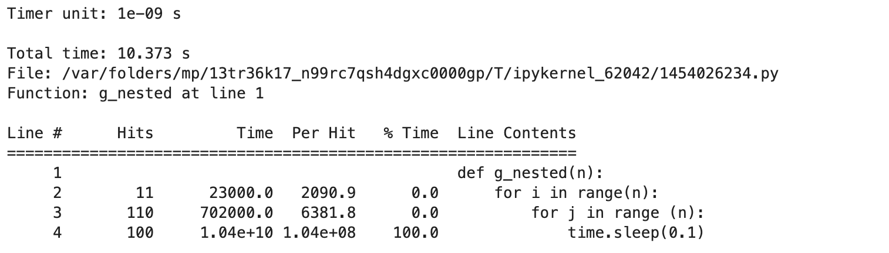
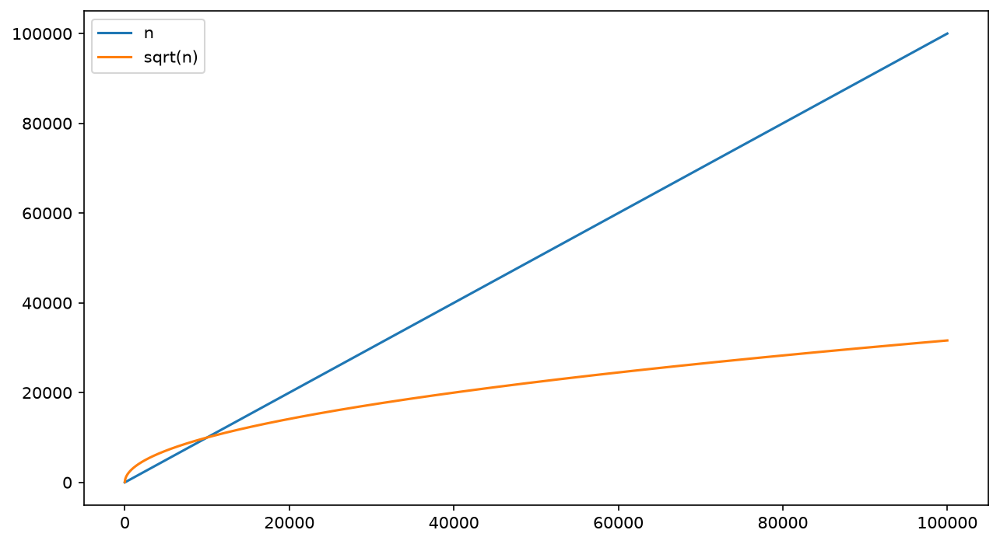

## Meet your instructor

::::: columns
::: {.column width="38%"}
{width=370px fig-align="center"}
:::

::: {.column width="62%" style="font-size: 0.75em;"}
-   [Sky (Kehan) Sheng, PhD](https://www.skysheng.io/)
-   👩‍💻 I am a post-doc of computer science and a sessional lecturer for statistics.
-   My research spans data science, AI fairness and animal welfare science.
-   Contact
    -   📧: skysheng\@cs.ubc.ca
    -   💼: ICCS Building Room 187
    -   🔗: skysheng.io
    -   💬: `@Sky` on Slack
    -   🕰️ [MDS calendar](https://ubc-mds.github.io/calendar/) for office hours.
:::
:::::

::: {.notes}
**My path to data science:**

- Grew up loving animals and wanted to be a vet as an undergrad, just like many of you might be figuring out your path right now
- Volunteered for wildlife rescue in Costa Rica, learned about tracking wild rhino using small satellites, which sparked my curiosity about the behaviour and movement patterns hidden in animal data
- Learned programming and how to analyze animal movement data, which led to a PhD using data science to study animal behaviour, preferences, friendships, and rivalries
- That work grew into research on AI fairness, how human values get embedded (and sometimes distorted) in AI systems
- Now: years of teaching experience, currently a post-doc and instructor

**TA introductions**
:::

## {background-image="images/diverse_path.png" background-size="contain" background-position="center"}

::: {.notes}
1. Data scientists come from all kinds of backgrounds, that's what makes this field so interesting.
2. This class is diverse: different majors, experiences, and starting points.
3. **If you have prior experience:** help others! Teaching is one of the best ways to test your own understanding, explaining a concept simply to someone else reveals what you truly know. Everyone in this room knows something the rest of the class doesn't.
4. **If you have zero experience:** that was me too when i entered university. My first laptop, my first terminal, it was intimidating, especially surrounded by classmates using jargon I didn't understand. I thought I wasn't smart enough for this. Looking back, that wasn't true at all. Not knowing something just means you haven't had the chance to learn it yet, it has nothing to do with your intelligence or your potential to succeed in this field.
5. Make friends and collaborate. Knowledge is freely available online, but friendships aren't. The biggest thing you'll gain from this course (and university in general) is the people you meet and the practice you get communicating, collaborating, and thinking together.
:::

## iClicker Set Up for Section 002

::: {style="text-align: center; margin-top: 1em"}
[join.iclicker.com/AGFP](https://join.iclicker.com/AGFP){preview-link="true" style="text-align: center"}
:::

{width=300px fig-align="center"}

::: {.notes}
no marks for iClicker, only for easier in class participation.
:::

## iClicker: Do we still need to learn algorithms and data structures in the AI era? {style="font-size: 0.7em;"}

::::: columns
::: {.column width="50%" style="text-align: center; font-size: 0.9em;"}
{width=250px height=180px fig-align="center" style="margin-bottom: -0.8em;"}

\(A) YES! AI can't replace my thinking!
:::

::: {.column width="50%" style="text-align: center; font-size: 0.9em;"}
{width=250px height=180px fig-align="center" style="margin-bottom: -0.8em;"}

\(B) NO! My bestie ChatGPT knows it all!
:::
:::::

::::: columns
::: {.column width="50%" style="text-align: center; font-size: 0.9em;"}
{width=250px height=180px fig-align="center" style="margin-bottom: -0.8em;"}

\(C) Strategically indecisive: "It depends..."
:::

::: {.column width="50%" style="text-align: center; font-size: 0.9em;"}
{width=250px height=180px fig-align="center" style="margin-bottom: -0.8em;"}

\(D) I'm still figuring out what data science is...
:::
:::::

::: {.notes}
*Hint: There is no correct answer for this question.*

show of hands for each option.
:::

# Why learn algorithms and data structures in the AI era? {background-image="images/why_ds.png" background-size="contain" background-position="center"}

## There is no shortcut to learning how to think {style="font-size: 0.8em;"}

{width=90% fig-align="center"}

::: {.notes}
- You can't outsource your thinking to AI. Exams do test whether you remember python syntax, but the long-term goal of this course isn't memorizing code, AI is already great at that.
- My own experience: I learned Java years ago, rarely use it now, but the logical thinking skills stuck with me.
- This course trains you to be an independent thinker, life-long learner, and problem solver, to approach and solve new problems on your own. There's no shortcut to that.
- If you copy-paste AI's answers into your worksheets, you're practicing copying and pasting, not thinking. That's why AI isn't allowed on tutorials, worksheets, or exams, you need to go through the process yourself, step by step.
- You'll make mistakes, get stuck, and see scary error messages: that's how you grow (my personal record is 8 hours debugging one issue!). Think of it like going to the gym: you have to lift the heavy weights yourself to build stronger problem-solving muscles.
- Your judgment and ability to think critically are what will make you stand out in this era.
- Read the book yourself, with your own brain. If you have AI read it for you, the machine is learning — not you.
:::

## AI updates every 6 months, but algorithmic fundamentals don't go out of fashion {style="font-size: 0.8em;"}

{width=80% fig-align="center"}

::: {.notes}
- There's a saying in AI: "If you learn slow enough, you'll never need to learn again."
- The best AI models and practices change every ~6 months. Techniques I've taught before (prompt engineering → system prompts → agentic workflows → MCP → harnesses) keep going out of date.
- It's a better investment to spend your time learning the fundamentals — nobody can keep up with every new AI tool all the time.
:::

## DSCI 512: Absolute fundamentals a data scientist needs to know {style="font-size: 0.8em;"}

{width=80% fig-align="center"}

::: {.notes}
- Some things don't go out of fashion no matter how slowly you learn them, these are the absolute fundamentals every data scientist is expected to know.
- Example: in a future job interview, if you're asked how to calculate time complexity of your code, "let me ask ChatGPT" won't be the right answer.
- DSCI 512 covers the absolute fundamentals of algorithms and data structures that a data scientist needs to know.
:::

## AI evaluation (AI eval) is a fancier term for data science {style="font-size: 0.8em;"}

{width=90% fig-align="center"}

::: footer
Sheng et al., 2026. Silencing controversial realities through prompt revision: The erasure of intensive livestock farming in text-to-image generative AI. *Technology in Society*, 103466.
:::

::: {.notes}
- "AI evaluation" is really just data science with a new name.
- The same tools you'll learn here: writing clean code, parallel processing, are exactly what's needed to evaluate AI models, one of the most in-demand skills today.
:::

## Course logistics

- Deliverables:

  - Four labs (12.5% each), and two quizzes (25% each).
  - Assignments to be submitted as Jupyter notebook.

- Class Schedule:

  - Weeks 1, 3, 4: Monday, Wednesday, 11am-12:20pm
  - Week 2: Wednesday, Friday 11am-12:20pm

- Lab Schedule:

  - Weeks 1, 3, 4: Monday 3pm-4:50pm, Tuesday 2pm-3:50pm
  - Week 2: Thursday 2pm-3:50pm, Friday, 3pm-4:50pm

  (This is all reflected on [MDS calendar](https://ubc-mds.github.io/calendar/))

## Course overview

- This focuses on
  - Fundamental data structures and algorithms,
  - Complexity analysis, and
  - Techniques for improving Python code performance.

## Course overview

- What is an algorithm?

{fig-align="center" width="60%"}

## Course overview

- What is an algorithm?

  - An algorithm is a well-defined computational procedure designed to solve a problem.
  - provides a sequence of precise steps for transforming **input** into **output** in order to arrive at a solution.

## Course overview

- What is an algorithm?

  - Example: Linear vs Binary search
    - Common problem: is a certain value present in a collection of items?

## Course overview

- What is a data structure?
  - A data structure is a way to organize and manage data.
  - More on this in Lecture 2.

## Course overview

- Why do we need to study algorithms and data structures?
  - To practice systematic thinking and develop algorithmic problem-solving skills
  - To gain practical insight into handling slow or inefficient code
  - To write cleaner code and communicate effectively with colleagues
  - Because algorithmic problem-solving is often tested directly in data science interviews

## Course overview

- Week 1: Code profiling, time and space complexity analysis
- Week 2: Graphs and Matrices
- Week 3: Recursive algorithms and data structures
- Week 4: Dynamic programming

## Course overview

- There are some recommended readings/videos for you to review in advance.
- The course is extremely compressed of a "classic" undergraduate course on algorithms and data structures.
- We will use `Python`.

## Lecture 1 outline

- Course overview ✅
- Code Profiling
- Time Complexity and Big O Notation

## Learning objectives

By the end of this lecture, you will be able to:

- Maintain an awareness that choosing a good algorithm matters, sometimes _a lot_!
- Measure the amount of time code in Python takes using `timeit`, `prun`, `line_profiler`.
- Given simple code, determine the time complexity using Big-O notation.
- Explain the difference between the common complexity classes (e.g. constant, logarithmic, linear, quadratic, etc.).
- Describe the linear and binary search algorithm.

## Code profiling

::: {.incremental}

- Code profiling allows us to identify the sources of inefficiency.

- Some of the tools we can use include:

  - `timeit`: A simple yet effective tool for measuring the execution time of small pieces of code.
  - `prun`: A function-level profiler that provides detailed information about how much time is spent in each function.
  - `lprun`: A tool that profiles code line by line.

- **Note:** Code profiling applies to memory usage as well. We will talk about memory profiling in the next lecture.
:::

## Code profiling

- Example: we can use the `%timeit` function to measure the runtime of a single statement.

```python
n = 10_000_000 # setting n to an arbitrary large number.
%timeit (list(range(n)))
```

```python
%timeit (set(range(n)))
```

## Code profiling

- Example (continued):

```python
x = list(range(n))
%timeit (-1 in x)
```

```python
x = set(range(n))
%timeit (-1 in x)
```

## Profiling functions

- we can use `%prun` on a function to tell how much time was spend in each part.
```python
def g(n):
    for i in range(n):
        time.sleep(0.1) # wait for 0.1 seconds
%prun g(5)
```
{fig-align="center" width="100%"}

## Line profiler

- we can use `%lprun` from the `line_profiler` library to profile out code line by line:
```python
def g(n):
    for i in range(n):
        time.sleep(0.1) # wait for 0.1 seconds
%lprun -f g g(5)
```

{fig-align="center" width="100%"}

## Line profiler

- what happens if $n$ is doubled, i.e., $n = 10$?

```python
def g(n):
    for i in range(n):
        time.sleep(0.1) # wait for 0.1 seconds
%lprun -f g g(10)
```

{fig-align="center" width="100%"}

## Line profiler

- What if there is a nested loop?

```python
def g_nested(n):
    for i in range(n):
        for j in range (n):
            time.sleep(0.1)
%lprun -f g_nested g_nested(5)
```

{fig-align="center" width="100%"}

## Line profiler

- what if $n$ is doubled in this case?

```python
def g_nested(n):
    for i in range(n):
        for j in range (n):
            time.sleep(0.1)
%lprun -f g_nested g_nested(10)
```

{fig-align="center" width="100%"}

## Line profiler

- What if $n=5$, but $0.1$ is double to be $0.2$?

```python
def g_nested(n):
    for i in range(n):
        for j in range (n):
            time.sleep(0.2)
%lprun -f g_nested g_nested(5)
```

{fig-align="center" width="100%"}

## Time complexity

- Computer scientists formalize the observations made above using mathematical definitions and notation.

- The key question to focus on is: How does the runtime grow as $n$ gets bigger?

## Time complexity

- let’s return to a simpler version of this question: If we double $n$, what happens to the number of steps?

```{pyodide}
import time

def g(n):
    for i in range(n):
        time.sleep(0.1)
```
- How about:

```{pyodide}
def g_nested(n):
    for i in range(n):
        for j in range(n):
            time.sleep(0.1)
```

## Big O notation

- The time complexity is commonly expressed using [big O notation](https://en.wikipedia.org/wiki/Big_O_notation).
  - It tells us the **approximate number of steps** an algorithm performs **as a function of the input size $n$**.

- **Definition** of $O$ (Optional):

  - We say a function $f(n)$ is $O(g(n))$ if there exists a positive number $M$ such that
  $$f(n) \leq M g(n) \text{ for all large enough } n.$$
  - It says the function $f$ grows no faster than the rate $g(n)$.

  <br>

  - If $g(n)=n$, then $f(n)$ grows linearly (or slower).
    - If we double $n$ then the runtime is double.

## Big O notation

- More examples:

  - $g(n)=n^3$, then
    - If we double $n$, the running time goes up $8x$
    - Because  $g(2n)/g(n)=(2n)^3/n^3=8$.
  - $g(n)=2^n$, then
    - If we increase $n$ by $1$, the runtime is double!
    - Because $g(n+1)/g(n)=2^{(n+1)}/2^n=2$.

## Common runtimes

| Big O |  name  | change in runtime for double $n$|
|-------|--------|-------|
| $O(1)$ | constant | same |
| $O(\log n)$ | logarithmic | increased by a constant |
| $O(n)$ | linear | 2x |
| $O(n \log n)$ | linearithmic | roughly 2x |
| $O(n^2)$ | quadratic | 4x |
| $O(n^3)$ | cubic | 8x |
| $O(n^k)$ | polynomial | increase by a factor of $2^k$ |
| $O(2^n)$ | exponential | squared |

## Visualizing time complexities (log-log plots)

{width=70% fig-align="center"}

- $2^n$ (exponential) is by far the biggest!
- In log-log plots, polynomials turn into straight lines, with slope equal to the exponent.

## Constant factors in big O notation

- We ignore **multiplicative constants**.
  - If an algorithm takes $2n$ steps, we write $O(n)$.
- We're interested in how the runtime grows, not the exact runtime.

## Lower-order terms in big O notation
- We also ignore **"lower order" terms**, including additive constants.
  - If the number of steps is $n+5$, we write $O(n)$.
  - If the number of steps is $n+\log n$, we write $O(n)$.
- We're interested in the growth when $n$ is large, and the lower order terms is not important when $n$ is large.

## Additive vs. multiplicative constant

- Note that $n+\log(n)$ is different from $n\log(n)$.
  - The first is $O(n)$.
  - The second is $O(n\log(n))$.

::: {.notes}
- In Big O analysis, we keep the biggest **term**.
  - Where "terms" are things being added together (not multiplied!)
- In the first case, the biggest term is $n$.
- In the second case, the biggest (and only) term is $n \log(n)$.
:::

## Visualizing lower order terms

- Why is $O(n+\log(n)+5)$ considered the same as $O(n)$?

. . .

{width=70% fig-align="center"}

- $n+\log(n)+5$ grows almost linearly.

::: {.notes}
- $\log(n)$ and $5$ are the lower order terms because they grow slowly than the dominant term $n$.
:::

## When $n$ is small

- Big O notation can be misleading when $n$ is small.
- Is code that runs in $O(n)$ time faster than code that runs in $O(n^2)$ time?
  - Not always! It depends on the constants or lower order terms.
  - $10000 n$ is more than $0.001n^2$ for small values of $n$.

::: {.notes}
- because we ignore constant and lower order terms.
- You will see an example of this phenomenon in lab 2.
:::

## The lower-order terms matter for small $n$

{width=70% fig-align="center"}

- An algorithm takes $100 n^{0.5}$ steps (orange) vs. an algorithm takes $n$ steps (blue).
- $n$ grows faster than $100 n^{0.5}$.

::: {.notes}
- According to big O, the second one grows faster than the first one, meaning the runtime is slower.
:::

## But what if we zoom in for small $n$
{width=70% fig-align="center"}

- The $100 n^{0.5}$ algorithm is slower!
- So, we can't ignore the lower order terms all the time, especially when $n$ is small.

::: {.notes}
- we can just ignore them for large $n$.
- Big O analysis isn't the be-all and end-all. It's just often useful.
:::

## Example big O analysis

Find the time complexities of `g` and `g_nested` below.

```{pyodide}
import time

def g(n):
    for i in range(n):
        time.sleep(0.1)
```
- $O(n)$

```{pyodide}
def g_nested(n):
    for i in range(n):
        for j in range(n):
            time.sleep(0.1)
```
- $O(n^2)$

## How to determine the complexity?

- With Python code, we can often "count the number of loops".
  - A loop $n$ times gives $O(n)$.
  - A nested loop gives $O(n^2$).
- However, we have to think about the functions we're using.

## Step 1: Determine the number of steps
```python
def g(n):
    for i in range(n):       # n iterations
        for i in range(n):   # n iterations
            print(j)         # constant-time (k)
    for j in range(n):       # n iterations
        print(j)             # constant-time (k)
```

So we have $f(n)=k n^2+ kn$.

## Step 2: Remove constant factors and lower-order terms

We have $f(n)=k n^2+ kn$.

- $k$ is a constant factor, so we can remove $k$.

- $n$ is lower order than $n^2$, so we can remove it.

- Leaving us with: $f(n) = O(n^2)$.

## Big O with two variables

```{pyodide}
def fun(n,m):
    for i in range(n):
        for j in range(m):
            print("Hello")

    for j in range(m):
            print("Hello")

fun(3, 2)
```
- The time complexity here is $O(nm)$.

  - $O(nm+m)$ would be just $O(nm)$
    - $nm+m=(n+1)m$ and we don't make a distinction between $n$ and $n+1$
  - If $m=n$  then it would be $O(n^2)$.
  - $O(n^2+n+m)$ would be just $O(n^2+m)$
  - $O(n^2+nm + m)$ would be $O(n^2+nm)$. We can't throw away either term because we don't know which will end up being the "dominant" factor.

## What factors affect the runtime?

- Typically, the algorithm determine the leading term.
- However, the implementation can play an important role for the constants or lower order terms.
  - How fast is your programming language (e.g. Python vs C)?
  - How fast are your libraries (e.g. Numpy)?
  - Is there an opportunity for data caching or parallel computation?

- **Note:** There are also $o$, $\omega$, $\Omega$, $\theta$, $\Theta$, and more. But we'll only discuss Big O in this course.

## Worst/best/average cases

- Sometimes algorithms have different _best case_, _worst case_ and _average case_ runtimes.
- In this course we won't go into this distinction. We're generally referring to the worst case, which often is the same complexity as the average cases anyway when you're concerned with the asymptotic behaviour.
