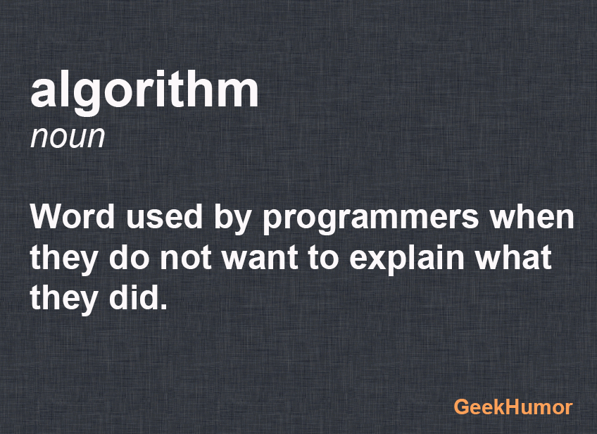
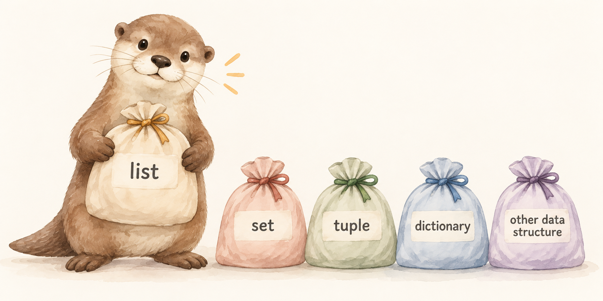
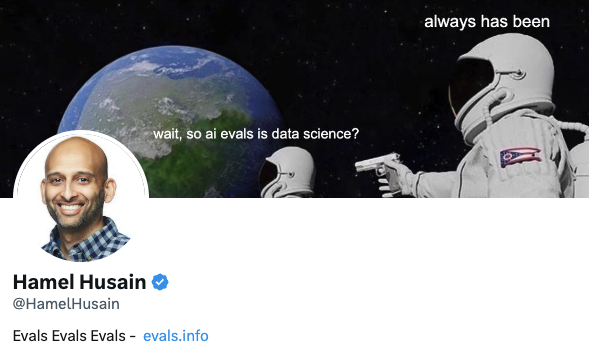

## Meet your instructor

::::: columns
::: {.column width="38%"}
{width=370px fig-align="center"}
:::

::: {.column width="62%" style="font-size: 0.8em;"}
-   [Sky (Kehan) Sheng, PhD](https://www.skysheng.io/)
-   👩‍💻 I am a post-doc of computer science and a sessional lecturer for statistics.
-   My research bridges AI fairness, animal welfare and data science.
-   Contact
    -   📧: skysheng\@cs.ubc.ca
    -   💼: ICCS Building Room 187
    -   💬: `@Sky` on Slack
    -   🕰️ [MDS calendar](https://ubc-mds.github.io/calendar/) for office hours.
:::
:::::

::: {.notes}
**My path to data science:**

- Grew up loving animals and wanted to be a vet as an undergrad, just like many of you might be figuring out your path right now
- Volunteered for wildlife rescue in Costa Rica, learned about tracking wild rhino using small satellites, which sparked my curiosity about the behaviour and movement patterns hidden in animal data
- Learned programming and how to analyze animal movement data, which led to a PhD using data science to study animal behaviour, preferences, friendships, and rivalries
- That work grew into research on AI fairness, how human values get embedded (and sometimes distorted) in AI systems
- Now: years of teaching experience, currently a post-doc and instructor

**TA introductions**
:::

## {background-image="images/diverse_path.png" background-size="contain" background-position="center"}

::: {.notes}
1. Data scientists come from all kinds of backgrounds, that's what makes this field so interesting.
2. This class is diverse: different majors, experiences, and starting points.
3. **If you have prior experience:** help others! Teaching is one of the best ways to test your own understanding, explaining a concept simply to someone else reveals what you truly know. Everyone in this room knows something the rest of the class doesn't.
4. **If you have zero experience:** that was me too when i entered university. My first laptop, my first terminal, it was intimidating, especially surrounded by classmates using jargon I didn't understand. I thought I wasn't smart enough for this. Looking back, that wasn't true at all. Not knowing something just means you haven't had the chance to learn it yet, it has nothing to do with your intelligence or your potential to succeed in this field.
5. Make friends and collaborate. Knowledge is freely available online, but friendships aren't. The biggest thing you'll gain from this course (and university in general) is the people you meet and the practice you get communicating, collaborating, and thinking together.
:::

::: footer
Image generated by OpenAI GPT-6
:::


## DSCI 512 overall learning objectives

- Fundamental data structures and algorithms,
- Complexity analysis
- Techniques for improving Python code performance.

## Course structure

- There are some recommended readings/videos for you to review in advance.
- The course is extremely compressed of a "classic" undergraduate course on algorithms and data structures.
- We will use `Python`.

## Grading breakdown {style="font-size: 0.8em;"}

- Assignments to be submitted as Jupyter notebook.
- Deliverables:

| Assessment | Weight |
|------------|--------|
| Guided Lab Activity (Week 1)      | 7%  |
| Guided Lab Activity (Week 2)      | 7%  |
| Oral Check-in (Week 3)      | 7%  |
| Guided Lab Activity (Week 4)      | 7%  |
| Short Homework 1     | 5.5%  |
| Short Homework 2     | 5.5%  |
| Short Homework 3     | 5.5%  |
| Short Homework 4     | 5.5%  |
| Quiz 1    | 25%    |
| Quiz 2    | 25%    |

## iClicker Set Up for Section 002

::: {style="text-align: center; margin-top: 1em"}
[join.iclicker.com/AGFP](https://join.iclicker.com/AGFP){preview-link="true" style="text-align: center"}
:::

{width=300px fig-align="center"}

::: {.notes}
no marks for iClicker, only for easier in class participation.
:::

## Timeline 

- Week 1: Code profiling, time and space complexity analysis
- Week 2: Graphs and Matrices
- Week 3: Recursive algorithms and data structures
- Week 4: Dynamic programming


## What is an algorithm?

{fig-align="center" width="60%"}

## What is an algorithm? Really.

- An algorithm is a well-defined computational procedure designed to solve a problem.
- provides a sequence of precise steps for transforming **input** into **output** in order to arrive at a solution.

::::: columns
::: {.column width="50%" style="text-align: center;"}
{width="200px"}

**Ingredients ≈ input**
:::

::: {.column width="50%" style="text-align: center;"}
{width="200px"}

**Recipe ≈ algorithm**
:::
:::::

::: {.notes}
cooking recipe is in a way like an algorithm. 
:::

## What is a data structure?

- A data structure is a way to organize and manage data.

{width=90% fig-align="center"}

::: {.notes}
some data structures are faster for you to access the data you are searching for, some data structures are faster to create, update or delete data. 
Some data structures can store duplicated items, some absolutely refuse to do so. 
we will learn about when to use what, the pros and cons of using them. 
:::

::: footer
Image generated by OpenAI GPT-6
:::

## Challenges Past Students Have Faced in This Course {style="font-size: 0.8em;"}

- Difficulty/pace
- Python coding 
- Some topics did not seem relevant to data science/AI

::: {.notes}
this would not be a easy A class, so do need to spend lots of time going through the logic, the algorithms yourself after class. 
questions always welcome! no stupid question in class
the last one --> iclicker question next page
:::

## iClicker: Do we still need to learn algorithms and data structures in the AI era? {style="font-size: 0.7em;"}

::::: columns
::: {.column width="50%" style="text-align: center; font-size: 0.9em;"}
{width=250px height=180px fig-align="center" style="margin-bottom: -0.8em;"}

\(A) YES! AI can't replace my brain!
:::

::: {.column width="50%" style="text-align: center; font-size: 0.9em;"}
{width=250px height=180px fig-align="center" style="margin-bottom: -0.8em;"}

\(B) NO! My bestie ChatGPT knows it all!
:::
:::::

::::: columns
::: {.column width="50%" style="text-align: center; font-size: 0.9em;"}
{width=250px height=180px fig-align="center" style="margin-bottom: -0.8em;"}

\(C) Strategically indecisive: "It depends..."
:::

::: {.column width="50%" style="text-align: center; font-size: 0.9em;"}
{width=250px height=180px fig-align="center" style="margin-bottom: -0.8em;"}

\(D) I'm still figuring out what data science is...
:::
:::::

::: {.notes}
*Hint: There is no correct answer for this question.*

show of hands for each option.
:::

# Why learn algorithms and data structures in the AI era? {background-image="images/why_ds.png" background-size="contain" background-position="center" style="font-size: 0.8em;"}

## There is no shortcut to learning how to think {style="font-size: 0.8em;"}

{width=90% fig-align="center"}

::: {.notes}
- You can't outsource your thinking to AI. Exams do test whether you remember python syntax, but the long-term goal of this course isn't memorizing code, AI is already great at that.
- My own experience: Java was my first language, rarely use it after I graduated, but the logical thinking skills stuck with me.
- This course trains you to be an independent thinker, life-long learner, and problem solver, to approach and solve new problems on your own. **To practice systematic thinking and develop algorithmic problem-solving skills.** There's no shortcut to that.

- If you copy-paste AI's answers into your worksheets, you're practicing copying and pasting, not thinking. That's why AI isn't allowed on tutorials, worksheets, or exams, you need to go through the process yourself, step by step.
- You'll make mistakes, get stuck, and see scary error messages: that's how you grow (my personal record is 8 hours debugging one issue!). Think of it like going to the gym: you have to lift the heavy weights yourself to build stronger problem-solving muscles.
- Your judgment and ability to think critically are what will make you stand out in this era.
- Read the book yourself, with your own brain. If you have AI read it for you, the machine is learning — not you.
:::

::: footer
Image generated by OpenAI GPT-6
:::

## AI updates every 6 months, but algorithmic fundamentals don't go out of fashion {style="font-size: 0.8em;"}

{width=80% fig-align="center"}

::: {.notes}
- There's a saying in AI: "If you learn slow enough, you'll never need to learn again."
- The best AI models and practices change every ~6 months. Techniques I've taught before (prompt engineering → system prompts → agentic workflows → MCP → harnesses) keep going out of date.
- It's a better investment to spend your time learning the fundamentals — nobody can keep up with every new AI tool all the time.
:::

::: footer
Image generated by OpenAI GPT-6
:::

## DSCI 512: Absolute fundamentals a data scientist needs to know {style="font-size: 0.8em;"}

{width=80% fig-align="center"}

::: {.notes}
- This course will be very helpful for your technical interviews. algorithmic problem-solving is often tested directly in data science interviews
- Some things don't go out of fashion no matter how slowly you learn them, these are the absolute fundamentals every data scientist is expected to know.
- Example: in a future job interview, if you're asked how to calculate time complexity of your code, "let me ask ChatGPT" won't be the right answer.
- DSCI 512 covers the absolute fundamentals of algorithms and data structures that a data scientist needs to know.
:::

::: footer
Image generated by OpenAI GPT-6
:::

## AI evaluation (AI eval) is a fancier term for data science {style="font-size: 0.8em;"}




::: footer
Hamel Husain, 2026. Revenge of the Data Scientists. [hamel.dev](https://hamel.dev/blog/posts/revenge/)
:::

::: {.notes}
- Hamel husain is well-known ML engineer (formerly Airbnb, GitHub). he argues that AI evals is a new opportunity/home for data scientists.

every company is rushing towards integerating LLM into their products. but they all struggle with one thing: how do you know if the LLM is performing well? 

lots of text out from lLM --> impossible to judge by human --> LLM-as-a-judge

common to use benchmark and eval datasets to evaluate LLM, call it a day.
:::

## AI evals are a data science problem {style="font-size: 0.8em;"}

{width=600px fig-align="center"}

::: footer
Hamza Boulahia, 2025. [How Do You Know If an LLM Is Right?](https://pub.towardsai.net/how-do-you-know-if-an-llm-is-right-c0e68e4ec1a3)
:::

::: {.notes}
like I give you an exam and answer key then i ask you to grade yourself. 

evaluate LLM in a data-driven way. what a data scientist would do: 
- explore the data!
- have domain expert look at the data! then desig the eval
- what is actually breaking? 
- what's the highest value thing to start measuring ?
- form new hypothesis, and experiment
- analyze and repeat!
- need deterministic tools to evaluate LLM

Say at work your boss asks you to evaluate an LLM's ability to write code, you will need the tool kits to know how to judge if the code written by LLM is correct and efficient; how to judge if the LLM is writing clean, readable, and maintainable code; and steer the AI towards your goal if it goes off track.

that's when you need to know identify slow or inefficient code, assess time complexity and space complexity, and that's exactly what you will learn in today's class. 

:::


## Outline of Today's Lecture

- Course overview ✅
- 🚗 Today's story: how does Uber find you a car?
- ⏱️ Code profiling: **measure** where the time goes
- 📈 Time complexity: **predict** how the time grows with $n$

::: {.notes}
One story for the whole lecture: Uber. Every piece of code today is something Uber's app has to do: check if a driver is online, notify drivers, match riders with drivers, estimate pickup times.
:::

# 🚗 Today's story: how does Uber find you a car in seconds? {style="font-size: 0.8em;"}

## 🚗 Uber's promise: optimizing everyone's time

{width=85% fig-align="center"}

::: footer
[Uber Matching Algorithm](https://www.uber.com/us/en/marketplace/matching/)
:::

::: {.notes}
- A ride has 4 stages: request, pick up, drive, drop off. Riders hate waiting, drivers hate idle time.
- Uber claims its matching algorithm saves **10 years of people's time every day**. That number comes from an algorithm, not from a faster phone or a faster server.
- Ask: what does the app actually have to compute between "request" and "pick up"?
:::

## 🚗 A better *algorithm*, not a faster computer

{width=85% fig-align="center"}

::: footer
[Uber Matching Algorithm](https://www.uber.com/us/en/marketplace/matching/)
:::

::: {.notes}
- Early days: first to request gets the closest driver. Simple, but across a city the waiting adds up.
- Now: wait a few seconds, collect a batch of riders and drivers, then match the whole batch to minimize everyone's wait.
- Same drivers, same cars, same phones. The only thing that changed is the algorithm. That's what this course is about.
:::

## 🚗 Today, you are Uber's first data scientist {style="font-size: 0.85em;"}

::::: columns
::: {.column width="50%" style="text-align: center;"}
**2010, Vancouver**

🚕 🚕 🚕 🚕 🚕 🚕 🚕 🚕 🚕 🚕

$n = 10$ drivers

*Any code works.*
:::

::: {.column width="50%" style="text-align: center;" .fragment}
**Today**

🚕 × millions of drivers, billions of trips a year

$n = 10{,}000{,}000$

*Does your code still work?*
:::
:::::

::: {.fragment}
**The question of the day:** if $n$ (drivers, riders, requests) grows from 10 to 10 million, what happens to the runtime of my code?

- ⏱️ **Code profiling**: *measure* it.
- 📈 **Time complexity**: *predict* it, before Uber gets big.
:::

::: {.notes}
- Set up the story: you wrote the first version of the matching code when Uber had 10 drivers. Everything was instant. Then the company took off.
- Real-world version of this question: what would be the runtime of your algorithm if your company rose from 100 customers to 1 million customers?
- Two tools today: profiling (look at the stopwatch) and time complexity (do the math before you run it).
:::

# ⏱️ Code Profiling {background-image="images/watch.png" background-size="cover" background-position="right" style="font-size: 0.8em;"}

Measure where your code spends its time.

```{python}
#| echo: false
import time
# load line_profiler as a regular python library
from line_profiler import LineProfiler
# load line_profiler as an IPython extension to run % commands in Jupyter notebook
%load_ext line_profiler
```

## 🚗 Scenario 1: is this driver online? {background-image="images/hash_mds.png" background-size="cover" background-position="right" style="font-size: 0.8em;"}

A rider requests a ride. Before matching, the app checks whether a driver is currently online.

```{python}
#| echo: true
n = 10_000_000                    # 10 million driver IDs (the _ does not change the value, it's for readability)
online_drivers = list(range(n))   # IDs of every driver online right now: 0, 1, ..., 9_999_999
-1 in online_drivers              # is driver -1 online?
```

::: {.notes}
- Assume each driver has a unique ID from 0 to 9,999,999.
- We ask about driver -1 on purpose: it doesn't exist, so Python has to compare against **every** ID before it can say `False`. This is the worst case.
- The same question shows up everywhere: does this hashtag exist, is this username taken, is this email in the list.
:::

::: footer
Image generated by OpenAI GPT-6
:::

## ⏱️ `%timeit`: search in a list vs. a set {auto-animate="true"}

::: {.fragment}
Search in a **list** of 10 million driver IDs:

```{python}
#| echo: true
online_drivers = list(range(n))
%timeit (-1 in online_drivers)
```
:::

::: {.fragment}
Search in a **set** of 10 million driver IDs:

```{python}
#| echo: true
online_drivers = set(range(n))
%timeit (-1 in online_drivers)
```
:::

::: {.fragment}
Milliseconds vs. nanoseconds. Same question, same drivers, different **data structure**.
:::

::: {.notes}
- `%timeit` is an IPython magic command, not plain Python. It runs the line many times and reports the mean and standard deviation.
- Uber answers "is this driver online?" millions of times a day. A million lookups in the list = many minutes; in the set = a few milliseconds.
- Why the set is so fast is next lecture (hashing). Today: measure first, explain later.
:::

## ⏱️ But building the collection costs time too {auto-animate="true"}

::: {.fragment}
Time to build the list of 10 million driver IDs:

```{python}
#| echo: true
%timeit (list(range(n)))
```
:::

::: {.fragment}
Time to build the set of 10 million driver IDs:

```{python}
#| echo: true
%timeit (set(range(n)))
```
:::

::: {.fragment}
The set is slower to **build** but much faster to **search**. Build it once, search it millions of times a day.
:::

::: {.notes}
- Trade-off: pay more up front to build the set, win on every single lookup afterwards.
- This is the pattern for the whole course: which data structure is fast for *the operation you do most often*?
:::

## 🚗 Scenario 2: notify the nearby drivers {style="font-size: 0.8em;"}

A rider requests a ride. The app sends a push notification to each of the $n$ nearby drivers.

```{python}
#| echo: true
def notify_drivers(n):
    for driver in range(n):
        time.sleep(0.1)  # 0.1 s each
```

::: {.fragment}
`%prun` tells us how much time was spent in each **function**. In a Jupyter notebook:

```python
%prun notify_drivers(5)
```
:::

::: {.fragment}
In a plain Python script (`%` magics only exist inside IPython/Jupyter), use `cProfile` directly:

```{python}
#| echo: true
import cProfile
cProfile.run("notify_drivers(5)", sort="cumulative")
```
:::

::: {.notes}
- `time.sleep(0.1)` stands in for real work: a network call to the driver's phone.
- 5 drivers, 0.1 s each: read the table together. Almost all of the 0.5 s is inside `sleep`, called 5 times.
- `%prun` is function-level: great for finding *which* function is slow, not *which line*.
:::

## ⏱️ `%lprun`: profile line by line {style="font-size: 0.8em;"}

```{python}
#| echo: true
def notify_drivers(n):
    for driver in range(n):
        time.sleep(0.1)  # 0.1 s each
```

::: {.fragment}
In a Jupyter notebook:

```python
%lprun -f notify_drivers notify_drivers(5)
```
:::

::: {.fragment}
In a plain Python script, use the `LineProfiler` class from the `line_profiler` library:

```{python}
#| echo: true
lp = LineProfiler()
lp.add_function(notify_drivers)
lp.runcall(notify_drivers, 5)
lp.print_stats()
```
:::

::: {.notes}
- Read the columns: Hits = how many times the line ran, Time = total time on that line, % Time = share of the total.
- The `for` line ran 6 times (5 iterations + 1 to find out the loop is over), `sleep` ran 5 times and took ~100% of the time.
:::

## ⏱️ A small helper so we can profile many calls {style="font-size: 0.8em;"}

Same four lines as before, wrapped in a function. It also remembers the total runtime so we can plot it.

```{python}
#| echo: true
runtimes = []    # one entry per profiled call, for the charts that follow

def line_profile(func, *args):
    lp = LineProfiler()
    lp.add_function(func)
    start = time.perf_counter()
    lp.runcall(func, *args)
    runtimes.append({"call": f"{func.__name__}({', '.join(map(str, args))})",
                     "seconds": time.perf_counter() - start})
    lp.print_stats()

line_profile(notify_drivers, 5)
```

::: {.notes}
- Nothing new here: `LineProfiler` + a stopwatch (`time.perf_counter()`) so we can compare runs visually on the next slides.
:::

## 🚗 Twice as many drivers: $n = 10$ {style="font-size: 0.8em;"}

```{python}
#| echo: true
line_profile(notify_drivers, 10)
```

::: {.fragment}
```{ojs}
//| echo: false
{
  const calls = ["notify_drivers(5)", "notify_drivers(10)"];
  const data = profiled.filter(d => calls.includes(d.call));
  return Plot.plot({
    width: 560, height: 260, marginLeft: 70, marginTop: 30,
    marginBottom: 48, style: {fontSize: "16px", background: "transparent"},
    x: {label: null, domain: calls},
    y: {label: "↑ measured runtime (s)", grid: true, domain: [0, 1.25]},
    marks: [
      Plot.barY(data, {x: "call", y: "seconds", fill: "#2a78d6", rx: 4, insetLeft: 40, insetRight: 40}),
      Plot.text(data, {x: "call", y: "seconds", text: d => d.seconds.toFixed(2) + " s", dy: -10, fontWeight: "bold"}),
      Plot.ruleY([0])
    ]
  });
}
```

**Double the drivers → double the runtime.**
:::

::: {.notes}
- 10 hits on `sleep`, 1.0 s total. The bar chart is drawn from the measured numbers above.
- One loop over $n$ things: runtime grows *in proportion* to $n$. Hold that thought.
:::

## 🚗 Scenario 3: match every rider with every driver {style="font-size: 0.8em;"}

Uber collects a batch of $n$ riders and $n$ drivers. For **every rider**, it estimates the pickup time from **every driver**.

```{python}
#| echo: true
def match_riders(n):
    for rider in range(n):
        for driver in range(n):
            time.sleep(0.1)  # 0.1 s each
```

::: {.fragment}
```{python}
#| echo: true
line_profile(match_riders, 5)
```
:::

::: {.notes}
- This is the batched matching from the Uber story: every rider–driver pair gets an estimated pickup time, then the best assignment is chosen.
- 5 riders × 5 drivers = 25 estimates = 2.5 s. Notice the inner `for` line: 30 hits, the `sleep` line: 25 hits.
:::

## 🚗 Double the batch: $n = 10$ {style="font-size: 0.8em;"}

```{python}
#| echo: true
line_profile(match_riders, 10)
```

::: {.fragment}
```{ojs}
//| echo: false
{
  const calls = ["notify_drivers(5)", "notify_drivers(10)", "match_riders(5)", "match_riders(10)"];
  const data = profiled.filter(d => calls.includes(d.call))
                       .map(d => ({...d, func: d.call.split("(")[0]}));
  return Plot.plot({
    width: 760, height: 250, marginLeft: 70, marginTop: 30,
    marginBottom: 48, style: {fontSize: "16px", background: "transparent"},
    x: {label: null, domain: calls},
    y: {label: "↑ measured runtime (s)", grid: true, domain: [0, 11.5]},
    color: {domain: ["notify_drivers", "match_riders"], range: ["#2a78d6", "#eb6834"], legend: true, swatchSize: 16},
    marks: [
      Plot.barY(data, {x: "call", y: "seconds", fill: "func", rx: 4, insetLeft: 25, insetRight: 25}),
      Plot.text(data, {x: "call", y: "seconds", text: d => d.seconds.toFixed(1) + " s", dy: -10, fontWeight: "bold"}),
      Plot.ruleY([0])
    ]
  });
}
```

**One loop:** double $n$ → 2× the time. **Nested loop:** double $n$ → 4× the time.
:::

::: {.notes}
- 10 × 10 = 100 estimates = 10 s. Doubling $n$ *quadrupled* the runtime.
- Now imagine $n$ = 10,000 riders and drivers in a city at rush hour: 100 million estimates. At 0.1 s each that's about 4 months for one batch. The algorithm, not the computer, is the problem.
:::

## 🚗 Same $n = 5$, each estimate twice as slow {style="font-size: 0.8em;"}

```{python}
#| echo: true
def match_riders_slow(n):
    for rider in range(n):
        for driver in range(n):
            time.sleep(0.2)  # now 0.2 s each

line_profile(match_riders_slow, 5)
```

::: {.fragment}
- Each step twice as slow → runtime **2×** (2.5 s → 5 s). A *constant factor*.
- Twice as many riders and drivers → runtime **4×** (2.5 s → 10 s). *Growth with $n$*.
- Big O notation (next section) cares about the second kind, not the first.
:::

::: {.notes}
- Same 25 hits, each one slower. This is what a slower language, slower library, or slower network does: it scales the whole thing by a constant.
- Doubling $n$ changed the *number of steps*; doubling the sleep changed the *cost per step*.
:::

## ⏱️ Code profiling summary {style="font-size: 0.8em;"}

::: {.incremental}
- Code profiling lets us **measure** where a program spends its time.
- Tools:
  - `%timeit`: time one line or expression (great for "list vs. set" questions).
  - `%prun` / `cProfile`: how much time in each **function**.
  - `%lprun` / `LineProfiler`: how much time on each **line**.
- What we saw with Uber:
  - one loop over $n$ drivers: double $n$ → 2× the time.
  - nested loop over $n$ riders × $n$ drivers: double $n$ → 4× the time.
- **Note:** profiling applies to memory as well. Memory profiling is next lecture.
:::

```{python}
#| echo: false
ojs_define(profiled = runtimes)
```

# 📈 Time Complexity {background-image="images/rocks.png" background-size="cover" background-position="right" style="font-size: 0.8em;"}

Predict how the runtime grows as $n$ gets bigger, *before* Uber gets big.

::: footer
Image generated by OpenAI GPT-6
:::

## 📈 The experiment: run both for $n = 1, 2, \dots, 30$ {style="font-size: 0.85em;"}

Same two Uber functions, but each step now takes 1 ms instead of 0.1 s so we can try many values of $n$.

```{python}
#| echo: true
def notify_drivers_1ms(n):
    for driver in range(n):
        time.sleep(0.001)

def match_riders_1ms(n):
    for rider in range(n):
        for driver in range(n):
            time.sleep(0.001)

growth = []
for n in range(1, 31):
    for func in (notify_drivers_1ms, match_riders_1ms):
        start = time.perf_counter()
        func(n)
        growth.append({"function": func.__name__, "n": n, "seconds": time.perf_counter() - start})

ojs_define(growth = growth)    # hand the measurements to the interactive plot on the next slide
```

::: {.notes}
- We profiled $n = 5$ and $n = 10$. Now we measure $n$ from 1 to 30 and *look at the shape*.
- `ojs_define` just passes the Python list to the plot on the next slide.
:::

## 📈 Drag $n$ and watch the runtime grow {style="font-size: 0.85em;"}

```{ojs}
//| echo: false
viewof n_max = Inputs.range([1, 30], {step: 1, value: 5, label: "n (riders = drivers)"})
```

```{ojs}
//| echo: false
{
  const at = f => growth.find(d => d.function === f && d.n === n_max).seconds;
  return html`<div style="font-size: 0.6em; margin: 0.2em 0 0 0;">
    At n = <b>${n_max}</b>:
    <span style="color:#2a78d6"><b>notify_drivers</b> (one loop) = ${at("notify_drivers_1ms").toFixed(3)} s</span> &nbsp;·&nbsp;
    <span style="color:#eb6834"><b>match_riders</b> (nested loop) = ${at("match_riders_1ms").toFixed(3)} s</span></div>`;
}
```

```{ojs}
//| echo: false
{
  const names = {notify_drivers_1ms: "notify_drivers (one loop)", match_riders_1ms: "match_riders (nested loop)"};
  const shown = growth.filter(d => d.n <= n_max).map(d => ({...d, label: names[d.function]}));
  const last = Object.values(names).map(l => shown.filter(d => d.label === l).at(-1));
  return Plot.plot({
    width: 860, height: 360, marginRight: 200, marginLeft: 70,
    marginBottom: 48, style: {fontSize: "16px", background: "transparent"},
    x: {label: "n (riders = drivers)", labelAnchor: "center", domain: [0, 31], grid: true},
    y: {label: "↑ measured runtime (s)", domain: [0, d3.max(growth, d => d.seconds) * 1.08], grid: true},
    color: {domain: Object.values(names), range: ["#2a78d6", "#eb6834"], legend: true, swatchSize: 16},
    marks: [
      Plot.line(shown, {x: "n", y: "seconds", stroke: "label", strokeWidth: 2}),
      Plot.dot(shown, {x: "n", y: "seconds", fill: "label", r: 4, stroke: "white", strokeWidth: 1}),
      Plot.text(last.filter(d => d.n >= 8), {x: "n", y: "seconds", text: "label",
                       dx: 10, textAnchor: "start", fontWeight: "bold"}),
      Plot.tip(shown, Plot.pointer({x: "n", y: "seconds",
                                    title: d => `${d.label}\nn = ${d.n}\n${d.seconds.toFixed(4)} s`})),
      Plot.ruleY([0])
    ]
  });
}
```

::: {.notes}
- Start at $n = 5$, drag slowly. The one-loop function grows in a straight line; the nested-loop function bends upward.
- At $n = 10$ vs $n = 20$: one loop doubles, nested loop quadruples. Same rule as with the profiler, now for every $n$.
- Ask: where would $n = 10{,}000$ be on this plot? (Off the top of the room.)
- The 1 ms step is just a scaled-down 0.1 s: the *shape* is what matters, not the units.
:::

## 📈 Big O notation {style="font-size: 0.85em;"}

- Time complexity is commonly written with [**big O notation**](https://en.wikipedia.org/wiki/Big_O_notation): the **approximate number of steps** as a function of the input size $n$, keeping only *how fast it grows*.

::: {.fragment}
| Uber function | steps | big O | name |
|---|---|---|---|
| `notify_drivers(n)`: one loop | $n$ | $O(n)$ | linear |
| `match_riders(n)`: nested loop | $n \times n$ | $O(n^2)$ | quadratic |
:::

::: {.fragment}
- **Definition** (optional): $f(n)$ is $O(g(n))$ if there is a positive number $M$ such that
  $$f(n) \leq M\, g(n) \text{ for all large enough } n.$$
  In words: $f$ grows **no faster** than $g$.
:::

::: {.notes}
- Big O is the vocabulary for the shapes we just saw: the straight line is $O(n)$, the curve is $O(n^2)$.
- $M$ absorbs the cost per step (0.1 s, 1 ms, a faster computer): big O does not care about that constant.
:::

## 📈 The doubling rule {style="font-size: 0.6em;"}

| Big O | name | double $n$ → runtime | Uber example |
|-------|------|----------------------|--------------|
| $O(1)$ | constant | same | is driver #42 in the **set** of online drivers? |
| $O(\log n)$ | logarithmic | + a constant | binary search in a **sorted** list of drivers |
| $O(n)$ | linear | 2× | notify every nearby driver |
| $O(n \log n)$ | linearithmic | roughly 2× | sort drivers by distance to the rider |
| $O(n^2)$ | quadratic | 4× | every rider × every driver |
| $O(n^3)$ | cubic | 8× | every rider × every driver × every route |
| $O(n^k)$ | polynomial | $2^k$× | $k$ nested loops |
| $O(2^n)$ | exponential | squared | every possible group of riders sharing one car |

::: {.fragment}
- Why 8× for $n^3$: $\dfrac{g(2n)}{g(n)} = \dfrac{(2n)^3}{n^3} = 8$.
- Why "squared" for $2^n$: $g(2n) = 2^{2n} = (2^n)^2$.
- Adding just **one** rider already doubles it: $\dfrac{2^{n+1}}{2^n} = 2$.
:::

::: {.notes}
- Use the doubling question as your intuition pump: "if I double the input, what happens?"
- $O(1)$ is the set lookup from Scenario 1; $O(n)$ is the list lookup and the notify loop; $O(n^2)$ is the matching loop.
- Exponential: for a shared pool, every rider is either in the car or not: $2^n$ combinations. With 30 riders that's a billion.
:::

## 📈 Pick the curves, zoom $n$, flip to log-log {style="font-size: 0.85em;"}

```{ojs}
//| echo: false
viewof classes = Inputs.checkbox(
  ["O(1)", "O(log n)", "O(n)", "O(n log n)", "O(n²)", "O(n³)", "O(2ⁿ)"],
  {value: ["O(1)", "O(log n)", "O(n)", "O(n log n)", "O(n²)", "O(n³)", "O(2ⁿ)"], label: "show"}
)
```

::::: columns
::: {.column width="50%"}
```{ojs}
//| echo: false
viewof n_top = Inputs.range([5, 40], {step: 1, value: 20, label: "n up to"})
```
:::
::: {.column width="50%"}
```{ojs}
//| echo: false
viewof loglog = Inputs.toggle({label: "log-log axes", value: false})
```
:::
:::::

```{ojs}
//| echo: false
{
  const fns = {
    "O(1)": n => 1, "O(log n)": n => Math.log2(n), "O(n)": n => n, "O(n log n)": n => n * Math.log2(n),
    "O(n²)": n => n ** 2, "O(n³)": n => n ** 3, "O(2ⁿ)": n => 2 ** n
  };
  const order = Object.keys(fns);
  const palette = ["#2a78d6", "#eb6834", "#1baf7a", "#eda100", "#e87ba4", "#008300", "#4a3aa7"];
  const rows = [];
  for (const c of order) if (classes.includes(c))
    for (let n = 1; n <= n_top; n++) rows.push({c, n, steps: fns[c](n)});
  const data = loglog ? rows.filter(d => d.steps > 0) : rows;
  const ends = order.map(c => data.filter(d => d.c === c).at(-1)).filter(Boolean);
  const top = ends.length ? ends.reduce((a, b) => (b.steps > a.steps ? b : a)) : null;
  const last = loglog ? ends : (top ? [top] : []);
  return Plot.plot({
    width: 860, height: 340, marginRight: 90, marginLeft: 80,
    marginBottom: 48, style: {fontSize: "16px", background: "transparent"},
    x: {label: "n", labelAnchor: "center", type: loglog ? "log" : "linear", grid: true},
    y: {label: "↑ number of steps", type: loglog ? "log" : "linear", grid: true},
    color: {domain: order, range: palette, legend: true, swatchSize: 16},
    marks: [
      Plot.line(data, {x: "n", y: "steps", stroke: "c", strokeWidth: 2}),
      Plot.text(last, {x: "n", y: "steps", text: "c", dx: 8, textAnchor: "start", fontWeight: "bold"}),
      Plot.tip(data, Plot.pointer({x: "n", y: "steps", title: d => `${d.c}\nn = ${d.n}\n${d3.format(",.0f")(d.steps)} steps`}))
    ]
  });
}
```

::: {.notes}
- Linear axes first: $2^n$ swallows everything. Untick it to see the rest.
- Then flip to log-log: every polynomial becomes a straight line, and the **slope is the exponent** ($n^2$ is twice as steep as $n$). $2^n$ still curves upward, even on log-log.
- Drag $n$ up to 40: $2^{40}$ is about a trillion steps.
:::

## 📈 Big O keeps only the fastest-growing term {style="font-size: 0.85em;"}

Uber's dispatch does three things: notify $n$ drivers, one binary search for the rider ($\log n$), and 5 setup steps.

$$f(n) = n + \log n + 5 \quad\Longrightarrow\quad O(n)$$

::: {.incremental}
- We drop **multiplicative constants**: $2n$ steps (notify every driver twice) is still $O(n)$.
- We drop **lower-order terms** and additive constants: $n + \log n + 5$ is $O(n)$.
- We care about growth when $n$ is large, and there the small terms don't matter.
- ⚠️ **Additive vs. multiplicative:** $n + \log n$ is $O(n)$, but $n \cdot \log n$ is $O(n \log n)$.
  "Terms" are things being **added**; keep the biggest one.
:::

::: {.notes}
- In $n + \log n + 5$, the biggest term is $n$. In $n \log n$ there is only one term.
- Multiplicative constants = the cost per step (0.1 s vs 0.2 s from the profiling section). Big O ignores them on purpose.
:::

## 📈 Zoom out: $n + \log n + 5$ is "just" $O(n)$ {style="font-size: 0.85em;"}

```{ojs}
//| echo: false
viewof n_zoom = Inputs.range([10, 5000], {step: 10, value: 10, label: "n up to"})
```

```{ojs}
//| echo: false
{
  const rows = [];
  for (let n = 1; n <= n_zoom; n += Math.max(1, Math.floor(n_zoom / 200))) {
    rows.push({c: "n", n, steps: n});
    rows.push({c: "n + log n + 5", n, steps: n + Math.log2(n) + 5});
  }
  const last = ["n", "n + log n + 5"].map(c => rows.filter(d => d.c === c).at(-1));
  return Plot.plot({
    width: 860, height: 360, marginRight: 150, marginLeft: 80,
    marginBottom: 48, style: {fontSize: "16px", background: "transparent"},
    x: {label: "n", labelAnchor: "center", grid: true},
    y: {label: "↑ number of steps", grid: true},
    color: {domain: ["n", "n + log n + 5"], range: ["#2a78d6", "#eb6834"], legend: true, swatchSize: 16},
    marks: [
      Plot.line(rows, {x: "n", y: "steps", stroke: "c", strokeWidth: 2}),
      Plot.text(last, {x: "n", y: "steps", text: "c", dx: 8, textAnchor: "start", fontWeight: "bold"}),
      Plot.tip(rows, Plot.pointer({x: "n", y: "steps", title: d => `${d.c}\nn = ${d.n}\n${d.steps.toFixed(1)} steps`}))
    ]
  });
}
```

::: {.notes}
- At $n = 10$ the two curves look different: the extra $\log n + 5$ is almost as big as $n$ itself.
- Drag to $n = 5000$: the two lines sit on top of each other. That is what "lower-order" means.
:::

## ⚠️ When $n$ is small, big O can mislead {style="font-size: 0.85em;"}

Two ways to find the closest drivers. **A** builds a map index first: $100\sqrt{n}$ steps, $O(\sqrt{n})$. **B** just scans every driver: $n$ steps, $O(n)$. Big O says A wins. Does it?

```{ojs}
//| echo: false
viewof n_small = Inputs.range([20, 40000], {step: 20, value: 20, label: "zoom: n up to"})
```

```{ojs}
//| echo: false
{
  const rows = [];
  for (let n = 1; n <= n_small; n += Math.max(1, Math.floor(n_small / 200))) {
    rows.push({c: "A: 100·√n  (O(√n))", n, steps: 100 * Math.sqrt(n)});
    rows.push({c: "B: n  (O(n))", n, steps: n});
  }
  const cs = ["A: 100·√n  (O(√n))", "B: n  (O(n))"];
  const last = cs.map(c => rows.filter(d => d.c === c).at(-1));
  return Plot.plot({
    width: 860, height: 340, marginRight: 190, marginLeft: 80,
    marginBottom: 48, style: {fontSize: "16px", background: "transparent"},
    x: {label: "n (drivers)", labelAnchor: "center", grid: true},
    y: {label: "↑ number of steps", grid: true},
    color: {domain: cs, range: ["#eb6834", "#2a78d6"], legend: true, swatchSize: 16},
    marks: [
      Plot.line(rows, {x: "n", y: "steps", stroke: "c", strokeWidth: 2}),
      Plot.text(last, {x: "n", y: "steps", text: "c", dx: 8, textAnchor: "start", fontWeight: "bold"}),
      n_small >= 10000 ? Plot.ruleX([10000], {stroke: "#52514e", strokeDasharray: "4 4"}) : null,
      n_small >= 10000 ? Plot.text([{n: 10000}], {x: d => d.n, y: d => 0, text: () => "crossover: n = 10,000", dy: -8, dx: 6, textAnchor: "start", fill: "#52514e"}) : null,
      Plot.tip(rows, Plot.pointer({x: "n", y: "steps", title: d => `${d.c}\nn = ${d.n}\n${d3.format(",.0f")(d.steps)} steps`}))
    ]
  });
}
```

::: {.notes}
- Vancouver 2010, 20 drivers: B (the "worse" $O(n)$ algorithm) is far faster: 20 steps vs. about 450.
- Drag out to 40,000 drivers: A crosses below B at $n = 10{,}000$ and wins from there on.
- Big O is about large $n$. For small $n$ the constants and lower-order terms we threw away come back. You will see this again in lab 2.
- Big O analysis isn't the be-all and end-all; it's just very often useful.
:::

## 🧮 Finding the complexity: count the loops {style="font-size: 0.85em;"}

```{pyodide}
#| persist: false
def dispatch(n):
    for rider in range(n):                    # n iterations
        for driver in range(n):               # n iterations
            estimate_pickup_time()            # constant time (k)
    for driver in range(n):                   # n iterations
        send_daily_summary()                  # constant time (k)
```

::: {.fragment}
**Step 1: count the steps.** Nested loop: $n \times n \times k$. Second loop: $n \times k$. So $f(n) = k n^2 + k n$.
:::

::: {.fragment}
**Step 2: drop constant factors and lower-order terms.** $k$ is a constant, $n$ is lower order than $n^2$, so $f(n) = O(n^2)$.
:::

::: {.fragment}
- A loop over $n$ things: $O(n)$. A nested loop: $O(n^2)$.
- But watch the functions you *call* inside the loop: `x in a_list` is itself $O(n)$, `x in a_set` is $O(1)$ (Scenario 1!).
:::

::: {.notes}
- With Python code we can often just count loops, then keep the biggest term.
- The trap: a one-line call can hide a loop. `-1 in online_drivers` on a list walks through 10 million IDs.
:::

## 🧮 Two variables: $n$ riders and $m$ drivers {style="font-size: 0.85em;"}

```{pyodide}
#| persist: false
def match(n_riders, m_drivers):
    for rider in range(n_riders):             # n iterations
        for driver in range(m_drivers):       # m iterations
            estimate_pickup_time()            # constant time
    for driver in range(m_drivers):           # m iterations
        send_daily_summary()                  # constant time
```

::: {.fragment}
The time complexity is $O(nm + m) = O(nm)$.
:::

::: {.incremental}
- $nm + m = (n+1)m$, and we don't distinguish $n$ from $n+1$.
- If $m = n$ (as many drivers as riders) it becomes $O(n^2)$.
- $O(n^2 + n + m)$ is just $O(n^2 + m)$: we can drop $n$ (dominated by $n^2$) but **not** $m$.
- $O(n^2 + nm + m)$ is $O(n^2 + nm)$: we can't drop either term, because we don't know whether riders or drivers will dominate.
:::

::: {.notes}
- At rush hour there may be many more riders than drivers, or the reverse at 3 am. When two inputs can grow independently, keep both.
:::

## iClicker: what is the time complexity of `surge_pricing(n)`? {style="font-size: 0.8em;"}

```{pyodide}
#| persist: false
def surge_pricing(n):
    for zone in range(n):                      # n zones in the city
        count_waiting_riders(zone)             # constant time
    for rider in range(n):                     # n riders
        for driver in range(n):                # n drivers
            estimate_pickup_time(rider, driver)   # constant time
```

- \(A) $O(n)$
- \(B) $O(n^2)$
- \(C) $O(n^2 + n)$
- \(D) $O(n^3)$

::: {.notes}
- Answer: **B**. $f(n) = kn + kn^2$; drop the constant $k$ and the lower-order $n$.
- C is not *wrong*, it's just not simplified: $O(n^2 + n)$ and $O(n^2)$ are the same thing, and we always write the simplest form.
:::

## 🔧 What else affects the runtime? {style="font-size: 0.85em;"}

- The **algorithm** decides the leading term: $O(n)$ vs. $O(n^2)$ (notify vs. match).
- The **implementation** decides the constants and lower-order terms (0.1 s vs. 0.2 s per step):
  - how fast your language is (Python vs. C),
  - how fast your libraries are (NumPy loops in C),
  - whether you can cache results or compute in parallel.

::: {.fragment}
- **Note:** there are also $o$, $\omega$, $\Omega$, $\theta$, $\Theta$, and more. We only use big O in this course.
:::

::: {.notes}
- A faster computer or a faster language is a constant factor: it makes the 10 s into 5 s. A better algorithm turns $n^2$ into $n$: at $n = 10{,}000$ that's the difference between 4 months and 17 minutes.
:::

## 🎯 Best, worst and average case {style="font-size: 0.85em;"}

Back to Scenario 1: `driver_id in online_drivers` when `online_drivers` is a **list** of $n$ IDs.

::: {.incremental}
- **Best case:** the driver is the first in the list: 1 step.
- **Worst case:** the driver is last, or doesn't exist (our driver `-1`): $n$ steps.
- **Average case:** somewhere in the middle: about $n/2$ steps, still $O(n)$.
- In this course we won't go into this distinction. We generally mean the **worst case**, which for large $n$ often has the same complexity as the average case anyway.
:::

::: {.notes}
- Uber can't plan around the best case: the app must be fast even when the driver is at the end of the list.
:::

## 🚗 Back to Uber: today's takeaways {style="font-size: 0.85em;"}

::: {.incremental}
- ⏱️ **Profiling measures.** `%timeit` for a line, `%prun` for functions, `%lprun` for lines.
- 📈 **Big O predicts.** Count the loops, keep the fastest-growing term: notify is $O(n)$, match is $O(n^2)$.
- 🔁 **The doubling rule.** Double $n$: $O(n)$ doubles, $O(n^2)$ quadruples, $O(2^n)$ gets squared.
- ⚠️ **Constants matter when $n$ is small**, and the data structure matters always (list vs. set).
- 🚗 **A better algorithm beats a faster computer.** Uber's batched matching saves 10 years of people's time every day.
:::

::: {.notes}
- Next lecture: *why* the set was so fast (hashing), and what all of this costs in memory (space complexity).
:::

## ❓ Questions?

- **Want to save these slides?** Right click → Print → Save to PDF.
