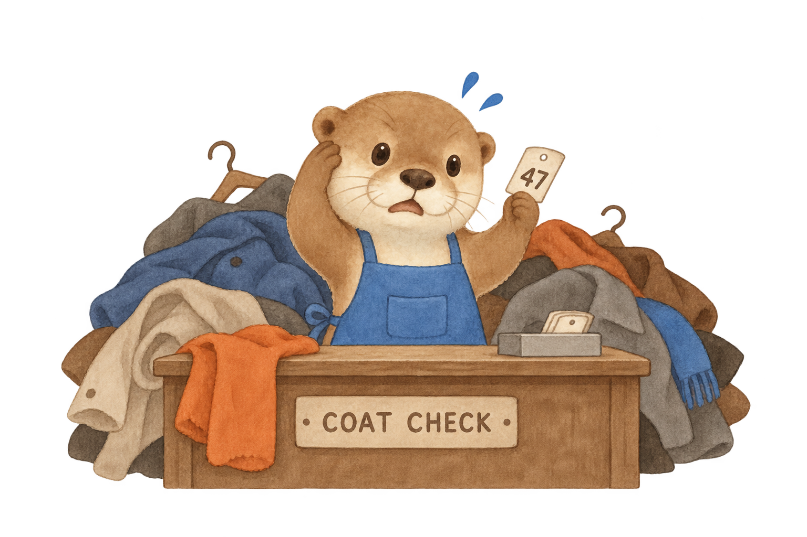
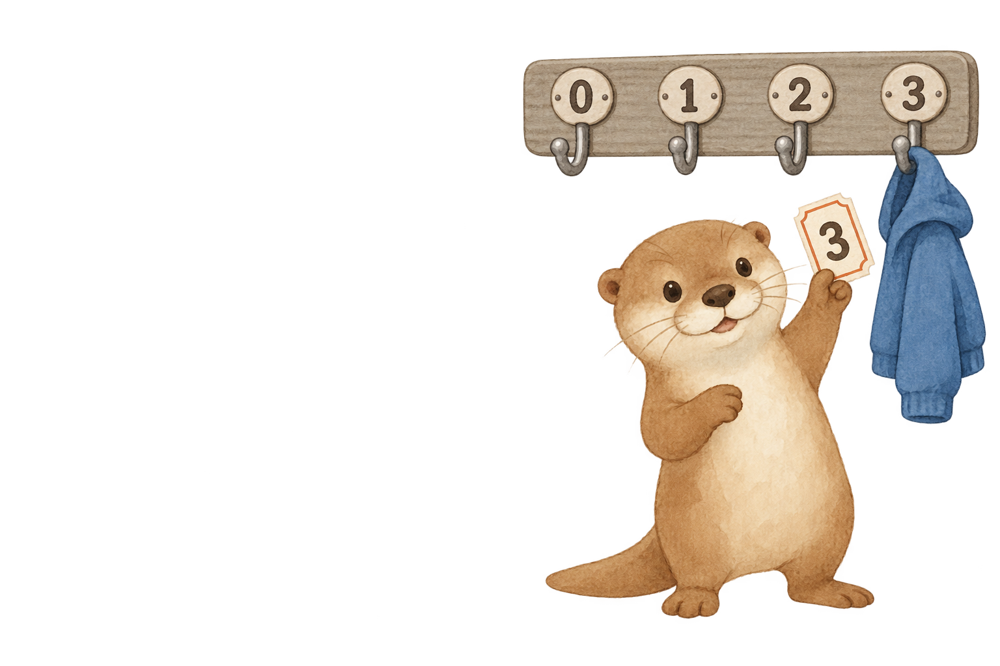

## How does coat checking work? {style="font-size: 0.9em;"}

:::{.columns}
::: {.column width="55%"}
You hand your coat to the attendant at a busy restaurant. **300 coats** are already back there.

Two hours later you come back, and they walk off and return with **your** coat in a few seconds.
:::
::: {.column width="45%"}
{width="100%"}
:::
:::

::: {.fragment}
### How? 🤔
:::

::: {.notes}
- Let them sit with the question for a while. 
:::

::: footer
Image generated by OpenAI GPT-image-2.5-sunburst
:::

## iClicker: how does the attendant find your coat? {style="font-size: 0.8em;"}

**A.** Pile them up. Look at every coat, one by one, until yours turns up.

**B.** Group the coats by **colour**. You say "black", they search only the black group.

**C.** Each coat gets a **ticket number**, hang the coats in **order**. Go to the middle of the rack, compare that ticket with yours, walk to the half of the rack that your coat would be in, and repeat.

**D.** Hand you a **numbered ticket**, and hang the coat on the hook with that number.


## Outline of Today's Lecture

- 👉 Binary search, and what $\log n$ really means
- Space complexity: **predict** how much memory your code needs
- Measuring memory: `psutil`, `nbytes`, `getsizeof`
- Hash table
- Stacks and queues

::: {.notes}
option C from previous question is a binary search algorithm!

Learning objectives:
- Explain how binary search works, and why its running time is $O(\log n)$.
- Explain what $\log n$ means, and why the base of the logarithm does not matter in Big O.
- Given simple code, determine the space complexity using Big-O notation.
- Measure the amount of memory usage in Python using `psutil`, `getsizeof`, and `nbytes`.
- Explain how data types can affect memory, and why it is important to choose the right data types.
- Explain what a data structure is and why it is useful in computing at a high level.
- List Python's built-in data structures and describe their properties.
- Explain basic (user-defined) data structures: stacks, queues, and hash tables.
- Explain the pros and cons of hash tables, and how they work at a high level.
:::


# Option C: Binary search, cut the rack in half {background-image="images/ig_otter_binary_search.png" background-size="contain" background-position="right" style="font-size: 0.8em;"}

::: footer
Image generated by OpenAI GPT-image-2.5-sunburst
:::

```{python}
#| echo: false
# Hidden: the binary search step-through on the slide below.
# Runs the search in Python and records every step; OJS only draws the boxes.
bs_rack = [12, 31, 48, 67, 85, 102, 124, 150, 173, 196, 217, 238, 259, 281, 300]
bs_target = 217

# step 0: nothing looked at yet, the whole rack is still in play
bs_steps = [{"cells": [""] * len(bs_rack), "lead": "Your ticket is", "ticket": f"#{bs_target}",
             "rest": f"Any of the {len(bs_rack)} coats could be yours."}]
lo, hi, look = 0, len(bs_rack) - 1, 0
while lo <= hi:
    mid = (lo + hi) // 2
    look += 1
    # "" = still in play, "out" = thrown away, "end" = the coat we look at, "found" = ours
    cells = ["" if lo <= i <= hi else "out" for i in range(len(bs_rack))]
    if bs_rack[mid] == bs_target:
        cells[mid] = "found"
        rest = f"That is your coat, found without checking the other {len(bs_rack) - look}."
    elif bs_rack[mid] < bs_target:
        cells[mid] = "end"
        rest = f"{bs_target} is bigger, so forget everything on the left."
    else:
        cells[mid] = "end"
        rest = f"{bs_target} is smaller, so forget everything on the right."
    bs_steps.append({"cells": cells, "lead": f"Look {look}: the middle coat is",
                     "ticket": f"#{bs_rack[mid]}", "rest": rest})
    if bs_rack[mid] == bs_target:
        break
    if bs_rack[mid] < bs_target:
        lo = mid + 1
    else:
        hi = mid - 1

bs_labels = [f"#{t}" for t in bs_rack]
ojs_define(bs_steps = bs_steps, bs_labels = bs_labels)
```

## Binary Search: Cut the rack in half {style="font-size: 0.78em;"}

The rack is in ticket-number order. Your ticket says **#217**.

::: {.incremental}
- Walk to the **middle** coat. Its ticket says #150.
- 217 is bigger, so your coat is somewhere in the **right half**. Forget the left half entirely.
- Walk to the middle of what is left, and do it again.
:::

```{ojs}
//| echo: false
viewof bs_step = Inputs.button([
  ["Next look", i => Math.min(i + 1, bs_steps.length - 1)],
  ["Start over", () => 0]
], {value: 0})
```

```{ojs}
//| echo: false
{
  // Draw only: every step below was computed in Python (bs_steps).
  const s = bs_steps[bs_step];
  const boxes = bs_labels.map((label, i) =>
    html`<div class="ds-box ${s.cells[i]}">${label}</div>`);
  return html`<div class="ojs-readout">${s.lead}
      <span class="${bs_step === bs_steps.length - 1 ? "notify" : "match"}">${s.ticket}</span>.
      ${s.rest}</div>
    <div class="ds-row bs-rack">${boxes}</div>`;
}
```

::: {.notes}
- Every look throws away **half** the rack.
- Click "Next look" slowly and ask the room before each click: left or right?
- Orange is the coat we are looking at, dashed grey is the part we threw away, blue is our coat.
- 15 coats, found in 4 looks. Double the rack to 30 coats and it only costs one more look.
- This only works because the rack is **sorted**. Keeping it sorted is what we pay for, and we come back to that bill in the hash table section.
:::

## iClicker: what is the run time of strategy C? {style="font-size: 0.8em;"}

Halving a rack of $n$ coats until one coat is left:

- \(A) $O(1)$
- \(B) $O(\log n)$
- \(C) $O(n)$
- \(D) $O(n \log n)$

::: {.fragment}
::: {.incremental}
- Answer: **B**
- 1 look leaves $n/2$, 2 looks leave $n/4$, $k$ looks leave $n/2^k$.
- We stop when $n/2^k = 1$, so $2^k = n$, so $k = \log_2 n$.
:::
:::

::: {.notes}
- Walk through that algebra on the board as each line appears.
:::

## What does $\log n$ actually mean? {style="font-size: 0.72em;"}

$\log_2 n$ asks: **how many times can I halve $n$ before I get down to 1?**

::: {.fragment}
| | what happens to the computation time |
|---|---|
| $O(2^n)$, add **1** to $n$ | the computation time **doubles** |
| $O(\log n)$, **double** $n$ | the computation time goes up by **1** |
:::

::: {.fragment}
| coats on the rack | 300 | 1,000 | 1 million | 3 billion |
|---|---|---|---|---|
| looks needed | 9 | 10 | 20 | 32 |
:::

::: {.fragment}
- Exponential and logarithmic growth are **mirror images** of each other.
- Log and exponent rules: [Math cheatsheet](../math.html#logarithms)
:::

::: {.notes}
- **Walk through this on the board.** 
  - $2^n$: every time you add one to $n$, you double the work.
  - $\log n$: to increase your computation time by one, you need to double the input size $n$
- Point at the table: 1 million to 3 billion is 3,000 times more coats, and it costs 12 extra looks.
:::

## Does the base of the log matter? {style="font-size: 0.78em;"}

You may have noticed that we do not write out the base of the log usually, that's because:

::: {.fragment}
$$\log_2 n \;=\; \frac{\log_{10} n}{\log_{10} 2} \;=\; {\log_{2} 10} \times \log_{10} n$$
:::

::: {.fragment}
- Changing the base only multiplies by a **constant**, and Big O throws constant factors away.
- Change of base: [Math cheatsheet](../math.html#log-rules)
:::

::: {.fragment}
So we write $O(\log n)$ and never say which base.
:::

::: {.notes}
- **Walk through the change of base formula on the board**: $\log_b x = \frac{\log_c x}{\log_c b}$, then substitute $b = 2$, $c = 10$.
- The denominator $\log_{10} 2 \approx 0.301$ does not depend on $n$ at all. It is just a number, so it is a constant factor.
:::


# Today's story: How does Instagram manage 3 billion users? {background-image="images/ig_otter_signup.png" background-size="contain" background-position="right" style="font-size: 0.8em;"}

::: footer
Image generated by OpenAI GPT-image-2.5-sunburst
:::

## The green check {style="font-size: 0.85em;"}

You open Instagram and type a username: `@otter_eats_clams` ✅

::: {.incremental}
- Before you finish typing, a **green check** ✅ appears: *this username is available.*
- Instagram has **about 3 billion** users.
- Checking your guess against 3 billion usernames, one at a time, at even 1 ns each, would take about **3 seconds**.
- But the check feels instant. **How? 🤔**
:::

::: {.notes}
- Type a username live on the projector if you have the app open; the check really is instant.
- Sanity-check the arithmetic with them: 3 × 10⁹ comparisons × 1 ns = 3 × 10⁹ ns = 3 s. And 1 ns per comparison is generous.
- Hold the question. We answer it in the hash table section, and by then they will have the vocabulary for it.
- Verify the 3 billion figure before teaching; Meta and DataReportal reported Instagram passing 3 billion monthly active users in 2025.
:::

::: footer
Instagram user count: [TechnologyChecker.io, 2026](https://technologychecker.io/blog/instagram-user-statistics), citing Meta / DataReportal.
:::

## Today, you are Instagram's data scientist {style="font-size: 0.85em;"}

You have been handed three tasks:

::: {.incremental}
1. **Load the user table onto your laptop.** Will 3 billion users even *fit* in memory?
2. **Make the username check instant.** Which data structure?
3. **Ship two app features**: the photo editor's *undo* button, and the *upload queue*.
:::

::: {.fragment}
Last lecture's question was *"how long does my code take?"*.

Today's is **"how much memory does my code need, and which data structure should I reach for?"**
:::

::: {.notes}
- These three tasks are the three halves of today's lecture (yes, three halves).
- Keep coming back to this slide: each section closes one of the three tasks.
:::

# Task 1: Space Complexity {background-image="images/ig_otter_ram.png" background-size="contain" background-position="right" style="font-size: 0.8em;"}

Predict how much **memory** your code needs, before you run it.

::: footer
Image generated by OpenAI GPT-image-2.5-sunburst
:::

## Why memory matters {style="font-size: 0.85em;"}

- When writing code, it's important to consider how long it takes to run.
- However, another significant concern is how much **space** (memory, not disk space) it uses.

::: {.incremental}
- Memory (RAM) is where your program keeps the data it is *currently working with*.
- If your program needs more memory than is available, it will **crash** (`MemoryError`) or slow down dramatically (the computer starts shuffling data to disk).
- Unlike a slow program, you often can't just "wait a bit longer". It simply does not run.
:::

::: {.notes}
- Ask: who has crashed a laptop or a Jupyter kernel by loading too big a file? Almost every hand goes up.
- Disk (your hard drive) is big and slow; RAM is small and fast. Today is about RAM.
- "Test on a fraction of your data first" is the practical advice that falls out of this whole section.
:::

```{python}
#| echo: false
# Hidden: everything the whole deck needs. Kept in one place so the visible
# cells below contain only the code students should read.
import timeit
from sys import getsizeof

import numpy as np
import pandas as pd
import psutil
```

## Checking your own RAM {style="font-size: 0.85em;"}

```{python}
#| echo: true
import psutil
psutil.virtual_memory()
```

```{python}
#| echo: false
# Hidden: numbers for the fragment below and for the "will it fit?" chart.
# Read from the same psutil call the slide just printed, so the prose on the
# slide can never disagree with the output above it.
BYTES_PER_NUMBER = 8                      # one float64
# Set this by hand (e.g. 18 * 1e9) if you render on one machine and present on another.
RAM_BYTES = float(psutil.virtual_memory().total)
ram_label = f"{RAM_BYTES / 1e9:,.0f} GB"
ram_capacity = RAM_BYTES / BYTES_PER_NUMBER
ram_capacity_label = f"{ram_capacity / 1e9:,.1f} billion"
too_many_label = f"{round(ram_capacity / 1e9 * 2):,.0f} billion"
```

::: {.fragment}
- A single number (a `float64`) takes **8 bytes**.
- `{python} ram_label` of RAM ÷ 8 bytes ≈ **`{python} ram_capacity_label` numbers**, if nothing else were running.
- So I can't run code that needs to hold `{python} too_many_label` numbers at once.
  - Fun fact: GPT-4 is rumored to have approximately 1.8 trillion parameters.
:::

::: {.notes}
- Run this live on the projector so they see *their own* number when they try it.
- In reality the usable amount is much less: the operating system, your browser and Python itself all take a share.
- Python also has overhead, so it uses more memory than just the raw data size (we measure this later).
- 1.8 trillion parameters × 2 bytes each ≈ 3.6 TB. Nobody's laptop runs GPT-4.
:::

## Space complexity, in Big O {style="font-size: 0.85em;"}

Same notation as last lecture, different question.

| | question | what we count |
|---|---|---|
| **Time** complexity | how long does it take? | number of **steps** |
| **Space** complexity | how much memory does it need? | number of **memory units** stored |

::: {.fragment}
Same rules as before: drop constant factors, keep the fastest-growing term.
:::

::: {.notes}
- With time complexity we focused on the algorithm and how efficiently it *processes* input.
- With space complexity we focus on how many things the algorithm has to *hold onto at once*.
- The Big O machinery is identical, which is the good news: they already know how to do this.
:::

## Example 1 {style="font-size: 0.85em;"}

One number per user: the follower count of each of the $n$ users.

```{pyodide}
import numpy as np

n = 100                # number of users
x = np.zeros(n)
x.nbytes               # bytes of memory used
```

::: {.incremental}
- Space complexity: $O(n)$.
:::

::: {.notes}
- `np.zeros(n)` makes an array of n zeros. Reading the shape off the code is the whole skill here.
- Run it live, then change `n` to 200 and run again: `nbytes` doubles. Ask them to predict it first.
:::

## Example 2 {style="font-size: 0.85em;"}

One number per **pair** of users: how close are user $i$ and user $j$?

```{pyodide}
import numpy as np

n = 100                # number of users
x = np.zeros((n, n))
x.nbytes               # bytes of memory used
```

::: {.incremental}
- Space complexity: $O(n^2)$.
:::

::: {.notes}
- This is the "who should I suggest you follow?" table. It's the same shape as Uber's rider × driver matching grid from last lecture.
- We meet this table again in lecture 3 as a **graph**, and see how to store it without the n² cost (sparse matrices).
:::

## Example 3 {style="font-size: 0.85em;"}

Five numbers per pair of users: likes, comments, DMs, tags, shares.

```{pyodide}
import numpy as np

n = 100                # number of users
x = np.zeros((n, n, 5))
x.nbytes               # bytes of memory used
```

::: {.incremental}
- Space complexity: $O(n^2)$.
:::

::: {.notes}
- Q: why not O(5n²)? Because 5 is a constant factor and Big O drops constant factors.
- It uses 5× the memory in practice; it is the same complexity *class*.
:::

## Example 4 {style="font-size: 0.85em;"}

One number per **triple** of users (how well would these three do in a group chat?).

```{pyodide}
import numpy as np

n = 100                # number of users, try 10, then 200. Not 1000!
x = np.zeros((n, n, n))
x.nbytes               # bytes of memory used
```

::: {.incremental}
- Space complexity: $O(n^3)$.
:::

::: {.notes}
- Foreshadow the chart in two slides: n³ is hopeless almost immediately.
- Live: n = 200 is fine (64 MB). Do **not** try n = 1000 in the browser, that is 8 GB and the cell will fail with a MemoryError. Which is the point.
:::

## Example 5 {style="font-size: 0.85em;"}

Five numbers, no matter how many users: today's likes, comments, follows, posts, DMs.

```{pyodide}
import numpy as np

x = np.zeros(5)
x.nbytes               # bytes of memory used
```

::: {.incremental}
- Space complexity: $O(1)$.
:::

::: {.notes}
- $n$ never appears in the formula, so the memory does not grow with the number of users. That is what O(1) means.
:::

## Example 6 {style="font-size: 0.85em;"}

::: {.incremental}
- You have $n$ users on your social network site, and you want to store a "level of friendship" between every pair of users.

- Space complexity: $O(n^2)$.
:::

::: {.notes}
- Same as Example 2, but stated in words instead of code. Make them translate the sentence into a shape first.
- Follow-up to ask: friendship is symmetric (if A is close to B, B is close to A), so we only need half the table. Does that change the Big O? No: n²/2 is still O(n²).
:::

```{python}
#| echo: false
# Hidden: data for the "will it fit?" chart on the next slide.
# Every byte count, every label and the legend order are computed here;
# OJS only draws. RAM_BYTES comes from psutil on the "Checking your own RAM" slide.

def human_bytes(n_bytes):
    """Readable size for chart labels: 400 KB, 20.0 GB, 32.0 EB."""
    for unit, size in [("EB", 1e18), ("PB", 1e15), ("TB", 1e12),
                       ("GB", 1e9), ("MB", 1e6), ("KB", 1e3)]:
        if n_bytes >= size:
            return f"{n_bytes / size:,.1f} {unit}"
    return f"{n_bytes:,.0f} bytes"

# label, big O, and the power of n in the formula: bytes = 8 * n ** power
fit_shapes = [("one number per user", "O(n)", 1),
              ("one number per pair of users", "O(n²)", 2),
              ("one number per triple of users", "O(n³)", 3)]

def fit_point(_label, big_o, power, n_users):
    n_bytes = BYTES_PER_NUMBER * n_users ** power
    fits = n_bytes <= RAM_BYTES
    return {"c": big_o, "n": n_users, "bytes": n_bytes,
            "fits": fits,
            # the text drawn next to the dot, assembled here so OJS only prints it
            "size": f"{human_bytes(n_bytes)} {'✅' if fits else '❌'}"}

fit_choices = [10 ** p for p in range(1, 10)]     # radio buttons: 10, 100, ..., 1 billion users

# largest whole n whose table still fits in RAM:  8 * n**power <= RAM  <=>  n <= (RAM/8) ** (1/power)
fit_max_n = [{"c": big_o, "n": int((RAM_BYTES / BYTES_PER_NUMBER) ** (1 / power)),
              "n_label": f"{int((RAM_BYTES / BYTES_PER_NUMBER) ** (1 / power)):,}"}
             for _, big_o, power in fit_shapes]

fit_chart = {
    "ram": RAM_BYTES,
    "ram_label": f"{ram_label} (my laptop)",
    "choices": fit_choices,
    "order": [big_o for _, big_o, _ in fit_shapes],        # legend / colour order
    # 81 points per line, evenly spaced on a log axis: 10^1, 10^0.1 apart, up to 10^9
    "curves": [fit_point(*shape, 10 ** (1 + i / 10)) for shape in fit_shapes for i in range(81)],
    "picks": {k: [fit_point(*shape, k) for shape in fit_shapes] for k in fit_choices},
    "max_n": fit_max_n,
}
ojs_define(fit_chart = fit_chart)
```

## Will it fit on my laptop? {style="font-size: 0.8em;"}

8 bytes per number. Drag the number of users and watch the three tables grow.

```{ojs}
//| echo: false
viewof n_users = Inputs.radio(fit_chart.choices, {value: 1000, label: "number of users",
                                                  format: d3.format("~s")})
```

```{ojs}
//| echo: false
// Draw only: every byte count and label was computed in Python (fit_chart).
{
  const picked = fit_chart.picks[n_users];
  const order = fit_chart.order;                 // legend order, from Python
  return Plot.plot({
    width: 880, height: 300, marginLeft: 80, marginRight: 150, marginBottom: 46,
    style: {fontSize: "16px", background: "transparent"},
    x: {type: "log", label: "number of users →", labelAnchor: "center", grid: true,
        tickFormat: "~s", ticks: fit_chart.choices},
    y: {type: "log", label: "↑ memory needed (bytes)", grid: true, tickFormat: "~s"},
    color: {domain: order, range: ["#2a78d6", "#eb6834", "#4a3aa7"], legend: true, swatchSize: 16},
    marks: [
      Plot.line(fit_chart.curves, {x: "n", y: "bytes", stroke: "c", strokeWidth: 2}),
      Plot.ruleY([fit_chart.ram], {stroke: "#52514e", strokeDasharray: "4 4"}),
      Plot.text([{y: fit_chart.ram}], {x: 10, y: "y", text: () => fit_chart.ram_label,
                                       dy: -10, textAnchor: "start", fill: "#52514e"}),
      Plot.ruleX([n_users], {stroke: "#b8b6b0", strokeDasharray: "4 4"}),
      Plot.dot(picked, {x: "n", y: "bytes", fill: "c", r: 6, stroke: "white", strokeWidth: 2}),
      Plot.text(picked, {x: "n", y: "bytes", text: "size",
                         dx: 10, textAnchor: "start", fontWeight: "bold"})
    ]
  });
}
```

```{ojs}
//| echo: false
{
  // Print only: every name and number below was computed in Python (fit_chart.max_n).
  const classes = ["notify", "match", "cube"];   // same colours as the three lines
  return html`<div class="ojs-readout">Largest table that still fits in ${fit_chart.ram_label}:
    ${fit_chart.max_n.map((m, i) => html`<span class="${classes[i]}">${m.c}</span>
      up to <b>${m.n_label}</b> users &nbsp;·&nbsp; `)}</div>`;
}
```

::: {.notes}
- Start at 10 users: all three fit ✅. This is the "2010 Instagram" moment from last lecture.
- Click up one step at a time and watch the ✅ turn into ❌. O(n³) dies first, then O(n²); O(n) survives to a billion. The line under the chart gives the exact cut-off for each.
- At 1 billion users the pairwise table needs 8 **exabytes**, more storage than most countries own. No laptop, no server, no data centre fixes an O(n²) memory plan.
- Both axes are log scale: each grid line is 10× the one below it.
- The moral: space complexity decides whether the code is *possible*, not just whether it is fast.
:::

## iClicker: what is the space complexity? {style="font-size: 0.8em;"}

You store, for each of the $n$ Instagram users, a list of their **10 most recent** posts.

```{.python}
recent_posts = np.zeros((n, 10))
```

- \(A) $O(1)$
- \(B) $O(n)$
- \(C) $O(10n)$
- \(D) $O(n^2)$

::: {.notes}
- Answer: **B**. The table holds 10n numbers; 10 is a constant factor, and Big O drops constant factors.
- C is not *wrong*, it is just not simplified. Same conversation as O(n² + n) last lecture.
- Follow-up worth asking: what if we stored *all* of a user's posts instead of the most recent 10? Then it is no longer n × constant; it is n × (average posts per user), which is a second variable: O(nm), exactly like the riders × drivers case from lecture 1.
:::

# Measuring memory {background-image="images/ig_otter_scale.png" background-size="contain" background-position="right" style="font-size: 0.8em;"}

Big O *predicts*. Now let's *measure*.

::: footer
Image generated by OpenAI GPT-image-2.5-sunburst
:::

## Four tools {style="font-size: 0.85em;"}

| tool | what it measures |
|---|---|
| `psutil.virtual_memory()` | how much RAM the whole **machine** has and is using |
| `array.nbytes` | the exact bytes of a NumPy array's **data** |
| `sys.getsizeof(obj)` | the bytes of **one Python object** (shallow!) |
| `df.memory_usage(deep=True)` | the bytes of each **pandas column** |

::: {.fragment}
⚠️ Memory profiling is **less straightforward than timing**:

- it is much more *dynamic*, Python frees memory whenever it feels like it,
- objects can share memory, so the parts don't always add up to the whole.
:::

::: {.notes}
- Timing is a stopwatch. Memory is more like asking "how much of this fridge is full?" while other people keep opening the door.
- `getsizeof` being *shallow* is the trap we show on the next-but-one slide: for a list it counts the pointers, not the things pointed at.
:::

## `nbytes` and `getsizeof` {style="font-size: 0.85em;"}

One follower count per user, for 1 million users:

```{pyodide}
import numpy as np
from sys import getsizeof

followers = np.zeros(1_000_000)   # 1 million float64 numbers
followers.shape
```

::: {.fragment}
```{pyodide}
followers.nbytes          # just the numbers: 1,000,000 × 8 bytes
```
:::

::: {.fragment}
```{pyodide}
getsizeof(followers)      # the numbers + NumPy's bookkeeping (shape, dtype, ...)
```
:::

::: {.notes}
- `nbytes` is exactly n × bytes-per-number. `getsizeof` adds a small constant (~112 bytes) of NumPy overhead.
- For a NumPy array the two agree closely. For a Python list they will not at all, see the next slide.
:::

```{python}
#| echo: false
# Hidden: data for the "same million numbers" chart on the next slide.
# Measured here with nbytes / getsizeof; OJS only draws.
size = 1_000_000

dtype_rows = []
for dtype in ["int8", "int16", "int32", "int64", "float32", "float64"]:
    arr = np.zeros(size, dtype=dtype)
    dtype_rows.append({"kind": f"NumPy {dtype}", "family": "NumPy array",
                       "bytes": int(arr.nbytes), "per_number": arr.nbytes / size})

# A Python list of ints stores pointers, and each int is a separate object,
# so count both: the list itself + every integer object it points to.
py_list = list(range(size))
list_bytes = getsizeof(py_list) + sum(getsizeof(value) for value in py_list)
dtype_rows.append({"kind": "Python list", "family": "Python list",
                   "bytes": int(list_bytes), "per_number": list_bytes / size})
del py_list

by_kind = {r["kind"]: r for r in dtype_rows}
dtype_chart = {
    "rows": [{**r, "mb": round(r["bytes"] / 1e6, 2), "per_number": round(r["per_number"]),
              # the text drawn at the end of each bar
              "bar_label": f"{round(r['bytes'] / 1e6, 2)} MB  ({round(r['per_number'])}"
                           f" byte{'' if round(r['per_number']) == 1 else 's'} each)"}
             for r in dtype_rows],
    "order": [r["kind"] for r in dtype_rows],              # bar order, biggest last
    "families": ["NumPy array", "Python list"],            # legend / colour order
    "ratio": round(list_bytes / (size * 8), 1),            # Python list vs NumPy float64
    "int8_vs_int64": round(by_kind["NumPy int64"]["bytes"] / by_kind["NumPy int8"]["bytes"]),
}
ojs_define(dtype_chart = dtype_chart)
```

## Same million numbers, very different memory {style="font-size: 0.8em;"}

```{ojs}
//| echo: false
// Draw only: every size was measured in Python (dtype_chart).
{
  const rows = dtype_chart.rows;
  return Plot.plot({
    width: 880, height: 300, marginLeft: 130, marginTop: 20, marginBottom: 46,
    style: {fontSize: "16px", background: "transparent"},
    x: {label: "memory for 1,000,000 numbers (MB) →", labelAnchor: "center", grid: true},
    y: {label: null, domain: dtype_chart.order},
    color: {domain: dtype_chart.families, range: ["#2a78d6", "#eb6834"], legend: true, swatchSize: 16},
    marks: [
      Plot.barX(rows, {y: "kind", x: "mb", fill: "family", rx: 4}),
      Plot.text(rows, {y: "kind", x: "mb", text: "bar_label",
                       dx: 8, textAnchor: "start", fontWeight: "bold"}),
      Plot.ruleX([0])
    ],
    marginRight: 210
  });
}
```

```{ojs}
//| echo: false
{
  return html`<div class="ojs-readout">A <span class="match">Python list</span> of 1 million integers uses
    <b>${dtype_chart.ratio}×</b> the memory of a <span class="notify">NumPy float64</span> array with the same
    numbers &nbsp;·&nbsp; and <b>${dtype_chart.int8_vs_int64}×</b> separates <code>int8</code> from <code>int64</code>.</div>`;
}
```

::: {.notes}
- Read the bars top to bottom: int8 is 1 byte per number, int64 is 8, and a Python list is about 36.
- Why 36? A list stores 8-byte *pointers*, and every Python integer is a separate object carrying ~28 bytes of type and reference-count information. `getsizeof(the_list)` alone would only have shown the 8. That is the shallow trap.
- This is why `numpy` and `pandas` exist: same numbers, a fraction of the memory, and much faster loops.
- Q for the room: if int8 is 8× smaller, why doesn't everyone just use int8? → next slide.
:::

## ⚠️ Smaller is not always safe {style="font-size: 0.85em;"}

```{pyodide}
import numpy as np

np.iinfo("uint8").max     # the largest number a uint8 can hold
```

::: {.incremental}
- `uint8` is perfect for **age** (0–120). ✅
- `uint8` for **follower count** would cap everyone at 255 followers. ❌
- Choosing a dtype is a promise about the range your data will *ever* take.
:::

::: {.notes}
- Real bug in the wild: a column stored as int32 that quietly overflowed once the company grew past 2.1 billion rows.
- Rule of thumb: pick the smallest type that comfortably covers the range you expect, and leave headroom.
:::

```{python}
#| echo: false
# Hidden: build the Instagram user table used by the next few slides.
# Written to a CSV at render time so the visible cells below are exactly the
# pd.read_csv() code students would write themselves.
from pathlib import Path

csv_path = Path("data/instagram_users.csv")
csv_path.parent.mkdir(exist_ok=True)

rng = np.random.default_rng(512)
n_rows = 500_000
pd.DataFrame({
    "user_id": np.arange(n_rows),
    "age": rng.integers(13, 80, n_rows),
    "followers": rng.integers(0, 50_000, n_rows),
    "country": rng.choice(["Canada", "USA", "India", "Brazil", "Japan"], n_rows),
    "is_active": rng.choice(["yes", "no"], n_rows),
    "signup": pd.to_datetime(rng.integers(1_500_000_000, 1_700_000_000, n_rows), unit="s").date,
}).to_csv(csv_path, index=False)
```

## Instagram's user table {style="font-size: 0.85em;"}

- Let's assume that we are dealing with the following dataframe:

```{python}
#| echo: true
import pandas as pd
df = pd.read_csv("data/instagram_users.csv")
df.head()
```

::: {.fragment}
```{python}
#| echo: true
df.shape
```
:::

::: {.notes}
- Half a million users, a rounding error next to Instagram's 3 billion, and already enough to make the point.
- Ask them to guess: how much memory does this take? Write the guesses on the board before the next slide.
:::

## Two ways to read the same file {style="font-size: 0.85em;"}

```{python}
#| echo: true
def load_naive(path):
    return pd.read_csv(path)
```

or,

```{python}
#| echo: true
def load_tight(path):
    dtype_opt = {
        "user_id": "uint32",       # up to 4.3 billion users
        "age": "uint8",            # 0-255 is plenty
        "followers": "uint32",     # up to 4.3 billion followers
        "country": "category",     # only 5 distinct values
        "is_active": "category",   # only 2 distinct values
    }
    return pd.read_csv(path, dtype=dtype_opt, parse_dates=["signup"])
```

::: {.notes}
- Same file, same rows, same values. The only difference is that we *tell pandas what to expect*.
- Walk the dictionary line by line on the next two slides.
:::

## Two ways to read the same file {style="font-size: 0.85em;"}

```{.python code-line-numbers="3,4,5"}
def load_tight(path):
    dtype_opt = {
        "user_id": "uint32",       # up to 4.3 billion users
        "age": "uint8",            # 0-255 is plenty
        "followers": "uint32",     # up to 4.3 billion followers
        "country": "category",     # only 5 distinct values
        "is_active": "category",   # only 2 distinct values
    }
    return pd.read_csv(path, dtype=dtype_opt, parse_dates=["signup"])
```

**Numbers**: ask for the smallest integer type that fits the real range.

::: {.notes}
- Default when pandas reads whole numbers is int64 (8 bytes). uint8 is 1 byte, uint32 is 4.
- "u" means *unsigned*: no negatives, so the whole range goes to positive numbers. Nobody has −3 followers.
:::

## Two ways to read the same file {style="font-size: 0.85em;"}

```{.python code-line-numbers="6,7"}
def load_tight(path):
    dtype_opt = {
        "user_id": "uint32",       # up to 4.3 billion users
        "age": "uint8",            # 0-255 is plenty
        "followers": "uint32",     # up to 4.3 billion followers
        "country": "category",     # only 5 distinct values
        "is_active": "category",   # only 2 distinct values
    }
    return pd.read_csv(path, dtype=dtype_opt, parse_dates=["signup"])
```

**Text that repeats**: `category` stores each distinct value **once**, plus one small number per row.

::: {.notes}
- This is the biggest win by far, and it is the one students forget.
- 500,000 rows of the word "Canada" is 500,000 copies of a string. As a category: the 5 country names, stored once, plus 500,000 one-byte codes.
- Rule: if a text column has far fewer *distinct* values than rows, make it a category.
:::

## Two ways to read the same file {style="font-size: 0.85em;"}

```{.python code-line-numbers="9"}
def load_tight(path):
    dtype_opt = {
        "user_id": "uint32",       # up to 4.3 billion users
        "age": "uint8",            # 0-255 is plenty
        "followers": "uint32",     # up to 4.3 billion followers
        "country": "category",     # only 5 distinct values
        "is_active": "category",   # only 2 distinct values
    }
    return pd.read_csv(path, dtype=dtype_opt, parse_dates=["signup"])
```

**Dates**: `parse_dates` turns the text `"2021-04-03"` into a real date, which is stored as one number.

::: {.notes}
- Without parse_dates, every signup date is a 10-character string object.
- Bonus: you can then do date arithmetic (`df["signup"].dt.year`), which you could not do with text.
:::

## How much did that save? {style="font-size: 0.85em;"}

```{python}
#| echo: true
naive = load_naive("data/instagram_users.csv")
tight = load_tight("data/instagram_users.csv")

print("naive:", naive.memory_usage(deep=True).sum() / 1e6, "MB")
print("tight:", tight.memory_usage(deep=True).sum() / 1e6, "MB")
```

```{python}
#| echo: false
# Hidden: per-column memory of both dataframes for the chart on the next slide.
# Reads the same numbers printed above, then frees the dataframes.
memory_rows = []
for how, frame in [("load_naive", naive), ("load_tight", tight)]:
    usage = frame.memory_usage(deep=True).drop("Index")
    for column, n_bytes in usage.items():
        memory_rows.append({"how": how, "column": column, "mb": round(int(n_bytes) / 1e6, 3)})

naive_mb = naive.memory_usage(deep=True).sum() / 1e6
tight_mb = tight.memory_usage(deep=True).sum() / 1e6

# if Instagram's 3 billion users were stored the same two ways:
# (MB for this file / rows in this file) * 3e9 rows, then MB -> GB
def at_scale_gb(total_mb):
    return round(total_mb / len(naive) * 3e9 / 1e3)

memory_chart = {
    "rows": memory_rows,
    "columns": list(naive.columns),
    "order": ["load_naive", "load_tight"],                 # bar order, top to bottom
    # one row per bar, for the total printed at the end of it
    "totals": [{"how": "load_naive", "mb": round(naive_mb, 1), "label": f"{naive_mb:,.1f} MB"},
               {"how": "load_tight", "mb": round(tight_mb, 1), "label": f"{tight_mb:,.1f} MB"}],
    "shrink": float(round(naive_mb / tight_mb, 1)),
    "rows_label": f"{len(naive):,}",
    "at_scale": {"load_naive": f"{at_scale_gb(naive_mb):,} GB",
                 "load_tight": f"{at_scale_gb(tight_mb):,} GB"},
}
ojs_define(memory_chart = memory_chart)
del naive, tight
```

::: {.notes}
- Read the two numbers out loud before showing the chart. Roughly 94 MB vs 9.5 MB.
- Same data. Same file on disk. One line of extra code.
:::

## Where the memory went, column by column {style="font-size: 0.8em;"}

```{ojs}
//| echo: false
// Draw only: every column's size was measured in Python (memory_chart).
{
  const rows = memory_chart.rows;
  return Plot.plot({
    width: 880, height: 300, marginLeft: 110, marginTop: 30, marginBottom: 46,
    style: {fontSize: "16px", background: "transparent"},
    x: {label: "memory (MB) →", labelAnchor: "center", grid: true},
    y: {label: null, domain: memory_chart.order},
    color: {domain: memory_chart.columns, legend: true, swatchSize: 16,
            range: ["#2a78d6", "#1baf7a", "#eda100", "#eb6834", "#e87ba4", "#4a3aa7"]},
    marks: [
      Plot.barX(rows, {y: "how", x: "mb", fill: "column", rx: 2}),
      Plot.text(memory_chart.totals, {y: "how", x: "mb", text: "label",
                 dx: 10, textAnchor: "start", fontWeight: "bold", fontSize: 20}),
      Plot.ruleX([0])
    ]
  });
}
```

```{ojs}
//| echo: false
{
  // Print only: every number and label below was computed in Python (memory_chart).
  const m = memory_chart;
  return html`<div class="ojs-readout">${m.rows_label} users:
    <b>${m.shrink}× smaller</b>. At Instagram's 3 billion users that is
    <span class="match">${m.at_scale.load_naive}</span> versus
    <span class="notify">${m.at_scale.load_tight}</span>.</div>`;
}
```

::: {.fragment}
Choosing the right data types affects memory, sometimes **a lot**.
:::

::: {.notes}
- The two text columns (`country`, `is_active`) and the date dominate the naive bar; as categories they nearly vanish.
- The 3-billion-user row is the punchline: one is a rack of servers, the other is a single machine.
- Same lesson as the set-vs-list trade-off from lecture 1: a tiny choice about *representation* changes what is possible.
:::

# Data structures: your toolbox {background-image="images/ig_otter_toolbox.png" background-size="contain" background-position="right" style="font-size: 0.8em;"}

::: footer
Image generated by OpenAI GPT-image-2.5-sunburst
:::

## Python's four built-in data structures {style="font-size: 0.6em;"}

:::: {.columns}
::: {.column width="30%"}
{width="100%"}

A **data structure** is a way to organize data. It is the *arrangement*, not the data.
:::
::: {.column width="70%"}
| | `list` | `tuple` | `set` | `dict` |
|---|---|---|---|---|
| **syntax** | `[1, 2, 3]` | `(1, 2, 3)` | `{1, 2, 3}` | `{"a": 1}` |
| **ordered?** | yes | yes | no | yes (insertion) |
| **mutable?** | yes | no | add / remove only | yes |
| **duplicates?** | allowed | allowed | never | keys no, values yes |
| **Instagram uses it for** | photos in your feed | a photo's `(lat, lon)` | usernames already taken | `username → user_id` |
:::
::::

::: {.fragment}
- Same four tools you met in 511. Today we ask a new question of each: **what does insert, delete and search cost?**
- Full refresher with examples: [Python cheatsheet](../python.html#the-four-basic-python-data-structures)
:::

::: footer
Image generated by OpenAI GPT-image-2.5-sunburst
:::

::: {.notes}
- Do not read the table out. Point at two cells: `set` cannot hold duplicates, and `tuple` cannot be changed. Everything else they already know from 511.
- Send them to the Python cheatsheet for the method names (`append`, `add`, `pop`, and friends). That page exists so this slide can stay short.
- ⚠️ One trap worth saying out loud: `value in my_dict` checks the **keys** and is fast. `value in my_dict.values()` scans everything and is slow. Students trip over this constantly.
- The new thing today is not the syntax, it is the price list.
:::

## The three questions we ask of every data structure {style="font-size: 0.85em;"}

::: {.incremental}
1. **Insert** a new element. A new user signs up.
2. **Delete** an element. A user deletes their account.
3. **Search**: is this element present? Is this username taken?
:::

::: {.fragment}
For each structure we ask: what is the **time complexity** of each of these three?
:::

::: {.fragment}
We fill in the whole price list at the end of today.
:::

::: {.notes}
- We have already seen one answer: searching in a set is far more efficient than searching in a list.
- Tell them to keep a mental scorecard. The cheat sheet at the end of the deck is where it all lands.
- After these four we build two more ourselves, stacks and queues, out of the ones we already have.
:::

# Task 2: how is the username check *instant*? {background-image="images/ig_otter_coathooks.png" background-size="contain" background-position="right" style="font-size: 0.8em;"}

::: footer
Image generated by OpenAI GPT-image-2.5-sunburst
:::

## The operations we want {style="font-size: 0.85em;"}

- In the previous lecture, we saw that checking if an element is present in a `set` is very efficient.
- `set` supports all three operations in $O(1)$ time:
  - Inserting a new element
  - Deleting an element
  - Checking if an element is present

::: {.fragment}
$O(1)$ means: **the time does not depend on how many usernames are stored.** 10 usernames or 3 billion, same answer, same speed.
:::

::: {.notes}
- Say this slowly. O(1) for search is a genuinely surprising claim and the rest of this section is the proof.
:::

## Why the obvious ideas don't work {style="font-size: 0.85em;"}

- How could we implement all three in $O(1)$ time?

::: {.incremental}
  - **Linear search** (strategy A): $O(n)$, which is 3 seconds per keystroke. Too slow.
  - **Binary search** (strategy C): $O(\log n)$ to search, and we proved that this morning. But a sorted rack has to *stay* sorted, so every new sign-up gets slotted into the right place at a cost of $O(n)$. Too slow to insert.
  - The solution? A [hash table](https://en.wikipedia.org/wiki/Hash_table)!!!
:::

::: {.notes}
- Do **not** re-derive $O(\log n)$ here, they did it at the start of the lecture. Just point back at it and spend the time on the insertion cost instead, which is the new idea.
- Make insertion physical: to slot ticket #217 into a sorted rack, every coat after it shifts one hook along. That is the $O(n)$.
- The tension: search wants order, insertion hates order. Hash tables sidestep the tension entirely, because they never sort anything.
- Binary search itself comes back in lecture 6 as binary search trees, which fix exactly this insertion problem.
:::

## Remember the coat check? {style="font-size: 0.8em;"}

You have already met all four of these:

| the attendant's strategy | in code | search | insert |
|---|---|---|---|
| **A.** look at every coat | `list` + linear search | $O(n)$ | $O(1)$ |
| **B.** group by colour | *nearly* right, hold on to this one | ? | ? |
| **C.** ticket-number order, halve each time ✅ | sorted list + binary search | $O(\log n)$ | $O(n)$ |
| **D.** ticket number = hook number | **?** | **?** | **?** |

::: {.fragment}
**D** is the one that works. So the only question left is: *where does the number on the ticket come from?*
:::

::: {.notes}
- Put their vote back on screen if iClicker still has it. C was answered this morning and its insert cost just killed it; A died on the previous slide.
- Spend a moment on B: colour *is* a rule that turns a coat into a group, which is the right shape. It is just a rule with far too few groups, so each group is enormous. Fixing B by using many more groups is literally what a hash table does.
- Leave D's cells as question marks on purpose. We fill them in at the end of the section.
:::

## Strategy A: one big pile {style="font-size: 0.85em;"}

{fig-align="center" width="42%"}

No rule at all. To find one coat you look at **every** coat: $O(n)$.

::: {.notes}
- This is a `list`. It is what "check every username" feels like physically.
:::

## Strategy D: a rack of numbered hooks {style="font-size: 0.85em;"}

{fig-align="center" width="55%"}

Your **ticket number** says which hook to walk to. You check **one** hook: $O(1)$.

::: {.notes}
- This is the whole idea of a hash table in one picture. Everything left in this section is "where does the number come from?"
- Ask: at a real coat check, who decides the number? (The attendant, when you arrive, and they hand it to you.) Instagram cannot do that. Nobody hands it a ticket when it goes looking for `@otter_eats_clams`. It has to work the number out **from the username itself**, the same way every time.
- That rule is a *hash function*, and it is the next slide.
:::

## Hash function {style="font-size: 0.8em;"}

- A hash function maps data of arbitrary size to a fixed-size value, called a **hash value**.

- Key properties of hash functions

  - **Deterministic**: The same input always produces the same output.
      - Python introduced a hash randomization.
  - **Fixed-size output**: Hash values are of a fixed size (e.g., 64-bit integer).
  - **Collision-resistant**: Good hash functions minimize the chance of different inputs producing the same output.

<br>

- Hash functions are extremely useful, beyond what we talk about in this course

::: {.notes}
- Deterministic is the essential one: if `@sky` hashed to hook 3 yesterday and hook 7 today, we could never find it again.
- Hash randomization: Python picks a random seed for string hashing *per process*, so `hash("mds")` differs between runs (a security measure). Within one run it is perfectly deterministic.
- Other uses: checking a downloaded file wasn't tampered with, storing passwords, git commit IDs, detecting duplicate photos.
:::

## A hash function you can do in your head {style="font-size: 0.8em;"}

Add up the position of each letter in the alphabet ($a=1$, $b=2$, …, $z=26$):

```{pyodide}
def toy_hash(username):
    total = 0
    for letter in username:
        total += ord(letter) - ord("a") + 1   # "a" -> 1, "b" -> 2, ..., "z" -> 26
    return total

toy_hash("sky")      # 19 + 11 + 25
```

::: {.fragment}
Then squash it into a hook number with `%` (the remainder after dividing):

```{pyodide}
toy_hash("sky") % 4  # which of the 4 hooks?
```
:::

::: {.notes}
- `%` is the modulo / remainder operator: 55 % 4 = 3, because 55 = 13 × 4 + 3.
- The remainder when dividing by 4 is *always* one of 0, 1, 2, 3, exactly the hook numbers we have. That is the trick: any number in, a valid hook number out.
- This toy hash is deterministic ✅ and fixed-size ✅, but badly collision-prone ❌ (`"ab"` and `"ba"` collide). Real hash functions are much cleverer; the *idea* is identical.
- Let them run it on their own name before moving on.
:::

```{python}
#| echo: false
# Hidden: the coatcheck demo for the next slide. Every hash value, every hook
# number and the contents of every bucket are worked out here; OJS only draws.
demo_usernames = ["sky", "ada", "otter", "clam", "kelp", "nori",
                  "mochi", "pixel", "bubbles", "sushi", "waffle", "river"]

def toy_hash(username):
    """a = 1, b = 2, ..., z = 26, added up. Same function as the visible cell above."""
    return sum(ord(letter) - ord("a") + 1 for letter in username)

def show_sum(username):
    """The arithmetic spelled out: 's(19) + k(11) + y(25)'."""
    return " + ".join(f"{letter}({ord(letter) - ord('a') + 1})" for letter in username)

coatcheck = {}
for n_buckets in (4, 8, 16):
    buckets = [[] for _ in range(n_buckets)]
    for username in demo_usernames:
        buckets[toy_hash(username) % n_buckets].append(username)
    sizes = [len(bucket) for bucket in buckets]
    for username in demo_usernames:
        value = toy_hash(username)
        n_checks = len(buckets[value % n_buckets])
        coatcheck[f"{n_buckets}|{username}"] = {
            "work": show_sum(username), "hash": value, "index": value % n_buckets,
            "buckets": buckets, "longest": max(sizes), "empty": sizes.count(0),
            # `contains` compares against everything sharing the hook
            "checks": n_checks,
            "checks_label": f"{n_checks} name" + ("" if n_checks == 1 else "s"),
            "total": len(demo_usernames),
        }
ojs_define(demo_usernames = demo_usernames, coatcheck = coatcheck)
```

## Watch a username find its hook {style="font-size: 0.8em;"}

```{ojs}
//| echo: false
viewof who = Inputs.radio(demo_usernames, {value: "sky", label: "username"})
```

```{ojs}
//| echo: false
viewof n_buckets = Inputs.radio([4, 8, 16], {value: 4, label: "how many hooks?"})
```

```{ojs}
//| echo: false
{
  const m = coatcheck[`${n_buckets}|${who}`];      // every number below came from Python
  return html`<div class="ojs-readout"><b>${who}</b>: ${m.work} = <b>${m.hash}</b>
    &nbsp;→&nbsp; ${m.hash} % ${n_buckets} = <b class="match">hook ${m.index}</b></div>`;
}
```

```{ojs}
//| echo: false
{
  // Draw only: the hooks below were computed in Python (coatcheck).
  const m = coatcheck[`${n_buckets}|${who}`];
  const wall = m.buckets.map((names, i) => html`<div class="bucket ${i === m.index ? "target" : ""}">
      <div class="bucket-id">hook ${i}</div>
      ${names.map(name => html`<div class="bucket-item ${name === who ? "landed" : ""}">${name}</div>`)}
    </div>`);
  return html`<div class="bucket-wall">${wall}</div>`;
}
```

```{ojs}
//| echo: false
{
  // Read only: every number below was computed in Python (coatcheck).
  const m = coatcheck[`${n_buckets}|${who}`];
  return html`<div class="ojs-readout">To answer <i>"is ${who} taken?"</i> we walk to
    <b>one</b> hook and compare against <b class="match">${m.checks_label}</b>,
    not all ${m.total} &nbsp;·&nbsp; fullest hook: <b>${m.longest}</b> names,
    empty hooks: <b>${m.empty}</b>.</div>`;
}
```

::: {.notes}
- Click through the usernames with 4 hooks: each one lands somewhere, and the arithmetic is on screen so anyone can check it by hand.
- Now the key move: switch to 8 hooks, then 16. The same 12 names spread out, the fullest hook shrinks from 5 → 3 → 2, and the number of comparisons drops with it.
- Also point out the cost: at 16 hooks, 6 hooks sit empty. **More hooks = faster search but more wasted memory.** That is a time and space trade-off, and it is the reason space complexity and data structures belong in the same lecture.
- Ask: what happens with 1 hook? (It becomes the pile of coats again: O(n).) What about a million hooks for 12 names? (O(1) search, and a lot of wasted memory.)
:::

## Python's real `hash` function {style="font-size: 0.85em;"}

```{pyodide}
print(hash("mds"))
print(hash(3.14))
print(hash(None))
print(hash(314))  # for small integers, the hash value is often the integer itself.
```

- Notice that `hash` returns an integer.

::: {.notes}
- Huge numbers, same idea as `toy_hash`: text in, one integer out. Then `% n_buckets` gives the hook.
- Run it twice in two different sessions: the string hashes change, the number hashes don't. That's the hash randomization mentioned earlier.
:::

## Not everything can be hashed {style="font-size: 0.85em;"}

- Immutable objects (numbers, strings, tuples) are hashable, mutable objects (lists, dicts) are not.

<br>

```{pyodide}
hash([1, 2, 3])  # This would return an error
# hash((1, 2, 3)) # This would work
```

::: {.notes}
- Why? If you could hash a list, you could hang it on hook 3, then *change the list*, and its hash would now say hook 9, and it would be lost forever.
- Immutability is the promise that the hook number will never go stale.
:::

## `set` is a hash table {style="font-size: 0.85em;"}

- Python `set` is backed by a hash function, so all elements must be hashable.

<br>

```{pyodide}
s = set()
s.add(5.5)
s.add("mds")
s.add((1, 2, 3))
s
```

- Adding a mutable object such as a list will cause an error.

::: {.notes}
- Try `s.add([1, 2])` live to get the TypeError: unhashable type.
- Say it out loud here: this is why a `set` lookup beats scanning a `list`. It checks **one hook** instead of every entry.
:::

## Hash tables, defined {style="font-size: 0.85em;"}

- A hash table keeps an array of **buckets** (a list of lists):
    - Use a hash function to map an object to an index.
    - The object is then added/deleted in the corresponding bucket.
- Insertion, retrieval, and deletion operations are $O(1)$ time assuming we have a "good" hash function.

::: {.notes}
- "A list of lists" is exactly the coat rack: the outer list is the rack, each inner list is one hook.
- The `% n` step returns the remainder of a division, which is always a valid index into the outer list.
- The hash value does *not* depend on the array size, only the bucket **index** does, via `hash(item) % n`. Change `n` and every index moves (that is why resizing is expensive, two slides from now).
- Python's built-in hash is "good" for default objects; if you end up needing to implement your own one day you should read a bit more about it.
:::

## A simple hash table {style="font-size: 0.8em;"}

- A simple (but low-quality) implementation of hash table

```{.python}
class HashTable:
    def __init__(self, num_buckets=4):
        self.n = num_buckets

        # A list of lists
        self.stuff = list()
        for i in range(num_buckets):
            self.stuff.append([]) # Create the inner bucket

    def add(self, item):
        if not self.contains(item):
            self.stuff[hash(item) % self.n].append(item)

    def contains(self, item):
        return item in self.stuff[hash(item) % self.n]

    def __str__(self):
        return str(self.stuff)
```

## A simple hash table {style="font-size: 0.8em;"}

- Build the rack: `num_buckets` empty hooks

```{.python code-line-numbers="1,2,3,4,5,6,7,8"}
class HashTable:
    def __init__(self, num_buckets=4):
        self.n = num_buckets

        # A list of lists
        self.stuff = list()
        for i in range(num_buckets):
            self.stuff.append([]) # Create the inner bucket

    def add(self, item):
        if not self.contains(item):
            self.stuff[hash(item) % self.n].append(item)

    def contains(self, item):
        return item in self.stuff[hash(item) % self.n]

    def __str__(self):
        return str(self.stuff)
```

## A simple hash table {style="font-size: 0.8em;"}

- Add: find the hook, hang it up (if it isn't already there)

```{.python code-line-numbers="10,11,12"}
class HashTable:
    def __init__(self, num_buckets=4):
        self.n = num_buckets

        # A list of lists
        self.stuff = list()
        for i in range(num_buckets):
            self.stuff.append([]) # Create the inner bucket

    def add(self, item):
        if not self.contains(item):
            self.stuff[hash(item) % self.n].append(item)

    def contains(self, item):
        return item in self.stuff[hash(item) % self.n]

    def __str__(self):
        return str(self.stuff)
```

## A simple hash table {style="font-size: 0.8em;"}

- Search: walk to **one** hook and look only there

```{.python code-line-numbers="14,15"}
class HashTable:
    def __init__(self, num_buckets=4):
        self.n = num_buckets

        # A list of lists
        self.stuff = list()
        for i in range(num_buckets):
            self.stuff.append([]) # Create the inner bucket

    def add(self, item):
        if not self.contains(item):
            self.stuff[hash(item) % self.n].append(item)

    def contains(self, item):
        return item in self.stuff[hash(item) % self.n]

    def __str__(self):
        return str(self.stuff)
```

::: {.notes}
- This one line is the whole lecture: `hash(item) % self.n` picks the hook, and `in` searches only that hook.
- Compare with `item in every_username`, which searches all 3 billion.
:::

## A simple hash table {style="font-size: 0.8em;"}

- Printing: show the whole wall

```{.python code-line-numbers="17,18"}
class HashTable:
    def __init__(self, num_buckets=4):
        self.n = num_buckets

        # A list of lists
        self.stuff = list()
        for i in range(num_buckets):
            self.stuff.append([]) # Create the inner bucket

    def add(self, item):
        if not self.contains(item):
            self.stuff[hash(item) % self.n].append(item)

    def contains(self, item):
        return item in self.stuff[hash(item) % self.n]

    def __str__(self):
        return str(self.stuff)
```

## Try it yourself {style="font-size: 0.8em;"}

```{pyodide}
class HashTable:
    def __init__(self, num_buckets=4):
        self.stuff = list() # A list of lists
        self.n = num_buckets

        for i in range(num_buckets):
            self.stuff.append([]) # Create the inner lists, one per bucket

    def add(self, item):
        if not self.contains(item):
            self.stuff[hash(item) % self.n].append(item)

    def contains(self, item):
        return item in self.stuff[hash(item) % self.n]

    def __str__(self):
        return str(self.stuff)

    # Exercise for you: implement deletion
```

## Registering a username {style="font-size: 0.85em;"}

```{pyodide}
usernames = HashTable()
print(usernames)
```

```{pyodide}
usernames.add("sky")
print(usernames)
```

```{pyodide}
# "sky" went on that hook because its hash value mod 4 is:
hash("sky") % 4
```

::: {.notes}
- Four empty hooks to start. After one add, exactly one hook is non-empty.
- Your number will differ from mine and from your neighbour's: string hashing is randomized per Python session. The *behaviour* is identical.
:::

## Is this username taken? {style="font-size: 0.85em;"}

```{pyodide}
usernames.add("otter")
usernames.add("clam")
usernames.add("kelp")
print(usernames)
```

```{pyodide}
print(hash("kelp") % 4)
print(usernames.contains("kelp"))
```

- We only check **one** bucket instead of the whole list, and if the buckets stay short, that is $O(1)$.

::: {.notes}
- Point at the printed wall: `contains` looked in exactly one of those four lists.
- This is the green check from the opening slide.
- Say "if the buckets stay short" deliberately. The exercise two slides from now is exactly the case where they don't.
:::

## Hash collisions {style="font-size: 0.85em;"}

- **Collisions** occur when multiple objects hash to the same index.
- Look at the rack we just built: did any two names land on the same hook?

```{pyodide}
print(usernames)
```

::: {.fragment}
With 4 names and 4 hooks, a collision happens about **90%** of the time.
:::

::: {.fragment}
- Solution (beyond the scope for this course):
  - Separate chaining
  - Open addressing
:::

::: {.notes}
- Separate chaining is what our class already does: each hook holds a *list*, so two names simply share the hook.
- Open addressing: if your hook is full, walk to the next free hook. Python's real dict uses a variant of this.
- Collisions are not a bug; with a fixed number of hooks and unlimited names they are unavoidable (the pigeonhole principle). The goal is to keep them *rare*.
:::

## Exercise {style="font-size: 0.85em;"}

If my hash table has 4 buckets, what is the time complexity of `contains`?

A: $O(1)$ \
B: $O(n)$ \
C: $O(\log n)$ \
D: $O(n \log n)$

. . .

$Answer: O(n)$ -> we narrow our search down to one of the 4 buckets, but we still need to search through all the elements in that bucket. Since the size of the bucket is $\frac{n}{4}$, our time complexity is $O(n)$.

::: {.notes}
- This is the sting in the tail: a **fixed** number of buckets does not give O(1). n/4 is still O(n): constant factors get dropped, remember.
- So the O(1) promise depends on the number of buckets growing along with the number of items. That is the next slide.
:::

## Hash table growth {style="font-size: 0.85em;"}

- In Python, the size of the hash table (i.e., the array of buckets) expands and contracts **dynamically**.
    - As more elements are inserted, the hash table resizes to avoid excessive collisions.
    - You will explore this in `lab1`.

::: {.fragment}
- Resizing means: build a **bigger rack of hooks**, then work out a new hook number for every name already stored.
- That costs $O(n)$, expensive! So it had better not happen often.
:::

::: {.notes}
- Why re-hash everything? Because the hook number is `hash(item) % n`, and n just changed. Every name's hook number changes.
- CPython grows the table when it is about ⅔ full, and roughly doubles the number of buckets.
:::

```{python}
#| echo: false
# Hidden: simulate n insertions into a hash table that doubles its buckets
# whenever it gets 2/3 full (like CPython), recording the cost of each insertion.
# Cost = 1 to drop the item in, plus one re-hash per item already stored on a resize.
def simulate_growth(n_inserts, start_buckets=8, max_load=2 / 3):
    buckets, stored, total, rows = start_buckets, 0, 0, []
    for i in range(1, n_inserts + 1):
        cost = 1
        if (stored + 1) / buckets > max_load:
            cost += stored          # re-hash everything already in the table
            buckets *= 2
        stored, total = stored + 1, total + cost
        rows.append({"i": i, "cost": cost, "avg": round(total / i, 2),
                     "buckets": buckets, "resize": cost > 1,
                     "resize_label": f"resize to {buckets}" if cost > 1 else ""})
    return rows

growth_rows = simulate_growth(80)
growth_chart = {
    "rows": growth_rows,
    # the orange "resize to N" labels, and the one blue label at the end of the average line
    "resize_labels": [r for r in growth_rows if r["resize"]],
    "avg_label": [{"i": growth_rows[-1]["i"], "avg": growth_rows[-1]["avg"],
                   "text": f"average: {growth_rows[-1]['avg']} steps"}],
    "worst": max(r["cost"] for r in growth_rows),
    "final_avg": growth_rows[-1]["avg"],
    "total": sum(r["cost"] for r in growth_rows),
    "n": len(growth_rows),
}
ojs_define(growth_chart = growth_chart)
```

## Growth and amortized cost {style="font-size: 0.8em;"}

One bar per insertion: almost all cost 1 step, a few cost a lot.

```{ojs}
//| echo: false
// Draw only: every cost and average was simulated in Python (growth_chart).
{
  const rows = growth_chart.rows;
  return Plot.plot({
    width: 880, height: 300, marginLeft: 70, marginTop: 24, marginBottom: 46,
    style: {fontSize: "16px", background: "transparent"},
    x: {label: "insertion number →", labelAnchor: "center", grid: true},
    y: {label: "↑ steps for this insertion", grid: true},
    marks: [
      Plot.barY(rows, {x: "i", y: "cost", fill: d => d.resize ? "#eb6834" : "#b8b6b0"}),
      Plot.line(rows, {x: "i", y: "avg", stroke: "#2a78d6", strokeWidth: 3}),
      Plot.text(growth_chart.resize_labels, {x: "i", y: "cost", text: "resize_label",
                 dy: -10, fontSize: 13, fill: "#eb6834"}),
      Plot.text(growth_chart.avg_label, {x: "i", y: "avg", text: "text",
                 dy: -14, dx: -6, textAnchor: "end", fontWeight: "bold", fill: "#2a78d6"}),
      Plot.ruleY([0])
    ]
  });
}
```

```{ojs}
//| echo: false
{
  // Read only: every number below was computed in Python (growth_chart).
  const g = growth_chart;
  return html`<div class="ojs-readout">${g.n} insertions cost <b>${g.total}</b> steps in total.
    The worst single insertion cost <span class="match">${g.worst}</span> steps, but the
    <span class="notify">average</span> is <b>${g.final_avg}</b>, a constant, so insertion is
    <b>O(1) amortized</b>.</div>`;
}
```

::: {.notes}
- Grey bars: an ordinary insertion, 1 step. Orange bars: the insertion unlucky enough to trigger a resize.
- The resizes get more expensive (they re-hash more items) but also **twice as rare** each time. Those two effects cancel exactly.
- The blue line is the running average. It jumps at each resize, then settles back toward 2. It never drifts upward.
- **Amortized** means "averaged over many operations". After adding n elements we spend O(n) total on growth, which is an average of O(1) per insertion.
- Real-world analogy: rent is due once a month and hurts, but your *average daily cost of housing* is a steady number.
:::

## Python `dict` {style="font-size: 0.85em;"}

- It is similar to a `set` but with key-value pairs:
  - The entries are called "keys," and the associated data are the "values."
- Python `dict` is implemented using a hash table, so we have $O(1)$ operations like insertion, deletion, and lookup.
- Only the **keys** are hashed, so only the keys have to be hashable.

::: {.fragment}
```{pyodide}
user_ids = {"sky": 1, "otter": 2, "clam": 3}   # username -> user_id
user_ids["kelp"] = 4                           # a new sign-up: O(1)
print("kelp" in user_ids)                      # is this username taken? O(1)
print(user_ids["kelp"])                        # look up their id: O(1)
```
:::

::: {.notes}
- A set is a dict with only keys. Same machinery, same speed.
- For example: a list can be a value, but not a key.
- This dict is how Instagram gets from the name you typed to the actual account, in one step.
:::

## Task 2, closed ✅ {style="font-size: 0.85em;"}

| | `list` | `set` / `dict` (hash table) |
|---|---|---|
| is this username taken? | $O(n)$ | $O(1)$ |
| register a new username | $O(1)$ | $O(1)$ amortized |
| delete an account | $O(n)$ | $O(1)$ |
| memory | smaller | larger (empty hooks) |

::: {.fragment}
The green check is instant because Instagram walks to **one hook**, not three billion coats.
:::

::: {.fragment}
**Coat check, answered: D.** `set` and `dict` are the rack of numbered hooks, and `hash()` is the attendant who prints the ticket.
:::

::: {.notes}
- The last row is the honest cost: hash tables trade memory for speed. Empty buckets are the price of the O(1).
- Connect back to the "will it fit?" chart: this is a space-for-time trade, and you now have the vocabulary for both sides.
:::

# Task 3: undo and the upload queue {background-image="images/ig_otter_undo.png" background-size="contain" background-position="right" style="font-size: 0.8em;"}

::: footer
Image generated by OpenAI GPT-image-2.5-sunburst
:::

## Two structures, one difference: which end? {style="font-size: 0.7em;"}

:::: {.columns}
::: {.column width="50%"}
### Stack: **LIFO**

*Last In, First Out*

{width="60%" fig-align="center"}

The photo editor's **undo**. Every edit is stacked on top, and undo takes off the **most recent** one.
:::
::: {.column width="50%"}
### Queue: **FIFO**

*First In, First Out*

{width="95%" fig-align="center"}

The **upload queue**. Your photo joins the back, and the server takes the one that has **waited longest**.
:::
::::

::: {.fragment}
Both add at the back. They differ only in **which end you take from**.
:::

::: {.notes}
- Analogy for the stack: a pile of books. You can only reach the top one. "Push" puts one on top, "pop" takes the top one off.
- Analogy for the queue: the line at a coffee shop. You join at the back, you are served from the front, nobody jumps the line.
- Ask which of these they have used today: `Ctrl+Z`, the browser Back button, the department printer, the "play next" list in their music app. Everyone has used at least three.
- Ask: why is undo a stack and not a queue? Because undoing the *oldest* edit first would be nonsense. You would un-crop a photo you cropped ten edits ago.
- Ask: why is the upload queue a queue and not a stack? Fairness. With a stack, a photo at the bottom could wait forever while new ones keep arriving. That is called *starvation*.
- Coming up in this course: the **call stack** in lecture 5, and **depth-first** and **breadth-first search** in lecture 4, which are a stack and a queue in a trench coat.
- ⚠️ If you want the implementations, the `deque` warning or the exercises, they are all in the bonus slides after the Move U slide.
:::

```{python}
#| echo: false
# Hidden: run the SAME sequence of operations through a stack and a queue and
# record both after every step, for the side-by-side comparison slide.
compare_script = [("add", "📷1"), ("add", "📷2"), ("add", "📷3"), ("remove", None),
                  ("add", "📷4"), ("remove", None), ("remove", None)]

cmp_stack, cmp_queue = [], []
compare_steps = [{"k": 0, "op": "start", "stack": [], "queue": [], "out_s": None, "out_q": None}]
for k, (op, item) in enumerate(compare_script, start=1):
    if op == "add":
        cmp_stack.append(item)
        cmp_queue.append(item)
        out_s = out_q = None
    else:
        out_s = cmp_stack.pop()      # LIFO: off the top
        out_q = cmp_queue.pop(0)     # FIFO: off the front
    compare_steps.append({"k": k, "op": f"add {item}" if item else "remove one",
                          "stack": list(cmp_stack), "queue": list(cmp_queue),
                          "out_s": out_s, "out_q": out_q})
ojs_define(compare_steps = compare_steps)
```

## Same operations, two different structures {style="font-size: 0.8em;"}

```{ojs}
//| echo: false
viewof cmp_step = Inputs.range([0, compare_steps.length - 1], {step: 1, value: 0, label: "step"})
```

```{ojs}
//| echo: false
{
  const s = compare_steps[cmp_step];             // both structures were replayed in Python
  return html`<div class="ojs-readout">Step ${s.k}: <b>${s.op}</b>${
    s.out_s ? html` &nbsp;→&nbsp; stack gives back <span class="match">${s.out_s}</span>,
      queue gives back <span class="notify">${s.out_q}</span>` : ""}</div>`;
}
```

::::: columns
::: {.column width="50%"}
```{ojs}
//| echo: false
{
  // Draw only: the boxes below were computed in Python (compare_steps).
  const s = compare_steps[cmp_step];
  const boxes = s.stack.map((label, i) =>
    html`<div class="ds-box ${i === s.stack.length - 1 ? "end" : ""}">${label}</div>`);
  return html`<div class="ds-caption"><b>Stack (LIFO)</b>: undo history</div>
    <div class="ds-col">${boxes}</div>
    <div class="ds-caption">remove takes the <b>top</b> ↑</div>`;
}
```
:::
::: {.column width="50%"}
```{ojs}
//| echo: false
{
  // Draw only: the boxes below were computed in Python (compare_steps).
  const s = compare_steps[cmp_step];
  const boxes = s.queue.map((label, i) =>
    html`<div class="ds-box ${i === 0 ? "end" : ""}">${label}</div>`);
  return html`<div class="ds-caption"><b>Queue (FIFO)</b>: upload queue</div>
    <div class="ds-row">${boxes}</div>
    <div class="ds-caption">← remove takes the <b>front</b>; new items join at the back</div>`;
}
```
:::
:::::

::: {.notes}
- Steps 1–3 are identical: both structures just collect 📷1, 📷2, 📷3.
- Step 4 is the whole point. The stack hands back 📷3 (newest); the queue hands back 📷1 (oldest). Same input, opposite answer.
- By step 7 the stack still holds 📷1 (it has been sitting at the bottom the whole time) while the queue holds 📷4.
- Ask: in which structure could an item wait forever? (The stack. If items keep arriving, the bottom one is never reached. That is called *starvation*, and it is why queues run the upload servers.)
:::

## Today's cheat sheet {style="font-size: 0.6em;"}

| structure | insert | delete | search | use it when |
|---|---|---|---|---|
| `list` | $O(1)$ at the end | $O(n)$ | $O(n)$ | order matters, duplicates allowed |
| **sorted** `list` + binary search | $O(n)$ | $O(n)$ | $O(\log n)$ | the data is already sorted and rarely changes |
| `tuple` | not possible | not possible | $O(n)$ | fixed data, or you need a dict key |
| `set` | $O(1)$ | $O(1)$ | $O(1)$ | "have I seen this before?" |
| `dict` | $O(1)$ | $O(1)$ | $O(1)$ (by key) | look something up **by name** |
| `Stack` (LIFO) | $O(1)$ push | $O(1)$ pop | $O(n)$ | most recent first: undo, back button |
| `Queue` (FIFO) | $O(1)$ push | $O(1)$ with `deque` | $O(n)$ | fairest first: job queues, BFS |

::: {.notes}
- Tell them to photograph this slide. It is the single most reusable thing in the lecture, and it comes back in the lab, the quiz, and in job interviews.
- The set/dict row is the one that surprises people: all three operations constant, regardless of size. They now know why (the coat rack).
:::

## Today's takeaways {style="font-size: 0.85em;"}

::: {.incremental}
- **Space complexity** predicts memory the same way time complexity predicts runtime.
  - On this laptop, $O(n)$ per user survives to a billion. $O(n^2)$ per *pair* dies at `{python} fit_max_n[1]["n_label"]` users.
  - Space complexity decides whether code is **possible**, not just whether it is fast.
- **Measure it**: `psutil` (machine), `nbytes` (array), `getsizeof` (object, shallow!), `memory_usage(deep=True)` (dataframe).
  - Data types matter: right dtypes made the same table **`{python} memory_chart["shrink"]`× smaller**.
- **Hash tables** turn "search everything" into "walk to one hook": $O(1)$ insert, delete and search.
  - The cost is memory (empty buckets) and the occasional $O(n)$ resize, which averages out to $O(1)$ **amortized**.
- **Stacks (LIFO)** for *most recent first*, **queues (FIFO)** for *longest waiting first*.
- Almost every choice today was a **time and space trade-off**.
:::

::: {.notes}
- Next lecture: what happens when that n² table of user-to-user connections is *mostly zeros*: graphs and sparse matrices.
- And the stacks and queues you met today come straight back in lecture 4 as depth-first and breadth-first search.
:::

# Questions?

## {background-image="images/move_u.jpg" background-size="contain" background-position="center"}

# (Bonus Slide) The four built-ins, one at a time {background-image="images/ig_otter_toolbox.png" background-size="contain" background-position="right" style="font-size: 0.8em;"}

::: footer
Image generated by OpenAI GPT-image-2.5-sunburst
:::

## (Bonus Slide) Why not use a `list` for everything? {style="font-size: 0.85em;"}

The coat check is already hinting at it: **same 300 coats, different arrangement, completely different search time.**

::: {.fragment}
- Some data structures are faster to search, some are faster to create, update or delete.
- Some can store duplicates, some absolutely refuse to.
- Picking the right one is what makes code efficient in both **time** and **space**.
:::

## (Bonus Slide) Lists {style="font-size: 0.85em;"}

*Instagram: the photos in your feed, in order.*

- Inserting a new element:
    - `list.append(value)`
    - `list.insert(pos, value)`
- Deleting an element:
    - `list.remove(value)`
    - `list.pop(index)` (default index is `-1`)
- Checking if an element is present:
    - `in`

::: {.notes}
- Ordered, duplicates allowed, mutable.
- `in` is the slow one: it scans from the left, so O(n). This is the Uber list from last lecture.
:::

## (Bonus Slide) Tuples {style="font-size: 0.85em;"}

*Instagram: a photo's `(latitude, longitude)`, fixed and never edited.*

- Inserting a new element:
    - Immutable, so no insertion is possible after creation.
- Deleting an element:
    - Immutable, so elements cannot be removed after creation.
- Checking if an element is present:
    - `in`

::: {.notes}
- "Immutable" means it cannot be changed after it is made. That sounds like a limitation, and it is also the reason tuples can be used as dictionary keys.
:::

## (Bonus Slide) Sets {style="font-size: 0.85em;"}

*Instagram: the set of usernames already taken.*

- Inserting a new element:
    - `set.add()`
    - Operations like `^` (symmetric difference), `|` (union), etc.
- Deleting an element:
    - `set.remove()`
    - Operations like `-` (difference), etc.
- Checking if an element is present:
    - `in`

::: {.notes}
- Unordered, no duplicates. All three operations are O(1), and the hash table section explains why.
:::

## (Bonus Slide) Dictionaries {style="font-size: 0.85em;"}

*Instagram: `username → user_id`.*

- Inserting a new element:
    - `dict[key] = value`
- Deleting an element:
    - `dict.pop(key)`
    - `del dict[key]`
- Checking if an element is present:
    - `in` (for `dict.keys()`, `dict.values()`)

::: {.notes}
- ⚠️ `value in dict` checks the **keys**, and is O(1). `value in dict.values()` scans every value, and is O(n). Students trip over this constantly.
:::

# (Bonus Slide) Stacks in detail {background-image="images/ig_otter_undo.png" background-size="contain" background-position="right" style="font-size: 0.8em;"}

::: footer
Image generated by OpenAI GPT-image-2.5-sunburst
:::

## (Bonus Slide) Stacks {style="font-size: 0.85em;"}

- A stack is a data structure that allows us to insert items and retrieve them later using the **Last In, First Out** (LIFO) principle.
  - Example: Think of it like a stack of books, where the last book placed on top is the first one to be removed.

{width=280 fig-align="center"}

::: {.notes}
- Only the top is reachable. You cannot pull a book out of the middle of the pile.
- "Push" = put one on top. "Pop" = take the top one off.
:::

## (Bonus Slide) Where you already use a stack {style="font-size: 0.85em;"}

::: {.incremental}
- Instagram's photo editor: every edit is **pushed**; **Undo** pops the most recent one.
- `Ctrl+Z` / `Cmd+Z` in every app you own.
- Your browser's **Back** button: the last page you visited is the first you go back to.
- `{ }` `( )` `[ ]`: how your editor knows a bracket is unmatched.
:::

::: {.fragment}
Coming up in this course: the **call stack** (lecture 5, recursion) and **depth-first search** (lecture 4).
:::

::: {.notes}
- Ask which of these they have used today. Everyone has used at least three.
- The bracket checker is a bonus slide after the Move U slide if there is time; it is a lovely two-minute demo.
:::

```{python}
#| echo: false
# Hidden: replay a short editing session for the interactive on the next slide.
# The stack after every step is computed here; OJS only draws the boxes.
editor_script = [("edit", "crop"), ("edit", "Clarendon"), ("edit", "bright +20"),
                 ("undo", None), ("edit", "sticker"), ("edit", "caption"),
                 ("undo", None), ("undo", None)]

edit_stack, undo_steps = [], [{"k": 0, "action": "open the photo", "stack": [],
                               "removed": None, "note": "nothing to undo yet"}]
for k, (action, label) in enumerate(editor_script, start=1):
    if action == "edit":
        edit_stack.append(label)
        undo_steps.append({"k": k, "action": f"apply {label}", "stack": list(edit_stack),
                           "removed": None, "note": f"pushed '{label}' on top"})
    else:
        removed = edit_stack.pop()
        undo_steps.append({"k": k, "action": "press undo", "stack": list(edit_stack),
                           "removed": removed, "note": f"popped '{removed}', the most recent edit"})

# the caption under the boxes, written here so OJS only prints it
for s_ in undo_steps:
    s_["caption"] = ("orange = top of the stack (the next thing undo removes)"
                     if s_["stack"] else "the stack is empty")
ojs_define(undo_steps = undo_steps)
```

## (Bonus Slide) Step through an editing session {style="font-size: 0.8em;"}

```{ojs}
//| echo: false
viewof step = Inputs.range([0, undo_steps.length - 1], {step: 1, value: 0, label: "step"})
```

```{ojs}
//| echo: false
{
  const s = undo_steps[step];                    // the stack at this step, computed in Python
  return html`<div class="ojs-readout">Step ${s.k}: <b>${s.action}</b>, ${s.note}</div>`;
}
```

```{ojs}
//| echo: false
{
  // Draw only: the boxes below were computed in Python (undo_steps).
  const s = undo_steps[step];
  const boxes = s.stack.map((label, i) =>
    html`<div class="ds-box ${i === s.stack.length - 1 ? "end" : ""}">${label}</div>`);
  const popped = s.removed ? html`<div class="ds-box out">${s.removed} ↩︎</div>` : "";
  return html`<div class="ds-col">${boxes}</div>
    <div class="ds-caption">${s.caption} ${popped}</div>`;
}
```

::: {.notes}
- Drag from step 0. Edits pile upward; the orange box is always the top.
- At step 4 press undo: `bright +20` comes off, *not* `crop`. That is LIFO, and it is exactly what a human expects "undo" to mean.
- Ask: why not a queue here? Because undoing the *oldest* edit first would be nonsense. You'd un-crop a photo you cropped ten edits ago.
- Ask: what is the time complexity of one undo? O(1): you only touch the top.
:::

## (Bonus Slide) Stack implementation using a `list` {style="font-size: 0.8em;"}

```{.python}
class Stack:
    def __init__(self):
        self.data = list()

    def push(self, item):
        self.data.append(item)

    def pop(self):
        return self.data.pop()

    def isEmpty(self):
        return len(self.data) == 0

    def __str__(self):
        return self.data.__str__()
```

## (Bonus Slide) Stack implementation using a `list` {style="font-size: 0.8em;"}

- Start empty

```{.python code-line-numbers="1,2,3"}
class Stack:
    def __init__(self):
        self.data = list()

    def push(self, item):
        self.data.append(item)

    def pop(self):
        return self.data.pop()

    def isEmpty(self):
        return len(self.data) == 0

    def __str__(self):
        return self.data.__str__()
```

## (Bonus Slide) Stack implementation using a `list` {style="font-size: 0.8em;"}

- `push`: add to the **end** of the list, that end is the "top"

```{.python code-line-numbers="5,6"}
class Stack:
    def __init__(self):
        self.data = list()

    def push(self, item):
        self.data.append(item)

    def pop(self):
        return self.data.pop()

    def isEmpty(self):
        return len(self.data) == 0

    def __str__(self):
        return self.data.__str__()
```

::: {.notes}
- `append` adds at the end and is O(1), no other element has to move.
:::

## (Bonus Slide) Stack implementation using a `list` {style="font-size: 0.8em;"}

- `pop`: take from the **same end**. Last in, first out.

```{.python code-line-numbers="8,9"}
class Stack:
    def __init__(self):
        self.data = list()

    def push(self, item):
        self.data.append(item)

    def pop(self):
        return self.data.pop()

    def isEmpty(self):
        return len(self.data) == 0

    def __str__(self):
        return self.data.__str__()
```

::: {.notes}
- `list.pop()` with no argument removes the last element, also O(1). Remember this: the queue version is not so lucky.
:::

## (Bonus Slide) Stack implementation using a `list` {style="font-size: 0.8em;"}

- `isEmpty`: is there anything left to undo?

```{.python code-line-numbers="11,12"}
class Stack:
    def __init__(self):
        self.data = list()

    def push(self, item):
        self.data.append(item)

    def pop(self):
        return self.data.pop()

    def isEmpty(self):
        return len(self.data) == 0

    def __str__(self):
        return self.data.__str__()
```

::: {.notes}
- This is what greys out the undo button in the app.
:::

## (Bonus Slide) Stack implementation using a `list` {style="font-size: 0.8em;"}

- `__str__`: how it prints

```{.python code-line-numbers="14,15"}
class Stack:
    def __init__(self):
        self.data = list()

    def push(self, item):
        self.data.append(item)

    def pop(self):
        return self.data.pop()

    def isEmpty(self):
        return len(self.data) == 0

    def __str__(self):
        return self.data.__str__()
```

## (Bonus Slide) Try it yourself {style="font-size: 0.8em;"}

```{pyodide}
class Stack:
    def __init__(self):
        self.data = list()

    def push(self, item):
        self.data.append(item)

    def pop(self):
        return self.data.pop()

    def isEmpty(self):
        return len(self.data) == 0

    def __str__(self):
        return self.data.__str__()
```

## (Bonus Slide) Stack operations {style="font-size: 0.85em;"}

```{pyodide}
# The photo editor's undo history:
edits = Stack()
edits.push("crop")
print(edits)
```

. . .

```{pyodide}
edits.push("Clarendon")
print(edits)
```

. . .

```{pyodide}
# Press undo: the most recent edit comes off
edits.pop()
print(edits)
```

::: {.notes}
- Get them to predict the printout before each cell runs.
:::

## (Bonus Slide) Exercise {style="font-size: 0.85em;"}

If a stack contains `n` items, what is the time complexity to retrieve the bottom item?

**A**: $O(1)$ <br>
**B**: $O(n)$ <br>
**C**: $O(\log n)$ <br>
**D**: $O(n^2)$

::: {.incremental}

- Answer: $O(n)$
- To retrieve the bottom item, we would have to pop all the elements above it.

:::

::: {.notes}
- In editor terms: to get back to the original photo you have to press undo n times.
- The lesson: a stack is O(1) for the operations it is *designed* for, and no better than a list for anything else. Pick the structure that matches the operation you do most.
:::

# (Bonus Slide) Queues in detail {background-image="images/ig_otter_queue.png" background-size="contain" background-position="right" style="font-size: 0.8em;"}

::: footer
Image generated by OpenAI GPT-image-2.5-sunburst
:::

## (Bonus Slide) Queues {style="font-size: 0.85em;"}

- A queue is a data structure that operates on the **First In, First Out** (FIFO) principle.
  - Example: waiting in line, people are served in the order they arrive.

<br>

{width=460 fig-align="center"}

::: {.notes}
- Items join at the back and leave from the front. Nobody jumps the line.
- The word queue is British English for "line-up".
:::

## (Bonus Slide) Where you already use a queue {style="font-size: 0.85em;"}

::: {.incremental}
- You tap **Share**. Your photo joins Instagram's processing queue: resize, compress, make thumbnails. First uploaded, first processed.
- Printer jobs: the department printer serves documents in the order they arrive.
- Customer support tickets, and the "you are number 7 in line" message.
- The "play next" queue in your music app.
:::

::: {.fragment}
Coming up in this course: **breadth-first search** (lecture 4) is a queue in a trench coat.
:::

::: {.notes}
- Fairness is the point of a queue. A stack would mean the person who arrived last gets served first, which is exactly what makes stacks wrong here and right for undo.
- Ask: which would you rather Instagram use for uploads? Everyone says queue. Now ask why, and you get "fairness", which is a real engineering requirement, not just a nicety.
:::

## (Bonus Slide) Queue implementation using a `list` {style="font-size: 0.8em;"}

```{.python}
class Queue:
    def __init__(self):
        self.data = list()

    def push(self, item):
        self.data.append(item)

    def pop(self):
        return self.data.pop(0)

    def isEmpty(self):
        return len(self.data) == 0

    def __str__(self):
        return self.data.__str__()
```

## (Bonus Slide) Queue implementation using a `list` {style="font-size: 0.8em;"}

- Start empty

```{.python code-line-numbers="1,2,3"}
class Queue:
    def __init__(self):
        self.data = list()

    def push(self, item):
        self.data.append(item)

    def pop(self):
        return self.data.pop(0)

    def isEmpty(self):
        return len(self.data) == 0

    def __str__(self):
        return self.data.__str__()
```

## (Bonus Slide) Queue implementation using a `list` {style="font-size: 0.8em;"}

- `push` (enqueue): join the **back** of the line, identical to the stack

```{.python code-line-numbers="5,6"}
class Queue:
    def __init__(self):
        self.data = list()

    def push(self, item):
        self.data.append(item)

    def pop(self):
        return self.data.pop(0)

    def isEmpty(self):
        return len(self.data) == 0

    def __str__(self):
        return self.data.__str__()
```

## (Bonus Slide) Queue implementation using a `list` {style="font-size: 0.8em;"}

- `pop` (dequeue): leave from the **front**. `pop(0)` is the only line that differs from `Stack`!

```{.python code-line-numbers="8,9"}
class Queue:
    def __init__(self):
        self.data = list()

    def push(self, item):
        self.data.append(item)

    def pop(self):
        return self.data.pop(0)

    def isEmpty(self):
        return len(self.data) == 0

    def __str__(self):
        return self.data.__str__()
```

::: {.notes}
- `pop()` vs `pop(0)`: one character of difference between a stack and a queue. Make them find it themselves.
- ⚠️ And `pop(0)` is secretly expensive. We measure that at the end of this section.
:::

## (Bonus Slide) Queue implementation using a `list` {style="font-size: 0.8em;"}

- `isEmpty`: anything left to process?

```{.python code-line-numbers="11,12"}
class Queue:
    def __init__(self):
        self.data = list()

    def push(self, item):
        self.data.append(item)

    def pop(self):
        return self.data.pop(0)

    def isEmpty(self):
        return len(self.data) == 0

    def __str__(self):
        return self.data.__str__()
```

## (Bonus Slide) Queue implementation using a `list` {style="font-size: 0.8em;"}

- `__str__`: how it prints

```{.python code-line-numbers="14,15"}
class Queue:
    def __init__(self):
        self.data = list()

    def push(self, item):
        self.data.append(item)

    def pop(self):
        return self.data.pop(0)

    def isEmpty(self):
        return len(self.data) == 0

    def __str__(self):
        return self.data.__str__()
```

## (Bonus Slide) Try it yourself {style="font-size: 0.8em;"}

```{pyodide}
class Queue:
    def __init__(self):
        self.data = list()

    def push(self, item):
        self.data.append(item)

    def pop(self):
        return self.data.pop(0)

    def isEmpty(self):
        return len(self.data) == 0

    def __str__(self):
        return self.data.__str__()
```

## (Bonus Slide) Queue operations {style="font-size: 0.85em;"}

```{pyodide}
# Photos waiting to be processed (enqueue)
uploads = Queue()
uploads.push("beach.jpg")
print(uploads)
```

. . .

```{pyodide}
uploads.push("otter.jpg")
print(uploads)
```
. . .

```{pyodide}
# The server takes the next job (dequeue): the one that has waited longest
uploads.pop()
print(uploads)
```

::: {.notes}
- `beach.jpg` arrived first, so it is processed first.
- With a Stack, `otter.jpg` would have jumped the line.
:::

## (Bonus Slide) Exercise {style="font-size: 0.85em;"}

If we have a queue `[A, B, C, D]` with `A` at the head of the queue, what will the queue look like after the following operations:

- push `E` onto the queue
- push `F` onto the queue
- remove one item from the queue
- push `A` onto the queue

::: {.incremental}

- Answer: `[B, C, D, E, F, A]`

:::

::: {.notes}
- The one to watch: "remove one item" takes A off the **front**, not F off the back.
- Note that A can join again at the back. Queues don't care about duplicates.
:::


```{python}
#| echo: false
# Hidden: measure how long it really takes to remove from the FRONT of a
# 100,000-item list vs. a deque. Fastest of 5 repeats; noise only makes it slower.
queue_size = 100_000
bench_setup = f"from collections import deque\nL = list(range({queue_size}))\nD = deque(range({queue_size}))"

def per_call(stmt, number=1_000):
    return min(timeit.repeat(stmt, setup=bench_setup, number=number, repeat=5)) / number

deque_rows = [{"how": "list.pop(0)", "kind": "O(n)",
               "ns": per_call("L.pop(0); L.append(0)") * 1e9},
              {"how": "deque.popleft()", "kind": "O(1)",
               "ns": per_call("D.popleft(); D.append(0)") * 1e9}]
for row in deque_rows:
    row["bar_label"] = f"{row['ns']:,.0f} ns  ({row['kind']})"

ratio = round(deque_rows[0]["ns"] / deque_rows[1]["ns"])
deque_chart = {
    "rows": deque_rows,
    "order": [row["how"] for row in deque_rows],           # bar order
    "kinds": [row["kind"] for row in deque_rows],           # legend / colour order
    # bars start at 1 ns, not 0: a log axis has no zero
    "x_domain": [1, max(row["ns"] for row in deque_rows) * 1.2],
    "n_label": f"{queue_size:,}",
    "ratio_label": f"{ratio:,}",
}
ojs_define(deque_chart = deque_chart)
```

## (Bonus Slide) ⚠️ Our `Queue` is secretly slow {style="font-size: 0.8em;"}

`list.pop(0)` removes the front item, and then **shifts every remaining item one place left**. That is $O(n)$, not $O(1)$.

```{ojs}
//| echo: false
// Draw only: both timings were measured in Python (deque_chart).
{
  const rows = deque_chart.rows;
  return Plot.plot({
    width: 820, height: 210, marginLeft: 160, marginRight: 170, marginTop: 20, marginBottom: 46,
    style: {fontSize: "16px", background: "transparent"},
    // bars start at 1 ns, not 0: a log axis has no zero
    x: {type: "log", label: "nanoseconds to remove one item (log scale) →",
        labelAnchor: "center", grid: true, domain: deque_chart.x_domain},
    y: {label: null, domain: deque_chart.order},
    color: {domain: deque_chart.kinds, range: ["#eb6834", "#2a78d6"], legend: true, swatchSize: 16},
    marks: [
      Plot.barX(rows, {y: "how", x1: 1, x2: "ns", fill: "kind", rx: 4}),
      Plot.text(rows, {y: "how", x: "ns", text: "bar_label",
                       dx: 8, textAnchor: "start", fontWeight: "bold"})
    ]
  });
}
```

```{ojs}
//| echo: false
{
  // Print only: every number below was computed in Python (deque_chart).
  const d = deque_chart;
  return html`<div class="ojs-readout">With ${d.n_label} photos waiting,
    <span class="match">list.pop(0)</span> is about <b>${d.ratio_label}×</b> slower than
    <span class="notify">deque.popleft()</span>.</div>`;
}
```

::: {.fragment}
In real code, use `collections.deque`:

```{pyodide}
from collections import deque

uploads = deque()
uploads.append("beach.jpg")    # join the back: O(1)
uploads.append("otter.jpg")
print(uploads.popleft())       # leave the front: O(1)
```
:::

::: {.notes}
- Why the shift? A Python list is a row of slots. Remove slot 0 and everything after it has to slide down one to close the gap.
- `deque` (pronounced "deck", for *double-ended queue*) is built to add and remove at **both** ends in O(1).
- Our `Queue` class is still the right thing to *learn* from: it makes FIFO obvious in five lines. Just don't ship it.
- This is the lecture-1 lesson again, from the other direction: the data structure you pick decides the complexity, and the slow part can hide inside a single innocent-looking character (`pop(0)`).
:::

# (Bonus Slide) How your editor spots a missing bracket {style="font-size: 0.8em;"}

## (Bonus Slide) The problem {style="font-size: 0.85em;"}

Which of these is balanced?

```{.python}
caption = "([{}])"     # ?
caption = "([)]"       # ?
```

::: {.fragment}
Reading left to right, the bracket you close must be the **most recent** one you opened.

Most recent first, that is a **stack**.
:::

::: {.notes}
- Get them to answer by eye first, then ask *how* they decided. They are running the stack algorithm in their head already.
- `"([)]"` is the interesting one: every bracket has a partner, and it is still wrong, because the pairs cross.
:::

## (Bonus Slide) Ten lines with a `Stack` {style="font-size: 0.75em;"}

```{pyodide}
pairs = {")": "(", "]": "[", "}": "{"}

def is_balanced(text):
    waiting = Stack()                     # brackets opened but not yet closed
    for char in text:
        if char in "([{":
            waiting.push(char)            # opened one: remember it, O(1)
        elif char in ")]}":
            if waiting.isEmpty():         # closing with nothing open
                return False
            if waiting.pop() != pairs[char]:   # wrong partner on top
                return False
    return waiting.isEmpty()              # anything left open means unbalanced

print(is_balanced("([{}])"))
print(is_balanced("([)]"))
```

::: {.fragment}
One pass over the text, $O(1)$ per character → $O(n)$ time, $O(n)$ space.
:::

::: {.notes}
- Reuses the `Stack` class from earlier in the deck, so run this in the same session.
- Walk `"([)]"` by hand: push `(`, push `[`, then `)` pops `[`, the wrong partner, so False.
- Ask about the two `return` cases at the end: `"(("` leaves the stack non-empty, `"))"` empties it too early. Both are unbalanced, and each is caught by a different line.
- Space complexity is the point for today: the stack holds at most one entry per *open* bracket, so worst case (`"((((("`) is $O(n)$ memory.
:::
