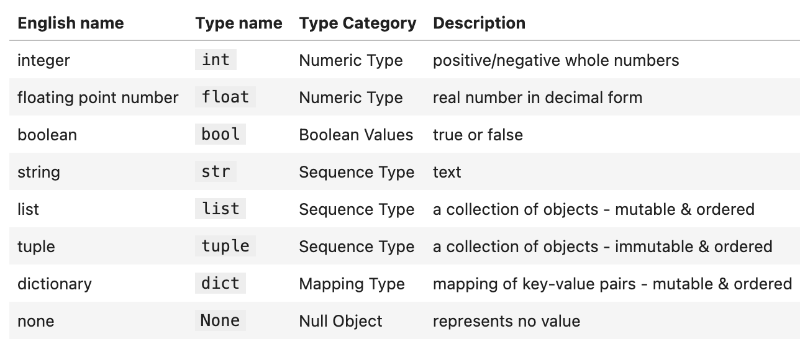
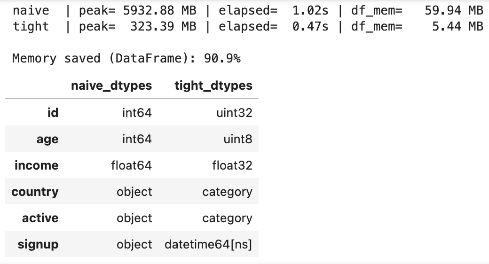
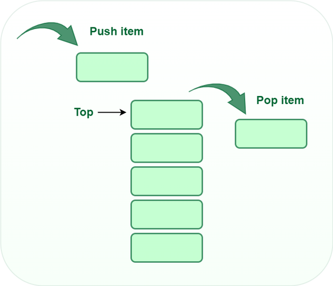
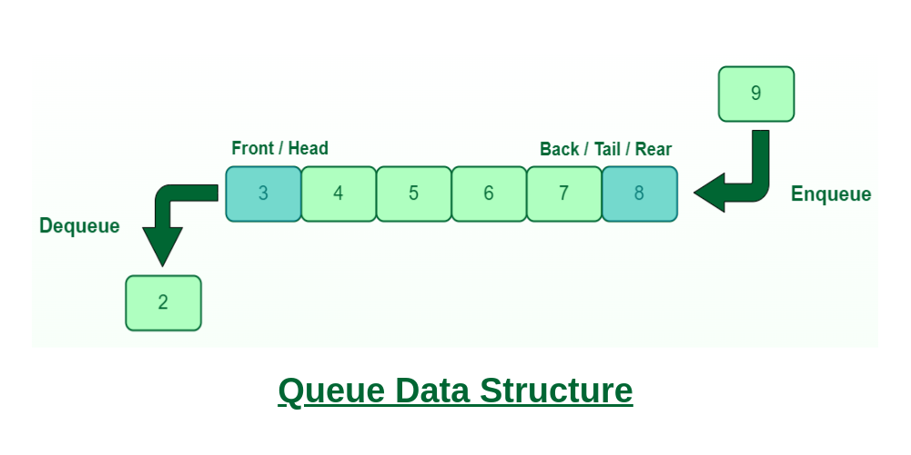

## Lecture 1 Review

- Time complexity, code profiling, and Big O notation

::: {.incremental}
- Agora Questions:

  - Can a faster algorithm in theory (like $O(log (n))$) ever run slower in practice than a slower one (like $O(n)$)?

  - What about $O(nlog(n))$? do we ignore the first $n$?

  - How do we usually balance writing easy to understand code versus writing the most efficient one?

  - Does this mean that when you get the Big O notation, then you are essentially calculating the worst case?

:::{.columns}
::: {.column width="60%"}
- [agora.students.cs.ubc.ca](https://agora.students.cs.ubc.ca) (code: **889779**)
:::
::: {.column width="40%"}
- {width="130"}
:::
:::

:::

## Outline

- Intro and space complexity
- Memory profiling
- Intro to basic data structures
- Hash tables and hash functions
- Stacks and queues

## Learning Objectives

- Given simple code, determine the space complexity using Big-O notation.
- Measure the amount of memory usage in Python using `psutil`, `getsizeof`, and `nbytes`.
- Explain how data types can affect memory, and why it is important to choose the right data types.
- Explain what a data structure is and why it is useful in computing at a high level.
- List Python's built-in data structures and describe their properties.
- Explain basic (user-defined) data structures: stacks, queues, and hash tables.
- Explain the pros and cons of hash tables, and how they work at a high level.

## Lecture Intro

When working with large datasets and complex code, one strategy to avoid frusteration due to insufficient memory, etc. is:

- **Analyze time and space complexity**
- **Test on a fraction of your data**

## Space Complexity

- When writing code, it's important to consider how long it takes to run.
- However, another significant concern is how much space (memory, not disk space) it uses.

- If your program requires more memory than is available, it could crash or slow down dramatically.

## Space Complexity

- **Checking RAM**

```python
import psutil
psutil.virtual_memory()
```

- My laptop has 18 GB of RAM, so I can store around 2 billion numbers (if a single number takes 8 bytes).
- I can't run a code that needs to store 2 billion numbers at the same time.
  - Fun fact: GPT 4 is rumored to have approximately 1.8 trillion parameters.

::: {.notes}
- In reality, the usable amount is less because the system and other programs also consume memory.
- Additionally, Python has some internal overhead, meaning it uses more memory than just the raw data size.
- If my code needs to store 2 billion numbers at the same time, I can't run it on my laptop.
:::

## Space Complexity

- Similar to time complexity, we can analyze the space complexity using Big O notation.

- Key difference:
  - When thinking about **time complexity**, we usually focus on the algorithm itself and how efficiently it processes input.
  - With **space complexity**, we’re more concerned with how many memory units are being used.

::: {.notes}
as they determine how much memory is required to store and manipulate data.
:::

## Example 1

::: {.incremental}

> x = np.zeros(n)

- Space complexity: $O(n)$.

:::

## Example 2

> x = np.zeros((n,n))

::: {.incremental}

- Space complexity: $O(n^2)$.

:::

## Example 3

::: {.incremental}

> x = np.zeros((n,n,5))

- Space complexity: $O(n^2)$.

:::

## Example 4

::: {.incremental}

> x = np.zeros((n,n,n))

- Space complexity: $O(n^3)$.

:::

## Example 5

::: {.incremental}

> x = np.zeros(5)

- Space complexity: $O(1)$.

:::

## Example 6

::: {.incremental}

- You have $n$ users on your social network site, and you want to store a “level of friendship” between every pair of users.

- Space complexity: $O(n^2)$.

:::

## Memory profiling

- Memory profiling:
  - can be done using a variety of tools such as `getsizeof`, `nbytes`, and `psutil`.
  - is not as straightforward as measuring execution time
  - is much more dynamic

## Memory profiling

```python
x = np.random.rand(1_000_000_000)
x.shape
```

```python
x.nbytes
```

```python
getsizeof(x)
```

## Data types and memory usage

- Common built-in Python data types

{fig-align="center" width="90%"}

- Choosing the right data types affect memory, sometimes a lot!

## Data types and memory usage

- Let's assume that we are dealing with the following dataframe:
```python
df = pd.read_csv("data/big_demo_mem.csv")
df.head()
```

## Data types and memory usage

- Two different read functions:
```{.python}
def load_naive(path):
    return pd.read_csv(path)
```
or,

```{.python}
def load_tight(path):
    dtype_opt = {
        "id": "uint32",
        "age": "uint8",
        "income": "float32",
        "country": "category",
        "active": "category",
    }
    return pd.read_csv(path, dtype=dtype_opt, parse_dates=["signup"])
```

## Data types and memory usage

- Two different read functions:
```{.python}
def load_naive(path):
    return pd.read_csv(path)
```
or,

```{.python code-line-numbers="2,3,4,5,6,7,8"}
def load_tight(path):
    dtype_opt = {
        "id": "uint32",
        "age": "uint8",
        "income": "float32",
        "country": "category",
        "active": "category",
    }
    return pd.read_csv(path, dtype=dtype_opt, parse_dates=["signup"])
```

## Data types and memory usage

- Two different read functions:
```{.python}
def load_naive(path):
    return pd.read_csv(path)
```
or,

```{.python code-line-numbers="9"}
def load_tight(path):
    dtype_opt = {
        "id": "uint32",
        "age": "uint8",
        "income": "float32",
        "country": "category",
        "active": "category",
    }
    return pd.read_csv(path, dtype=dtype_opt, parse_dates=["signup"])
```

## Data types and memory usage

{fig-align="center" width="80%"}

## Introduction to data structures

- A **data structure** is a way to organize and manage data effectively.
- Data structures help with writing more efficient code (both in terms of time and space).
- We consider three main operations for data structures:
    - Inserting a new element
    - Deleting an element
    - Checking if an element is present

::: {.notes}
We have seen searching in set is much more efficient than searching in a list.
:::

## Python built-in data structures

- Lists
- Tuples
- Sets
- Dictionaries

::: {.notes}
- Python offers several built-in data structures that we have already covered in 511:
:::

## Lists

- Inserting a new element:
    - `list.append(value)`
    - `list.insert(pos, value)`
- Deleting an element:
    - `list.remove(value)`
    - `list.pop(index)` (default index is `-1`)
- Checking if an element is present:
    - `in`

## Tuples

- Inserting a new element:
    - Immutable, so no insertion is possible after creation.
- Deleting an element:
    - Immutable, so elements cannot be removed after creation.
- Checking if an element is present:
    - `in`

## Sets

- Inserting a new element:
    - `set.add()`
    - Operations like `^` (symmetric difference), `|` (union), etc.
- Deleting an element:
    - `set.remove()`
    - Operations like `-` (difference), etc.
- Checking if an element is present:
    - `in`

## Dictionaries

- Inserting a new element:
    - `dict[key] = value`
- Deleting an element:
    - `dict.pop(key)`
    - `del dict[key]`
- Checking if an element is present:
    - `in` (for `dict.keys()`, `dict.values()`)

## Hash tables

- In the previous lecture, we saw that checking if an element is present in a `set` is very efficient.
- `set` supports the following operations in $O(1)$ time:
  - Inserting a new element
  - Deleting an element
  - Checking if an element is present

## Hash tables

- How could we implement these operations in $O(1)$ time?

  - Linear search is too slow.
  - Binary search requires maintaining an ordered list, so insertion/deletion is slow.
  - The solution? A [hash table](https://en.wikipedia.org/wiki/Hash_table)!!!

## Hash tables

{fig-align="center" width="40%"}

## Hash tables

{fig-align="center" width="70%"}

## Hash function

- A hash function maps data of arbitrary size to a fixed-size value, called a hash value.

- Key properties of hash functions

  - **Deterministic**: The same input always produces the same output.
      - Python introduced a Hash randomization.
  - **Fixed-size output**: Hash values are of a fixed size (e.g., 64-bit integer).
  - **Collision-resistant**: Good hash functions minimize the chance of different inputs producing the same output.

<br>

- Hash functions are extremely useful, beyond what we talk about in this course 🤓

## Hash function

- In Python, the `hash` function can be used:

```{pyodide}
print(hash("mds"))
print(hash(3.14))
print(hash(None))
print(hash(314)) # for small integers, the hash value is often the integer itself.
```

- Notice that `hash` returns an integer.

## Hash function

- Immutable objects (numbers, strings, tuples) are hashable, mutable objects (lists, dicts) are not.

<br>

```{pyodide}
hash([1, 2, 3])  # This would return an error
# hash((1, 2, 3)) # This would work
```

## Hash function

- Python `set` is backed by a hash function, so all elements must be hashable.

<br>

```{pyodide}
s = set()
s.add(5.5)
s.add("mds")
s.add((1, 2, 3))
s
```

- Adding a mutable object such as a list will cause an error.

## Hash tables

- A hash table keeps an array of buckets (a list of lists):
    - Use a hash function to map an object to an index.
    - The object is then added/deleted in the corresponding bucket.
- Insertion, retrieval, and deletion operations are $O(1)$ time assuming we have a "good" hash function.

::: {.notes}
- this mod operation returns the remainder of a division,

- So, it looks like the hash function maps from an object to an integer.
- And that Python `set`s use these hash functions.
- The hash function depends on this array size.
- The hash function will be "good" for default Python objects, and if you end up needing to implement your own one day you should read a bit more about it.
:::

## Hash tables

- A simple (but low-quality) implementation of hash table

```{.python}
class HashTable:
    def __init__(self, num_buckets=4):
        self.n = num_buckets

        # A list of lists
        self.stuff = list()
        for i in range(num_buckets):
            self.stuff.append([]) # Create the inner bucket

    def add(self, item):
        if not self.contains(item):
            self.stuff[hash(item) % self.n].append(item)

    def contains(self, item):
        return item in self.stuff[hash(item) % self.n]

    def __str__(self):
        return str(self.stuff)
```

## Hash tables

- A simple (but low-quality) implementation of hash table

```{.python code-line-numbers="1,2,3,4,5,6,7,8"}
class HashTable:
    def __init__(self, num_buckets=4):
        self.n = num_buckets

        # A list of lists
        self.stuff = list()
        for i in range(num_buckets):
            self.stuff.append([]) # Create the inner bucket

    def add(self, item):
        if not self.contains(item):
            self.stuff[hash(item) % self.n].append(item)

    def contains(self, item):
        return item in self.stuff[hash(item) % self.n]

    def __str__(self):
        return str(self.stuff)
```

## Hash tables

- A simple (but low-quality) implementation of hash table

```{.python code-line-numbers="10,11,12"}
class HashTable:
    def __init__(self, num_buckets=4):
        self.n = num_buckets

        # A list of lists
        self.stuff = list()
        for i in range(num_buckets):
            self.stuff.append([]) # Create the inner bucket

    def add(self, item):
        if not self.contains(item):
            self.stuff[hash(item) % self.n].append(item)

    def contains(self, item):
        return item in self.stuff[hash(item) % self.n]

    def __str__(self):
        return str(self.stuff)
```

## Hash tables

- A simple (but low-quality) implementation of hash table

```{.python code-line-numbers="14,15"}
class HashTable:
    def __init__(self, num_buckets=4):
        self.n = num_buckets

        # A list of lists
        self.stuff = list()
        for i in range(num_buckets):
            self.stuff.append([]) # Create the inner bucket

    def add(self, item):
        if not self.contains(item):
            self.stuff[hash(item) % self.n].append(item)

    def contains(self, item):
        return item in self.stuff[hash(item) % self.n]

    def __str__(self):
        return str(self.stuff)
```

## Hash tables

- A simple (but low-quality) implementation of hash table

```{.python code-line-numbers="17,18"}
class HashTable:
    def __init__(self, num_buckets=4):
        self.n = num_buckets

        # A list of lists
        self.stuff = list()
        for i in range(num_buckets):
            self.stuff.append([]) # Create the inner bucket

    def add(self, item):
        if not self.contains(item):
            self.stuff[hash(item) % self.n].append(item)

    def contains(self, item):
        return item in self.stuff[hash(item) % self.n]

    def __str__(self):
        return str(self.stuff)
```

## Hash tables

```{pyodide}
class HashTable:
    def __init__(self, num_buckets=4):
        self.stuff = list() # A list of lists
        self.n = num_buckets

        for i in range(num_buckets):
            self.stuff.append([]) # Create the inner lists, one per bucket

    def add(self, item):
        if not self.contains(item):
            self.stuff[hash(item) % self.n].append(item)

    def contains(self, item):
        return item in self.stuff[hash(item) % self.n]

    def __str__(self):
        return str(self.stuff)

    # Exercise for your: implement deletion
```

## Hash tables

- Adding an item

```{pyodide}
ht = HashTable()
print(ht)
```

```{pyodide}
ht.add("mds")
print(ht)
```

```{pyodide}
# "mds" is placed in the bucket
# because the hash value of "mds" mod 4 is:
hash("mds") % 4
```

## Hash tables

- Searching for an item

```{pyodide}
ht.add("goodbye")
ht.add("test")
ht.add("item")
print(ht)
```

```{pyodide}
print(hash("item") % 4)
print(ht.contains("item"))
```

- We only need to check one bucket, so the search takes $O(1)$ time.

## Hash collisions

- Collisions occur when multiple objects hash to the same index.
- In the previous example, two items ended up in the same bucket, creating a collision:

```{pyodide}
print(ht)
```

- Solution (beyond the scope for this course):
  - Separate chaining
  - Open addressing

## Exercise

If my hash table has 4 buckets, what is the time complexity of `contains`?

A: $O(1)$ \
B: $O(n)$ \
C: $O(log(n))$ \
D: $O(nlog(n))$

. . .

$Answer: O(n)$ -> we narrow our search down to one of the 4 buckets, but we still need to search through all the elements in that bucket. Since the size of the bucket is $\frac{n}{4}$, our time complexity is $O(n)$.

## Hash table growth

- In Python, the size of the hash table  (i.e., the array of buckets) expands and contracts dynamically.
    - As more elements are inserted, the hash table resizes to avoid excessive collisions.
    - You will explore this in `lab1`.

## Hash table growth and amortized cost

- Resizing occurs infrequently, and between resize events, insertions are very fast.
- The cost "averages out":
    - After adding $n$ elements, we spend $O(n)$ time on growth.
    - An average of $O(1)$ per insertion.

::: {.notes}
- Although individual resizing operations can be slow, the average or **amortized** cost over many operations is still $O(1)$.

:::

## Python `dict`

- It is similar to a `set` but with key-value pairs:
  - The entries are called "keys," and the associated data are the "values."
- Python `dict` is implemented using a hash table, so we have $O(1)$ operations like insertion, deletion, and lookup.
- Only the keys are hashed, so only the keys have to be hashable.

::: {.notes}
- For example: a list can be a value, but not a key.
:::

## Stacks

- A stack is a data structure that allows us to insert items and retrieve them later using the **Last In, First Out** (LIFO) principle.
  - Example: Think of it like a stack of books, where the last book placed on top is the first one to be removed.

{width=300 fig-align="center"}

## Stack implementation using a `list`

```{.python}
class Stack:
    def __init__(self):
        self.data = list()

    def push(self, item):
        self.data.append(item)

    def pop(self):
        return self.data.pop()

    def isEmpty(self):
        return len(self.data) == 0

    def __str__(self):
        return self.data.__str__()
```

## Stack implementation using a `list`

```{.python code-line-numbers="1,2,3"}
class Stack:
    def __init__(self):
        self.data = list()

    def push(self, item):
        self.data.append(item)

    def pop(self):
        return self.data.pop()

    def isEmpty(self):
        return len(self.data) == 0

    def __str__(self):
        return self.data.__str__()
```

## Stack implementation using a `list`

```{.python code-line-numbers="5,6"}
class Stack:
    def __init__(self):
        self.data = list()

    def push(self, item):
        self.data.append(item)

    def pop(self):
        return self.data.pop()

    def isEmpty(self):
        return len(self.data) == 0

    def __str__(self):
        return self.data.__str__()
```

## Stack implementation using a `list`

```{.python code-line-numbers="8,9"}
class Stack:
    def __init__(self):
        self.data = list()

    def push(self, item):
        self.data.append(item)

    def pop(self):
        return self.data.pop()

    def isEmpty(self):
        return len(self.data) == 0

    def __str__(self):
        return self.data.__str__()
```

## Stack implementation using a `list`

```{.python code-line-numbers="11,12"}
class Stack:
    def __init__(self):
        self.data = list()

    def push(self, item):
        self.data.append(item)

    def pop(self):
        return self.data.pop()

    def isEmpty(self):
        return len(self.data) == 0

    def __str__(self):
        return self.data.__str__()
```

## Stack implementation using a `list`

```{.python code-line-numbers="14,15"}
class Stack:
    def __init__(self):
        self.data = list()

    def push(self, item):
        self.data.append(item)

    def pop(self):
        return self.data.pop()

    def isEmpty(self):
        return len(self.data) == 0

    def __str__(self):
        return self.data.__str__()
```

## Stack implementation using a `list`

```{pyodide}
class Stack:
    def __init__(self):
        self.data = list()

    def push(self, item):
        self.data.append(item)

    def pop(self):
        return self.data.pop()

    def isEmpty(self):
        return len(self.data) == 0

    def __str__(self):
        return self.data.__str__()
```

## Stack operations

```{pyodide}
# Push and pop operations on a stack:
s = Stack()
s.push("1")
print(s)
```

. . .

```{pyodide}
s.push("2")
print(s)
```

. . .

```{pyodide}
# Pop the top element:
s.pop()
print(s)
```

## Exercise

If a stack contains `n` items, what is the time complexity to retrieve the bottom item?

**A**: $O(1)$ <br>
**B**: $O(n)$ <br>
**C**: $O(log(n))$ <br>
**D**: $O(n^2)$

::: {.incremental}

- Answer: $O(n)$
- To retrieve the bottom item, we would have to pop all the elements above it.

:::

## Queues

- A queue is a data structure that operates on the **First In, First Out**(FIFO) principle.
  - Example: waiting in line—people are served in the order they arrive.

<br>

{width=500 fig-align="center"}

## Queue implementation using a `list`

```{.python}
class Queue:
    def __init__(self):
        self.data = list()

    def push(self, item):
        self.data.append(item)

    def pop(self):
        return self.data.pop(0)

    def isEmpty(self):
        return len(self.data) == 0

    def __str__(self):
        return self.data.__str__()
```

## Queue implementation using a `list`

```{.python code-line-numbers="1,2,3"}
class Queue:
    def __init__(self):
        self.data = list()

    def push(self, item):
        self.data.append(item)

    def pop(self):
        return self.data.pop(0)

    def isEmpty(self):
        return len(self.data) == 0

    def __str__(self):
        return self.data.__str__()
```

## Queue implementation using a `list`

```{.python code-line-numbers="5,6"}
class Queue:
    def __init__(self):
        self.data = list()

    def push(self, item):
        self.data.append(item)

    def pop(self):
        return self.data.pop(0)

    def isEmpty(self):
        return len(self.data) == 0

    def __str__(self):
        return self.data.__str__()
```

## Queue implementation using a `list`

```{.python code-line-numbers="8,9"}
class Queue:
    def __init__(self):
        self.data = list()

    def push(self, item):
        self.data.append(item)

    def pop(self):
        return self.data.pop(0)

    def isEmpty(self):
        return len(self.data) == 0

    def __str__(self):
        return self.data.__str__()
```

## Queue implementation using a `list`

```{.python code-line-numbers="11,12"}
class Queue:
    def __init__(self):
        self.data = list()

    def push(self, item):
        self.data.append(item)

    def pop(self):
        return self.data.pop(0)

    def isEmpty(self):
        return len(self.data) == 0

    def __str__(self):
        return self.data.__str__()
```

## Queue implementation using a `list`

```{.python code-line-numbers="14,15"}
class Queue:
    def __init__(self):
        self.data = list()

    def push(self, item):
        self.data.append(item)

    def pop(self):
        return self.data.pop(0)

    def isEmpty(self):
        return len(self.data) == 0

    def __str__(self):
        return self.data.__str__()
```

## Queue implementation using a `list`

```{pyodide}
class Queue:
    def __init__(self):
        self.data = list()

    def push(self, item):
        self.data.append(item)

    def pop(self):
        return self.data.pop(0)

    def isEmpty(self):
        return len(self.data) == 0

    def __str__(self):
        return self.data.__str__()
```

## Queue operations

```{pyodide}
# Push operations (enqueue) on a queue
q = Queue()
q.push("first")
print(q)
```

. . .

```{pyodide}
q.push("second")
print(q)
```
. . .

```{pyodide}
# Pop operations (dequeue) on a queue:
q.pop()
print(q)
```

## Exercise

If we have a queue `[A, B, C, D]` with `A` at the head of the queue, what will the queue look like after the following operations:

- push `E` onto the queue
- push `F` onto the queue
- remove one item from the queue
- push `A` onto the queue

::: {.incremental}

- Answer: `[B, C, D, E, F, A]`

:::
