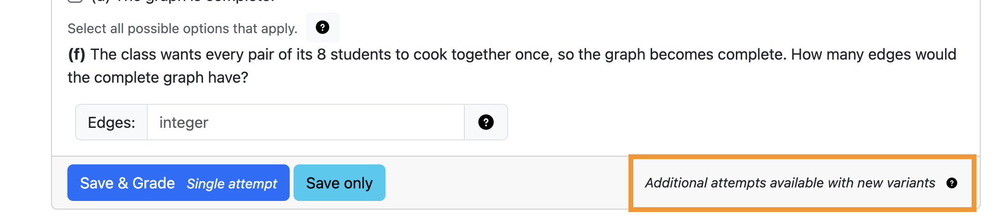
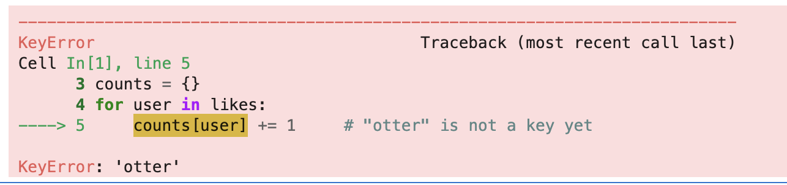
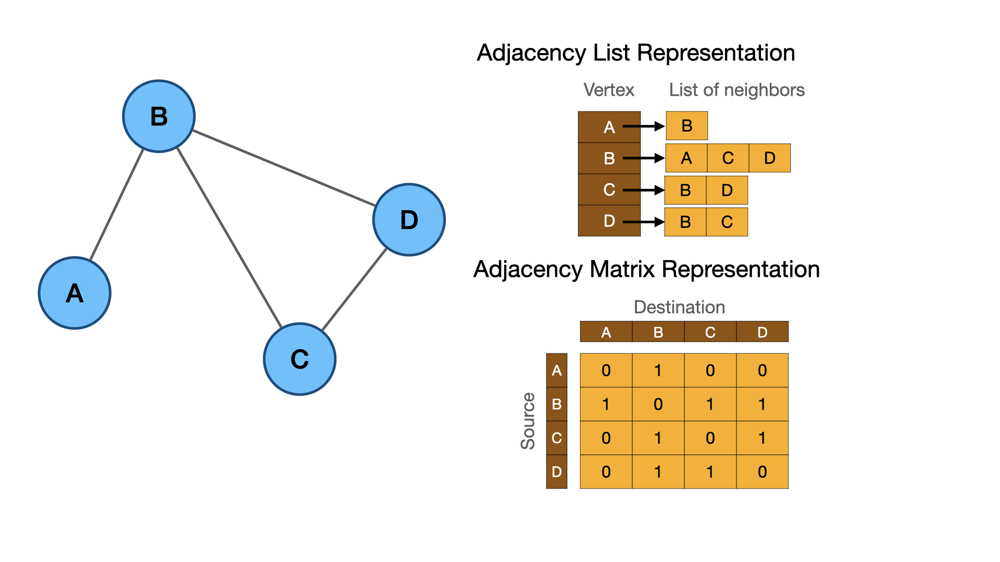
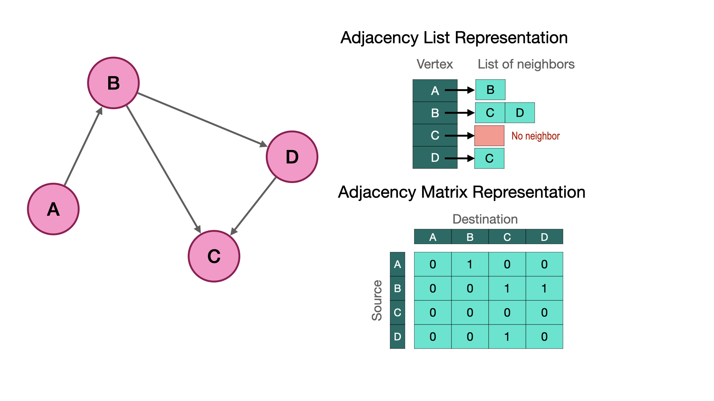

## Housekeeping: labs {style="font-size: 0.85em;"}

::: {.incremental}
- "Single Attempt" on a lab question means one attempt per **variant**. You get unlimited attempts per question.

  {width="80%" fig-alt="PrairieLearn question footer showing Save & Grade (Single attempt) and the message: Additional attempts available with new variants"}

- New: the Jupyter scratchpad has starter code for every coding question. Play with the data and test your code there before you submit on PL.
- Week 1 practice problems are on PL. Keep practising as you study.
:::

## Housekeeping: live coding quizzes {background-image="images/care.png" background-size="cover" background-position="right" style="font-size: 0.8em;"}

::: {.incremental}
- The goal is a safe space to make mistakes and practise before a real technical interview.
- Go to your own lab session. Bring your UBC ID, or show your photo on Canvas or Workday.
- Each quiz covers the **previous** week. This week: Week 1, binary and linear search.
- Retakes: up to two extra tries, closed-book, new questions but on the same concepts. During any TA or instructor office hours, before November 6.
:::

::: {.notes}
Last week's quizzes were stressful for many of you, and that was not our intention. Everyone walked a different path to MDS with different prior exposure to coding, so we want to give you more room to practise.

Retake details:<br>
Deadline: all retakes must be done before November 6.<br>
Where: during any TA's or instructor's office hours.<br>
Format: closed-book on PL (the lab quizzes are open-book). New questions that test the same concepts or algorithm as the quiz you are retaking.<br>
Scheduling: if you cannot make office hours, contact the instructors and we will find another time.

We hope this takes some pressure off.
:::

## Where we stopped last time {style="font-size: 0.9em;"}
```{python}
#| echo: false
# Hidden: imports for the whole deck, kept in one place so the visible cells
# below contain only the code students should read.
import math
import timeit

import networkx as nx
import numpy as np
import psutil
import scipy.sparse
```

```{pyodide}
#| include: false
# Hidden setup for the runnable cells: the same friend network, likes and
# adjacency matrix as the visible cells, so a later cell still works when an
# earlier slide was skipped.
from collections import Counter, defaultdict

import networkx as nx

friendships = [("sky", "otter"), ("sky", "clam"), ("sky", "kelp"), ("sky", "mochi"),
               ("clam", "kelp"), ("nori", "clam"), ("nori", "kelp"), ("nori", "mochi"),
               ("bubbles", "otter"), ("bubbles", "clam"), ("pixel", "otter"),
               ("pixel", "ada"), ("waffle", "river")]
G = nx.Graph()
G.add_edges_from(friendships)

likes = ["otter", "clam", "otter", "kelp", "otter"]
by_user = defaultdict(list)
users = list(G.nodes)
A = nx.to_numpy_array(G, nodelist=users, dtype=int)
```


The rest of lecture 2 shrinks Instagram's user table about 10× by picking the right dtypes. Read it on your own: [lecture 2 slides](slides_02.html#/instagrams-user-table). 


## How does Instagram know who you might know? {style="font-size: 0.9em;"}

:::{.columns}
::: {.column width="45%"}
You open Instagram. A card says **Suggested for you: nori**.

You have never met nori, but the card says *Followed by clam, kelp and mochi*.
:::
::: {.column width="55%"}
{width="100%"}
:::
:::

::: {.fragment}
Out of 3 billion users, how did Instagram pick nori? 🤔
:::

::: {.notes}
- "mutual friends"?
- Follow up: what does Instagram need to store to answer that quickly?
:::

::: footer
Image generated by OpenAI GPT-image-2.5-sunburst
:::

```{python}
#| echo: false
# Hidden: the Instagram friend network behind every graph picture in this deck.
# Same 13 friendships as the visible pyodide cells. Positions are placed by hand
# so the drawing is identical on every slide.
friend_pos = {
    "sky": (0.0, 0.0), "otter": (-1.4, 1.0), "clam": (1.0, 1.3), "kelp": (1.6, 0.0),
    "mochi": (1.0, -1.2), "nori": (3.0, 0.5), "bubbles": (-0.2, 2.4),
    "pixel": (-2.8, 0.2), "ada": (-4.2, 0.2), "waffle": (-3.8, -1.4), "river": (-2.4, -1.4),
}
friendships = [("sky", "otter"), ("sky", "clam"), ("sky", "kelp"), ("sky", "mochi"),
               ("clam", "kelp"), ("nori", "clam"), ("nori", "kelp"), ("nori", "mochi"),
               ("bubbles", "otter"), ("bubbles", "clam"), ("pixel", "otter"),
               ("pixel", "ada"), ("waffle", "river")]
friends = nx.Graph()
friends.add_nodes_from(friend_pos)
friends.add_edges_from(friendships)
users = list(friends.nodes)


def edge_key(u, v):
    """One name per undirected edge, the same whichever end you start from."""
    return "|".join(sorted((u, v)))


def layout(G, pos, pad=0.5):
    """Where to draw every node and edge of G, plus the axis ranges. Drawn by OJS."""
    xs = [x for x, _ in pos.values()]
    ys = [y for _, y in pos.values()]
    return {"nodes": [{"id": u, "x": pos[u][0], "y": pos[u][1]} for u in G.nodes],
            "edges": [{"x1": pos[u][0], "y1": pos[u][1], "x2": pos[v][0], "y2": pos[v][1]}
                      for u, v in G.edges],
            "x_domain": [min(xs) - pad, max(xs) + pad],
            "y_domain": [min(ys) - pad, max(ys) + pad + 0.3]}


def roles(G, node_role=None, edge_role=None, labels=None, show_edges=True):
    """A colour role for every node and edge of G, in the same order as layout(G).
    Nodes: "you", "friend", "pick" or "other". Edges: "friend", "path" or "base"."""
    node_role, edge_role, labels = node_role or {}, edge_role or {}, labels or {}
    return {"node_roles": [node_role.get(u, "other") for u in G.nodes],
            "edge_roles": [edge_role.get(edge_key(u, v), "base") for u, v in G.edges],
            "labels": [labels.get(u, u) for u in G.nodes],
            "show_edges": show_edges}


def names(items):
    """["clam", "kelp", "mochi"] -> "clam, kelp and mochi"."""
    items = list(items)
    return items[0] if len(items) == 1 else ", ".join(items[:-1]) + " and " + items[-1]


friend_layout = layout(friends, friend_pos)
```

```{python}
#| echo: false
# Hidden: the "Suggested for you" step-through on the next slide.
# Finds sky's friends of friends and counts mutual friends here; OJS only draws.
you = "sky"
your_friends = list(friends.neighbors(you))
mutual = {}                                   # friend of a friend -> the mutual friends
for friend in your_friends:
    for fof in friends.neighbors(friend):
        if fof != you and fof not in your_friends:
            mutual.setdefault(fof, []).append(friend)
ranked = sorted(mutual, key=lambda u: -len(mutual[u]))
top = ranked[0]

friend_roles = {you: "you", **{f: "friend" for f in your_friends}}
friend_edges = {edge_key(you, f): "friend" for f in your_friends}
fof_edges = {edge_key(f, u): "path" for u in mutual for f in mutual[u]}
top_edges = {edge_key(f, top): "path" for f in mutual[top]}

suggest_steps = [
    {**roles(friends, show_edges=False),
     "say": f"{len(users)} Instagram users. Who is friends with whom?"},
    {**roles(friends),
     "say": "Draw a line between two users who follow each other."},
    {**roles(friends, {you: "you"}),
     "say": f"You are {you}."},
    {**roles(friends, friend_roles, friend_edges),
     "say": f"Your {len(your_friends)} friends: {names(your_friends)}."},
    {**roles(friends, {**friend_roles, **{u: "pick" for u in mutual}}, {**friend_edges, **fof_edges},
             {u: f"{u} ({len(mutual[u])})" for u in mutual}),
     "say": "Their friends you don't follow yet, with the number of mutual friends: "
            + ", ".join(f"{u} ({len(mutual[u])})" for u in ranked) + "."},
    {**roles(friends, {**friend_roles, top: "pick"}, {**friend_edges, **top_edges},
             {top: f"{top} ({len(mutual[top])})"}),
     "say": f"Suggested for you: {top}, followed by {names(mutual[top])}."},
]
for k, step in enumerate(suggest_steps):
    step["count"] = f"Step {k} of {len(suggest_steps) - 1}"

ojs_define(friend_layout = friend_layout, suggest_steps = suggest_steps)
```

## Draw it {style="font-size: 0.8em;"}

```{ojs}
//| echo: false
viewof suggest_step = Inputs.button([
  ["Back", i => Math.max(i - 1, 0)],
  ["Next step", i => Math.min(i + 1, suggest_steps.length - 1)],
  ["Start over", () => 0]
], {value: 0})
```

```{ojs}
//| echo: false
{
  // Print only: the sentence was written in Python (suggest_steps).
  const s = suggest_steps[suggest_step];
  return html`<div class="ojs-readout"><span class="sq-count">${s.count}</span> ${s.say}</div>`;
}
```

```{ojs}
//| echo: false
{
  // Draw only: every position, colour role and label was computed in Python.
  const s = suggest_steps[suggest_step];
  const base = friend_layout;
  const fill = {you: "#52514e", friend: "#2a78d6", pick: "#eb6834", other: "#b8b6b0"};
  const stroke = {friend: "#2a78d6", path: "#eb6834", base: "#d9d8d4"};
  const nodes = base.nodes.map((d, i) => ({...d, role: s.node_roles[i], label: s.labels[i]}));
  const edges = s.show_edges ? base.edges.map((d, i) => ({...d, role: s.edge_roles[i]})) : [];
  return Plot.plot({
    width: 900, height: 390, margin: 20,
    style: {fontSize: "16px", background: "transparent"},
    x: {axis: null, domain: base.x_domain}, y: {axis: null, domain: base.y_domain},
    marks: [
      Plot.link(edges, {filter: d => d.role === "base", x1: "x1", y1: "y1", x2: "x2", y2: "y2",
                        stroke: stroke.base, strokeWidth: 2}),
      Plot.link(edges, {filter: d => d.role !== "base", x1: "x1", y1: "y1", x2: "x2", y2: "y2",
                        stroke: d => stroke[d.role], strokeWidth: 4}),
      Plot.dot(nodes, {x: "x", y: "y", r: 14, fill: d => fill[d.role], stroke: "white", strokeWidth: 2}),
      Plot.text(nodes, {x: "x", y: "y", text: "label", dy: -25, fontWeight: "bold"})
    ]
  });
}
```

::: {.fragment}
Users and lines between them: this is called a **graph**.
:::

::: {.notes}
- Dark = you, blue = your friends, orange = friends of friends.
- Step 4: nori has 3 mutual friends, bubbles 2, pixel 1. The most mutual friends wins the card.
- waffle and river never light up. 
:::

## Graph, defined {style="font-size: 0.85em;"}

A graph $G = (V, E)$ has

- $V$, a set of **vertices** (also called nodes): the users.
- $E$, a set of **edges**: the friendships. Each edge $(u, v)$ connects two vertices $u, v \in V$.

::: {.fragment}
Many kinds of data are graphs:

| data | vertices | edges |
|---|---|---|
| social network | people | who is friends with whom |
| the internet | web pages | which page links to which |
| transportation | cities | direct flights |
| MDS courses | courses | which course you need first |
:::

::: {.notes}
- A table is good when rows stand on their own. A graph is good when the connections are what we care about.
- Prerequisites: DSCI 511 before DSCI 512 is an edge.
:::

## Build it in `networkx` {style="font-size: 0.85em;"}

```{pyodide}
import networkx as nx

friendships = [("sky", "otter"), ("sky", "clam"), ("sky", "kelp"), ("sky", "mochi"),
               ("clam", "kelp"), ("nori", "clam"), ("nori", "kelp"), ("nori", "mochi"),
               ("bubbles", "otter"), ("bubbles", "clam"), ("pixel", "otter"),
               ("pixel", "ada"), ("waffle", "river")]

G = nx.Graph()                    # an empty undirected graph
G.add_edges_from(friendships)     # one edge per pair, the nodes are added for you

print("number of nodes:", G.number_of_nodes())   # V
print("number of edges:", G.number_of_edges())   # E
```

::: {.fragment}
One at a time: `G.add_node("ada")`, `G.add_edge("sky", "otter")`. Many at once: `add_nodes_from`, `add_edges_from`.
:::

::: {.notes}
- Same 11 users and 13 friendships as the picture.
- `nx.draw(G)` draws it with matplotlib. Positions are random each run unless you pass `pos=nx.spring_layout(G, seed=0)`: only nodes and edges matter, not where they are drawn.
- `list(G.nodes())` and `list(G.edges())` list them.
:::

```{python}
#| echo: false
# Hidden: neighbours and degree of every user, for the next slide and for the
# "same graph, two ways" slide. The adjacency list is built exactly like the
# visible defaultdict cell, so the order of the neighbours matches.
adj_list = {u: [] for u in users}
for u, v in friendships:
    adj_list[u].append(v)
    adj_list[v].append(u)
friend_matrix = nx.to_numpy_array(friends, nodelist=users, dtype=int)
assert all(friend_matrix[users.index(u)].sum() == len(adj_list[u]) for u in users)

user_views = {}
for u in users:
    nbrs = adj_list[u]
    user_views[u] = {
        **roles(friends, {u: "you", **{v: "friend" for v in nbrs}},
                {edge_key(u, v): "friend" for v in nbrs}),
        "degree_say": f"{u}'s neighbours: {names(nbrs)}. Degree = {len(nbrs)}.",
        "matrix_say": f"Row {u} has a 1 under {names(nbrs)}. Add up the row: {len(nbrs)}, the degree.",
        # which line of the list and which row of the matrix to highlight
        "list_cls": ["on" if w == u else "" for w in users],
        "row_cls": ["on" if w == u else "faded" for w in users],
    }

adj_view = {
    "users": users,
    "short": [u[:3] for u in users],                   # column headers: sky, ott, cla, ...
    "rows": friend_matrix.tolist(),
    "lines": [f"{u}: [{', '.join(adj_list[u])}]" for u in users],
}
ojs_define(user_views = user_views, adj_view = adj_view)
```

## Neighbours and degree {style="font-size: 0.8em;"}

:::: {.columns}
::: {.column width="38%"}
- $u$ and $v$ are **neighbours** if there is an edge between them.
- The **degree** of a vertex is the number of edges touching it.

```{pyodide}
print(list(G.neighbors("sky")))
print(G.degree("sky"))
print(dict(G.degree()))
```
:::
::: {.column width="62%"}
```{ojs}
//| echo: false
viewof deg_who = Inputs.select(adj_view.users, {value: "sky", label: "user"})
```

```{ojs}
//| echo: false
{
  // Draw only: roles were computed in Python (user_views).
  const s = user_views[deg_who];
  const base = friend_layout;
  const fill = {you: "#52514e", friend: "#2a78d6", pick: "#eb6834", other: "#b8b6b0"};
  const nodes = base.nodes.map((d, i) => ({...d, role: s.node_roles[i]}));
  const edges = base.edges.map((d, i) => ({...d, role: s.edge_roles[i]}));
  return html`${Plot.plot({
    width: 600, height: 300, margin: 16,
    style: {fontSize: "15px", background: "transparent"},
    x: {axis: null, domain: base.x_domain}, y: {axis: null, domain: base.y_domain},
    marks: [
      Plot.link(edges, {filter: d => d.role === "base", x1: "x1", y1: "y1", x2: "x2", y2: "y2",
                        stroke: "#d9d8d4", strokeWidth: 2}),
      Plot.link(edges, {filter: d => d.role !== "base", x1: "x1", y1: "y1", x2: "x2", y2: "y2",
                        stroke: "#2a78d6", strokeWidth: 4}),
      Plot.dot(nodes, {x: "x", y: "y", r: 11, fill: d => fill[d.role], stroke: "white", strokeWidth: 2}),
      Plot.text(nodes, {x: "x", y: "y", text: "id", dy: -20, fontWeight: "bold"})
    ]
  })}<div class="ojs-readout">${s.degree_say}</div>`;
}
```
:::
::::

::: {.notes}
- Pick sky (4), then nori (3), then ada (1).
- In a simple graph (no self-loops, no repeated edges), degree = number of neighbours.
:::

```{python}
#| echo: false
# Hidden: the shortest path between every pair of users, for the next slide.
# nx.shortest_path does the work here; OJS only colours what it is told to.
path_lookup = {}
for a in users:
    for b in users:
        if a == b:
            on_nodes, on_edges, say = [a], [], "Pick two different users."
        elif nx.has_path(friends, a, b):
            p = nx.shortest_path(friends, a, b)
            on_nodes, on_edges = p, [edge_key(u, v) for u, v in zip(p, p[1:])]
            say = (f"{' → '.join(p)}: {len(p) - 1} edge{'s' if len(p) > 2 else ''}, "
                   f"so the distance from {a} to {b} is {len(p) - 1}.")
        else:
            on_nodes, on_edges = [a, b], []
            say = f"No path from {a} to {b} at all."
        path_lookup[f"{a}|{b}"] = {**roles(friends, {u: "pick" for u in on_nodes},
                                           {e: "path" for e in on_edges}),
                                   "say": say}
ojs_define(path_lookup = path_lookup)
```

## Paths and distance {style="font-size: 0.7em;"}

```{ojs}
//| echo: false
viewof path_from = Inputs.select(adj_view.users, {value: "nori", label: "from"})
```

```{ojs}
//| echo: false
viewof path_to = Inputs.select(adj_view.users, {value: "ada", label: "to"})
```

```{ojs}
//| echo: false
{
  // Draw only: the shortest path was found in Python (path_lookup).
  const s = path_lookup[`${path_from}|${path_to}`];
  const base = friend_layout;
  const nodes = base.nodes.map((d, i) => ({...d, role: s.node_roles[i]}));
  const edges = base.edges.map((d, i) => ({...d, role: s.edge_roles[i]}));
  return html`<div class="ojs-readout">${s.say}</div>${Plot.plot({
    width: 820, height: 270, margin: 14,
    style: {fontSize: "16px", background: "transparent"},
    x: {axis: null, domain: base.x_domain}, y: {axis: null, domain: base.y_domain},
    marks: [
      Plot.link(edges, {filter: d => d.role === "base", x1: "x1", y1: "y1", x2: "x2", y2: "y2",
                        stroke: "#d9d8d4", strokeWidth: 2}),
      Plot.link(edges, {filter: d => d.role !== "base", x1: "x1", y1: "y1", x2: "x2", y2: "y2",
                        stroke: "#eb6834", strokeWidth: 5}),
      Plot.dot(nodes, {x: "x", y: "y", r: 12, fill: d => d.role === "pick" ? "#eb6834" : "#b8b6b0",
                       stroke: "white", strokeWidth: 2}),
      Plot.text(nodes, {x: "x", y: "y", text: "id", dy: -22, fontWeight: "bold"})
    ]
  })}`;
}
```

::: {.incremental}
- A **path** is a sequence of vertices joined by edges. Its length is the number of edges.
- The shortest one is the **distance**: "degrees of separation".
- A **cycle** is a path that starts and ends at the same vertex: sky → clam → kelp → sky.
:::

::: {.notes}
- Start with nori to ada: 5 edges. Then nori to bubbles: 2.
- nori → kelp → clam → sky → otter → pixel → ada is also a path, but longer.
- Then try sky to waffle: no path at all. That is the next slide.
- A cycle does not reuse an edge.
:::

## Shortest path in code {style="font-size: 0.85em;"}

```{pyodide}
print(nx.shortest_path(G, "nori", "ada"))          # the users along a shortest path
print(nx.shortest_path_length(G, "nori", "ada"))   # its length: the number of edges
```

::: {.fragment}
How does `networkx` find it? Breadth-first search, next lecture.
:::

::: {.notes}
- "Suggested for you" only looks at distance 2: friends of friends.
:::

```{python}
#| echo: false
# Hidden: colour each user by connected component, for the next slide.
components = list(nx.connected_components(friends))
component_role = {}
for k, component in enumerate(components):
    for u in component:
        component_role[u] = "friend" if k == 0 else "pick"   # blue, then orange
component_view = {
    **roles(friends, component_role,
            {edge_key(u, v): component_role[u] for u, v in friends.edges}),
    "say": f"{len(components)} connected components: "
           + " and ".join("{" + ", ".join(sorted(c)) + "}" for c in components) + ".",
}
ojs_define(component_view = component_view)
```

## Connected or not? {style="font-size: 0.8em;"}

```{ojs}
//| echo: false
{
  // Draw only: the components were found in Python (component_view).
  const s = component_view;
  const base = friend_layout;
  const color = {friend: "#2a78d6", pick: "#eb6834"};
  const nodes = base.nodes.map((d, i) => ({...d, role: s.node_roles[i]}));
  const edges = base.edges.map((d, i) => ({...d, role: s.edge_roles[i]}));
  return html`${Plot.plot({
    width: 820, height: 300, margin: 16,
    style: {fontSize: "16px", background: "transparent"},
    x: {axis: null, domain: base.x_domain}, y: {axis: null, domain: base.y_domain},
    marks: [
      Plot.link(edges, {x1: "x1", y1: "y1", x2: "x2", y2: "y2", stroke: d => color[d.role], strokeWidth: 3}),
      Plot.dot(nodes, {x: "x", y: "y", r: 12, fill: d => color[d.role], stroke: "white", strokeWidth: 2}),
      Plot.text(nodes, {x: "x", y: "y", text: "id", dy: -22, fontWeight: "bold"})
    ]
  })}<div class="ojs-readout">${s.say}</div>`;
}
```

::: {.incremental}
- **Connected**: there is a path between every pair of vertices.
- Our graph is **disconnected**: no path from sky to waffle. Instagram can't suggest waffle through friends.
- Each separate group is a **connected component**.
:::

## Connected components in code {style="font-size: 0.85em;"}

```{pyodide}
print(nx.is_connected(G))              # True only if every pair has a path
print(list(nx.connected_components(G)))   # one set of users per component
```

```{python}
#| echo: false
# Hidden: complete graphs with 2 to 10 users for the slider two slides down.
# Positions on a circle, edges and every number in the sentence are computed here.
complete_views = {}
for n_users in range(2, 11):
    group = users[:n_users]
    circle = {u: (round(math.cos(math.pi / 2 + 2 * math.pi * k / n_users), 3),
                  round(math.sin(math.pi / 2 + 2 * math.pi * k / n_users), 3))
              for k, u in enumerate(group)}
    K = nx.complete_graph(group)
    n_edges = K.number_of_edges()
    assert n_edges == n_users * (n_users - 1) // 2
    view = layout(K, circle, pad=0.5)
    for node in view["nodes"]:                 # labels sit just outside the circle
        node["lx"], node["ly"] = round(node["x"] * 1.28, 3), round(node["y"] * 1.22, 3)
    complete_views[n_users] = {
        **view,
        "say": f"{n_users} users, everyone friends with everyone: each user has degree "
               f"{n_users - 1}, and there are {n_users} × {n_users - 1} / 2 = {n_edges} edges.",
    }
ojs_define(complete_views = complete_views)
```

## iClicker: how many edges? {style="font-size: 0.8em;"}

A group chat of $V$ users where everyone follows everyone. This is a **complete graph**: every pair of vertices has an edge.

How many edges does it have?

- \(A) $V - 1$
- \(B) $V$
- \(C) $\frac{V(V-1)}{2}$
- \(D) $V^2$

::: {.fragment}
- Answer: **C**
- Each user has degree $V - 1$. Adding up all $V$ degrees counts every edge twice, once from each end.
:::


## Check it {style="font-size: 0.8em;"}

```{ojs}
//| echo: false
viewof complete_n = Inputs.range([2, 10], {step: 1, value: 5, label: "number of users V"})
```

```{ojs}
//| echo: false
{
  // Draw only: positions, edges and the sentence were computed in Python (complete_views).
  const s = complete_views[complete_n];
  return html`<div class="ojs-readout">${s.say}</div>${Plot.plot({
    width: 420, height: 380, margin: 20,
    style: {fontSize: "16px", background: "transparent"},
    x: {axis: null, domain: s.x_domain}, y: {axis: null, domain: s.y_domain},
    marks: [
      Plot.link(s.edges, {x1: "x1", y1: "y1", x2: "x2", y2: "y2", stroke: "#2a78d6", strokeWidth: 2}),
      Plot.dot(s.nodes, {x: "x", y: "y", r: 12, fill: "#2a78d6", stroke: "white", strokeWidth: 2}),
      Plot.text(s.nodes, {x: "lx", y: "ly", text: "id", fontWeight: "bold"})
    ]
  })}`;
}
```

::: {.fragment}
About half of $V^2$: a complete graph has $O(V^2)$ edges. Keep this in mind for memory.
:::

::: {.notes}
- `nx.complete_graph(G.nodes)` builds one in code.
- Real social networks are nowhere near complete. That is the whole point of sparse matrices later.
:::

# Graph types {style="font-size: 0.8em;"}

```{python}
#| echo: false
# Hidden: the directed "who follows whom" graph for the next slide.
# Arrows, in-degree, out-degree and every sentence are worked out here; OJS only draws.
follow_pos = {"sky": (0.0, 0.0), "otter": (-1.7, 0.4), "clam": (1.7, 0.4),
              "kelp": (1.3, -1.2), "natgeo": (0.0, 1.5)}
follows = [("sky", "natgeo"), ("otter", "natgeo"), ("clam", "natgeo"),
           ("sky", "otter"), ("otter", "sky"), ("kelp", "sky")]
follow_graph = nx.DiGraph()
follow_graph.add_nodes_from(follow_pos)
follow_graph.add_edges_from(follows)


def arrow_layout(D, pos, shift=0.09):
    """Arrow coordinates for a directed graph. A two-way pair is drawn as two
    arrows side by side, each shifted a little to its own right."""
    arrows = []
    for u, v, data in D.edges(data=True):
        (x1, y1), (x2, y2) = pos[u], pos[v]
        dx = dy = 0.0
        if D.has_edge(v, u):
            length = math.hypot(x2 - x1, y2 - y1)
            dx, dy = shift * (y2 - y1) / length, -shift * (x2 - x1) / length
        arrows.append({"x1": x1 + dx, "y1": y1 + dy, "x2": x2 + dx, "y2": y2 + dy,
                       # weight label: halfway along, pushed further to the arrow's right
                       "lx": (x1 + x2) / 2 + 2.6 * dx, "ly": (y1 + y2) / 2 + 2.6 * dy,
                       "weight": data.get("weight")})
    return arrows


follow_lookup = {}
for u in follow_graph.nodes:
    fans, following = list(follow_graph.predecessors(u)), list(follow_graph.successors(u))
    follow_lookup[u] = {
        "node_roles": ["you" if w == u else "other" for w in follow_graph.nodes],
        # arrows into u are blue (followers), arrows out of u are orange (following)
        "edge_roles": ["in" if b == u else "out" if a == u else "base" for a, b in follow_graph.edges],
        "in_say": f"in-degree {len(fans)}" + (f" ({names(fans)})" if fans else ""),
        "out_say": f"out-degree {len(following)}" + (f" ({names(following)})" if following else ""),
    }

follow_view = {
    **layout(follow_graph, follow_pos, pad=0.5),
    "arrows": arrow_layout(follow_graph, follow_pos),
    "users": list(follow_graph.nodes),
    "lookup": follow_lookup,
}
ojs_define(follow_view = follow_view)
```

## Instagram followers are one-way {style="font-size: 0.8em;"}

:::: {.columns}
::: {.column width="45%"}
- **Undirected**: an edge goes both ways. Facebook friends: if Alice is friends with Bob, Bob is friends with Alice.
- **Directed**: an edge has a direction, drawn as an arrow. Instagram followers: You can follow natgeo without natgeo following you.

::: {.fragment}
Degree splits in two:

- <span style="color:#2a78d6">in-degree</span>: arrows in, followers
- <span style="color:#eb6834">out-degree</span>: arrows out, following
:::
:::
::: {.column width="55%"}
```{ojs}
//| echo: false
viewof follow_who = Inputs.radio(follow_view.users, {value: "natgeo", label: "user"})
```

```{ojs}
//| echo: false
{
  // Draw only: arrows and degrees were computed in Python (follow_view).
  const s = follow_view.lookup[follow_who];
  const color = {in: "#2a78d6", out: "#eb6834", base: "#c9c7c1"};
  const nodes = follow_view.nodes.map((d, i) => ({...d, role: s.node_roles[i]}));
  const arrows = follow_view.arrows.map((d, i) => ({...d, role: s.edge_roles[i]}));
  return html`${Plot.plot({
    width: 520, height: 330, margin: 16,
    style: {fontSize: "16px", background: "transparent"},
    x: {axis: null, domain: follow_view.x_domain}, y: {axis: null, domain: follow_view.y_domain},
    marks: [
      Plot.arrow(arrows, {x1: "x1", y1: "y1", x2: "x2", y2: "y2", stroke: d => color[d.role],
                          strokeWidth: 3, insetStart: 16, insetEnd: 16, headLength: 12}),
      Plot.dot(nodes, {x: "x", y: "y", r: 13, fill: d => d.role === "you" ? "#52514e" : "#b8b6b0",
                       stroke: "white", strokeWidth: 2}),
      Plot.text(nodes, {x: "x", y: "y", text: "id", dy: -24, fontWeight: "bold"})
    ]
  })}<div class="ojs-readout">${follow_who}: <span class="notify">${s.in_say}</span>,
    <span class="match">${s.out_say}</span></div>`;
}
```
:::
::::

::: {.notes}
- natgeo: 3 followers, follows nobody.
- sky and otter follow each other: a two-way relationship is two edges, one each way.
- Directed graphs can also have self-loops, an edge from a node to itself. You'll meet them in Markov chains (DSCI 575).
:::

## Directed graphs in code {style="font-size: 0.85em;"}

```{pyodide}
D = nx.DiGraph()                  # an empty directed graph
D.add_edges_from([("sky", "natgeo"), ("otter", "natgeo"), ("clam", "natgeo"),
                  ("sky", "otter"), ("otter", "sky"), ("kelp", "sky")])   # ("sky", "natgeo"): sky -> natgeo

print("natgeo in-degree: ", D.in_degree("natgeo"))    # followers
print("natgeo out-degree:", D.out_degree("natgeo"))   # following
```

```{python}
#| echo: false
# Hidden: two weighted graphs for the next slide. Line widths grow with the weight,
# and every label position is computed here.
dm_pos = {"sky": (0.0, 0.0), "otter": (-1.6, 1.1), "clam": (1.6, 1.1), "kelp": (0.0, -1.3)}
dm_graph = nx.Graph()
dm_graph.add_weighted_edges_from([("sky", "otter", 12), ("sky", "clam", 5),
                                  ("otter", "clam", 8), ("sky", "kelp", 1)])
like_pos = {"sky": (0.0, 0.0), "otter": (-1.6, 1.1), "clam": (1.6, 1.1)}
like_graph = nx.DiGraph()
like_graph.add_weighted_edges_from([("sky", "otter", 40), ("otter", "sky", 3),
                                    ("sky", "clam", 12), ("clam", "sky", 12)])


def weighted_view(G, pos):
    """Layout plus one record per edge: its weight, its line width and where the label goes."""
    view = layout(G, pos, pad=0.45)
    if G.is_directed():
        lines = arrow_layout(G, pos, shift=0.12)
    else:
        lines = [{"x1": pos[u][0], "y1": pos[u][1], "x2": pos[v][0], "y2": pos[v][1],
                  "lx": (pos[u][0] + pos[v][0]) / 2, "ly": (pos[u][1] + pos[v][1]) / 2,
                  "weight": w} for u, v, w in G.edges(data="weight")]
    top_weight = max(line["weight"] for line in lines)
    for line in lines:
        line["width"] = round(1.5 + 7 * line["weight"] / top_weight, 1)
    view["lines"] = lines
    return view


weighted = {"dm": weighted_view(dm_graph, dm_pos), "likes": weighted_view(like_graph, like_pos)}
ojs_define(weighted = weighted)
```

## Weighted graphs {style="font-size: 0.8em;"}

**Weighted**: every edge carries a number. Unweighted: an edge either exists or it doesn't.

:::: {.columns}
::: {.column width="50%"}
```{ojs}
//| echo: false
{
  // Draw only: widths and label positions were computed in Python (weighted.dm).
  const w = weighted.dm;
  return Plot.plot({
    width: 460, height: 300, margin: 10,
    style: {fontSize: "16px", background: "transparent"},
    x: {axis: null, domain: w.x_domain}, y: {axis: null, domain: w.y_domain},
    marks: [
      Plot.link(w.lines, {x1: "x1", y1: "y1", x2: "x2", y2: "y2", stroke: "#2a78d6", strokeWidth: "width"}),
      Plot.text(w.lines, {x: "lx", y: "ly", text: "weight", fontWeight: "bold",
                          stroke: "white", strokeWidth: 5, fill: "#0b0b0b"}),
      Plot.dot(w.nodes, {x: "x", y: "y", r: 13, fill: "#b8b6b0", stroke: "white", strokeWidth: 2}),
      Plot.text(w.nodes, {x: "x", y: "y", text: "id", dy: -24, fontWeight: "bold"})
    ]
  });
}
```

Undirected: one number per **pair**. Weight = number of mutual friends, 12 mutual friends between sky and otter.
:::
::: {.column width="50%"}
```{ojs}
//| echo: false
{
  // Draw only: widths and label positions were computed in Python (weighted.likes).
  const w = weighted.likes;
  return Plot.plot({
    width: 460, height: 300, margin: 10,
    style: {fontSize: "16px", background: "transparent"},
    x: {axis: null, domain: w.x_domain}, y: {axis: null, domain: w.y_domain},
    marks: [
      Plot.arrow(w.lines, {x1: "x1", y1: "y1", x2: "x2", y2: "y2", stroke: "#eb6834",
                           strokeWidth: "width", insetStart: 16, insetEnd: 18, headLength: 5}),
      Plot.text(w.lines, {x: "lx", y: "ly", text: "weight", fontWeight: "bold",
                          stroke: "white", strokeWidth: 5, fill: "#0b0b0b"}),
      Plot.dot(w.nodes, {x: "x", y: "y", r: 13, fill: "#b8b6b0", stroke: "white", strokeWidth: 2}),
      Plot.text(w.nodes, {x: "x", y: "y", text: "id", dy: -24, fontWeight: "bold"})
    ]
  });
}
```

Directed: one number per **direction**. Weight = likes given: sky liked otter 40 times, otter liked sky only 3 times.
:::
::::

::: {.notes}
- Left: sky and otter share the most mutual friends (12), so they are the strongest "people you may know" pair. Same idea as the opening question.
- Right: sky liked otter's posts 40 times, otter liked sky's only 3 times. Same pair, two different numbers, so it has to be directed.
- Flights are the classic example: price (undirected) and flight time (directed, because of the wind).
:::

## Weighted graphs in code {style="font-size: 0.85em;"}

```{pyodide}
W = nx.Graph()
W.add_edge("sky", "otter", weight=12)   # weight=... stores a number (mutual friends) on the edge stores a number on the edge
W.add_edge("sky", "clam", weight=5)
W.add_edge("otter", "clam", weight=8)
W.add_edge("sky", "kelp", weight=1)

print(nx.get_edge_attributes(W, "weight"))   # {edge: weight} for every edge
```

## Question: which kind of graph? {style="font-size: 0.8em;"}

City roads, including one-way streets, with travel times.

- \(A) undirected, unweighted
- \(B) undirected, weighted
- \(C) directed, unweighted
- \(D) directed, weighted

::: {.fragment}
- Answer: **D**. One-way streets need a direction, and travel time is the weight.
:::

::: {.notes}
- Think, pair, share: not an iClicker question. Give them a minute with a neighbour first.
:::

## Your turn {style="font-size: 0.8em;"}

| | directed? | weighted? |
|---|---|---|
| which actors have been in a film together | [no]{.fragment} | [no]{.fragment} |
| how many films each pair of actors made together | [no]{.fragment} | [yes, the count]{.fragment} |
| which web pages link to which other pages | [yes]{.fragment} | [no]{.fragment} |

::: {.notes}
- Give them 30 seconds with a neighbour, then reveal row by row.
- Web pages: A can link to B without B linking back.
:::

# How do we store a graph? {style="font-size: 0.8em;"}

Two standard ways: an adjacency list and an adjacency matrix. The list is a `dict`, so first a short detour.


## A plain `dict` and a missing key {style="font-size: 0.8em;"}

Who liked your posts today? Count the likes per user.

```python
likes = ["otter", "clam", "otter", "kelp", "otter"]

counts = {}
for user in likes:
    counts[user] += 1     # "otter" is not a key yet
```

{width="80%" fig-alt="Python traceback: KeyError: 'otter' raised on the line counts[user] += 1"}

::: {.fragment}
You have to check every key yourself:

```{pyodide}
likes = ["otter", "clam", "otter", "kelp", "otter"]

counts = {}
for user in likes:
    if user not in counts:    # first time we see this user: start at 0
        counts[user] = 0
    counts[user] += 1
print(counts)
```
:::

::: {.notes}
- The first block raises `KeyError: 'otter'` (screenshot shown, not run live).
- `counts.get("ada", 0)` returns 0 for a missing key, but only reads: it adds nothing.
:::

## `defaultdict` does the check for you {style="font-size: 0.7em;"}

`defaultdict(f)` calls `f()` to make the value for a key it has not seen yet.

```{pyodide}
from collections import defaultdict

counts = defaultdict(int)       # a missing key starts at int(), which is 0
for user in likes:
    counts[user] += 1
print(counts)
```

```{pyodide}
posts = [("sky", "beach.jpg"), ("otter", "clam.jpg"), ("sky", "sunset.jpg")]

by_user = defaultdict(list)     # a missing key starts at list(), which is []
for user, photo in posts:
    by_user[user].append(photo)
print(by_user)
```

::: {.fragment}
`int` to count, `list` to group, `set` to collect unique items.
:::

::: {.notes}
- Still a hash table underneath: same O(1) lookups as `dict`.
:::

## Two things to watch {style="font-size: 0.8em;"}

⚠️ Just looking at a missing key adds it:

```{pyodide}
print("ada" in by_user)   # False: `in` only checks
by_user["ada"]            # looking it up adds "ada": []
print("ada" in by_user)   # True now
```

::: {.fragment}
Why `defaultdict(list)` and not `defaultdict(list())`?
:::

::: {.fragment}
- `defaultdict` needs a **function** it can call for every missing key. `list` is that function.
- `list()` is one empty list that already exists. It raises a `TypeError`.
:::

::: {.notes}
- Same reason it is `defaultdict(int)`, not `defaultdict(0)`.
- Plain dict: you control every key that gets created. defaultdict can hide a typo by quietly adding a key.
:::

## `Counter` is made for counting {style="font-size: 0.8em;"}

```{pyodide}
from collections import Counter

counts = Counter(likes)          # count the whole list in one step
print(counts)
print(counts["ada"])             # 0: no KeyError, and nothing is added
print(counts.most_common(1))     # the top liker
```

::: {.fragment}
How many r's are in "strawberry"? One line.

```{pyodide}
Counter("strawberry").most_common(1)
```
:::

::: {.fragment}
| you want to... | use |
|---|---|
| look things up, every key known up front | `dict` |
| group items under a key | `defaultdict(list)` or `defaultdict(set)` |
| count things | `Counter` or `defaultdict(int)` |
:::

::: {.notes}
- Strawberry: early chatbots famously got this wrong. A string is a sequence of letters, so Counter counts letters.
:::

## Back to "Suggested for you" {style="font-size: 0.8em;"}

Count mutual friends with a `Counter`:

```{pyodide}
from collections import Counter

mutual = Counter()
for friend in G.neighbors("sky"):              # sky's friends
    for fof in G.neighbors(friend):            # their friends
        if fof != "sky" and not G.has_edge("sky", fof):
            mutual[fof] += 1                    # one more mutual friend

print(mutual.most_common())
```

::: {.fragment}
That is the card from the start of class.
:::

::: {.notes}
- nori 3, bubbles 2, pixel 1, the same numbers as the step-through.
- `G.has_edge("sky", fof)`: already friends, don't suggest.
:::

## Adjacency list {style="font-size: 0.8em;"}

For every user, keep a list of their friends: a `dict` of lists.

```{pyodide}
from collections import defaultdict

adj_list = defaultdict(list)
for u, v in friendships:
    adj_list[u].append(v)
    adj_list[v].append(u)    # undirected: the edge goes both ways

dict(adj_list)
```

::: {.fragment}
Directed graph? Drop the second `append`: an edge from `u` to `v` only goes in `u`'s list.
:::

::: {.notes}
- This is how the picture on the next slides is built, same order of neighbours.
:::

## Adjacency list with `networkx` {style="font-size: 0.8em;"}

Edge lists often come as a table. `nx.from_pandas_edgelist` turns one into a graph:

```{pyodide}
import pandas as pd

friends_df = pd.DataFrame(friendships, columns=["user", "friend"])   # one row per edge
G2 = nx.from_pandas_edgelist(friends_df, "user", "friend")          # one edge per row
nx.to_dict_of_lists(G2)                                            # its adjacency list
```

## iClicker: space of an adjacency list {style="font-size: 0.8em;"}

What is the space complexity of an adjacency list, with $V$ vertices and $E$ edges?

- \(A) $O(V)$
- \(B) $O(E)$
- \(C) $O(VE)$
- \(D) $O(V + E)$

::: {.fragment}
- Answer: **D**
- One key per vertex: $O(V)$. Each edge appears once, or twice if undirected: $O(E)$.
- Not $O(E)$: a graph can have vertices and no edges. Not $O(V^2)$: most graphs are far from complete.
:::

::: {.notes}
- $2E$ is still $O(E)$.
- If the graph is complete, E is about V²/2 and O(V + E) becomes O(V²). The formula still holds, E is just big.
:::

## Adjacency matrix {style="font-size: 0.8em;"}

Number the vertices $1, \dots, V$. The adjacency matrix $A$ is $V \times V$:

$$a_{ij} =
\begin{cases}
1, & \text{if there is an edge from } i \text{ to } j \\
0, & \text{otherwise}
\end{cases}$$

```{pyodide}
import pandas as pd

users = list(G.nodes)
A = nx.to_numpy_array(G, nodelist=users, dtype=int)   # rows and columns in the order of `users`
pd.DataFrame(A, index=users, columns=users)
```

::: {.notes}
- $a_{ij}$ is the entry in row $i$, column $j$.
- Lecture 2: one number per pair of users. Here it is.
:::

## Same graph, two ways {style="font-size: 0.8em;"}

```{ojs}
//| echo: false
viewof adj_who = Inputs.select(adj_view.users, {value: "clam", label: "user"})
```

```{ojs}
//| echo: false
{
  // Draw only: the graph roles, the list lines and the matrix rows were computed in Python.
  const s = user_views[adj_who];
  const base = friend_layout;
  const fill = {you: "#52514e", friend: "#2a78d6", other: "#b8b6b0"};
  const nodes = base.nodes.map((d, i) => ({...d, role: s.node_roles[i]}));
  const edges = base.edges.map((d, i) => ({...d, role: s.edge_roles[i]}));
  const graph = Plot.plot({
    width: 290, height: 240, margin: 12,
    style: {fontSize: "13px", background: "transparent"},
    x: {axis: null, domain: base.x_domain}, y: {axis: null, domain: base.y_domain},
    marks: [
      Plot.link(edges, {filter: d => d.role === "base", x1: "x1", y1: "y1", x2: "x2", y2: "y2",
                        stroke: "#d9d8d4", strokeWidth: 1.5}),
      Plot.link(edges, {filter: d => d.role !== "base", x1: "x1", y1: "y1", x2: "x2", y2: "y2",
                        stroke: "#2a78d6", strokeWidth: 3}),
      Plot.dot(nodes, {x: "x", y: "y", r: 7, fill: d => fill[d.role], stroke: "white", strokeWidth: 1.5}),
      Plot.text(nodes, {x: "x", y: "y", text: "id", dy: -14, fontWeight: "bold"})
    ]
  });
  const list = adj_view.lines.map((line, i) => html`<div class="${s.list_cls[i]}">${line}</div>`);
  const header = html`<tr><th></th>${adj_view.short.map(h => html`<th>${h}</th>`)}</tr>`;
  const rows = adj_view.rows.map((row, i) => html`<tr class="${s.row_cls[i]}">
      <th>${adj_view.short[i]}</th>${row.map(v => html`<td class="${v ? "one" : ""}">${v}</td>`)}</tr>`);
  return html`<div class="adj-wrap">
      <div class="adj-panel">${graph}<div class="ds-caption">graph</div></div>
      <div class="adj-panel"><div class="adj-list">${list}</div><div class="ds-caption">adjacency list</div></div>
      <div class="adj-panel"><table class="adj-table">${header}${rows}</table><div class="ds-caption">adjacency matrix</div></div>
    </div>
    <div class="ojs-readout">${s.matrix_say}</div>`;
}
```

::: {.notes}
- Same information three times. The list stores only the friends, the matrix stores a 0 for every non-friend too.
- The matrix is symmetric because the graph is undirected: row clam, column sky and row sky, column clam are both 1.
- Pick waffle: one 1 in a row of 11. Most of the matrix is zeros.
:::

## Reading the matrix {style="font-size: 0.85em;"}

```{pyodide}
print("degrees:   ", A.sum(axis=1))           # add up each row
print("symmetric? ", (A == A.T).all())        # A.T is the transpose
print("sky-nori?  ", A[users.index("sky"), users.index("nori")])   # one lookup: O(1)
```

::: {.incremental}
- Row sum = degree.
- Undirected, so $a_{ij} = a_{ji}$: symmetric. A directed graph's matrix usually isn't.
- Is there an edge? One lookup, `A[i, j]`: $O(1)$.
:::

## Question: space of an adjacency matrix {style="font-size: 0.8em;"}

- \(A) $O(VE)$
- \(B) $O(E^2)$
- \(C) $O(V^2)$
- \(D) $O(V + E)$

::: {.fragment}
- Answer: **C**. One number per **pair** of vertices, edge or not.
:::

::: {.notes}
- Think, pair, share: not an iClicker question. Give them a minute with a neighbour first.
:::

## Directed: read it off the matrix {style="font-size: 0.8em;"}

The follow graph from earlier, as a matrix:

```{python}
#| echo: false
#| output: asis
# Hidden: the follow graph as a markdown table, written from the adjacency
# matrix networkx builds, so it cannot be mistyped.
follow_users = list(follow_graph.nodes)
follow_matrix = nx.to_numpy_array(follow_graph, nodelist=follow_users, dtype=int)
follow_table = "| row follows column | " + " | ".join(follow_users) + " |\n"
follow_table += "|---" * (len(follow_users) + 1) + "|\n"
for u, row in zip(follow_users, follow_matrix):
    follow_table += f"| {u} | " + " | ".join(str(v) for v in row) + " |\n"
print(follow_table)
```

::: {.incremental}
- Who follows whom? Draw it on paper.
- Is it symmetric? No: sky → natgeo is a 1, natgeo → sky is a 0.
- Only sky and otter have a 1 both ways: they follow each other.
:::

::: {.notes}
- Add up a column to get followers (in-degree): natgeo has 3.
- Board: sketch the arrows from the rows, then compare with the follow slide.
:::

## Both representations, one picture {style="font-size: 0.8em;"}

{width="49%"} {width="49%"}

::: {.notes}
- Left undirected, right directed.
- Directed list: an edge only appears in the list of the vertex it leaves.
- Directed matrix: rows are where the edge starts, columns where it ends.
:::

::: footer
Images from the DSCI 512 lecture notes
:::

## Which one to use? {style="font-size: 0.75em;"}

| | adjacency list | adjacency matrix |
|---|---|---|
| space | $O(V + E)$ | $O(V^2)$ |
| is there an edge from $u$ to $v$? | $O(\text{degree of } u)$, $O(V)$ worst case | $O(1)$: `A[u, v]` |
| all neighbours of $u$ | $O(\text{degree of } u)$ | $O(V)$: scan the row |
| good for | big graphs with few edges, walking the graph | small or dense graphs, linear algebra |

::: {.fragment}
A trick from lecture 2: store neighbours in a **set**, and the edge check is $O(1)$ on average. `networkx` does this: a graph is a dict of dicts.
:::

::: {.notes}
- Walking the graph = BFS and DFS, next lecture.
- `G.has_edge(u, v)` is fast because of the dict of dicts.
:::

## Question: few edges {style="font-size: 0.8em;"}

$E$ is much smaller than $V^2$. Which representation uses less memory?

- \(A) adjacency list
- \(B) adjacency matrix

::: {.fragment}
- Answer: **A**. Most of the matrix would be zeros, each one taking memory to say "no edge here".
- An Instagram user has a few hundred friends out of 3 billion users.
:::

::: {.notes}
- Think, pair, share: not an iClicker question. Give them a minute with a neighbour first.
:::

## Can we have both? {style="font-size: 0.85em;"}

::: {.incremental}
- The matrix is handy: fast edge checks, and PageRank, spectral clustering and graph neural networks are all written as matrix maths.
- The list is small.
- A **sparse matrix** gets close to both. `networkx` already uses one:
:::

::: {.fragment}
```{pyodide}
am = nx.adjacency_matrix(G)
type(am)
```
:::

# Sparse matrices {style="font-size: 0.8em;"}

Store only the friendships, not the 3 billion "no"s.


## "Sparse matrix" means two things {style="font-size: 0.85em;"}

::: {.incremental}
- In maths: a matrix that is mostly zeros.
- In code: a **data structure** that stores only the non-zero entries.
- Use the data structure when your matrix is mostly zeros.
:::

## Our friend graph, stored sparse {style="font-size: 0.8em;"}

```{pyodide}
am = nx.adjacency_matrix(G)   # a scipy.sparse csr_array
print(am.nnz, "stored values out of", am.shape[0] * am.shape[1])   # nnz: number of non-zeros
print(am)                     # only the non-zeros, as (row, column)  value
```

::: {.fragment}
```{pyodide}
am.toarray()                  # back to a regular NumPy array
```
:::

::: {.notes}
- 26 stored values, not 13: each friendship sits in two places, `[u, v]` and `[v, u]`.
- ⚠️ `.toarray()` is fine for 11 users. On a big matrix it is how you crash your kernel.
:::

## How much memory does it save? {style="font-size: 0.75em;"}

A random graph with 100,000 users, where each possible friendship exists with probability 0.0001:

```{python}
#| echo: true
G_big = nx.fast_gnp_random_graph(100_000, 1e-4, seed=512)
am_big = nx.adjacency_matrix(G_big)

V = G_big.number_of_nodes()
E = G_big.number_of_edges()
print(f"V = {V:,} users, E = {E:,} friendships, nnz = {am_big.nnz:,}")

dense_bytes = V**2 * 8                                                    # every entry, 8 bytes each
sparse_bytes = am_big.data.nbytes + am_big.indices.nbytes + am_big.indptr.nbytes   # only what is stored
print(f"dense:  {dense_bytes / 1e9:,.1f} GB")
print(f"sparse: {sparse_bytes / 1e6:,.1f} MB")
```

::: {.notes}
- nnz is twice E: every friendship is stored at `[u, v]` and `[v, u]`.
- The three arrays (`data`, `indices`, `indptr`) are unpacked in a few slides.
- 80 GB won't fit on a laptop. A few MB is nothing.
:::

## The formula {style="font-size: 0.8em;"}

At 8 bytes per number, for an undirected graph:

| | what is stored | bytes | space |
|---|---|---|---|
| dense matrix | all $V^2$ entries | $8V^2$ | $O(V^2)$ |
| sparse matrix (CSR) | `data` + `indices` + `indptr` | $8 \times (\text{nnz} + \text{nnz} + V + 1)$ | $O(V + E)$ |

with $\text{nnz} = 2E$.

::: {.fragment}
Same space complexity as an adjacency list, and that is no coincidence.
:::

::: {.notes}
- Lecture 2 dtype tricks work here too: an unweighted graph only needs bool values (1 byte), and int32 indices (4 bytes) are enough below about 2 billion users.
:::

## iClicker: will it fit? {style="font-size: 0.8em;"}

1 million users, 200 friends each on average. How much memory does the **dense** adjacency matrix need, at 8 bytes per number?

- \(A) 1.6 GB
- \(B) 80 GB
- \(C) 8 TB
- \(D) 1.6 TB

::: {.fragment}
- Answer: **C**. $8 \times (10^6)^2 = 8 \times 10^{12}$ bytes.
- Sparse: $E = 10^6 \times 200 / 2 = 10^8$, so $\text{nnz} = 2 \times 10^8$ and $8 \times (4 \times 10^8 + 10^6 + 1) \approx 3.2$ GB.
:::

::: {.notes}
- Watch for the divide by 2: every friendship is shared by two users.
- About 2,500 times smaller, and it fits on a laptop. Check with the slider next.
:::

```{python}
#| echo: false
# Hidden: dense vs sparse memory for the slider on the next slide.
# Every byte count, label and the laptop's RAM are computed here; OJS only draws.
RAM_BYTES = float(psutil.virtual_memory().total)
FRIENDS_EACH = 200


def human_bytes(n_bytes):
    """Readable size for chart labels: 400 KB, 3.2 GB, 72.0 EB."""
    for unit, size in [("EB", 1e18), ("PB", 1e15), ("TB", 1e12), ("GB", 1e9), ("MB", 1e6), ("KB", 1e3)]:
        if n_bytes >= size:
            return f"{n_bytes / size:,.1f} {unit}"
    return f"{n_bytes:,.0f} bytes"


def memory_point(n_users):
    """Bytes for the dense matrix and the CSR matrix of a friend graph with n_users users."""
    nnz = n_users * min(FRIENDS_EACH, n_users - 1)   # 2E: every friendship sits in two rows
    dense = 8 * n_users ** 2
    sparse = 8 * (nnz + nnz + n_users + 1)           # data + indices + indptr
    return dense, sparse


def short_count(n):
    for unit, size in [("B", 10 ** 9), ("M", 10 ** 6), ("k", 10 ** 3)]:
        if n >= size:
            return f"{n // size:,}{unit}"
    return f"{n:,}"


mem_choices = [10 ** 3, 10 ** 4, 10 ** 5, 10 ** 6, 10 ** 7, 10 ** 8, 10 ** 9, 3 * 10 ** 9]
mem_curves = []
for n in np.logspace(3, np.log10(3e9), 60):
    dense, sparse = memory_point(int(n))
    mem_curves += [{"n": int(n), "bytes": dense, "kind": "dense O(V²)"},
                   {"n": int(n), "bytes": sparse, "kind": "sparse O(V + E)"}]

mem_picks = {}
for n in mem_choices:
    dense, sparse = memory_point(n)
    mem_picks[n] = {
        "points": [{"n": n, "bytes": b, "kind": kind,
                    "label": f"{human_bytes(b)} {'✅' if b <= RAM_BYTES else '❌'}"}
                   for b, kind in [(dense, "dense O(V²)"), (sparse, "sparse O(V + E)")]],
        "dense": human_bytes(dense), "sparse": human_bytes(sparse),
        "ratio": f"{dense / sparse:,.0f}",
        "users": f"{n:,}",
    }

mem_chart = {
    "curves": mem_curves, "picks": mem_picks, "choices": mem_choices,
    "choice_labels": {n: short_count(n) for n in mem_choices},
    "order": ["dense O(V²)", "sparse O(V + E)"],
    "ram": RAM_BYTES, "ram_label": f"{RAM_BYTES / 1e9:,.0f} GB (my laptop)",
    "friends_each": FRIENDS_EACH,
}
ojs_define(mem_chart = mem_chart)
```

## Will Instagram's friend graph fit? {style="font-size: 0.8em;"}

200 friends per user, 8 bytes per number.

```{ojs}
//| echo: false
viewof mem_n = Inputs.radio(mem_chart.choices, {value: 1000000, label: "number of users",
                                                format: n => mem_chart.choice_labels[n]})
```

```{ojs}
//| echo: false
// Draw only: every byte count and label was computed in Python (mem_chart).
{
  const picked = mem_chart.picks[mem_n].points;
  return Plot.plot({
    width: 880, height: 320, marginLeft: 80, marginRight: 150, marginBottom: 46,
    style: {fontSize: "16px", background: "transparent"},
    x: {type: "log", label: "number of users →", labelAnchor: "center", grid: true,
        ticks: mem_chart.choices, tickFormat: n => mem_chart.choice_labels[n]},
    y: {type: "log", label: "↑ memory needed (bytes)", grid: true, tickFormat: "~s"},
    color: {domain: mem_chart.order, range: ["#eb6834", "#2a78d6"], legend: true, swatchSize: 16},
    marks: [
      Plot.line(mem_chart.curves, {x: "n", y: "bytes", stroke: "kind", strokeWidth: 2.5}),
      Plot.ruleY([mem_chart.ram], {stroke: "#52514e", strokeDasharray: "4 4"}),
      Plot.text([{y: mem_chart.ram}], {x: 1000, y: "y", text: () => mem_chart.ram_label,
                                       dy: -10, textAnchor: "start", fill: "#52514e"}),
      Plot.ruleX([mem_n], {stroke: "#b8b6b0", strokeDasharray: "4 4"}),
      Plot.dot(picked, {x: "n", y: "bytes", fill: "kind", r: 6, stroke: "white", strokeWidth: 2}),
      Plot.text(picked, {x: "n", y: "bytes", text: "label", dx: 10, textAnchor: "start", fontWeight: "bold"})
    ]
  });
}
```

```{ojs}
//| echo: false
{
  // Print only: every number below was computed in Python (mem_chart).
  const p = mem_chart.picks[mem_n];
  return html`<div class="ojs-readout">${p.users} users: <span class="match">dense ${p.dense}</span>,
    <span class="notify">sparse ${p.sparse}</span>, <b>${p.ratio}×</b> smaller.</div>`;
}
```

::: {.notes}
- Both axes are log scale: the orange line is twice as steep, that is V² against V.
- 1M users: 8 TB vs 3.2 GB, the iClicker answer.
- 3B users: the dense matrix needs exabytes. The sparse one needs terabytes: a data centre, not impossible.
:::

```{python}
#| echo: false
# Hidden: the CSR step-through on the next slide. The three arrays come from
# scipy itself; every highlight and sentence is worked out here, OJS only draws.
csr_dense = np.array([
    [0, 5, 0, 0, 1],
    [0, 0, 0, 2, 0],
    [0, 0, 0, 0, 0],
    [3, 0, 4, 0, 0],
    [0, 0, 0, 0, 6],
])
csr_demo = scipy.sparse.csr_array(csr_dense)
csr_data, csr_indices, csr_indptr = (csr_demo.data.tolist(), csr_demo.indices.tolist(),
                                     csr_demo.indptr.tolist())

csr_steps = {}
for i in range(csr_dense.shape[0]):
    start, end = csr_indptr[i], csr_indptr[i + 1]
    in_row = range(start, end)
    if end == start:
        say = (f"Row {i}: indptr[{i}] = {start} and indptr[{i + 1}] = {end}. "
               f"An empty slice, so row {i} has no non-zeros.")
    else:
        where = f"position {start}" if end - start == 1 else f"positions {start} to {end - 1}"
        say = (f"Row {i}: indptr[{i}] = {start} and indptr[{i + 1}] = {end}, so look at {where}: "
               f"columns {csr_indices[start:end]}, values {csr_data[start:end]}.")
    csr_steps[i] = {
        "rows": [{"cls": "on" if r == i else "faded",
                  "cells": [{"v": int(v), "cls": "one" if v else ""} for v in row]}
                 for r, row in enumerate(csr_dense)],
        "data": [{"label": v, "tag": k, "cls": "found" if k in in_row else ""}
                 for k, v in enumerate(csr_data)],
        "indices": [{"label": c, "tag": k, "cls": "found" if k in in_row else ""}
                    for k, c in enumerate(csr_indices)],
        "indptr": [{"label": p, "tag": k, "cls": "end" if k in (i, i + 1) else ""}
                   for k, p in enumerate(csr_indptr)],
        "say": say,
    }
csr_view = {"steps": csr_steps, "rows": list(range(csr_dense.shape[0])),
            "col_labels": [f"col {j}" for j in range(csr_dense.shape[1])]}
ojs_define(csr_view = csr_view)
```

## How CSR stores a matrix {style="font-size: 0.8em;"}

CSR = **Compressed Sparse Row**. Walk the matrix row by row and write down each non-zero.

```{ojs}
//| echo: false
viewof csr_row = Inputs.radio(csr_view.rows, {value: 0, label: "row", format: i => `row ${i}`})
```

```{ojs}
//| echo: false
{
  // Draw only: the arrays and the highlights were computed in Python (csr_view).
  const s = csr_view.steps[csr_row];
  const header = html`<tr><th></th>${csr_view.col_labels.map(h => html`<th>${h}</th>`)}</tr>`;
  const rows = s.rows.map((r, i) => html`<tr class="${r.cls}"><th>row ${i}</th>
      ${r.cells.map(c => html`<td class="${c.cls}">${c.v}</td>`)}</tr>`);
  const boxes = items => items.map(b =>
    html`<div class="ds-box ${b.cls}">${b.label}<span class="sq-tag below">${b.tag}</span></div>`);
  return html`<div class="adj-wrap">
      <div class="adj-panel"><table class="adj-table">${header}${rows}</table>
        <div class="ds-caption">the matrix</div></div>
      <div class="adj-panel">
        <div class="ds-row csr"><span class="csr-name">data</span>${boxes(s.data)}</div>
        <div class="ds-row csr"><span class="csr-name">indices</span>${boxes(s.indices)}</div>
        <div class="ds-row csr"><span class="csr-name">indptr</span>${boxes(s.indptr)}</div>
        <div class="ds-caption">what CSR stores (small numbers: position in the array)</div></div>
    </div>
    <div class="ojs-readout">${s.say}</div>`;
}
```

::: {.notes}
- data: the non-zero values, row by row. indices: the column of each one. indptr: where each row starts.
- Row 2 is empty: indptr[2] and indptr[3] are both 3.
- indptr has one more entry than rows, so the last row knows where it ends.
- Each row's slice is that vertex's list of neighbours: CSR is an adjacency list packed into flat arrays.
- Diagram in the lecture notes, section 4.3.
:::

## CSR in code {style="font-size: 0.8em;"}

```{pyodide}
import numpy as np
import scipy.sparse

dense = np.array([[0, 5, 0, 0, 1],
                  [0, 0, 0, 2, 0],
                  [0, 0, 0, 0, 0],
                  [3, 0, 4, 0, 0],
                  [0, 0, 0, 0, 6]])
x = scipy.sparse.csr_array(dense)
print("data:   ", x.data)      # the non-zero values, row by row
print("indices:", x.indices)   # the column of each value
print("indptr: ", x.indptr)    # where each row starts
```

```{pyodide}
for i in range(x.shape[0]):
    start, end = x.indptr[i], x.indptr[i + 1]   # row i is data[start:end]
    print(f"row {i}: columns {x.indices[start:end]}, values {x.data[start:end]}")
```

::: {.notes}
- Rows are cheap: two lookups in indptr, then one slice.
- Columns are expensive: to find everything in column 4, check every row's slice.
:::

## Question: how long is each array? {style="font-size: 0.8em;"}

A $V \times V$ CSR matrix has nnz non-zeros. How long are `data`, `indices` and `indptr`?

- \(A) nnz, nnz, nnz
- \(B) nnz, nnz, $V + 1$
- \(C) nnz, $V$, $V$
- \(D) $V$, $V$, $V + 1$

::: {.fragment}
- Answer: **B**. That is where $8 \times (\text{nnz} + \text{nnz} + V + 1)$ comes from.
:::

::: {.notes}
- Think, pair, share: not an iClicker question. Give them a minute with a neighbour first.
:::

## Working with sparse matrices {style="font-size: 0.8em;"}

Many NumPy operations work. Row sums of an adjacency matrix give every degree, without building the dense matrix:

```{pyodide}
am = nx.adjacency_matrix(G)
print(am.sum(axis=1))      # one number per user
print(dict(G.degree()))    # same numbers
```

::: {.fragment}
Use `x[i, j]`, not `x[i][j]`:

```{pyodide}
import scipy.sparse

old = scipy.sparse.csr_matrix(am)   # the older type, still common (scikit-learn)
print(old[3, 2])                    # works
print(old[3][2])                    # IndexError: old[3] is a 1-row matrix, it has no row 2
```
:::

::: {.notes}
- With a NumPy array both forms work. With `csr_matrix`, `x[3]` stays 2D with one row.
- `x[i, j]` works for NumPy, both sparse types and pandas `.iloc`. Plain Python lists are the exception.
:::

## Rows vs columns: CSR and CSC {style="font-size: 0.75em;"}

CSR is stored row by row. CSC (Compressed Sparse **Column**) is the same idea, column by column.

```{python}
#| echo: true
G_10k = nx.fast_gnp_random_graph(10_000, 0.0025, seed=512)   # 10,000 users
csr = nx.adjacency_matrix(G_10k)
csc = csr.tocsc()          # convert once, before any loop

def get_rows(m, k=200):
    for i in range(k):
        m[[i], :]          # row i, all columns

def get_cols(m, k=200):
    for j in range(k):
        m[:, [j]]          # all rows, column j

times = {}
for name, m in [("CSR", csr), ("CSC", csc)]:
    times[name, "rows"] = timeit.timeit(lambda: get_rows(m), number=1)
    times[name, "columns"] = timeit.timeit(lambda: get_cols(m), number=1)
    print(f"{name}: 200 rows {times[name, 'rows'] * 1e3:6.1f} ms,  200 columns {times[name, 'columns'] * 1e3:6.1f} ms")
```

```{python}
#| echo: false
# Hidden: the bar chart on the next slide, from the same `times` printed above.
timing_rows = [{"bar": f"{fmt}, 200 {what}", "what": f"200 {what}", "ms": round(sec * 1e3, 2),
                "label": f"{sec * 1e3:,.1f} ms"}
               for (fmt, what), sec in times.items()]
timing_chart = {
    "rows": timing_rows,
    "bars": [row["bar"] for row in timing_rows],          # CSR first, then CSC
    "order": ["200 rows", "200 columns"],
    "csr_ratio": f"{times['CSR', 'columns'] / times['CSR', 'rows']:,.0f}",
    "csc_ratio": f"{times['CSC', 'rows'] / times['CSC', 'columns']:,.0f}",
}
ojs_define(timing_chart = timing_chart)
```

## Each format is fast in its own direction {style="font-size: 0.8em;"}

```{ojs}
//| echo: false
// Draw only: every time was measured in Python (timing_chart).
Plot.plot({
  width: 880, height: 220, marginLeft: 170, marginRight: 90, marginBottom: 46,
  style: {fontSize: "16px", background: "transparent"},
  x: {label: "milliseconds →", labelAnchor: "center", grid: true},
  y: {label: null, domain: timing_chart.bars},
  color: {domain: timing_chart.order, range: ["#2a78d6", "#eb6834"], legend: true, swatchSize: 16},
  marks: [
    Plot.barX(timing_chart.rows, {y: "bar", x: "ms", fill: "what", rx: 4}),
    Plot.text(timing_chart.rows, {y: "bar", x: "ms", text: "label",
                                  dx: 8, textAnchor: "start", fontWeight: "bold"}),
    Plot.ruleX([0])
  ]
})
```

```{ojs}
//| echo: false
{
  // Print only: both ratios were computed in Python (timing_chart).
  return html`<div class="ojs-readout">CSR: columns are about <b>${timing_chart.csr_ratio}×</b> slower than rows.
    &nbsp;·&nbsp; CSC: rows are about <b>${timing_chart.csc_ratio}×</b> slower than columns.</div>`;
}
```

::: {.fragment}
| | CSR | CSC |
|---|---|---|
| stores | values, column indices, row pointers | values, row indices, column pointers |
| fast at | rows | columns |
| typical use | most of scikit-learn, row-wise work | column-wise work |
:::

::: {.notes}
- Mostly rows: `.tocsr()`. Mostly columns: `.tocsc()`.
- Converting copies the whole matrix. Do it once, before the loop, never inside it.
- NumPy also stores row by row, but a dense array can jump to any column, so the gap is much smaller.
:::

## Sparse data is everywhere {style="font-size: 0.8em;"}

::: {.incremental}
- Word counts: one row per document, one column per word. Each document uses a tiny fraction of all words.
- One-hot encoding: scikit-learn's `OneHotEncoder` returns a sparse matrix by default.
- Ratings: one row per user, one column per product. Each user rates only a few.
- Sensors: a 2019 MDS capstone team worked with particle physics images where most sensors picked up nothing.
:::

::: {.notes}
- Ask: anyone met a sparse matrix in another course already?
:::

## iClicker: dense or sparse? {style="font-size: 0.8em;"}

The value of trade between every pair of the 45 countries in Europe. Countries are vertices, trade value is the edge weight.

- \(A) a dense adjacency matrix (NumPy array)
- \(B) an adjacency list
- \(C) a sparse matrix

::: {.fragment}
- Answer: **A**. $45 \times 45 = 2{,}025$ numbers is about 16 KB, and almost every pair trades a bit, so it isn't mostly zeros.
- Sparse pays off when the matrix is **big** and mostly zeros.
:::

::: {.notes}
- Follow up: 100,000 companies instead? V² = 10¹⁰, 80 GB dense, and each company trades with only a few. Sparse matrix for maths, adjacency list for walking the graph or adding and removing edges.
:::

## Today's cheat sheet {style="font-size: 0.65em;"}

Storing a graph with $V$ vertices and $E$ edges:

| representation | space | edge from $u$ to $v$? | neighbours of $u$ | use it when |
|---|---|---|---|---|
| adjacency list (dict of lists) | $O(V + E)$ | $O(\text{degree of } u)$ | $O(\text{degree of } u)$ | the graph is big, has few edges, or changes often |
| adjacency matrix (NumPy) | $O(V^2)$ | $O(1)$ | $O(V)$ | the graph is small, or most pairs are connected |
| sparse matrix (CSR) | $O(V + E)$ | $O(\text{degree of } u)$ | $O(\text{degree of } u)$ | the graph is big and you want matrix maths |

## Today's takeaways {style="font-size: 0.85em;"}

::: {.incremental}
- A graph is vertices plus edges. Directed or not, weighted or not.
- `networkx`: `G.neighbors(v)`, `G.degree(v)`, `nx.shortest_path_length(G, u, v)`, `nx.connected_components(G)`.
- `defaultdict` fills in missing keys, `Counter` counts a whole list in one step.
- Adjacency list: $O(V + E)$. Adjacency matrix: $O(V^2)$. Real graphs have far fewer than $V^2$ edges.
- A sparse matrix stores only the non-zeros. CSR is fast at rows, CSC at columns. Never `.toarray()` a big one.
:::

# Questions?


<center>{width="600"}</center>

::: footer
[GIPHY](https://media.giphy.com/media/v1.Y2lkPWVjZjA1ZTQ3c2ZmZXRwbHhsdmhuazU5Ym9xZGNwcWhibHFka2Z5eG9lOHJpcWhxYyZlcD12MV9naWZzX3NlYXJjaCZjdD1n/hEIuLmpW9DmGA/giphy.gif)
:::


## {background-image="images/move_u.jpg" background-size="contain" background-position="center"}