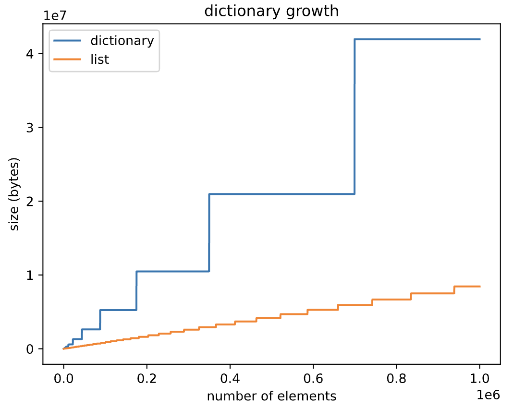
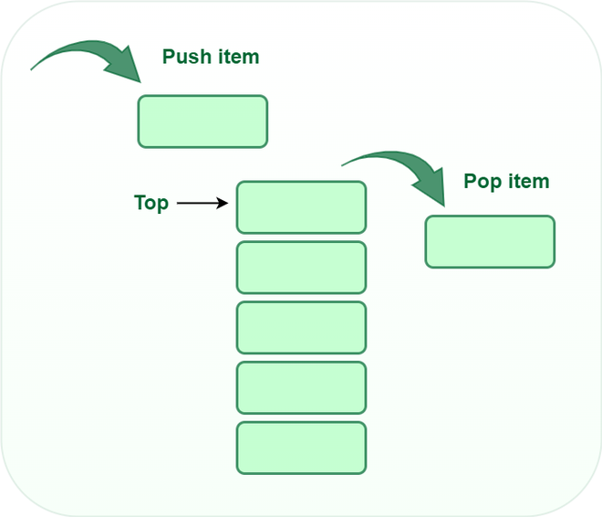
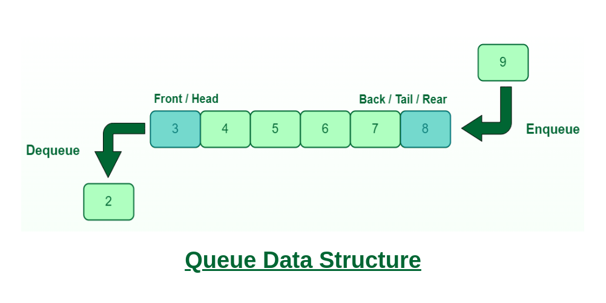
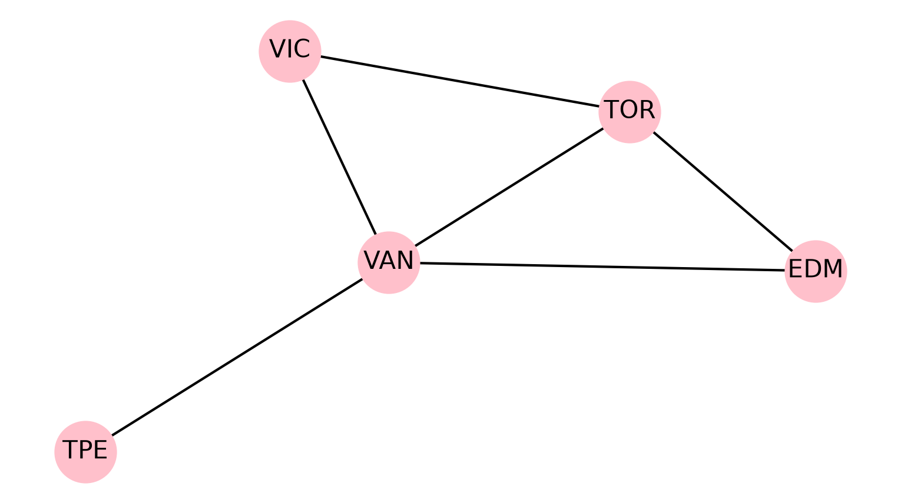
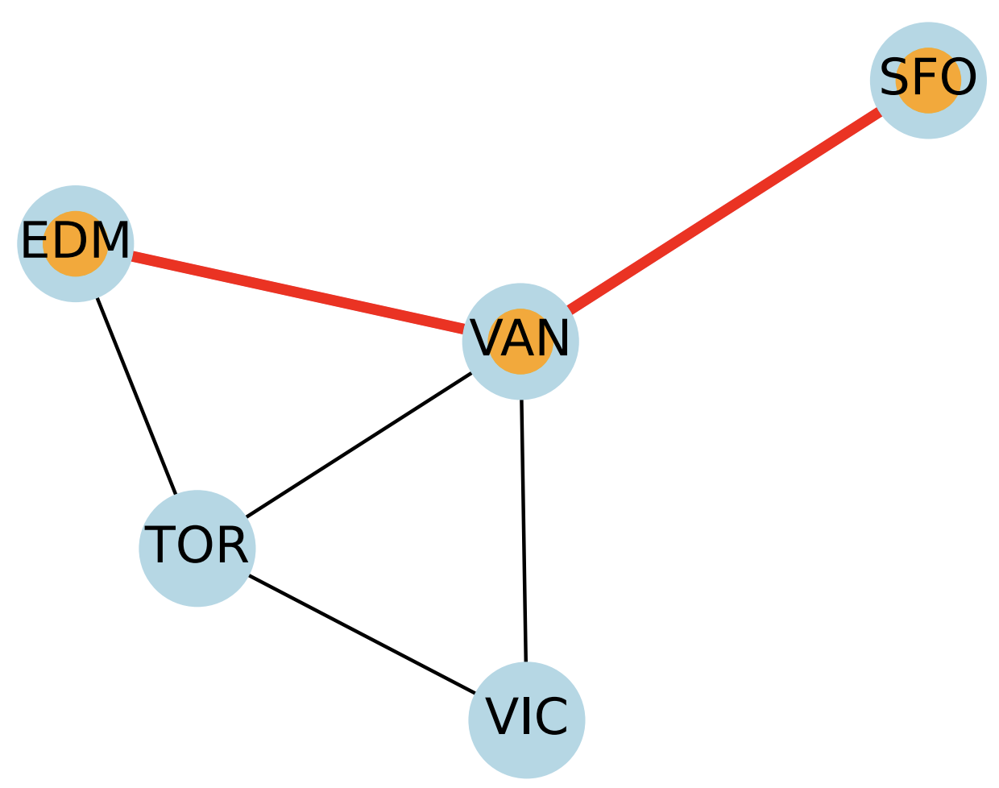
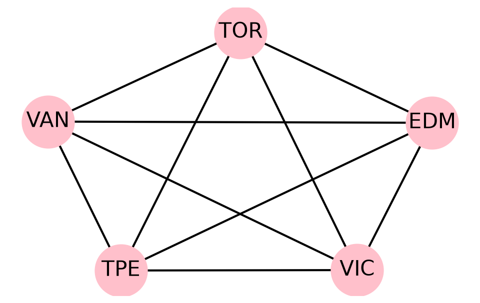
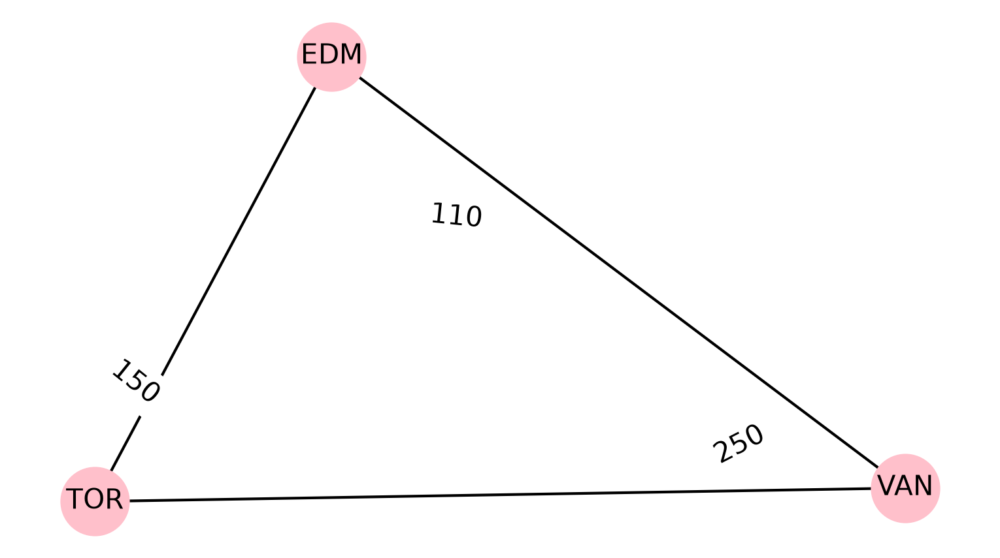
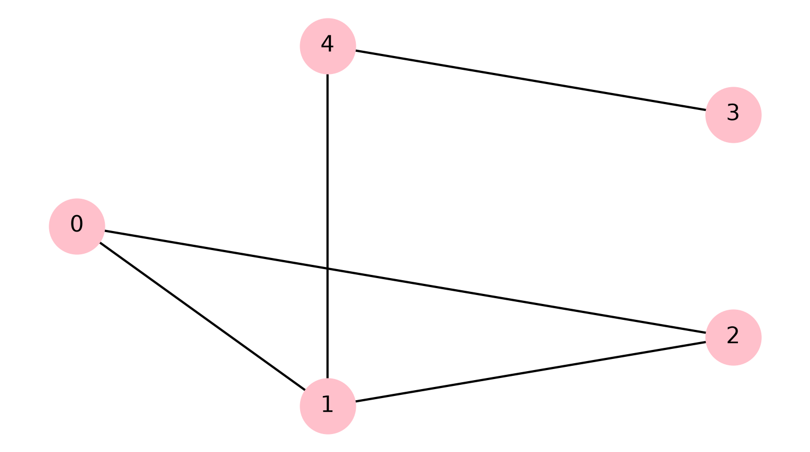

## Python `dict`

- It is similar to a `set` but with key-value pairs:
  - The entries are called "keys," and the associated data are the "values."
- Python `dict` is implemented using a hash table, so we have $O(1)$ operations like insertion, deletion, and lookup.
- Only the keys are hashed, so only the keys have to be hashable.

## Hash table growth and amortized cost

- Resizing occurs infrequently, and between resize events, insertions are very fast.
- The cost "averages out":
    - After adding $n$ elements, we spend $O(n)$ time on growth.
    - An average of $O(1)$ per insertion.

{fig-align="center" width="45%"}

## `dict` operations

```{pyodide}
# Adding an item
d = dict()
d[5] = "a"
d["b"] = 9
d
```

```{pyodide}
# Searching for an item in keys
print(5 in d)
print(9 in d)
```

```{pyodide}
# Attempting to use a mutable object (like a list) as a key will result in an error:
d[[1,2,3]] = 10
```

<!-- #### More examples of dictionary
```{pyodide}
# Iteration syntax
for key, val in d.items():
    print("key =", key, " val =", val)
```

```{pyodide}
# A dictionary can be a value inside another dictionary
g = dict()
g[5] = d
g
``` -->

## Introducing `defaultdict`
```{pyodide}
grades = {'Alice': 85, 'Bob': 90}
```

```{pyodide}
print(grades['Alice'])
```

```{pyodide}
print(grades['Charlie'])
```

::: {.incremental}
- {fig-align="left" width="80%"}
:::

## Introducing `defaultdict`

[`defaultdict`](https://docs.python.org/3/library/collections.html#defaultdict-objects) is a subclass of `dict` from the `collections` module that automatically handles missing keys.

```python
from collections import defaultdict
dd = defaultdict(default_factory)
```
- `default_factory` is a function that provides the default value for a missing key. Usually, it's a type like `list`, `int`, `set`, etc.

- When a key is missing, `defaultdict` calls `default_factory` to create a default value and inserts it into the dictionary

## Introducing `defaultdict`

```{.python code-line-numbers="1,2,3"}
from collections import defaultdict

counts = defaultdict(int)
for fruit in ['apple', 'banana', 'apple']:
    counts[fruit] += 1

print(counts)
```

## Introducing `defaultdict`

```{.python code-line-numbers="4,5"}
from collections import defaultdict

counts = defaultdict(int)
for fruit in ['apple', 'banana', 'apple']:
    counts[fruit] += 1

print(counts)
```

<!-- #### Introducing `defaultdict`

```{.python code-line-numbers="7"}
from collections import defaultdict

counts = defaultdict(int)
for fruit in ['apple', 'banana', 'apple']:
    counts[fruit] += 1

print(counts)
``` -->

## Introducing `defaultdict`

```{pyodide}
from collections import defaultdict

counts = defaultdict(int)
for fruit in ['apple', 'banana', 'apple']:
    counts[fruit] += 1

print(counts)
```

## Introducing `defaultdict`

```{pyodide}
groups = defaultdict(list)
pairs = [('a', 1), ('a', 2), ('b', 3)]
for key, val in pairs:
    groups[key].append(val)

print(groups)
```

```{pyodide}
print(type(grades))
print(type(counts))
```

<!-- #### Introducing `defaultdict`
- **Key take-aways**

    - `dict` is simple and you control all key creation.
    - `defaultdict` automatically initializes missing keys.
    - Use `defaultdict(int)` for counting, `defaultdict(list)` for grouping, and `defaultdict(set)` for collecting unique items.
 -->

# Task 3: undo and the upload queue {background-image="images/ig_otter_undo.png" background-size="contain" background-position="right" style="font-size: 0.8em;"}

::: footer
Image generated by OpenAI GPT-image-2.5-sunburst
:::

## Stack and Queue {style="font-size: 0.7em;"}

:::: {.columns}
::: {.column width="50%"}
### Stack: LIFO

*Last In, First Out*

{width="60%" fig-align="center"}

The photo editor's undo. Every edit is stacked on top, and undo takes off the most recent one.
:::
::: {.column width="50%"}
### Queue: FIFO

*First In, First Out*

{width="95%" fig-align="center"}

The upload queue. Your photo joins the back, and the server takes the one that has waited longest.
:::
::::

::: {.fragment}
Both add at the back. They differ only in **which end you take from**.
:::

::: {.notes}
- Stack: a pile of books. Queue: the line at a coffee shop.
- Ask: why is undo a stack? Undoing the oldest edit first would be nonsense.
- Ask: why is upload a queue? Fairness.
- Implementations, `deque` and exercises are in the bonus slides.
:::

```{python}
#| echo: false
# Hidden: replay ONE list of operations through a stack and through a queue, for
# the two step-through slides below. Every box, colour class and sentence is
# worked out here; OJS only draws.
ds_script = [("add", "📷1"), ("add", "📷2"), ("add", "📷3"), ("remove", None),
             ("add", "📷4"), ("remove", None), ("remove", None)]

def replay(kind):
    """One entry per click. kind is "stack" (take from the top) or "queue" (take from the front).
    Colour means the operation: "sq-in" (blue) = the item that just went in,
    "sq-out" (orange) = the item that just came out. Everything else stays grey."""
    items, out_so_far, steps = [], [], []
    for k in range(len(ds_script) + 1):
        op = added = removed = None
        if k > 0:
            op, item = ds_script[k - 1]
            if op == "add":
                items.append(item)              # both add at the same place: the top / the back
                added = item
            elif kind == "stack":
                removed = items.pop()           # LIFO: off the top
            else:
                removed = items.pop(0)          # FIFO: off the front
            if removed:
                out_so_far.append(removed)
        next_out = len(items) - 1 if kind == "stack" else 0
        # items in the container (stack: bottom to top, queue: front to back),
        # with a small "next out" tag on the one that leaves next
        tag = "◀ next out" if kind == "stack" else "▲ next out"
        boxes = [{"label": label, "cls": "sq-in" if label == added else "",
                  "tag": tag if i == next_out else ""}
                 for i, label in enumerate(items)]
        # the sentence under the buttons: a coloured verb, then what happened
        if k == 0:
            verb, verb_cls, say = "Start", "", f"The {kind} is empty."
        elif added:
            verb, verb_cls = "add", "add"
            if kind == "stack":
                say = f"{added} goes on the top."
            elif len(items) == 1:
                say = f"{added} joins an empty line, so it is at the front."
            else:
                say = f"{added} joins the back of the line."
        else:
            verb, verb_cls = "remove", "remove"
            say = (f"{removed} comes off the top. The newest item leaves first." if kind == "stack"
                   else f"{removed} leaves from the front. It has waited the longest.")
        steps.append({
            "count": f"Step {k} of {len(ds_script)}", "verb": verb, "verb_cls": verb_cls, "say": say,
            "boxes": boxes,
            "removed": removed or "",
            "removed_cls": "sq-out" if removed else "sq-empty",
            # the arrow at the end used this step lights up in its colour
            "add_cls": "on" if op == "add" else "",
            "remove_cls": "on" if op == "remove" else "",
            "out_so_far": list(out_so_far),
            # the script strip: blue chips add, orange chips remove; done, now or still to come
            "ops": [{"label": f"add {it}" if o == "add" else "remove",
                     "cls": f"{o} {'done' if j < k - 1 else 'now' if j == k - 1 else ''}"}
                    for j, (o, it) in enumerate(ds_script)],
        })
    return steps

ojs_define(stack_steps = replay("stack"), queue_steps = replay("queue"))
```

## How a stack works: last in, first out {style="font-size: 0.8em;"}

```{ojs}
//| echo: false
viewof stack_step = Inputs.button([
  ["Back", i => Math.max(i - 1, 0)],
  ["Next step", i => Math.min(i + 1, stack_steps.length - 1)],
  ["Start over", () => 0]
], {value: 0})
```

```{ojs}
//| echo: false
{
  // Draw only: every box, colour and sentence was computed in Python (stack_steps).
  const s = stack_steps[stack_step];
  const ops = s.ops.map(o => html`<div class="sq-op ${o.cls}">${o.label}</div>`);
  const boxes = s.boxes.map(b =>
    html`<div class="ds-box ${b.cls}">${b.label}<span class="sq-tag right">${b.tag}</span></div>`);
  const out = s.out_so_far.map(label => html`<div class="ds-box out">${label}</div>`);
  return html`<div class="sq-ops">${ops}</div>
    <div class="sq-say"><span class="sq-count">${s.count}</span>
      <span class="sq-verb ${s.verb_cls}">${s.verb}</span> ${s.say}</div>
    <div class="sq-stage">
      <div class="sq-lift">
        <div class="ds-box ${s.removed_cls}">${s.removed}</div>
        <div class="sq-ends">
          <span class="sq-arrow add ${s.add_cls}">⬇ add</span>
          <span class="sq-arrow remove ${s.remove_cls}">⬆ remove</span>
        </div>
        <div class="sq-stack">${boxes}</div>
        <div class="ds-caption">undo history</div>
      </div>
      <div class="sq-tray">
        <div class="ds-caption">came out, in order</div>
        <div class="ds-row center">${out.length ? out : html`<span class="ds-caption">nothing yet</span>`}</div>
      </div>
    </div>`;
}
```

::: {.notes}
- Ask them to predict each step before you click.
- Colour is the operation: blue is the item that just went in, orange is the item that just came out. Everything else is grey.
- Add and remove happen at the same end, the top: both arrows sit on the same opening. The newest item is always the next one out.
- Step 4: remove gives back 📷3, the newest. Remember that for the next slide.
- Step 7: 📷1 is still at the bottom. Keep adding and it could wait forever: that is starvation, and why upload servers use queues.
- In code, add is `push` and remove is `pop`.
:::

## How a queue works: first in, first out {style="font-size: 0.8em;"}

```{ojs}
//| echo: false
viewof queue_step = Inputs.button([
  ["Back", i => Math.max(i - 1, 0)],
  ["Next step", i => Math.min(i + 1, queue_steps.length - 1)],
  ["Start over", () => 0]
], {value: 0})
```

```{ojs}
//| echo: false
{
  // Draw only: every box, colour and sentence was computed in Python (queue_steps).
  const s = queue_steps[queue_step];
  const ops = s.ops.map(o => html`<div class="sq-op ${o.cls}">${o.label}</div>`);
  const boxes = s.boxes.map(b =>
    html`<div class="ds-box ${b.cls}">${b.label}<span class="sq-tag below">${b.tag}</span></div>`);
  const out = s.out_so_far.map(label => html`<div class="ds-box out">${label}</div>`);
  return html`<div class="sq-ops">${ops}</div>
    <div class="sq-say"><span class="sq-count">${s.count}</span>
      <span class="sq-verb ${s.verb_cls}">${s.verb}</span> ${s.say}</div>
    <div class="sq-line">
      <div class="sq-exit"><div class="ds-box ${s.removed_cls}">${s.removed}</div></div>
      <span class="sq-arrow remove ${s.remove_cls}">⬅ remove<br><small>front</small></span>
      <div class="sq-queue">${boxes}</div>
      <span class="sq-arrow add ${s.add_cls}">⬅ add<br><small>back</small></span>
    </div>
    <div class="ds-caption">upload queue</div>
    <div class="sq-tray">
      <div class="ds-caption">came out, in order</div>
      <div class="ds-row center">${out.length ? out : html`<span class="ds-caption">nothing yet</span>`}</div>
    </div>`;
}
```

::: {.notes}
- Same seven steps and same colours as the stack slide: blue went in, orange came out.
- Add at the back, remove from the front: the two arrows are on opposite ends.
- Step 4: the queue gives back 📷1, the stack gave back 📷3. Same input, different answer.
- Look at "came out, in order": 📷1, 📷2, 📷3, exactly the order they arrived. That is FIFO, and it is fair.
:::

## Stack and queue cheat sheet {style="font-size: 0.7em;"}

| structure | insert | delete | search | use it when |
|---|---|---|---|---|
| `Stack` (LIFO) | $O(1)$ push | $O(1)$ pop | $O(n)$ | most recent first: undo, back button |
| `Queue` (FIFO) | $O(1)$ push | $O(1)$ with `deque` | $O(n)$ | fairest first: job queues, BFS |

::: {.notes}
- These two rows belong with the data structure table from last lecture, so photograph them together.
:::

## Outline

- Graphs intro
- Graph types
- Graph representations
- Sparse Matrices

## Learning Objectives

By the end of this lecture, you will be able to:

- Map real-world problems to various kinds of graphs (directed/undirected, weighted/unweighted).
- Convert between adjacency matrices and their corresponding graphs.
- Manipulate scipy sparse matrix objects in Python.
- Analyze the space complexity of sparse and dense matrix representations.
- Appropriately use row-wise vs. column-wise sparse matrices.

## Introduction to graphs
- A graph is a data structure to model relationships between entities.

::: {.notes}
- Graphs are more general than the trees we studied earlier, as they allow for a broader range of connections and structures.
- Unlike trees, which have a hierarchical form, graphs can represent any set of relationships, including cyclic and non-hierarchical ones.
:::

<!-- :::{.columns}
::: {.column width="60%"}
- A graph $G=(V,E)$ is a set of vertices $V$ and edges $E$ where each edge $(u,v)$ connects a pair of vertices $u,v \in V$
    - $V$: is a set of vertices or nodes.
    - $E$: is a set of edges.
:::
::: {.column width="40%"}
 {width="130"}
:::
::: -->
More formally:

- A graph $G=(V,E)$ is a set of vertices $V$ and edges $E$ where each edge $(u,v)$ connects a pair of vertices $u,v \in V$
    - $V$: is a set of vertices or nodes.
    - $E$: is a set of edges.

{fig-align="center" width="50%"}

## Introduction to graphs
- Many Types of Data are Graphs

{fig-align="center" width="90%"}

## Introduction to graphs
- Many Types of Data are Graphs

{fig-align="center" width="90%"}

## Introduction to graphs

- Another example: cities are nodes and flights are edges connecting cities
{width=70% fig-align="center"}

## Graph terminology
- Vertices $u$ and $v$ are **neighbors** if there is an edge $(u,v)$ between them.
- The **degree** of a vertex: the number of edges connected to that vertex.
- A **<span style="color:red;">path</span>** is a sequence of edges that connect a sequence of distinct nodes.
- A **cycle** is a path with the same start and end node, and all other nodes are distinct.

{fig-align="center" width="40%"}

## Graph terminology

- A graph is **connected** if there exists a path between every pair of nodes.
- A graph is **disconnected** if at least one pair of nodes does not have a path connecting them.

{fig-align="center" width="80%"}

## Complete graph

- A graph is **complete** if every pair of vertices is connected by an edge.

{width=70% fig-align="center"}

::: incremental
- What is the degree of vertex "VAN" above?
- In a complete graph with $n$ node, each node has a degree of $n−1$.
:::

## Undirected vs directed graph

- **Undirected**:
  - Relationships between entities are **bidirectional** or **symmetric**.
  - If there is a connection from A to B, the reverse connection also holds.
  - Example: Facebook.

- **Directed**:
  - The relationship between entities is **directional** or **asymmetric**.
  - Example: Twitter.
  - Directed graphs can also have **self-connections**.
    - Example: Markov chain.

## Example: twitter follower relationship
{width=70% fig-align="center"}

## Unweighted vs weighted graph

- **Unweighted**:
  - All edges are considered equal.
  - An edge simply indicates whether a relationship exists between two nodes.
  - Example: a friendship network.

- **Weighted**:
  - Each edge is assigned a numerical value or weight.
  - Example: A transportation network where the weights represent the cost or distance between two cities.
- More detailed modeling of relationships and are useful for problems involving optimization.

## Example: the cost to fly between two airports
{width=70% fig-align="center"}

## `networkx`: a Python library for complex networks

-  Creating an undirected Graph:

```{.python code-line-numbers="1,"}
G = nx.Graph()
G.add_node("VAN") # Vancouver
G.add_node("TOR") # Toronto
G.add_edge("VAN", "TOR") # Add edges
nx.draw(G, nx.shell_layout(G), **draw_params) # Draw the graph
```

## `networkx`: a Python library for complex networks

-  Creating an undirected Graph:

```{.python code-line-numbers="2,3"}
G = nx.Graph()
G.add_node("VAN") # Vancouver
G.add_node("TOR") # Toronto
G.add_edge("VAN", "TOR") # Add edges
nx.draw(G, nx.shell_layout(G), **draw_params) # Draw the graph
```

## `networkx`: a Python library for complex networks

-  Creating an undirected Graph:

```{.python code-line-numbers="4"}
G = nx.Graph()
G.add_node("VAN") # Vancouver
G.add_node("TOR") # Toronto
G.add_edge("VAN", "TOR") # Add edges
nx.draw(G, nx.shell_layout(G), **draw_params) # Draw the graph
```

## `networkx`: a Python library for complex networks

-  Creating an undirected Graph:

```{.python code-line-numbers="5"}
G = nx.Graph()
G.add_node("VAN") # Vancouver
G.add_node("TOR") # Toronto
G.add_edge("VAN", "TOR") # Add edges
nx.draw(G, nx.shell_layout(G), **draw_params) # Draw the graph
```

## `networkx`: a Python library for complex networks

-  Creating an undirected Graph:

{width=70% fig-align="center"}

## `networkx`: a Python library for complex networks

-  Creating a directed graph with `DiGraph()`

```python
G = nx.DiGraph()
G.add_node("VAN")
G.add_node("TOR")
G.add_edge("VAN", "TOR") # Add directional edges
nx.draw(G, nx.shell_layout(G), **draw_params)
```

{width=70% fig-align="center"}

## Adding weights to edges

```python
G = nx.Graph()

G.add_node("VAN")
G.add_node("EDM")
G.add_node("TOR")

G.add_edge("VAN", "EDM", weight=110)
G.add_edge("VAN", "TOR", weight=250)
G.add_edge("TOR", "EDM", weight=150)

nx.draw(G, nx.spring_layout(G), **draw_params)
labels = nx.get_edge_attributes(G, 'weight')
nx.draw_networkx_edge_labels(G, nx.spring_layout(G), edge_labels=labels, font_size=20)
```

## Adding weights to edges

{width=70% fig-align="center"}

## Graph representations

- How to represent a graph $G=(V,E)$ more efficiently?

-  **Adjacency matrix representation**
    - Supppose the vertices are numbered $1,2,\dots,|V|$ in some arbitrary manner.
    - The adjacency matrix $A$ is a $|V| \times |V|$ matrix such that
    $$a_{i,j} =
    \begin{cases}
    1,\ \text{if } (i,j) \in E \\
    0,\ \text{otherwise}.
    \end{cases}$$

- **Adjacency list representation**
    - For each vertex $u$, we maintain an adjacency list contains all the vertices $v$ such that there is an edge $(u,v)\in E$.

## Example graph
{width=70% fig-align="center"}

```{pyodide}
import scipy
import networkx as nx
G4 = nx.bull_graph()
adj = nx.adjacency_matrix(G4).toarray()
print(adj)
```

```{pyodide}
adj_list_dict = {node: list(neighbors) for node, neighbors in G4.adjacency()}
print(adj_list_dict)
```

## Exercise
{width=70% fig-align="center"}

```{pyodide}
import scipy
import networkx as nx
G4 = nx.bull_graph()
adj = nx.adjacency_matrix(G4).toarray()
print(adj)
```

```{pyodide}
adj_list_dict = {node: list(neighbors) for node, neighbors in G4.adjacency()}
print(adj_list_dict)
```

## Question

::: incremental
- What is the space complexity of an adjacency matrix, in terms of $|V|$, the number of vertices, and $|E|$, the number of edges?
- Answer: $O(|V|^2)$.
:::

## Question

::: incremental
- What is the space complexity of an adjacency list, in terms of $|V|$ and $|E|$?
- Answer: $O(|E| + |V|)$.
:::

## Comparing two representations

::: incremental
- Adjacency matrix
  - Straightforward and intuitive representation
  - Space complexity: $O(|V|^2)$.
  - Lookup time (checking if any two nodes are connected): $O(1)$ (why?).

- Adjacency list
  - A compact representation
  - Space complexity: $O(|V|+|E|)$.
  - Lookup time: $O(|V|)$ (why?).
:::

## Question

::: incremental
- If $|E|$ is much less than $|V^2|$, which representation is better  in terms of space complexity?
  - **Answer**: the adjacency list is more efficient in this case.
:::

## Question

- Can we have lookup speed of the adjacency matrix and the storage efficiency of the adjacency list?
    - Sparse matrices!!!
    - In fact, `networkx` uses sparse matrix to store the adjacency matrix:

. . .

```{pyodide}
am_matrix = nx.adjacency_matrix(G4)
type(am_matrix)
```

## Introduction to sparse matrices

- Sparse matrices are matrices with most of its elements being $0$.
- In CS, sparse matrix is a data structure to efficiently store and manipulate large datasets with mostly zero values.

## Sparse datasets come up a lot in practice.

- **Social networks**: Most users are not connected, leading to many zeros in the graph adjacency matrix.
- **Word counts**: Documents can be represented by the words they contain, but typically, only a small subset of all possible words appear in a given document.
- **Ratings**: We might represent an Amazon item by user ratings, but only a small fraction of users rate any particular item.
- And many other cases.

::: {.notes}
Ask if anyone wants to share?
:::

## `scipy.sparse`

- `scipy.sparse` provides the standard Python implementation for sparse matrices.

- Example

```{pyodide}
from scipy.sparse import csr_matrix, csc_matrix, lil_matrix, coo_matrix
import numpy as np
dense_matrix = np.array([
    [1, 0, 0, 0],
    [0, 0, 2, 0],
    [0, 3, 0, 0],
    [0, 0, 0, 4]
])
# Convert the dense matrix to a sparse matrix
csr = csr_matrix(dense_matrix)
print(csr)
```

- Example
```{pyodide}
# We can convert a scipy sparse matrix back to a numpy array.
print(csr.toarray())
```

## A bigger sparse matrix

- Suppose we have a 100000 by 100000 matrix:
  - A dense matrix would take up 100000 * 100000 * 8 / 1e9 = 80 GB.
  - A sparse matrix with 1000000 non-zero elements would take only 1000000 * 8 * 3 / 1e6 = 24 MB.

- That is why we don't want to store the full matrix with many zeros.

## Basic `scipy.sparse` operations

```{pyodide}
print(csr.shape)
print(csr.nnz)  # non-zero elements of the matrix
print(np.sum(csr, axis = 0))  # regular numpy functions work on sparse matrices
print(csr.data)
```

. . .

- Regular numpy functions work on sparse matrices, although they might be fast/slow depending on various factors.

## Building sparse matrices

To create an empty sparse martrix, we just need to provide the shape.

```{pyodide}
from scipy.sparse import csr_matrix, csc_matrix, lil_matrix

x = csr_matrix((10,10))
x.shape
```

## Sparse matrix representations

- CSR: Compressed Sparse Row array

```{pyodide}
x = csr_matrix(dense_matrix)
print(x.data)
print(x.indices)
print(x.indptr)
```

::: {.notes}
  - We store an adjacency list per row
  - So if we want Row 4, we just grab it right away.
:::

- CSC: Compressed Sparse Column array

```{pyodide}
x = csc_matrix(dense_matrix)
print(x.data)
print(x.indices)
print(x.indptr)
```

- We need to chooose the appropriate format for different operations.

## Rows versus columns operations

| Feature               | CSR                          | CSC                          |
|----------------------|------------------------------|------------------------------|
| Storage Arrays       | Values, Column Indices, Row Pointers | Values, Row Indices, Column Pointers |
| Optimized For        | Row operations               | Column operations             |
| Access Pattern       | Fast row slicing             | Fast column slicing           |
| Use Cases            | Matrix-vector multiplication, row-wise operations | Column-wise computations, matrix factorization |

::: {.notes}
CSR (Compressed Sparse Row) and CSC (Compressed Sparse Column) are two common formats for storing sparse matrices.
:::

## Don't use CSR matrices for operations which require looping over columns

```python
from scipy.sparse import csr_matrix
n = 10000
dense_matrix = np.random.rand(n, n)
mask = np.random.rand(n, n) < 0.01
sparse_matrix = dense_matrix * mask
csr = csr_matrix(sparse_matrix)
```

```python
%%timeit -r1 -n1

for i in range(n):
    csr[i,:]
```

<br>

```python
%%timeit -r1 -n1

for i in range(n):
  csr[:,i]
```

## We should avoid looping directly through sparse matrices in general

- Loping through the rows of a csr matrix is fine.
- Looping through the columns of a csr matrix can be disaster (why?).
  - If we want to get elements from column 1, we have to iterate through every row and check if there’s an element in column 1!
  - Convert to CSC format instead:

. . .

```python
csc = csr.tocsc()
```

::: {.notes}
- Because it is stored row by row.
- To grab a single column, it needs to loop through each row and look for items in that column.
:::

## `Numpy` Matrix vs. Array

- When we do an operation on sparse matrix that removes one of the dimensions, you actually don't have a sparse matrix anymore:

. . .

```{pyodide}
from scipy.sparse import csr_matrix
x = csr_matrix([[1, 0, 0], [0, 0, 3], [0, 0, 0]])
sum_x = x.sum(axis=0)

sum_x
```

. . .

- Surprisingly, we get a numpy matrix, not numpy array!

## Matrix vs. Array

::: incremental
- See [the official document](https://numpy.org/devdocs/user/numpy-for-matlab-users.html#array-or-matrix-which-should-i-use).
- TL;DR: we shoud covert to numpy array using `np.asarray`.
:::

. . .

```{pyodide}
np.asarray(sum_x)
```

## Note: Indexing
- With a regular numpy array, `x[i,j]` and `x[i][j]` are equivalent:

```{pyodide}
x = np.random.rand(10,10)
print(x[1, 2])
print(x[1][2])
```

## Indexing a sparse matrix:

```{pyodide}
from scipy.sparse import csr_matrix
x_sparse = csr_matrix(x)
x_sparse[1, 2]
# x_sparse[1][2]
# x_sparse[1]
```

- The sparse matrix returns a different shape.
- This is because sparse matrices must always be 2d (same problem as non-sparse matrices)
- In general, use the `x[1,2]` notation when possible because chaining the `[]` can be problematic in several places (e.g., also pandas).

# Questions?

## {background-image="images/move_u.jpg" background-size="contain" background-position="center"}

# (Bonus Slide) Stacks in detail {background-image="images/ig_otter_undo.png" background-size="contain" background-position="right" style="font-size: 0.8em;"}

::: footer
Image generated by OpenAI GPT-image-2.5-sunburst
:::

## (Bonus Slide) Stacks {style="font-size: 0.85em;"}

- A stack is a data structure that allows us to insert items and retrieve them later using the **Last In, First Out** (LIFO) principle.
  - Example: Think of it like a stack of books, where the last book placed on top is the first one to be removed.

{width=280 fig-align="center"}

::: {.notes}
- Push = put one on top, pop = take the top one off.
:::

## (Bonus Slide) Where you already use a stack {style="font-size: 0.85em;"}

::: {.incremental}
- Instagram's photo editor: every edit is pushed; Undo pops the most recent one.
- `Ctrl+Z` / `Cmd+Z` in every app you own.
- Your browser's Back button: the last page you visited is the first you go back to.
- `{ }` `( )` `[ ]`: how your editor knows a bracket is unmatched.
:::

::: {.fragment}
Coming up in this course: the call stack (lecture 5, recursion) and depth-first search (lecture 4).
:::

::: {.notes}
- Ask which of these they used today.
:::

```{python}
#| echo: false
# Hidden: replay a short editing session for the interactive on the next slide.
# The stack after every step is computed here; OJS only draws the boxes.
editor_script = [("edit", "crop"), ("edit", "Clarendon"), ("edit", "bright +20"),
                 ("undo", None), ("edit", "sticker"), ("edit", "caption"),
                 ("undo", None), ("undo", None)]

edit_stack, undo_steps = [], [{"k": 0, "action": "open the photo", "stack": [],
                               "removed": None, "note": "nothing to undo yet"}]
for k, (action, label) in enumerate(editor_script, start=1):
    if action == "edit":
        edit_stack.append(label)
        undo_steps.append({"k": k, "action": f"apply {label}", "stack": list(edit_stack),
                           "removed": None, "note": f"pushed '{label}' on top"})
    else:
        removed = edit_stack.pop()
        undo_steps.append({"k": k, "action": "press undo", "stack": list(edit_stack),
                           "removed": removed, "note": f"popped '{removed}', the most recent edit"})

# the caption under the boxes, written here so OJS only prints it
for s_ in undo_steps:
    s_["caption"] = ("orange = top of the stack (the next thing undo removes)"
                     if s_["stack"] else "the stack is empty")
ojs_define(undo_steps = undo_steps)
```

## (Bonus Slide) Step through an editing session {style="font-size: 0.8em;"}

```{ojs}
//| echo: false
viewof step = Inputs.range([0, undo_steps.length - 1], {step: 1, value: 0, label: "step"})
```

```{ojs}
//| echo: false
{
  const s = undo_steps[step];                    // the stack at this step, computed in Python
  return html`<div class="ojs-readout">Step ${s.k}: ${s.action}, ${s.note}</div>`;
}
```

```{ojs}
//| echo: false
{
  // Draw only: the boxes below were computed in Python (undo_steps).
  const s = undo_steps[step];
  const boxes = s.stack.map((label, i) =>
    html`<div class="ds-box ${i === s.stack.length - 1 ? "end" : ""}">${label}</div>`);
  const popped = s.removed ? html`<div class="ds-box out">${s.removed} ↩︎</div>` : "";
  return html`<div class="ds-col">${boxes}</div>
    <div class="ds-caption">${s.caption} ${popped}</div>`;
}
```

::: {.notes}
- At step 4 undo removes `bright +20`, not `crop`.
- Ask: time of one undo? O(1), you only touch the top.
:::

## (Bonus Slide) Stack implementation using a `list` {style="font-size: 0.8em;"}

```{.python}
class Stack:
    def __init__(self):
        self.data = list()

    def push(self, item):
        self.data.append(item)

    def pop(self):
        return self.data.pop()

    def isEmpty(self):
        return len(self.data) == 0

    def __str__(self):
        return self.data.__str__()
```

## (Bonus Slide) Stack implementation using a `list` {style="font-size: 0.8em;"}

- Start empty

```{.python code-line-numbers="1,2,3"}
class Stack:
    def __init__(self):
        self.data = list()

    def push(self, item):
        self.data.append(item)

    def pop(self):
        return self.data.pop()

    def isEmpty(self):
        return len(self.data) == 0

    def __str__(self):
        return self.data.__str__()
```

## (Bonus Slide) Stack implementation using a `list` {style="font-size: 0.8em;"}

- `push`: add to the **end** of the list, that end is the "top"

```{.python code-line-numbers="5,6"}
class Stack:
    def __init__(self):
        self.data = list()

    def push(self, item):
        self.data.append(item)

    def pop(self):
        return self.data.pop()

    def isEmpty(self):
        return len(self.data) == 0

    def __str__(self):
        return self.data.__str__()
```

::: {.notes}
- `append` adds at the end and is O(1), no other element has to move.
:::

## (Bonus Slide) Stack implementation using a `list` {style="font-size: 0.8em;"}

- `pop`: take from the **same end**. Last in, first out.

```{.python code-line-numbers="8,9"}
class Stack:
    def __init__(self):
        self.data = list()

    def push(self, item):
        self.data.append(item)

    def pop(self):
        return self.data.pop()

    def isEmpty(self):
        return len(self.data) == 0

    def __str__(self):
        return self.data.__str__()
```

::: {.notes}
- `list.pop()` with no argument removes the last element, also O(1). Remember this: the queue version is not so lucky.
:::

## (Bonus Slide) Stack implementation using a `list` {style="font-size: 0.8em;"}

- `isEmpty`: is there anything left to undo?

```{.python code-line-numbers="11,12"}
class Stack:
    def __init__(self):
        self.data = list()

    def push(self, item):
        self.data.append(item)

    def pop(self):
        return self.data.pop()

    def isEmpty(self):
        return len(self.data) == 0

    def __str__(self):
        return self.data.__str__()
```

::: {.notes}
- This is what greys out the undo button in the app.
:::

## (Bonus Slide) Stack implementation using a `list` {style="font-size: 0.8em;"}

- `__str__`: how it prints

```{.python code-line-numbers="14,15"}
class Stack:
    def __init__(self):
        self.data = list()

    def push(self, item):
        self.data.append(item)

    def pop(self):
        return self.data.pop()

    def isEmpty(self):
        return len(self.data) == 0

    def __str__(self):
        return self.data.__str__()
```

## (Bonus Slide) Try it yourself {style="font-size: 0.8em;"}

```{pyodide}
class Stack:
    def __init__(self):
        self.data = list()

    def push(self, item):
        self.data.append(item)

    def pop(self):
        return self.data.pop()

    def isEmpty(self):
        return len(self.data) == 0

    def __str__(self):
        return self.data.__str__()
```

## (Bonus Slide) Stack operations {style="font-size: 0.85em;"}

```{pyodide}
# The photo editor's undo history:
edits = Stack()
edits.push("crop")
print(edits)
```

. . .

```{pyodide}
edits.push("Clarendon")
print(edits)
```

. . .

```{pyodide}
# Press undo: the most recent edit comes off
edits.pop()
print(edits)
```

::: {.notes}
- Get them to predict the printout before each cell runs.
:::

## (Bonus Slide) Exercise {style="font-size: 0.85em;"}

If a stack contains `n` items, what is the time complexity to retrieve the bottom item?

A: $O(1)$ <br>
B: $O(n)$ <br>
C: $O(\log n)$ <br>
D: $O(n^2)$

::: {.incremental}

- Answer: $O(n)$
- To retrieve the bottom item, we would have to pop all the elements above it.

:::

::: {.notes}
- Editor terms: press undo n times to get back to the original photo.
- A stack is O(1) only for what it is designed for. Pick the structure for the operation you do most.
:::

# (Bonus Slide) Queues in detail {background-image="images/ig_otter_queue.png" background-size="contain" background-position="right" style="font-size: 0.8em;"}

::: footer
Image generated by OpenAI GPT-image-2.5-sunburst
:::

## (Bonus Slide) Queues {style="font-size: 0.85em;"}

- A queue is a data structure that operates on the **First In, First Out** (FIFO) principle.
  - Example: waiting in line, people are served in the order they arrive.

<br>

{width=460 fig-align="center"}

::: {.notes}
- Queue is British English for line-up.
:::

## (Bonus Slide) Where you already use a queue {style="font-size: 0.85em;"}

::: {.incremental}
- You tap Share. Your photo joins Instagram's processing queue: resize, compress, make thumbnails. First uploaded, first processed.
- Printer jobs: the department printer serves documents in the order they arrive.
- Customer support tickets, and the "you are number 7 in line" message.
- The "play next" queue in your music app.
:::

::: {.fragment}
Coming up in this course: breadth-first search (lecture 4) is a queue in a trench coat.
:::

::: {.notes}
- Ask: queue or stack for Instagram uploads? Then ask why: fairness is a real engineering requirement.
:::

## (Bonus Slide) Queue implementation using a `list` {style="font-size: 0.8em;"}

```{.python}
class Queue:
    def __init__(self):
        self.data = list()

    def push(self, item):
        self.data.append(item)

    def pop(self):
        return self.data.pop(0)

    def isEmpty(self):
        return len(self.data) == 0

    def __str__(self):
        return self.data.__str__()
```

## (Bonus Slide) Queue implementation using a `list` {style="font-size: 0.8em;"}

- Start empty

```{.python code-line-numbers="1,2,3"}
class Queue:
    def __init__(self):
        self.data = list()

    def push(self, item):
        self.data.append(item)

    def pop(self):
        return self.data.pop(0)

    def isEmpty(self):
        return len(self.data) == 0

    def __str__(self):
        return self.data.__str__()
```

## (Bonus Slide) Queue implementation using a `list` {style="font-size: 0.8em;"}

- `push` (enqueue): join the **back** of the line, identical to the stack

```{.python code-line-numbers="5,6"}
class Queue:
    def __init__(self):
        self.data = list()

    def push(self, item):
        self.data.append(item)

    def pop(self):
        return self.data.pop(0)

    def isEmpty(self):
        return len(self.data) == 0

    def __str__(self):
        return self.data.__str__()
```

## (Bonus Slide) Queue implementation using a `list` {style="font-size: 0.8em;"}

- `pop` (dequeue): leave from the **front**. `pop(0)` is the only line that differs from `Stack`!

```{.python code-line-numbers="8,9"}
class Queue:
    def __init__(self):
        self.data = list()

    def push(self, item):
        self.data.append(item)

    def pop(self):
        return self.data.pop(0)

    def isEmpty(self):
        return len(self.data) == 0

    def __str__(self):
        return self.data.__str__()
```

::: {.notes}
- Make them find the one character that differs from `Stack`.
- ⚠️ `pop(0)` is secretly slow. Measured at the end of this section.
:::

## (Bonus Slide) Queue implementation using a `list` {style="font-size: 0.8em;"}

- `isEmpty`: anything left to process?

```{.python code-line-numbers="11,12"}
class Queue:
    def __init__(self):
        self.data = list()

    def push(self, item):
        self.data.append(item)

    def pop(self):
        return self.data.pop(0)

    def isEmpty(self):
        return len(self.data) == 0

    def __str__(self):
        return self.data.__str__()
```

## (Bonus Slide) Queue implementation using a `list` {style="font-size: 0.8em;"}

- `__str__`: how it prints

```{.python code-line-numbers="14,15"}
class Queue:
    def __init__(self):
        self.data = list()

    def push(self, item):
        self.data.append(item)

    def pop(self):
        return self.data.pop(0)

    def isEmpty(self):
        return len(self.data) == 0

    def __str__(self):
        return self.data.__str__()
```

## (Bonus Slide) Try it yourself {style="font-size: 0.8em;"}

```{pyodide}
class Queue:
    def __init__(self):
        self.data = list()

    def push(self, item):
        self.data.append(item)

    def pop(self):
        return self.data.pop(0)

    def isEmpty(self):
        return len(self.data) == 0

    def __str__(self):
        return self.data.__str__()
```

## (Bonus Slide) Queue operations {style="font-size: 0.85em;"}

```{pyodide}
# Photos waiting to be processed (enqueue)
uploads = Queue()
uploads.push("beach.jpg")
print(uploads)
```

. . .

```{pyodide}
uploads.push("otter.jpg")
print(uploads)
```
. . .

```{pyodide}
# The server takes the next job (dequeue): the one that has waited longest
uploads.pop()
print(uploads)
```

::: {.notes}
- With a Stack, `otter.jpg` would have jumped the line.
:::

## (Bonus Slide) Exercise {style="font-size: 0.85em;"}

If we have a queue `[A, B, C, D]` with `A` at the head of the queue, what will the queue look like after the following operations:

- push `E` onto the queue
- push `F` onto the queue
- remove one item from the queue
- push `A` onto the queue

::: {.incremental}

- Answer: `[B, C, D, E, F, A]`

:::

::: {.notes}
- Watch for: "remove one item" takes A off the front, not F off the back.
- A can rejoin at the back: queues allow duplicates.
:::


```{python}
#| echo: false
# Hidden: measure how long it really takes to remove from the FRONT of a
# 100,000-item list vs. a deque. Fastest of 5 repeats; noise only makes it slower.
import timeit

queue_size = 100_000
bench_setup = f"from collections import deque\nL = list(range({queue_size}))\nD = deque(range({queue_size}))"

def per_call(stmt, number=1_000):
    return min(timeit.repeat(stmt, setup=bench_setup, number=number, repeat=5)) / number

deque_rows = [{"how": "list.pop(0)", "kind": "O(n)",
               "ns": per_call("L.pop(0); L.append(0)") * 1e9},
              {"how": "deque.popleft()", "kind": "O(1)",
               "ns": per_call("D.popleft(); D.append(0)") * 1e9}]
for row in deque_rows:
    row["bar_label"] = f"{row['ns']:,.0f} ns  ({row['kind']})"

ratio = round(deque_rows[0]["ns"] / deque_rows[1]["ns"])
deque_chart = {
    "rows": deque_rows,
    "order": [row["how"] for row in deque_rows],           # bar order
    "kinds": [row["kind"] for row in deque_rows],           # legend / colour order
    # bars start at 1 ns, not 0: a log axis has no zero
    "x_domain": [1, max(row["ns"] for row in deque_rows) * 1.2],
    "n_label": f"{queue_size:,}",
    "ratio_label": f"{ratio:,}",
}
ojs_define(deque_chart = deque_chart)
```

## (Bonus Slide) ⚠️ Our `Queue` is secretly slow {style="font-size: 0.8em;"}

`list.pop(0)` removes the front item, and then **shifts every remaining item one place left**. That is $O(n)$, not $O(1)$.

```{ojs}
//| echo: false
// Draw only: both timings were measured in Python (deque_chart).
{
  const rows = deque_chart.rows;
  return Plot.plot({
    width: 820, height: 210, marginLeft: 160, marginRight: 170, marginTop: 20, marginBottom: 46,
    style: {fontSize: "16px", background: "transparent"},
    // bars start at 1 ns, not 0: a log axis has no zero
    x: {type: "log", label: "nanoseconds to remove one item (log scale) →",
        labelAnchor: "center", grid: true, domain: deque_chart.x_domain},
    y: {label: null, domain: deque_chart.order},
    color: {domain: deque_chart.kinds, range: ["#eb6834", "#2a78d6"], legend: true, swatchSize: 16},
    marks: [
      Plot.barX(rows, {y: "how", x1: 1, x2: "ns", fill: "kind", rx: 4}),
      Plot.text(rows, {y: "how", x: "ns", text: "bar_label",
                       dx: 8, textAnchor: "start", fontWeight: "bold"})
    ]
  });
}
```

```{ojs}
//| echo: false
{
  // Print only: every number below was computed in Python (deque_chart).
  const d = deque_chart;
  return html`<div class="ojs-readout">With ${d.n_label} photos waiting,
    <span class="match">list.pop(0)</span> is about <b>${d.ratio_label}×</b> slower than
    <span class="notify">deque.popleft()</span>.</div>`;
}
```

::: {.fragment}
In real code, use `collections.deque`:

```{pyodide}
from collections import deque

upload_queue = deque()
upload_queue.append("beach.jpg")    # join the back: O(1)
upload_queue.append("otter.jpg")
print(upload_queue.popleft())       # leave the front: O(1)
```
:::

::: {.notes}
- A list is a row of slots: remove slot 0 and everything slides down one.
- `deque` is pronounced "deck", short for double-ended queue.
- Our `Queue` class is for learning FIFO. Don't ship it.
:::

# (Bonus Slide) How your editor spots a missing bracket {style="font-size: 0.8em;"}

## (Bonus Slide) The problem {style="font-size: 0.85em;"}

Which of these is balanced?

```{.python}
caption = "([{}])"     # ?
caption = "([)]"       # ?
```

::: {.fragment}
Reading left to right, the bracket you close must be the most recent one you opened.

Most recent first, that is a **stack**.
:::

::: {.notes}
- Let them answer by eye, then ask how they decided: they are already running the stack in their head.
- `"([)]"`: every bracket has a partner, but the pairs cross.
:::

## (Bonus Slide) Ten lines with a `Stack` {style="font-size: 0.75em;"}

```{pyodide}
pairs = {")": "(", "]": "[", "}": "{"}

def is_balanced(text):
    waiting = Stack()                     # brackets opened but not yet closed
    for char in text:
        if char in "([{":
            waiting.push(char)            # opened one: remember it, O(1)
        elif char in ")]}":
            if waiting.isEmpty():         # closing with nothing open
                return False
            if waiting.pop() != pairs[char]:   # wrong partner on top
                return False
    return waiting.isEmpty()              # anything left open means unbalanced

print(is_balanced("([{}])"))
print(is_balanced("([)]"))
```

::: {.fragment}
One pass over the text, $O(1)$ per character → $O(n)$ time, $O(n)$ space.
:::

::: {.notes}
- Needs the `Stack` cell from earlier in the deck, in the same session.
- Walk `"([)]"` by hand: push `(`, push `[`, then `)` pops `[`, the wrong partner.
- `"(("` is caught by the last line, `"))"` by the `isEmpty` check.
- Worst case `"((((("`: O(n) memory.
:::
