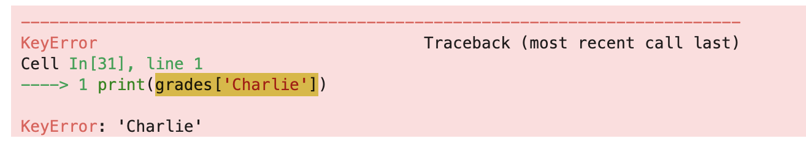
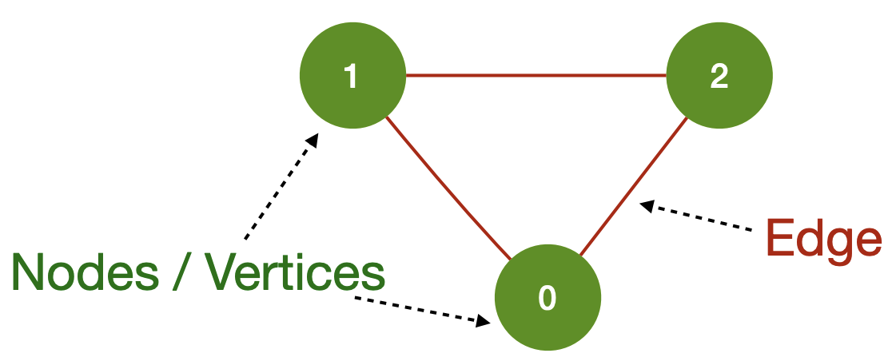
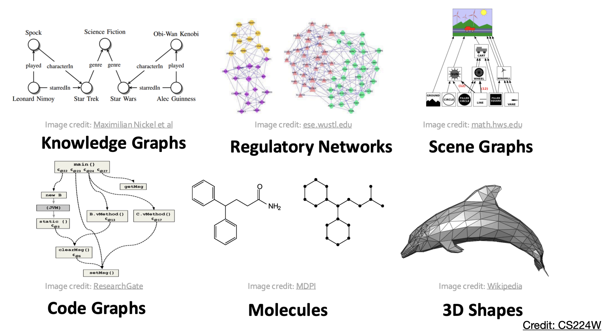
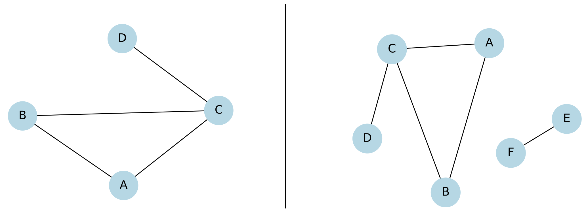
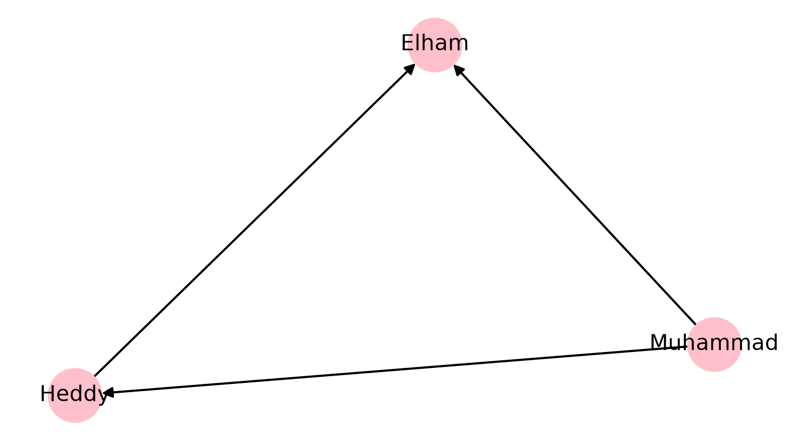
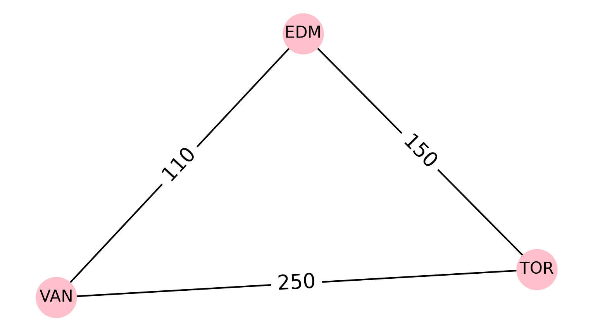
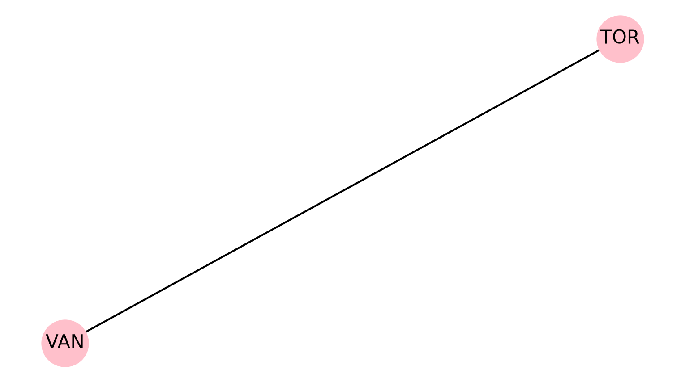
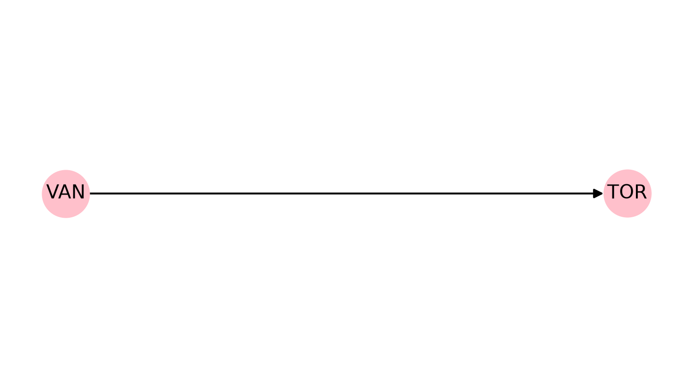
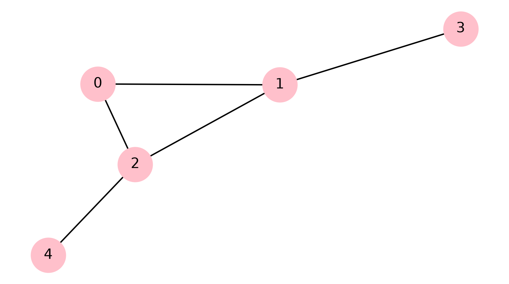

## Lecture 2 Review

- Space complexity, Data types and Memory usage, and Hash functions/tables.

::: {.incremental}
- Agora Questions:

  - Are hash functions used only in hash tables, or in other parts of computing too?

  - Can you mention the time complexity for np.zeros(n)?

  - How do we usually decide whether it’s worth trading more space for less time, or vice versa?

  - Does this mean that when you get the Big O notation, then you are essentially calculating the worst case?

:::{.columns}
::: {.column width="60%"}
- [agora.students.cs.ubc.ca](https://agora.students.cs.ubc.ca) (code: **889779**)
:::
::: {.column width="40%"}
- {width="130"}
:::
:::

:::

## Python `dict`

- It is similar to a `set` but with key-value pairs:
  - The entries are called "keys," and the associated data are the "values."
- Python `dict` is implemented using a hash table, so we have $O(1)$ operations like insertion, deletion, and lookup.
- Only the keys are hashed, so only the keys have to be hashable.

## Hash table growth and amortized cost

- Resizing occurs infrequently, and between resize events, insertions are very fast.
- The cost "averages out":
    - After adding $n$ elements, we spend $O(n)$ time on growth.
    - An average of $O(1)$ per insertion.

{fig-align="center" width="45%"}

## `dict` operations

```{pyodide}
# Adding an item
d = dict()
d[5] = "a"
d["b"] = 9
d
```

```{pyodide}
# Searching for an item in keys
print(5 in d)
print(9 in d)
```

```{pyodide}
# Attempting to use a mutable object (like a list) as a key will result in an error:
d[[1,2,3]] = 10
```

<!-- #### More examples of dictionary
```{pyodide}
# Iteration syntax
for key, val in d.items():
    print("key =", key, " val =", val)
```

```{pyodide}
# A dictionary can be a value inside another dictionary
g = dict()
g[5] = d
g
``` -->

## Introducing `defaultdict`
```{pyodide}
grades = {'Alice': 85, 'Bob': 90}
```

```{pyodide}
print(grades['Alice'])
```

```{pyodide}
print(grades['Charlie'])
```

::: {.incremental}
- {fig-align="left" width="80%"}
:::

## Introducing `defaultdict`

[`defaultdict`](https://docs.python.org/3/library/collections.html#defaultdict-objects) is a subclass of `dict` from the `collections` module that automatically handles missing keys.

```python
from collections import defaultdict
dd = defaultdict(default_factory)
```
- `default_factory` is a function that provides the default value for a missing key. Usually, it's a type like `list`, `int`, `set`, etc.

- When a key is missing, `defaultdict` calls `default_factory` to create a default value and inserts it into the dictionary

## Introducing `defaultdict`

```{.python code-line-numbers="1,2,3"}
from collections import defaultdict

counts = defaultdict(int)
for fruit in ['apple', 'banana', 'apple']:
    counts[fruit] += 1

print(counts)
```

## Introducing `defaultdict`

```{.python code-line-numbers="4,5"}
from collections import defaultdict

counts = defaultdict(int)
for fruit in ['apple', 'banana', 'apple']:
    counts[fruit] += 1

print(counts)
```

<!-- #### Introducing `defaultdict`

```{.python code-line-numbers="7"}
from collections import defaultdict

counts = defaultdict(int)
for fruit in ['apple', 'banana', 'apple']:
    counts[fruit] += 1

print(counts)
``` -->

## Introducing `defaultdict`

```{pyodide}
from collections import defaultdict

counts = defaultdict(int)
for fruit in ['apple', 'banana', 'apple']:
    counts[fruit] += 1

print(counts)
```

## Introducing `defaultdict`

```{pyodide}
groups = defaultdict(list)
pairs = [('a', 1), ('a', 2), ('b', 3)]
for key, val in pairs:
    groups[key].append(val)

print(groups)
```

```{pyodide}
print(type(grades))
print(type(counts))
```

<!-- #### Introducing `defaultdict`
- **Key take-aways**

    - `dict` is simple and you control all key creation.
    - `defaultdict` automatically initializes missing keys.
    - Use `defaultdict(int)` for counting, `defaultdict(list)` for grouping, and `defaultdict(set)` for collecting unique items.
 -->

## Outline

- Graphs intro
- Graph types
- Graph representations
- Sparse Matrices

## Learning Objectives

By the end of this lecture, you will be able to:

- Map real-world problems to various kinds of graphs (directed/undirected, weighted/unweighted).
- Convert between adjacency matrices and their corresponding graphs.
- Manipulate scipy sparse matrix objects in Python.
- Analyze the space complexity of sparse and dense matrix representations.
- Appropriately use row-wise vs. column-wise sparse matrices.

## Introduction to graphs
- A graph is a data structure to model relationships between entities.

::: {.notes}
- Graphs are more general than the trees we studied earlier, as they allow for a broader range of connections and structures.
- Unlike trees, which have a hierarchical form, graphs can represent any set of relationships, including cyclic and non-hierarchical ones.
:::

<!-- :::{.columns}
::: {.column width="60%"}
- A graph $G=(V,E)$ is a set of vertices $V$ and edges $E$ where each edge $(u,v)$ connects a pair of vertices $u,v \in V$
    - $V$: is a set of vertices or nodes.
    - $E$: is a set of edges.
:::
::: {.column width="40%"}
 {width="130"}
:::
::: -->
More formally:

- A graph $G=(V,E)$ is a set of vertices $V$ and edges $E$ where each edge $(u,v)$ connects a pair of vertices $u,v \in V$
    - $V$: is a set of vertices or nodes.
    - $E$: is a set of edges.

{fig-align="center" width="50%"}

## Introduction to graphs
- Many Types of Data are Graphs

{fig-align="center" width="90%"}

## Introduction to graphs
- Many Types of Data are Graphs

{fig-align="center" width="90%"}

## Introduction to graphs

- Another example: cities are nodes and flights are edges connecting cities
{width=70% fig-align="center"}

## Graph terminology
- Vertices $u$ and $v$ are **neighbors** if there is an edge $(u,v)$ between them.
- The **degree** of a vertex: the number of edges connected to that vertex.
- A **<span style="color:red;">path</span>** is a sequence of edges that connect a sequence of distinct nodes.
- A **cycle** is a path with the same start and end node, and all other nodes are distinct.

{fig-align="center" width="40%"}

## Graph terminology

- A graph is **connected** if there exists a path between every pair of nodes.
- A graph is **disconnected** if at least one pair of nodes does not have a path connecting them.

{fig-align="center" width="80%"}

## Complete graph

- A graph is **complete** if every pair of vertices is connected by an edge.

{width=70% fig-align="center"}

::: incremental
- What is the degree of vertex "VAN" above?
- In a complete graph with $n$ node, each node has a degree of $n−1$.
:::

## Undirected vs directed graph

- **Undirected**:
  - Relationships between entities are **bidirectional** or **symmetric**.
  - If there is a connection from A to B, the reverse connection also holds.
  - Example: Facebook.

- **Directed**:
  - The relationship between entities is **directional** or **asymmetric**.
  - Example: Twitter.
  - Directed graphs can also have **self-connections**.
    - Example: Markov chain.

## Example: twitter follower relationship
{width=70% fig-align="center"}

## Unweighted vs weighted graph

- **Unweighted**:
  - All edges are considered equal.
  - An edge simply indicates whether a relationship exists between two nodes.
  - Example: a friendship network.

- **Weighted**:
  - Each edge is assigned a numerical value or weight.
  - Example: A transportation network where the weights represent the cost or distance between two cities.
- More detailed modeling of relationships and are useful for problems involving optimization.

## Example: the cost to fly between two airports
{width=70% fig-align="center"}

## `networkx`: a Python library for complex networks

-  Creating an undirected Graph:

```{.python code-line-numbers="1,"}
G = nx.Graph()
G.add_node("VAN") # Vancouver
G.add_node("TOR") # Toronto
G.add_edge("VAN", "TOR") # Add edges
nx.draw(G, nx.shell_layout(G), **draw_params) # Draw the graph
```

## `networkx`: a Python library for complex networks

-  Creating an undirected Graph:

```{.python code-line-numbers="2,3"}
G = nx.Graph()
G.add_node("VAN") # Vancouver
G.add_node("TOR") # Toronto
G.add_edge("VAN", "TOR") # Add edges
nx.draw(G, nx.shell_layout(G), **draw_params) # Draw the graph
```

## `networkx`: a Python library for complex networks

-  Creating an undirected Graph:

```{.python code-line-numbers="4"}
G = nx.Graph()
G.add_node("VAN") # Vancouver
G.add_node("TOR") # Toronto
G.add_edge("VAN", "TOR") # Add edges
nx.draw(G, nx.shell_layout(G), **draw_params) # Draw the graph
```

## `networkx`: a Python library for complex networks

-  Creating an undirected Graph:

```{.python code-line-numbers="5"}
G = nx.Graph()
G.add_node("VAN") # Vancouver
G.add_node("TOR") # Toronto
G.add_edge("VAN", "TOR") # Add edges
nx.draw(G, nx.shell_layout(G), **draw_params) # Draw the graph
```

## `networkx`: a Python library for complex networks

-  Creating an undirected Graph:

{width=70% fig-align="center"}

## `networkx`: a Python library for complex networks

-  Creating a directed graph with `DiGraph()`

```python
G = nx.DiGraph()
G.add_node("VAN")
G.add_node("TOR")
G.add_edge("VAN", "TOR") # Add directional edges
nx.draw(G, nx.shell_layout(G), **draw_params)
```

{width=70% fig-align="center"}

## Adding weights to edges

```python
G = nx.Graph()

G.add_node("VAN")
G.add_node("EDM")
G.add_node("TOR")

G.add_edge("VAN", "EDM", weight=110)
G.add_edge("VAN", "TOR", weight=250)
G.add_edge("TOR", "EDM", weight=150)

nx.draw(G, nx.spring_layout(G), **draw_params)
labels = nx.get_edge_attributes(G, 'weight')
nx.draw_networkx_edge_labels(G, nx.spring_layout(G), edge_labels=labels, font_size=20)
```

## Adding weights to edges

{width=70% fig-align="center"}

## Graph representations

- How to represent a graph $G=(V,E)$ more efficiently?

-  **Adjacency matrix representation**
    - Supppose the vertices are numbered $1,2,\dots,|V|$ in some arbitrary manner.
    - The adjacency matrix $A$ is a $|V| \times |V|$ matrix such that
    $$a_{i,j} =
    \begin{cases}
    1,\ \text{if } (i,j) \in E \\
    0,\ \text{otherwise}.
    \end{cases}$$

- **Adjacency list representation**
    - For each vertex $u$, we maintain an adjacency list contains all the vertices $v$ such that there is an edge $(u,v)\in E$.

## Example graph
{width=70% fig-align="center"}

```{pyodide}
import scipy
import networkx as nx
G4 = nx.bull_graph()
adj = nx.adjacency_matrix(G4).toarray()
print(adj)
```

```{pyodide}
adj_list_dict = {node: list(neighbors) for node, neighbors in G4.adjacency()}
print(adj_list_dict)
```

## Exercise
{width=70% fig-align="center"}

```{pyodide}
import scipy
import networkx as nx
G4 = nx.bull_graph()
adj = nx.adjacency_matrix(G4).toarray()
print(adj)
```

```{pyodide}
adj_list_dict = {node: list(neighbors) for node, neighbors in G4.adjacency()}
print(adj_list_dict)
```

## Question

::: incremental
- What is the space complexity of an adjacency matrix, in terms of $|V|$, the number of vertices, and $|E|$, the number of edges?
- Answer: $O(|V|^2)$.
:::

## Question

::: incremental
- What is the space complexity of an adjacency list, in terms of $|V|$ and $|E|$?
- Answer: $O(|E| + |V|)$.
:::

## Comparing two representations

::: incremental
- Adjacency matrix
  - Straightforward and intuitive representation
  - Space complexity: $O(|V|^2)$.
  - Lookup time (checking if any two nodes are connected): $O(1)$ (why?).

- Adjacency list
  - A compact representation
  - Space complexity: $O(|V|+|E|)$.
  - Lookup time: $O(|V|)$ (why?).
:::

## Question

::: incremental
- If $|E|$ is much less than $|V^2|$, which representation is better  in terms of space complexity?
  - **Answer**: the adjacency list is more efficient in this case.
:::

## Question

- Can we have lookup speed of the adjacency matrix and the storage efficiency of the adjacency list?
    - Sparse matrices!!!
    - In fact, `networkx` uses sparse matrix to store the adjacency matrix:

. . .

```{pyodide}
am_matrix = nx.adjacency_matrix(G4)
type(am_matrix)
```

## Introduction to sparse matrices

- Sparse matrices are matrices with most of its elements being $0$.
- In CS, sparse matrix is a data structure to efficiently store and manipulate large datasets with mostly zero values.

## Sparse datasets come up a lot in practice.

- **Social networks**: Most users are not connected, leading to many zeros in the graph adjacency matrix.
- **Word counts**: Documents can be represented by the words they contain, but typically, only a small subset of all possible words appear in a given document.
- **Ratings**: We might represent an Amazon item by user ratings, but only a small fraction of users rate any particular item.
- And many other cases.

::: {.notes}
Ask if anyone wants to share?
:::

## `scipy.sparse`

- `scipy.sparse` provides the standard Python implementation for sparse matrices.

- Example

```{pyodide}
from scipy.sparse import csr_matrix, csc_matrix, lil_matrix, coo_matrix
import numpy as np
dense_matrix = np.array([
    [1, 0, 0, 0],
    [0, 0, 2, 0],
    [0, 3, 0, 0],
    [0, 0, 0, 4]
])
# Convert the dense matrix to a sparse matrix
csr = csr_matrix(dense_matrix)
print(csr)
```

- Example
```{pyodide}
# We can convert a scipy sparse matrix back to a numpy array.
print(csr.toarray())
```

## A bigger sparse matrix

- Suppose we have a 100000 by 100000 matrix:
  - A dense matrix would take up 100000 * 100000 * 8 / 1e9 = 80 GB.
  - A sparse matrix with 1000000 non-zero elements would take only 1000000 * 8 * 3 / 1e6 = 24 MB.

- That is why we don't want to store the full matrix with many zeros.

## Basic `scipy.sparse` operations

```{pyodide}
print(csr.shape)
print(csr.nnz)  # non-zero elements of the matrix
print(np.sum(csr, axis = 0))  # regular numpy functions work on sparse matrices
print(csr.data)
```

. . .

- Regular numpy functions work on sparse matrices, although they might be fast/slow depending on various factors.

## Building sparse matrices

To create an empty sparse martrix, we just need to provide the shape.

```{pyodide}
from scipy.sparse import csr_matrix, csc_matrix, lil_matrix

x = csr_matrix((10,10))
x.shape
```

## Sparse matrix representations

- CSR: Compressed Sparse Row array

```{pyodide}
x = csr_matrix(dense_matrix)
print(x.data)
print(x.indices)
print(x.indptr)
```

::: {.notes}
  - We store an adjacency list per row
  - So if we want Row 4, we just grab it right away.
:::

- CSC: Compressed Sparse Column array

```{pyodide}
x = csc_matrix(dense_matrix)
print(x.data)
print(x.indices)
print(x.indptr)
```

- We need to chooose the appropriate format for different operations.

## Rows versus columns operations

| Feature               | CSR                          | CSC                          |
|----------------------|------------------------------|------------------------------|
| Storage Arrays       | Values, Column Indices, Row Pointers | Values, Row Indices, Column Pointers |
| Optimized For        | Row operations               | Column operations             |
| Access Pattern       | Fast row slicing             | Fast column slicing           |
| Use Cases            | Matrix-vector multiplication, row-wise operations | Column-wise computations, matrix factorization |

::: {.notes}
CSR (Compressed Sparse Row) and CSC (Compressed Sparse Column) are two common formats for storing sparse matrices.
:::

## Don't use CSR matrices for operations which require looping over columns

```python
from scipy.sparse import csr_matrix
n = 10000
dense_matrix = np.random.rand(n, n)
mask = np.random.rand(n, n) < 0.01
sparse_matrix = dense_matrix * mask
csr = csr_matrix(sparse_matrix)
```

```python
%%timeit -r1 -n1

for i in range(n):
    csr[i,:]
```

<br>

```python
%%timeit -r1 -n1

for i in range(n):
  csr[:,i]
```

## We should avoid looping directly through sparse matrices in general

- Loping through the rows of a csr matrix is fine.
- Looping through the columns of a csr matrix can be disaster (why?).
  - If we want to get elements from column 1, we have to iterate through every row and check if there’s an element in column 1!
  - Convert to CSC format instead:

. . .

```python
csc = csr.tocsc()
```

::: {.notes}
- Because it is stored row by row.
- To grab a single column, it needs to loop through each row and look for items in that column.
:::

## `Numpy` Matrix vs. Array

- When we do an operation on sparse matrix that removes one of the dimensions, you actually don't have a sparse matrix anymore:

. . .

```{pyodide}
from scipy.sparse import csr_matrix
x = csr_matrix([[1, 0, 0], [0, 0, 3], [0, 0, 0]])
sum_x = x.sum(axis=0)

sum_x
```

. . .

- Surprisingly, we get a numpy matrix, not numpy array!

## Matrix vs. Array

::: incremental
- See [the official document](https://numpy.org/devdocs/user/numpy-for-matlab-users.html#array-or-matrix-which-should-i-use).
- TL;DR: we shoud covert to numpy array using `np.asarray`.
:::

. . .

```{pyodide}
np.asarray(sum_x)
```

## Note: Indexing
- With a regular numpy array, `x[i,j]` and `x[i][j]` are equivalent:

```{pyodide}
x = np.random.rand(10,10)
print(x[1, 2])
print(x[1][2])
```

## Indexing a sparse matrix:

```{pyodide}
from scipy.sparse import csr_matrix
x_sparse = csr_matrix(x)
x_sparse[1, 2]
# x_sparse[1][2]
# x_sparse[1]
```

- The sparse matrix returns a different shape.
- This is because sparse matrices must always be 2d (same problem as non-sparse matrices)
- In general, use the `x[1,2]` notation when possible because chaining the `[]` can be problematic in several places (e.g., also pandas).
