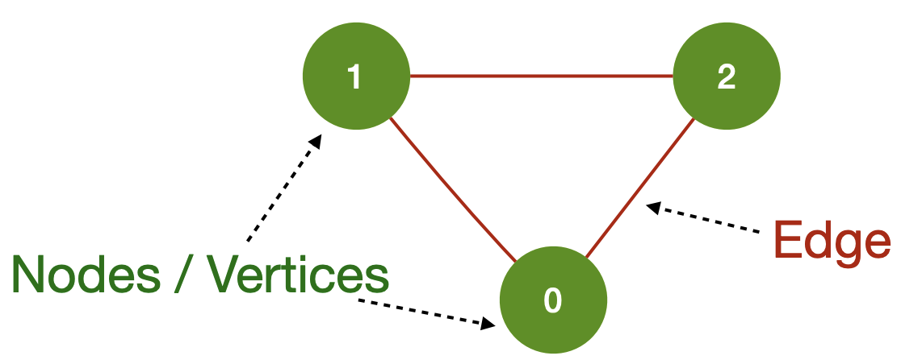
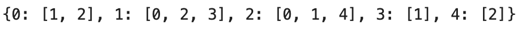
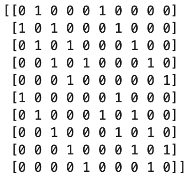
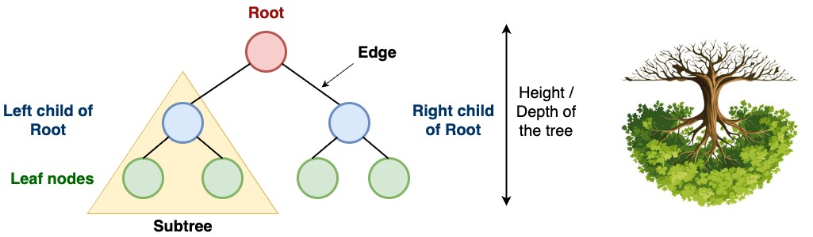
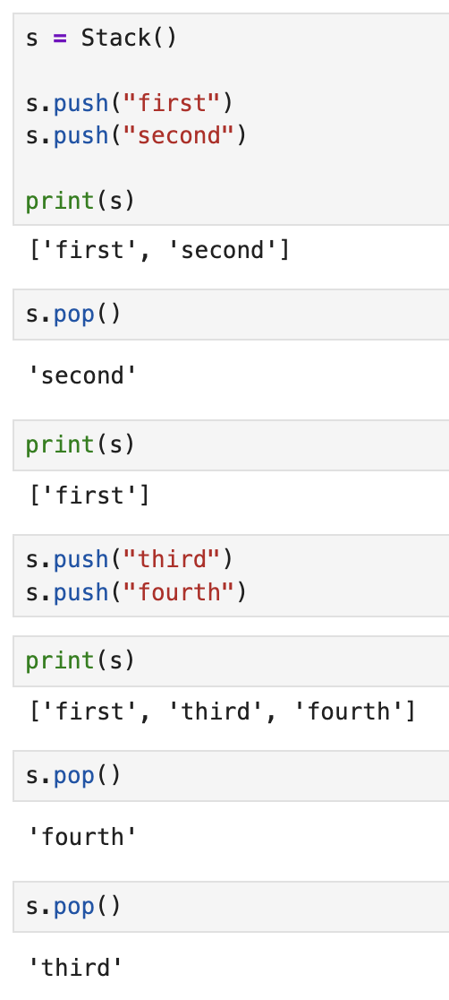
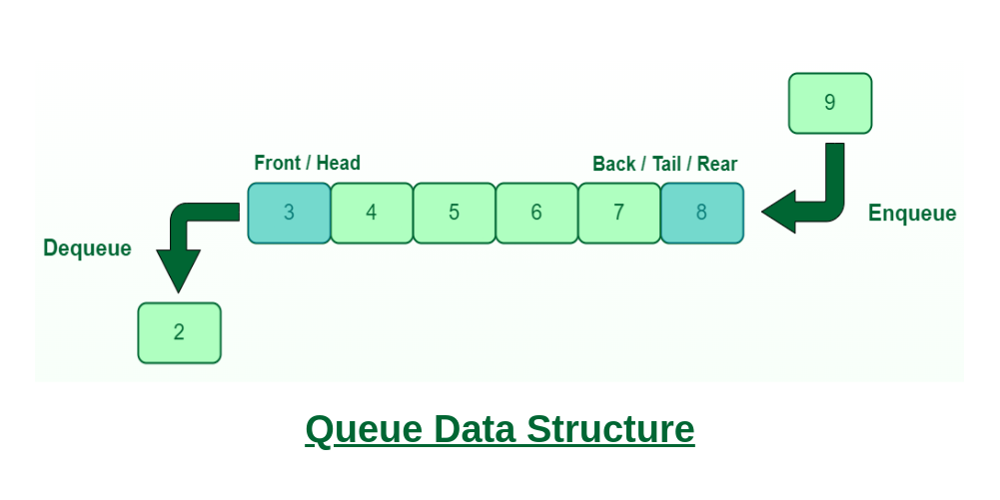
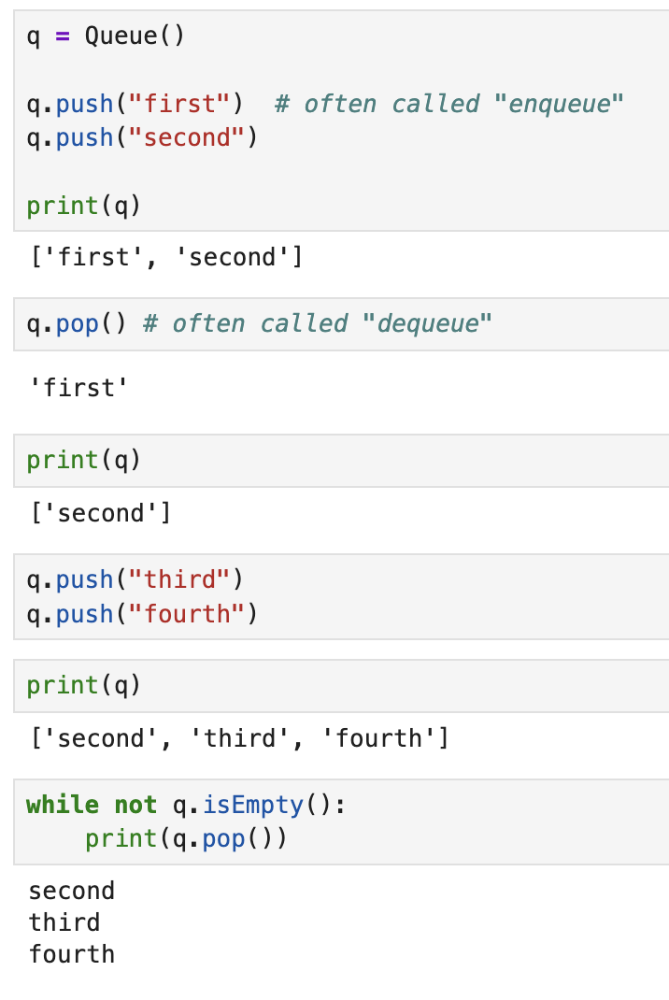

## Logistics

- Practice Quiz 1 is out.
- Cheatsheet 1 submission is open.
- **Quiz 1**: Tuesday - Friday
  - Make sure you book a slot for all 4 Quizzes.
- 512 Quiz contains both multiple choice and coding questions.
  - Syllabus: lecture 1 - 4 (please review all the material covered in the lecture notes)
  - 7-9 multiple choice questions
  - 2 coding questions (auto graded)

## Lecture 3 Review

- Graphs (undirected vs directed, weighted vs unweighted)
- Graph representations

::: incremental
- {fig-align="center" width="30%"}
- {fig-align="center" width="50%"}
- {fig-align="center" width="25%"}
:::

## Agora Questions
::: {.incremental}

- Is there any situation where using a plain `dict` is better than `defaultdict`?Why?

- Why might high-degree nodes be important in networks such as Facebook or Twitter?

- Can you have a directional weighted graph?

- Generally, is adjacency list better than adjacency matrix or vice versa?
:::

## Comparing two representations

::: incremental
- Adjacency matrix
  - Straightforward and intuitive representation
  - Space complexity: $O(|V|^2)$.
  - Lookup time (checking if any two nodes are connected): $O(1)$ (why?).

- Adjacency list
  - A compact representation
  - Space complexity: $O(|V|+|E|)$.
  - Lookup time: $O(|V|)$ (why?).

- **Question**: If $|E|$ is much less than $|V^2|$, which representation is better  in terms of space complexity?
  - **Answer**: the adjacency list is more efficient in this case.
:::

## Question

- Can we have lookup speed of the adjacency matrix and the storage efficiency of the adjacency list?
    - Sparse matrices!!!
    - In fact, `networkx` uses sparse matrix to store the adjacency matrix:

## Introduction to sparse matrices

{fig-align="center" width="40%"}

## Introduction to sparse matrices

- Sparse matrices are matrices with most of its elements being $0$.
- In CS, sparse matrix is a data structure to efficiently store and manipulate large datasets with mostly zero values.

## Sparse datasets come up a lot in practice.

- **Social networks**: Most users are not connected, leading to many zeros in the graph adjacency matrix.
- **Word counts**: Documents can be represented by the words they contain, but typically, only a small subset of all possible words appear in a given document.
- **Ratings**: We might represent an Amazon item by user ratings, but only a small fraction of users rate any particular item.
- And many other cases.

::: {.notes}
Ask if anyone wants to share?
:::

## `scipy.sparse`

- `scipy.sparse` provides the standard Python implementation for sparse matrices.

- Example

```{pyodide}
from scipy.sparse import csr_matrix, csc_matrix
import numpy as np
dense_matrix = np.array([
    [1, 0, 0, 0],
    [0, 0, 2, 0],
    [0, 3, 0, 0],
    [0, 0, 0, 4]
])
# Convert the dense matrix to a sparse matrix
csr = csr_matrix(dense_matrix)
print(csr)
```

- Example
```{pyodide}
# We can convert a scipy sparse matrix back to a numpy array.
print(csr.toarray())
```

## A bigger sparse matrix

- Suppose we have a 100000 by 100000 matrix:
  - A dense matrix would take up 100000 * 100000 * 8 / 1e9 = 80 GB.
  - A sparse matrix with 1000000 non-zero elements would take only 1000000 * 8 * 3 / 1e6 = 24 MB.

- That is why we don't want to store the full matrix with many zeros.

## Basic `scipy.sparse` operations

```{pyodide}
print(csr.shape)
print(csr.nnz)  # non-zero elements of the matrix
print(np.sum(csr, axis = 0))  # regular numpy functions work on sparse matrices
print(csr.data)
```

. . .

- Regular numpy functions work on sparse matrices, although they might be fast/slow depending on various factors.

## Sparse matrix representations

- CSR: Compressed Sparse Row array

```{pyodide}
x = csr_matrix(dense_matrix)
print(x.data)
print(x.indices)
print(x.indptr)
```

::: {.notes}
  - We store an adjacency list per row
  - So if we want Row 4, we just grab it right away.
:::

- CSC: Compressed Sparse Column array

```{pyodide}
x = csc_matrix(dense_matrix)
print(x.data)
print(x.indices)
print(x.indptr)
```

- We need to chooose the appropriate format for different operations.

## Rows versus columns operations

| Feature               | CSR                          | CSC                          |
|----------------------|------------------------------|------------------------------|
| Storage Arrays       | Values, Column Indices, Row Pointers | Values, Row Indices, Column Pointers |
| Optimized For        | Row operations               | Column operations             |
| Access Pattern       | Fast row slicing             | Fast column slicing           |
| Use Cases            | Matrix-vector multiplication, row-wise operations | Column-wise computations, matrix factorization |

::: {.notes}
CSR (Compressed Sparse Row) and CSC (Compressed Sparse Column) are two common formats for storing sparse matrices.
:::

## Don't use CSR matrices for operations which require looping over columns

```python
from scipy.sparse import csr_matrix
n = 10000
dense_matrix = np.random.rand(n, n)
mask = np.random.rand(n, n) < 0.01
sparse_matrix = dense_matrix * mask
csr = csr_matrix(sparse_matrix)
```

```python
%%timeit -r1 -n1

for i in range(n):
    csr[i,:]
```

<br>

```python
%%timeit -r1 -n1

for i in range(n):
  csr[:,i]
```

## We should avoid looping directly through sparse matrices in general

- Loping through the rows of a csr matrix is fine.
- Looping through the columns of a csr matrix can be disaster (why?).
  - If we want to get elements from column 1, we have to iterate through every row and check if there’s an element in column 1!
  - Convert to CSC format instead:

. . .

```python
csc = csr.tocsc()
```

::: {.notes}
- Because it is stored row by row.
- To grab a single column, it needs to loop through each row and look for items in that column.
:::

## Trees

- a tree is an undirected connected graph containing no cycles

{fig-align="center" width="100%"}

<!--
## Tree Terminology

1. A **node** is a fundamental part of a tree. It stores data.
2. The first node in a tree is called the **root** node.
3. A link connecting one node to another is called an **edge**.
4. A **child** node is an immediate successor of another node.
5. A **parent** node is an immediate predecessor of another node.
    - A node can have zero, one, or many child nodes.
    - A node can only have one parent node.
6. Nodes without links to other child nodes are called **leaves**, or **leaf nodes**. -->

## Why do we need to study trees?

- Many systems involve data that has a parent–child relationship, such as:
  - File systems (folders and subfolders),
  - Organization charts (manager–employee hierarchy).
- Specialized trees are often used for efficient searching and sorting algorithms.
  - Binary Search Trees (BSTs) $->$ next week
  - Heaps $->$ next term
- Trees help model relationships like
  - decision trees, random forests, and gradient-boosted trees in machine learning.

## Stacks

- A stack is a data structure that allows us to insert items and retrieve them later using the **Last In, First Out** (LIFO) principle.
  - Example: Think of it like a stack of books, where the last book placed on top is the first one to be removed.

{width=300 fig-align="center"}

## Stack implementation using a `list`

```{.python}
class Stack:
    def __init__(self):
        self.data = list()

    def push(self, item):
        self.data.append(item)

    def pop(self):
        return self.data.pop()

    def isEmpty(self):
        return len(self.data) == 0

    def __str__(self):
        return self.data.__str__()
```

<!-- #### Stack implementation using a `list`

```{.python code-line-numbers="1,2,3"}
class Stack:
    def __init__(self):
        self.data = list()

    def push(self, item):
        self.data.append(item)

    def pop(self):
        return self.data.pop()

    def isEmpty(self):
        return len(self.data) == 0

    def __str__(self):
        return self.data.__str__()
```

## Stack implementation using a `list`

```{.python code-line-numbers="5,6"}
class Stack:
    def __init__(self):
        self.data = list()

    def push(self, item):
        self.data.append(item)

    def pop(self):
        return self.data.pop()

    def isEmpty(self):
        return len(self.data) == 0

    def __str__(self):
        return self.data.__str__()
```

## Stack implementation using a `list`

```{.python code-line-numbers="8,9"}
class Stack:
    def __init__(self):
        self.data = list()

    def push(self, item):
        self.data.append(item)

    def pop(self):
        return self.data.pop()

    def isEmpty(self):
        return len(self.data) == 0

    def __str__(self):
        return self.data.__str__()
```

## Stack implementation using a `list`

```{.python code-line-numbers="11,12"}
class Stack:
    def __init__(self):
        self.data = list()

    def push(self, item):
        self.data.append(item)

    def pop(self):
        return self.data.pop()

    def isEmpty(self):
        return len(self.data) == 0

    def __str__(self):
        return self.data.__str__()
```

## Stack implementation using a `list`

```{.python code-line-numbers="14,15"}
class Stack:
    def __init__(self):
        self.data = list()

    def push(self, item):
        self.data.append(item)

    def pop(self):
        return self.data.pop()

    def isEmpty(self):
        return len(self.data) == 0

    def __str__(self):
        return self.data.__str__()
``` -->

<!-- #### Stack implementation using a `list`

```{pyodide}
class Stack:
    def __init__(self):
        self.data = list()

    def push(self, item):
        self.data.append(item)

    def pop(self):
        return self.data.pop()

    def isEmpty(self):
        return len(self.data) == 0

    def __str__(self):
        return self.data.__str__()
``` -->

## Stack operations

{width=250 fig-align="left"}

## Exercise

If a stack contains `n` items, what is the time complexity to retrieve the bottom item?

**A**: $O(1)$ <br>
**B**: $O(n)$ <br>
**C**: $O(log(n))$ <br>
**D**: $O(n^2)$

::: {.incremental}

- Answer: $O(n)$
- To retrieve the bottom item, we would have to pop all the elements above it.

:::

## Queues

- A queue is a data structure that operates on the **First In, First Out**(FIFO) principle.
  - Example: waiting in line—people are served in the order they arrive.

<br>

{width=500 fig-align="center"}

## Queue implementation using a `list`

```{.python}
class Queue:
    def __init__(self):
        self.data = list()

    def push(self, item):
        self.data.append(item)

    def pop(self):
        return self.data.pop(0)

    def isEmpty(self):
        return len(self.data) == 0

    def __str__(self):
        return self.data.__str__()
```

<!-- #### Queue implementation using a `list`

```{.python code-line-numbers="1,2,3"}
class Queue:
    def __init__(self):
        self.data = list()

    def push(self, item):
        self.data.append(item)

    def pop(self):
        return self.data.pop(0)

    def isEmpty(self):
        return len(self.data) == 0

    def __str__(self):
        return self.data.__str__()
```

## Queue implementation using a `list`

```{.python code-line-numbers="5,6"}
class Queue:
    def __init__(self):
        self.data = list()

    def push(self, item):
        self.data.append(item)

    def pop(self):
        return self.data.pop(0)

    def isEmpty(self):
        return len(self.data) == 0

    def __str__(self):
        return self.data.__str__()
```

## Queue implementation using a `list`

```{.python code-line-numbers="8,9"}
class Queue:
    def __init__(self):
        self.data = list()

    def push(self, item):
        self.data.append(item)

    def pop(self):
        return self.data.pop(0)

    def isEmpty(self):
        return len(self.data) == 0

    def __str__(self):
        return self.data.__str__()
```

## Queue implementation using a `list`

```{.python code-line-numbers="11,12"}
class Queue:
    def __init__(self):
        self.data = list()

    def push(self, item):
        self.data.append(item)

    def pop(self):
        return self.data.pop(0)

    def isEmpty(self):
        return len(self.data) == 0

    def __str__(self):
        return self.data.__str__()
```

## Queue implementation using a `list`

```{.python code-line-numbers="14,15"}
class Queue:
    def __init__(self):
        self.data = list()

    def push(self, item):
        self.data.append(item)

    def pop(self):
        return self.data.pop(0)

    def isEmpty(self):
        return len(self.data) == 0

    def __str__(self):
        return self.data.__str__()
``` -->

<!-- #### Queue implementation using a `list`

```{pyodide}
class Queue:
    def __init__(self):
        self.data = list()

    def push(self, item):
        self.data.append(item)

    def pop(self):
        return self.data.pop(0)

    def isEmpty(self):
        return len(self.data) == 0

    def __str__(self):
        return self.data.__str__()
``` -->

## Queue operations

{width=500 fig-align="left"}

## Exercise

If we have a queue `[A, B, C, D]` with `A` at the head of the queue, what will the queue look like after the following operations:

- push `E` onto the queue
- push `F` onto the queue
- remove one item from the queue
- push `A` onto the queue

::: {.incremental}

- Answer: `[B, C, D, E, F, A]`

:::

## Graph search algorithms

::: incremental
- When we model data as a graph, we have to search through the graph to address various questions, such as:
  - Is there a path between two vertices?
  - What is the shortest distance between two vertices?
- To do so, we will need some algorithms to traverse the graph.
:::

## Breadth-first search (BFS)

::: incremental
- BFS explores the edges of the graph to find all the vertices in that can be reached from  $s$.
- Process:
  - Initially all the vertices are "undiscovered".
  - BFS expands the frontier between discovered and undiscovered vertices uniformly across the breadth of the frontier.
:::

::: {.notes}
All nodes at the current distance from the starting node are explored before moving on to nodes at the next distance.
:::

## Exercise: what is the time and space complexity of BFS?

::: incremental
- Time complexity: $O(|V|+|E|)$.
  - Each vertex is processed once, and each edge is examined once when exploring adjacent vertices.
- Space Complexity: $O(|V|)$
  - Queue is $O(|V|)$.
  - The list of visited nodes is $O(|V|)$.
:::

## Depth-first search (DFS)

::: incremental
- DFS explores deeper into the graph whenever possible.
- Change the data structure from a `Queue` to a `Stack`.
:::

## Exercise: what is the time and space complexity of DFS?

::: incremental
- Time complexity: $O(V+E)$.
  - DFS explores each vertex and edge once.
- Space Complexity: $O(V)$.
  - Stack is $O(V)$.
  - The list of discovered (visited) nodes is $O(V)$.
:::

## DFS vs BFS

|                  | BFS         | DFS         |
|------------------|-------------|-------------|
| Data structure   | Queue       | Stack       |
| Time Complexity  | $O(V+E)$    | $O(V+E)$    |
| Space Complexity | $O(V)$      | $O(V)$      |

::: incremental
- However, BFS often requires more memory, especially in wide graphs.
  - BFS holds all nodes in the frontier.
  - DFS holds only the nodes in the current path, which typically requires less space.
:::

## Exercise

::: incremental
- If you wanted to find the shortest path between two nodes in an unweighted graph, would you use BFS or DFS? Why?
  - BFS explores all nodes at the current distance level before moving on to nodes at the next distance level.
  - The first time you reach the target node, you've found the shortest path.
  -  You will explore this in Exercise 2 of `lab2`.
:::

## Other graph problems

::: incremental
- There are many other well-known problems in graph theory, e.g., **traveling salesman problem**.
- A lot of real-world problems can be mapped to these problems.
- **However**, some of the problems are [NP-Hard](https://www.geeksforgeeks.org/np-completeness-set-1/), meaning there are no known efficient algorithms to solve these problems.
:::
