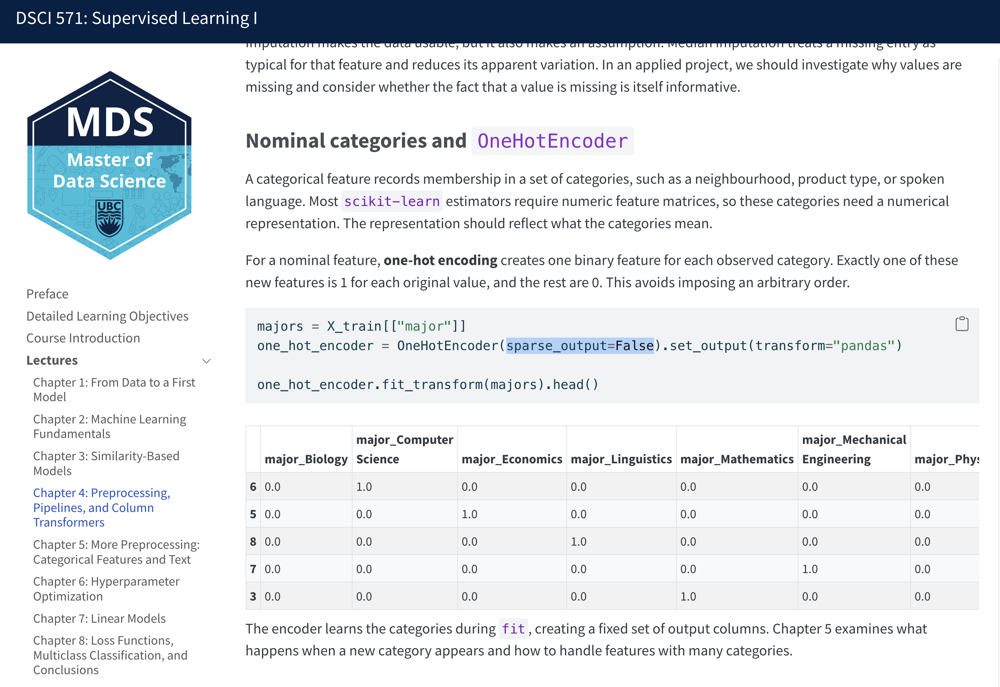
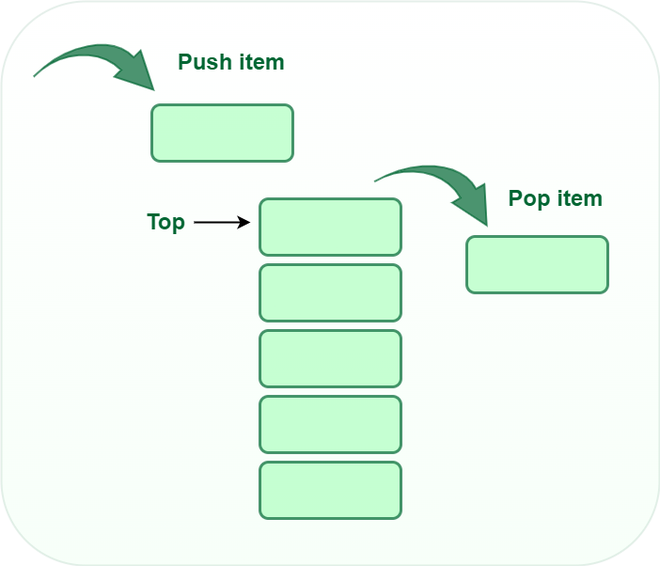

## Housekeeping 🏠


```{python}
#| echo: false
# Hidden: imports and drawing helpers for the whole deck, kept in one place so
# the visible cells below contain only the code students should read.
import timeit
from collections import deque

import networkx as nx
import numpy as np
import scipy.sparse


def edge_key(u, v):
    """One name per undirected edge, the same whichever end you start from."""
    return "|".join(sorted((str(u), str(v))))


def layout(G, pos, pad=0.5):
    """Where to draw every node and edge of G, plus the axis ranges. Drawn by OJS."""
    xs = [x for x, _ in pos.values()]
    ys = [y for _, y in pos.values()]
    return {"nodes": [{"id": str(u), "x": pos[u][0], "y": pos[u][1]} for u in G.nodes],
            "edges": [{"x1": pos[u][0], "y1": pos[u][1], "x2": pos[v][0], "y2": pos[v][1]}
                      for u, v in G.edges],
            "x_domain": [min(xs) - pad, max(xs) + pad],
            "y_domain": [min(ys) - pad, max(ys) + pad]}


def ring_pos(G, start, width=8):
    """Start at the top, each BFS ring (same number of hops from start) on its own row."""
    pos = {}
    for hops, ring in enumerate(nx.bfs_layers(G, start)):
        for i, node in enumerate(ring):
            pos[node] = ((i + 0.5) / len(ring) * width, -hops)
    return pos


def names(items):
    """[1, 2, 3] -> "1, 2 and 3"."""
    items = [str(x) for x in items]
    return items[0] if len(items) == 1 else ", ".join(items[:-1]) + " and " + items[-1]


def ordinal(d):
    return {1: "1st", 2: "2nd", 3: "3rd"}.get(d, f"{d}th")
```

```{pyodide}
#| include: false
# Hidden setup for the runnable cells: the 4 by 3 sparse matrix (CSR and CSC), the classes,
# the LinkedIn graph and the two searches, so a later cell still works when an earlier slide was skipped.
from collections import deque

import networkx as nx
import numpy as np
import scipy.sparse

connections = [("sky", "otter"), ("sky", "clam"), ("sky", "kelp"), ("otter", "clam"),
               ("otter", "nori"), ("clam", "bubbles"), ("kelp", "mochi"), ("nori", "ada"),
               ("mochi", "pixel"), ("pixel", "ada")]
G = nx.Graph(connections)
G.add_node("waffle")
small_graph = nx.Graph([(0, 1), (0, 2), (1, 3), (2, 3), (2, 4), (3, 5), (4, 5)])

dense = np.array([[0, 5, 1],
                  [0, 0, 0],
                  [2, 0, 3],
                  [4, 0, 0]])
x = scipy.sparse.csr_array(dense)
y = scipy.sparse.csc_array(dense)


class Stack:
    def __init__(self):
        self.data = list()

    def push(self, item):
        self.data.append(item)

    def pop(self):
        return self.data.pop()

    def isEmpty(self):
        return len(self.data) == 0

    def __str__(self):
        return str(self.data)


class Queue(Stack):
    def pop(self):
        return self.data.pop(0)


def bfs_connected(g, start, goal, verbose=False):
    to_visit = deque([start])
    visited = {start}
    while to_visit:
        node = to_visit.popleft()
        if verbose:
            print("At node", node)
        if node == goal:
            return True
        for neighbour in g.neighbors(node):
            if neighbour not in visited:
                visited.add(neighbour)
                to_visit.append(neighbour)
    return False


def dfs_connected(g, start, goal, verbose=False):
    to_visit = [start]
    visited = set()
    while to_visit:
        node = to_visit.pop()
        if node in visited:
            continue
        visited.add(node)
        if verbose:
            print("At node", node)
        if node == goal:
            return True
        for neighbour in g.neighbors(node):
            if neighbour not in visited:
                to_visit.append(neighbour)
    return False
```


- Cheatsheet 1 submission is open.
- Section 004 lab today is at **LIFE 2402**
- **Quiz 1**: Next Tuesday to Friday
  - Make sure you book a slot for all 4 quizzes.
- The 512 quiz has both multiple choice and coding question.
  - Syllabus: lectures 1 to 4 (please review all the material in the lecture notes)
  - We will **NOT** test about **Trees** in the quiz, and will not discuss **Trees** in the lecture this week.

```{python}
#| echo: false
# Hidden: the CSR step-through on the "How CSR stores a matrix" slide. The three arrays come from
# scipy itself; every highlight and sentence is worked out here, OJS only draws.
csr_dense = np.array([
    [0, 5, 1],
    [0, 0, 0],
    [2, 0, 3],
    [4, 0, 0],
])
csr_demo = scipy.sparse.csr_array(csr_dense)
csr_data, csr_indices, csr_indptr = (csr_demo.data.tolist(), csr_demo.indices.tolist(),
                                     csr_demo.indptr.tolist())

n_rows = csr_dense.shape[0]
nnz_total = len(csr_data)
row_nnz = [int(c) for c in (csr_dense != 0).sum(axis=1)]

csr_steps = {}
for k in range(-1, n_rows):                    # k = last row filled in; -1 = nothing yet
    filled_data = csr_indptr[k + 1] if k >= 0 else 0
    last = (k == n_rows - 1)
    n_ptr = (k + 1) + (1 if last else 0)       # indptr[0..k], plus the closing total after the last row
    start, end = (csr_indptr[k], csr_indptr[k + 1]) if k >= 0 else (0, 0)
    if k < 0:
        say = ["Three empty arrays. Click a row to fill them in."]
    else:
        count = end - start
        if count:
            fill = (f"Row {k} has {count} non-zero{'s' if count != 1 else ''}: "
                    f"data gets {csr_data[start:end]}, indices gets {csr_indices[start:end]}.")
        else:
            fill = f"Row {k} has no non-zeros, so data and indices get nothing."
        say = [fill, f"indptr[{k}] = {start}: that many non-zeros come before row {k}."]
        if last:
            say.append(f"One more: indptr[{k + 1}] = {end}, the total number of non-zeros.")
    csr_steps[k] = {
        "rows": [{"cls": "on" if r == k else "",
                  "cells": [{"v": int(v), "cls": "one" if v else ""} for v in row]}
                 for r, row in enumerate(csr_dense)],
        "nnz": [{"v": row_nnz[r] if r <= k else "", "cls": "on" if r == k else ""}
                for r in range(n_rows)],
        "data": [{"label": csr_data[j] if j < filled_data else "", "tag": j,
                  "cls": ("found" if start <= j < end else "") if j < filled_data else "out"}
                 for j in range(nnz_total)],
        "indices": [{"label": csr_indices[j] if j < filled_data else "", "tag": j,
                     "cls": ("found" if start <= j < end else "") if j < filled_data else "out"}
                    for j in range(nnz_total)],
        "indptr": [{"label": csr_indptr[j] if j < n_ptr else "", "tag": j,
                    "cls": ("end" if j in (k, k + 1) and j < n_ptr and (j == k or last) else "") if j < n_ptr else "out"}
                   for j in range(len(csr_indptr))],
        "say": say,
    }
csr_view = {"steps": csr_steps, "rows": list(range(-1, n_rows)),
            "col_labels": [f"col {j}" for j in range(csr_dense.shape[1])]}
ojs_define(csr_view = csr_view)
```

```{python}
#| echo: false
# Hidden: the "rebuild the matrix" step-through on the "From CSR back to the matrix" slide,
# from the same csr_data, csr_indices and csr_indptr. Four clicks per row: find the slice in
# indptr, read data, read indices, fill the row in. Every highlight, formula and sentence is
# worked out here, OJS only draws.
n_cols = csr_dense.shape[1]
rebuilt = [None] * n_rows                      # None = this row is not rebuilt yet
work_formulas = [("indptr[i] : indptr[i+1]", "where row i starts and stops"),
                 ("data[indptr[i] : indptr[i+1]]", "the non-zeros in row i"),
                 ("indices[indptr[i] : indptr[i+1]]", "the column of each non-zero")]


def rebuild_snapshot(i, phase, say):
    """What the slide shows at one click. i = the row being rebuilt (None = before any row);
    phase 0 = slice found, 1 = data read, 2 = indices read, 3 = row filled in."""
    start, end = (csr_indptr[i], csr_indptr[i + 1]) if i is not None else (0, 0)
    rows = []
    for r in range(n_rows):
        cls = "on" if r == i else ""
        if rebuilt[r] is None:
            rows.append({"cls": cls or "faded", "cells": [{"v": "?", "cls": ""}] * n_cols})
        else:
            rows.append({"cls": cls, "cells": [{"v": v, "cls": "one" if v else ""} for v in rebuilt[r]]})
    data_on = i is not None and phase >= 1
    indices_on = i is not None and phase >= 2
    values = ([] if i is None else
              [f"indptr[{i}] : indptr[{i + 1}] = {start} : {end}",
               f"data[{start}:{end}] = {csr_data[start:end]}",
               f"indices[{start}:{end}] = {csr_indices[start:end]}"])
    work = [{"formula": f, "gives": g,
             "value": values[w] if i is not None and w <= phase else "",
             "cls": "on" if i is not None and w == phase else ""}
            for w, (f, g) in enumerate(work_formulas)]
    return {"rows": rows,
            "data": [{"label": v, "tag": j, "cls": "found" if data_on and start <= j < end else ""}
                     for j, v in enumerate(csr_data)],
            "indices": [{"label": v, "tag": j, "cls": "found" if indices_on and start <= j < end else ""}
                        for j, v in enumerate(csr_indices)],
            "indptr": [{"label": v, "tag": j, "cls": "end" if i is not None and j in (i, i + 1) else ""}
                       for j, v in enumerate(csr_indptr)],
            "work": work,
            "work_head": "this row" if i is None else f"row {i}",
            "say": say}                         # [text, colour class] pieces


rebuild_steps = [rebuild_snapshot(None, 0, [["We only have the three arrays. Rebuild the matrix one row at a time.", ""]])]
for i in range(n_rows):
    start, end = csr_indptr[i], csr_indptr[i + 1]   # row i is data[start:end]
    slots = list(range(start, end))
    vals, cols = csr_data[start:end], csr_indices[start:end]
    rebuild_steps.append(rebuild_snapshot(i, 0, [
        [f"Row {i} starts at ", ""], [f"indptr[{i}] = {start}", "match"], [" and stops before ", ""],
        [f"indptr[{i + 1}] = {end}", "match"],
        ["." if slots else ": the same number, so the slice is empty.", ""]]))
    rebuild_steps.append(rebuild_snapshot(i, 1, [
        [f"data[{start}:{end}] = {vals}", "notify"],
        [f": the non-zeros in row {i}." if slots else f": row {i} has no non-zeros.", ""]]))
    rebuild_steps.append(rebuild_snapshot(i, 2, [
        [f"indices[{start}:{end}] = {cols}", "notify"],
        [": the column of each non-zero." if slots else ": no columns either.", ""]]))
    rebuilt[i] = [0] * n_cols
    for j in slots:
        rebuilt[i][csr_indices[j]] = csr_data[j]
    if slots:
        fill = (f"Put {names([f'{csr_data[j]} in column {csr_indices[j]}' for j in slots])}."
                " Every other cell is 0.")
    else:
        fill = f"Nothing to put: row {i} is all zeros."
    if i == n_rows - 1:
        assert np.array_equal(rebuilt, csr_dense)
        fill += " Done: the whole matrix is back."
    rebuild_steps.append(rebuild_snapshot(i, 3, [[fill, ""]]))
for k, step in enumerate(rebuild_steps):
    step["count"] = f"Step {k} of {len(rebuild_steps) - 1}"
ojs_define(rebuild_steps = rebuild_steps)
```

```{python}
#| echo: false
# Hidden: the COO step-through on the "Build a matrix from triples: COO" slide. The three
# arrays come from scipy itself; every highlight and sentence is worked out here, OJS only draws.
coo_demo = scipy.sparse.coo_array(csr_dense)
coo_row, coo_col, coo_data = coo_demo.row.tolist(), coo_demo.col.tolist(), coo_demo.data.tolist()

coo_steps = {}
for k in range(-1, len(coo_data)):              # k = last triple placed; -1 = nothing yet
    placed = {(coo_row[t], coo_col[t]): coo_data[t] for t in range(k + 1)}
    if k < 0:
        say = [f"Start with a {n_rows} by {n_cols} grid of zeros. Click a triple to place it."]
    else:
        r, c, v = coo_row[k], coo_col[k], coo_data[k]
        say = [f"Triple {k}: row {r}, column {c}, value {v}. Put {v} at row {r}, column {c}."]
        if k == len(coo_data) - 1:
            built = [[placed.get((i, j), 0) for j in range(n_cols)] for i in range(n_rows)]
            assert np.array_equal(built, csr_dense)
            say.append("Done: every other cell stays 0.")
    current = (coo_row[k], coo_col[k]) if k >= 0 else None
    coo_steps[k] = {
        "rows": [{"cls": "",
                  "cells": [{"v": placed.get((i, j), 0),
                             "cls": ("on one" if (i, j) == current else
                                     "one" if (i, j) in placed else "faded")}
                            for j in range(n_cols)]}
                 for i in range(n_rows)],
        "arrays": [{"name": name,
                    "boxes": [{"label": vals[t], "tag": t, "cls": "found" if t == k else ""}
                              for t in range(len(vals))]}
                   for name, vals in [("row", coo_row), ("col", coo_col), ("data", coo_data)]],
        "say": say,
    }
coo_view = {"steps": coo_steps, "triples": list(range(-1, len(coo_data))),
            "col_labels": [f"col {j}" for j in range(n_cols)]}
ojs_define(coo_view = coo_view)
```

# Sparse matrices, continued 🦦 {background-image="images/lec03_title_bg.png" background-size="cover" background-position="right" style="font-size: 0.8em;"}

::: footer
Image generated by OpenAI GPT-image-2.5-sunburst
:::

## Build a matrix from triples: COO {style="font-size: 0.8em;"}

COO (**COO**rdinate format, also called triplet format): for every non-zero, store its row, its column and its value.

```{ojs}
//| echo: false
viewof coo_k = Inputs.radio(coo_view.triples, {value: -1, label: "place", format: k => k < 0 ? "start" : `triple ${k}`})
```

```{ojs}
//| echo: false
{
  // Draw only: the triples and the highlights were computed in Python (coo_view).
  const s = coo_view.steps[coo_k];
  const header = html`<tr><th></th>${coo_view.col_labels.map(h => html`<th>${h}</th>`)}</tr>`;
  const rows = s.rows.map((r, i) => html`<tr class="${r.cls}"><th>row ${i}</th>
      ${r.cells.map(c => html`<td class="${c.cls}">${c.v}</td>`)}</tr>`);
  const boxes = items => items.map(b =>
    html`<div class="ds-box ${b.cls}">${b.label}<span class="sq-tag below">${b.tag}</span></div>`);
  return html`<div class="adj-wrap csr-wrap">
      <div class="adj-panel">
        ${s.arrays.map(a => html`<div class="ds-row csr"><span class="csr-name">${a.name}</span>${boxes(a.boxes)}</div>`)}
        <div class="ds-caption">what COO stores (small numbers: triple number)</div></div>
      <div class="adj-panel"><table class="adj-table">${header}${rows}</table>
        <div class="ds-caption">the matrix we build</div></div>
    </div>
    <div class="ojs-readout">${s.say.join(" ")}</div>`;
}
```


## How CSR stores a matrix in a compressed way {style="font-size: 0.8em;"}

CSR (**Compressed Sparse Row**). The matrix does not need to be square: this one has 4 rows and 3 columns.

```{ojs}
//| echo: false
viewof csr_row = Inputs.radio(csr_view.rows, {value: -1, label: "fill in", format: i => i < 0 ? "start" : `row ${i}`})
```

```{ojs}
//| echo: false
{
  // Draw only: the arrays and the highlights were computed in Python (csr_view).
  const s = csr_view.steps[csr_row];
  const header = html`<tr><th></th>${csr_view.col_labels.map(h => html`<th>${h}</th>`)}</tr>`;
  const rows = s.rows.map((r, i) => html`<tr class="${r.cls}"><th>row ${i}</th>
      ${r.cells.map(c => html`<td class="${c.cls}">${c.v}</td>`)}</tr>`);
  const nnzRows = s.nnz.map(r => html`<tr class="${r.cls}"><td>${r.v}</td></tr>`);
  const boxes = items => items.map(b =>
    html`<div class="ds-box ${b.cls}">${b.label}<span class="sq-tag below">${b.tag}</span></div>`);
  return html`<div class="adj-wrap csr-wrap">
      <div class="adj-panel"><table class="adj-table">${header}${rows}</table>
        <div class="ds-caption">the matrix</div></div>
      <div class="adj-panel"><table class="adj-table">
          <tr><th>non-zeros</th></tr>${nnzRows}</table>
        <div class="ds-caption">count per row</div></div>
      <div class="adj-panel">
        <div class="ds-row csr"><span class="csr-name">data</span>${boxes(s.data)}</div>
        <div class="ds-row csr"><span class="csr-name">indices</span>${boxes(s.indices)}</div>
        <div class="ds-row csr"><span class="csr-name">indptr</span>${boxes(s.indptr)}</div>
        <div class="ds-caption">what CSR stores (small numbers: position in the array)</div></div>
    </div>
    <div class="ojs-readout">${s.say.join(" ")}</div>`;
}
```


## Sparse matrices: CSR in code {style="font-size: 0.8em;"}

```{pyodide}
import numpy as np
import scipy.sparse

dense = np.array([[0, 5, 1],
                  [0, 0, 0],
                  [2, 0, 3],
                  [4, 0, 0]])
x = scipy.sparse.csr_array(dense)
print("data:   ", x.data)      # the non-zero values, row by row
print("indices:", x.indices)   # the column of each value
print("indptr: ", x.indptr)    # where each row starts
print("shape:  ", x.shape)     # 4 rows, 3 columns: it does not have to be square
```

```{pyodide}
for i in range(x.shape[0]):
    start, end = x.indptr[i], x.indptr[i + 1]   # row i is data[start:end]
    print(f"row {i}: columns {x.indices[start:end]}, values {x.data[start:end]}")
```


## From CSR back to the matrix {style="font-size: 0.8em;"}

Given only `data`, `indices` and `indptr`, can we get the matrix back?

```{ojs}
//| echo: false
viewof rebuild_step = Inputs.button([
  ["Back", i => Math.max(i - 1, 0)],
  ["Next step", i => Math.min(i + 1, rebuild_steps.length - 1)],
  ["Start over", () => 0]
], {value: 0})
```

```{ojs}
//| echo: false
{
  // Draw only: every highlight, cell and sentence was computed in Python (rebuild_steps).
  const s = rebuild_steps[rebuild_step];
  const header = html`<tr><th></th>${csr_view.col_labels.map(h => html`<th>${h}</th>`)}</tr>`;
  const rows = s.rows.map((r, i) => html`<tr class="${r.cls}"><th>row ${i}</th>
      ${r.cells.map(c => html`<td class="${c.cls}">${c.v}</td>`)}</tr>`);
  const boxes = items => items.map(b =>
    html`<div class="ds-box ${b.cls}">${b.label}<span class="sq-tag below">${b.tag}</span></div>`);
  const say = s.say.map(([t, cls]) => html`<span class="${cls}">${t}</span>`);
  const work = s.work.map(w => html`<tr class="${w.cls}"><td class="code">${w.formula}</td>
      <td class="gives">${w.gives}</td><td class="code value">${w.value}</td></tr>`);
  return html`<div class="ojs-readout"><span class="sq-count">${s.count}</span> ${say}</div>
    <div class="adj-wrap csr-wrap">
      <div class="adj-panel">
        <div class="ds-row csr"><span class="csr-name">data</span>${boxes(s.data)}</div>
        <div class="ds-row csr"><span class="csr-name">indices</span>${boxes(s.indices)}</div>
        <div class="ds-row csr"><span class="csr-name">indptr</span>${boxes(s.indptr)}</div>
        <div class="ds-caption">what CSR stores (small numbers: position in the array)</div></div>
      <div class="adj-panel"><table class="adj-table">${header}${rows}</table>
        <div class="ds-caption">the matrix, rebuilt</div></div>
    </div>
    <div class="adj-wrap"><table class="adj-table csr-work">
      <tr><th>formula</th><th>gives</th><th>${s.work_head}</th></tr>${work}</table></div>`;
}
```


## Rebuild it in code {style="font-size: 0.8em;"}

The same three steps per row, as a loop:

```{pyodide}
rebuilt = np.zeros(x.shape, dtype=int)            # start with all zeros
for i in range(x.shape[0]):
    start, end = x.indptr[i], x.indptr[i + 1]     # 1. find row i's slice
    cols = x.indices[start:end]                   # 2. which columns
    rebuilt[i, cols] = x.data[start:end]          # 3. which values
print(rebuilt)
```

::: {.fragment}
scipy does this for you: `x.toarray()`.

```{pyodide}
print("data:   ", x.data)      # the non-zero values, row by row
print("indices:", x.indices)   # the column of each value
print("indptr: ", x.indptr)    # where each row starts
print(x.toarray())
```
:::


## Working with sparse matrices {style="font-size: 0.7em;"}

Many NumPy operations work. Can we add up each row without building the dense matrix?

```{pyodide}
print(x.toarray())            # the 4 by 3 matrix from before, as a regular array
print(type(x))                # x = csr_array(dense): only the non-zeros are stored
```

::: {.fragment}
- Row 0 holds 5 and 1, so its total should be **6**.
- Row 1 is empty, so its total is **0**.
- Row 2 holds 2 and 3, so its total should be **5**.
- Row 3 holds 4, so its total is **4**.
:::

::: {.fragment}
```{pyodide}
print(x.sum(axis=1))       # add up each row: one number per row, no dense matrix built
```
:::


## Tricks in Python {style="font-size: 0.7em;"}

- `axis = 1` VS `axis = 0`
    - `axis` says which direction to add up.
    - `axis=1` collapses the columns, so you get one total per row.
    - `axis=0` collapses the rows, so you get one total per column.

```{pyodide}
print(x.sum(axis=1))       
print(x.sum(axis=0))     
```

::: {.fragment}

- Use `x[i, j]` to access the element in row `i` and column `j`, not `x[i][j]`.

```{pyodide}
import scipy.sparse

old = scipy.sparse.csr_matrix(dense)   # the older type, still common (scikit-learn)
print(old[2, 2])                    # works
#print(old[2][2])                    # IndexError: old[2] is a 1-row matrix, it has no row 2
```
:::


::: {.notes}
```
import numpy as np

numpy_array = np.array([[1, 2, 3], [4, 5, 6]])
print(numpy_array[1, 2])
print(numpy_array[1][2])

numpy_matrix = np.matrix([[1, 2, 3], [4, 5, 6]])
print(numpy_matrix[1, 2])
print(numpy_matrix[1][2])
```
:::

## Rows vs columns: CSR and CSC {style="font-size: 0.75em;"}

CSR is stored row by row. CSC (Compressed Sparse **Column**) is the same idea, column by column.

The code below has 2 functions, one pulls out 200 rows, and the other pulls out 200 columns. We time how long it takes when we use CSR VS CSC.

```{python}
#| echo: true
G_10k = nx.fast_gnp_random_graph(10_000, 0.0025, seed=512)   # 10,000 users
csr = nx.adjacency_matrix(G_10k)
csc = csr.tocsc()          # convert once, before any loop

def get_rows(m, k=200):
    for i in range(k):
        m[[i], :]          # row i, all columns

def get_cols(m, k=200):
    for j in range(k):
        m[:, [j]]          # all rows, column j

times = {}
for name, m in [("CSR", csr), ("CSC", csc)]:
    times[name, "rows"] = timeit.timeit(lambda: get_rows(m), number=1)
    times[name, "columns"] = timeit.timeit(lambda: get_cols(m), number=1)
    print(f"{name}: 200 rows {times[name, 'rows'] * 1e3:6.1f} ms,  200 columns {times[name, 'columns'] * 1e3:6.1f} ms")
```

```{python}
#| echo: false
# Hidden: the bar chart on the next slide, from the same `times` printed above.
timing_rows = [{"bar": f"{fmt}, 200 {what}", "what": f"200 {what}", "ms": round(sec * 1e3, 2),
                "label": f"{sec * 1e3:,.1f} ms"}
               for (fmt, what), sec in times.items()]
timing_chart = {
    "rows": timing_rows,
    "bars": [row["bar"] for row in timing_rows],          # CSR first, then CSC
    "order": ["200 rows", "200 columns"],
    "csr_ratio": f"{times['CSR', 'columns'] / times['CSR', 'rows']:,.0f}",
    "csc_ratio": f"{times['CSC', 'rows'] / times['CSC', 'columns']:,.0f}",
}
ojs_define(timing_chart = timing_chart)
```

## Each format is fast in its own direction {style="font-size: 0.8em;"}

```{ojs}
//| echo: false
// Draw only: every time was measured in Python (timing_chart).
Plot.plot({
  width: 880, height: 220, marginLeft: 170, marginRight: 90, marginBottom: 46,
  style: {fontSize: "16px", background: "transparent"},
  x: {label: "milliseconds →", labelAnchor: "center", grid: true},
  y: {label: null, domain: timing_chart.bars},
  color: {domain: timing_chart.order, range: ["#2a78d6", "#eb6834"], legend: true, swatchSize: 16},
  marks: [
    Plot.barX(timing_chart.rows, {y: "bar", x: "ms", fill: "what", rx: 4}),
    Plot.text(timing_chart.rows, {y: "bar", x: "ms", text: "label",
                                  dx: 8, textAnchor: "start", fontWeight: "bold"}),
    Plot.ruleX([0])
  ]
})
```

```{ojs}
//| echo: false
{
  // Print only: both ratios were computed in Python (timing_chart).
  return html`<div class="ojs-readout">CSR: columns are about <b>${timing_chart.csr_ratio}×</b> slower than rows.
    &nbsp;·&nbsp; CSC: rows are about <b>${timing_chart.csc_ratio}×</b> slower than columns.</div>`;
}
```


## Which one should I use? {style="font-size: 0.7em;"}

| Your situation | Use |
|---|---|
| Small matrix, or more than about 10% non-zeros | dense matrix |
| Linear algebra calculation (e.g., full factorizations or eigendecompositions) | dense matrix |
| Large matrix, with lots of zeros | sparse matrix |
| Building it one entry at a time | COO, then convert |
| Mostly reading rows (most of scikit-learn; matrix-vector multiplication) | CSR |
| Mostly reading columns (extracting all values in certain features for a machine learning model) | CSC |
| Look up edges or if two vertices are connected | adjacency matrix |
| Graph search: visit each node's neighbours | adjacency list, or CSR |


::: {.notes}
- Sparse is not free: every value also stores its index, and jumping around in memory is slower. It only pays off when most entries are zero.
- The threshold: under 1% sparse almost always wins on large matrices, above 10% dense usually wins., between 1% and 10% it depends on the situation.
- Inserting into CSR or CSC shifts the arrays, so build in COO and call `.tocsr()` or `.tocsc()` once.
- CSR is an adjacency list packed into arrays: row i's neighbours sit together in `indices[indptr[i]:indptr[i+1]]`.
- Adjacency matrix: only for small or dense graphs, or when you mostly ask "is there an edge from u to v?"
:::

::: footer
Density thresholds: [MLX sparse, Performance guide](https://mlx-sparse.readthedocs.io/en/latest/performance.html)
:::

## Sparse data is everywhere {style="font-size: 0.8em;"}

:::: {.columns}
::: {.column width="45%"}
- [Natural language processing: a document-term matrix, one row per document, one column per word. Each document uses only a tiny fraction of the vocabulary.]{.fragment fragment-index=1}
- [One-hot encoding: scikit-learn's `OneHotEncoder` returns a sparse matrix by default.]{.fragment fragment-index=2}
- [Recommendation systems: a user-item matrix, one row per user, one column per item. Each user interacts with only a few items.]{.fragment fragment-index=3}
:::
::: {.column width="55%"}
::: {.fragment fragment-index=2}
{width="100%"}
:::
:::
::::

::: {.notes}
- The screenshot is from DSCI 571, Chapter 4. There they passed `sparse_output=False` to turn sparse off, so the output prints as a readable table.
:::

::: footer
Screenshot: DSCI 571 lecture notes, Chapter 4 · Examples: [AskPython, SciPy sparse](https://www.askpython.com/python-modules/scipy/scipy-sparse)
:::

## Word counts are sparse {style="font-size: 0.8em;"}

```{pyodide}
from sklearn.feature_extraction.text import CountVectorizer

documents = [
    "I love machine learning",
    "Python is great for data science",
    "Machine learning with Python"
]

vectorizer = CountVectorizer()
doc_term_matrix = vectorizer.fit_transform(documents)   # one row per document, one column per word

print(f"Matrix format: {type(doc_term_matrix)}")
```


::: footer
Example adapted from [AskPython, SciPy sparse](https://www.askpython.com/python-modules/scipy/scipy-sparse)
:::


# Stacks and queues

You are writing an Instagram post with a few photos. Which data structure we should use for the "Undo" button? Which one to use for the "Upload" button? 🤔

::: footer
Image generated by OpenAI GPT-image-2.5-sunburst
:::


## Stack and queue {style="font-size: 0.7em;"}

:::: {.columns}
::: {.column width="50%"}
### Stack: LIFO

*Last In, First Out*

{width="60%" fig-align="center"}

Undo while you edit. Every edit goes on top, and undo takes off the most recent one.
:::
::: {.column width="50%"}
### Queue: FIFO

*First In, First Out*

{width="95%" fig-align="center"}

The upload queue. Each photo joins the back, and the server takes the one that has waited longest.
:::
::::

::: {.fragment}
Both add at the back. They differ only in **which end you take from**.
:::


```{python}
#| echo: false
# Hidden: replay ONE list of operations through a stack and through a queue, for
# the two step-through slides below. Every box, colour class and sentence is
# worked out here; OJS only draws.
ds_script = [("add", "📷1"), ("add", "📷2"), ("add", "📷3"), ("remove", None),
             ("add", "📷4"), ("remove", None), ("remove", None)]

def replay(kind):
    """One entry per click. kind is "stack" (take from the top) or "queue" (take from the front).
    Colour means the operation: "sq-in" (blue) = the item that just went in,
    "sq-out" (orange) = the item that just came out. Everything else stays grey."""
    items, out_so_far, steps = [], [], []
    for k in range(len(ds_script) + 1):
        op = added = removed = None
        if k > 0:
            op, item = ds_script[k - 1]
            if op == "add":
                items.append(item)              # both add at the same place: the top / the back
                added = item
            elif kind == "stack":
                removed = items.pop()           # LIFO: off the top
            else:
                removed = items.pop(0)          # FIFO: off the front
            if removed:
                out_so_far.append(removed)
        next_out = len(items) - 1 if kind == "stack" else 0
        # items in the container (stack: bottom to top, queue: front to back),
        # with a small "next out" tag on the one that leaves next
        tag = "◀ next out" if kind == "stack" else "▲ next out"
        boxes = [{"label": label, "cls": "sq-in" if label == added else "",
                  "tag": tag if i == next_out else ""}
                 for i, label in enumerate(items)]
        # the sentence under the buttons: a coloured verb, then what happened
        if k == 0:
            verb, verb_cls, say = "Start", "", f"The {kind} is empty."
        elif added:
            verb, verb_cls = "add", "add"
            if kind == "stack":
                say = f"{added} goes on the top."
            elif len(items) == 1:
                say = f"{added} joins an empty line, so it is at the front."
            else:
                say = f"{added} joins the back of the line."
        else:
            verb, verb_cls = "remove", "remove"
            say = (f"{removed} comes off the top. The newest item leaves first." if kind == "stack"
                   else f"{removed} leaves from the front. It has waited the longest.")
        steps.append({
            "count": f"Step {k} of {len(ds_script)}", "verb": verb, "verb_cls": verb_cls, "say": say,
            "boxes": boxes,
            "removed": removed or "",
            "removed_cls": "sq-out" if removed else "sq-empty",
            # the arrow at the end used this step lights up in its colour
            "add_cls": "on" if op == "add" else "",
            "remove_cls": "on" if op == "remove" else "",
            "out_so_far": list(out_so_far),
            # the script strip: blue chips add, orange chips remove; done, now or still to come
            "ops": [{"label": f"add {it}" if o == "add" else "remove",
                     "cls": f"{o} {'done' if j < k - 1 else 'now' if j == k - 1 else ''}"}
                    for j, (o, it) in enumerate(ds_script)],
        })
    return steps

ojs_define(stack_steps = replay("stack"), queue_steps = replay("queue"))
```

## How a stack works: last in, first out {style="font-size: 0.8em;"}

```{ojs}
//| echo: false
viewof stack_step = Inputs.button([
  ["Back", i => Math.max(i - 1, 0)],
  ["Next step", i => Math.min(i + 1, stack_steps.length - 1)],
  ["Start over", () => 0]
], {value: 0})
```

```{ojs}
//| echo: false
{
  // Draw only: every box, colour and sentence was computed in Python (stack_steps).
  const s = stack_steps[stack_step];
  const ops = s.ops.map(o => html`<div class="sq-op ${o.cls}">${o.label}</div>`);
  const boxes = s.boxes.map(b =>
    html`<div class="ds-box ${b.cls}">${b.label}<span class="sq-tag right">${b.tag}</span></div>`);
  const out = s.out_so_far.map(label => html`<div class="ds-box out">${label}</div>`);
  return html`<div class="sq-ops">${ops}</div>
    <div class="sq-say"><span class="sq-count">${s.count}</span>
      <span class="sq-verb ${s.verb_cls}">${s.verb}</span> ${s.say}</div>
    <div class="sq-stage">
      <div class="sq-lift">
        <div class="ds-box ${s.removed_cls}">${s.removed}</div>
        <div class="sq-ends">
          <span class="sq-arrow add ${s.add_cls}">⬇ add</span>
          <span class="sq-arrow remove ${s.remove_cls}">⬆ remove</span>
        </div>
        <div class="sq-stack">${boxes}</div>
        <div class="ds-caption">undo history</div>
      </div>
      <div class="sq-tray">
        <div class="ds-caption">came out, in order</div>
        <div class="ds-row center">${out.length ? out : html`<span class="ds-caption">nothing yet</span>`}</div>
      </div>
    </div>`;
}
```

::: {.notes}
- Ask them to predict each step before you click.
- Colour is the operation: blue is the item that just went in, orange is the item that just came out. Everything else is grey.
- Add and remove happen at the same end, the top: both arrows sit on the same opening. The newest item is always the next one out.
- Step 4: remove gives back 📷3, the newest. Remember that for the next slide.
- Step 7: 📷1 is still at the bottom. Keep adding and it could wait forever: that is starvation, and why upload servers use queues.
- In code, add is `push` and remove is `pop`.
:::

## How a queue works: first in, first out {style="font-size: 0.8em;"}

```{ojs}
//| echo: false
viewof queue_step = Inputs.button([
  ["Back", i => Math.max(i - 1, 0)],
  ["Next step", i => Math.min(i + 1, queue_steps.length - 1)],
  ["Start over", () => 0]
], {value: 0})
```

```{ojs}
//| echo: false
{
  // Draw only: every box, colour and sentence was computed in Python (queue_steps).
  const s = queue_steps[queue_step];
  const ops = s.ops.map(o => html`<div class="sq-op ${o.cls}">${o.label}</div>`);
  const boxes = s.boxes.map(b =>
    html`<div class="ds-box ${b.cls}">${b.label}<span class="sq-tag below">${b.tag}</span></div>`);
  const out = s.out_so_far.map(label => html`<div class="ds-box out">${label}</div>`);
  return html`<div class="sq-ops">${ops}</div>
    <div class="sq-say"><span class="sq-count">${s.count}</span>
      <span class="sq-verb ${s.verb_cls}">${s.verb}</span> ${s.say}</div>
    <div class="sq-line">
      <div class="sq-exit"><div class="ds-box ${s.removed_cls}">${s.removed}</div></div>
      <span class="sq-arrow remove ${s.remove_cls}">⬅ remove<br><small>front</small></span>
      <div class="sq-queue">${boxes}</div>
      <span class="sq-arrow add ${s.add_cls}">⬅ add<br><small>back</small></span>
    </div>
    <div class="ds-caption">upload queue</div>
    <div class="sq-tray">
      <div class="ds-caption">came out, in order</div>
      <div class="ds-row center">${out.length ? out : html`<span class="ds-caption">nothing yet</span>`}</div>
    </div>`;
}
```

::: {.notes}
- Same seven steps and same colours as the stack slide: blue went in, orange came out.
- Add at the back, remove from the front: the two arrows are on opposite ends.
- Step 4: the queue gives back 📷1, the stack gave back 📷3. Same input, different answer.
- Look at "came out, in order": 📷1, 📷2, 📷3, exactly the order they arrived. That is FIFO, and it is fair.
:::

## Stack in code {style="font-size: 0.8em;"}

The top of the stack is the **end** of the list.

```{.python code-line-numbers="5,6,8,9"}
class Stack:
    def __init__(self):
        self.data = list()

    def push(self, item):
        self.data.append(item)    # add to the top

    def pop(self):
        return self.data.pop()    # take from the top

    def isEmpty(self):
        return len(self.data) == 0

    def __str__(self):
        return str(self.data)
```

::: {.fragment}
`append` and `pop()` both work at the end of a list: $O(1)$, nothing else moves.
:::

## Try it: a stack {style="font-size: 0.8em;"}

```{pyodide}
class Stack:
    def __init__(self):
        self.data = list()

    def push(self, item):
        self.data.append(item)

    def pop(self):
        return self.data.pop()

    def isEmpty(self):
        return len(self.data) == 0

    def __str__(self):
        return str(self.data)

s = Stack()
for item in ["first", "second", "third", "fourth"]:
    s.push(item)
print(s)
while not s.isEmpty():
    print(s.pop())
```

::: {.notes}
- Ask them to predict the printout first: items come out in reverse order.
:::


## Queue in code {style="font-size: 0.8em;"}

The only change from `Stack`: take from the **front** of the list.

```{.python code-line-numbers="8,9"}
class Queue:
    def __init__(self):
        self.data = list()

    def push(self, item):
        self.data.append(item)    # join the back ("enqueue")

    def pop(self):
        return self.data.pop(0)   # leave from the front ("dequeue")

    def isEmpty(self):
        return len(self.data) == 0

    def __str__(self):
        return str(self.data)
```

## Try it: a queue {style="font-size: 0.8em;"}

```{pyodide}
class Queue:
    def __init__(self):
        self.data = list()

    def push(self, item):
        self.data.append(item)

    def pop(self):
        return self.data.pop(0)

    def isEmpty(self):
        return len(self.data) == 0

    def __str__(self):
        return str(self.data)

q = Queue()
for item in ["first", "second", "third", "fourth"]:
    q.push(item)
print(q)
while not q.isEmpty():
    print(q.pop())
```

::: {.notes}
- Same order out as in.
:::


```{python}
#| echo: false
# Hidden: the list.pop(0) vs deque.popleft() step-through on the next slide. Five
# photos leave from the front one at a time; every box, count and sentence is
# worked out here, OJS only draws.
shift_items = ["📷1", "📷2", "📷3", "📷4", "📷5"]
n_shift = len(shift_items)
shift_steps, shift_moves = [], []
for k in range(n_shift + 1):                   # k = photos taken out so far
    left = shift_items[k:]
    moved = len(left) if k > 0 else 0          # after a pop(0), every item left moves one slot
    if k > 0:
        shift_moves.append(moved)
    # list: the items always fill slots 0, 1, 2, ..., so they all shifted left
    list_boxes = [{"label": left[s] if s < len(left) else "", "tag": s,
                   "cls": ("end" if k > 0 else "") if s < len(left) else "out"} for s in range(n_shift)]
    # deque: nothing moves, the front just starts one slot later
    deque_boxes = [{"label": shift_items[s] if s >= k else "", "tag": s,
                    "cls": "" if s >= k else "out"} for s in range(n_shift)]
    if k == 0:
        say = [["The same 5 photos in a list and in a deque. Take the front one out each click.", ""]]
    else:
        say = [[f"Take out {shift_items[k - 1]}: ", ""],
               [f"the list moves {moved} item{'s' if moved != 1 else ''}", "match"],
               [f" ({sum(shift_moves)} so far), ", ""], ["the deque moves 0", "notify"], [".", ""]]
    if k == n_shift:
        say.append([f" Total for the list: {' + '.join(map(str, shift_moves))} = {sum(shift_moves)} moves, "
                    "about n²/2, so O(n²).", ""])
    shift_steps.append({"count": f"Step {k} of {n_shift}", "say": say,
                        "list": list_boxes, "deque": deque_boxes})
ojs_define(shift_steps = shift_steps)
```


## ⚠️ `list.pop(0)` is slow {style="font-size: 0.75em;"}

So we use `deque`! `collections.deque` ("deck", a double-ended queue) adds and removes at both ends in $O(1)$: `append` to join the back, `popleft` to leave the front.

```{python}
#| echo: true
n = 100_000

def empty_list_queue(n):
    q = list(range(n))
    while q:
        q.pop(0)        # O(n) each time: shift everything left

def empty_deque(n):
    q = deque(range(n))
    while q:
        q.popleft()     # O(1) each time

t_list = timeit.timeit(lambda: empty_list_queue(n), number=1)
t_deque = timeit.timeit(lambda: empty_deque(n), number=1)
print(f"list.pop(0):     {t_list * 1e3:8.1f} ms")
print(f"deque.popleft(): {t_deque * 1e3:8.1f} ms   ({t_list / t_deque:,.0f}x faster)")
```

```{python}
#| echo: false
# Hidden: the bar chart on the next slide, from the same t_list and t_deque printed above.
deque_rows = [{"how": "list.pop(0)", "kind": "O(n²) in total", "ms": t_list * 1e3},
              {"how": "deque.popleft()", "kind": "O(n) in total", "ms": t_deque * 1e3}]
for row in deque_rows:
    row["bar_label"] = f"{row['ms']:,.1f} ms"
deque_chart = {
    "rows": deque_rows,
    "order": [row["how"] for row in deque_rows],
    "kinds": [row["kind"] for row in deque_rows],
    "x_domain": [0, max(row["ms"] for row in deque_rows) * 1.25],
    "n_label": f"{n:,}",
    "ratio_label": f"{t_list / t_deque:,.0f}",
}
ojs_define(deque_chart = deque_chart)
```


## Demonstration comparing `list.pop(0)` and `deque.popleft()` {style="font-size: 0.8em;"}

A list keeps its items in slots 0, 1, 2, ... with no gaps. What happens when the front one leaves?

```{ojs}
//| echo: false
viewof shift_step = Inputs.button([
  ["Back", i => Math.max(i - 1, 0)],
  ["Next step", i => Math.min(i + 1, shift_steps.length - 1)],
  ["Start over", () => 0]
], {value: 0})
```

```{ojs}
//| echo: false
{
  // Draw only: every box, count and sentence was computed in Python (shift_steps).
  const s = shift_steps[shift_step];
  const boxes = items => items.map(b =>
    html`<div class="ds-box ${b.cls}">${b.label}<span class="sq-tag below">${b.tag}</span></div>`);
  const say = s.say.map(([t, cls]) => html`<span class="${cls}">${t}</span>`);
  return html`<div class="ojs-readout"><span class="sq-count">${s.count}</span> ${say}</div>
    <div class="adj-wrap"><div class="adj-panel">
      <div class="ds-row csr shift"><span class="csr-name">list</span>${boxes(s.list)}</div>
      <div class="ds-row csr shift"><span class="csr-name">deque</span>${boxes(s.deque)}</div>
      <div class="ds-caption">orange: moved one slot left (small numbers: slot)</div>
    </div></div>`;
}
```

::: {.notes}
- The list must keep item 0 in slot 0, so after pop(0) every remaining item slides one slot left. One pop is O(n).
- The deque just remembers where its front is now. Nothing moves: O(1).
- Last step: 4 + 3 + 2 + 1 + 0. Emptying n items this way costs about n²/2 moves.
- `list.insert(0, item)` is slow for the same reason: everything shifts right.
:::

## Emptying a queue of 100,000 items {style="font-size: 0.7em;"}

```{ojs}
//| echo: false
// Draw only: both times were measured in Python (deque_chart).
Plot.plot({
  width: 860, height: 200, marginLeft: 150, marginRight: 110, marginTop: 20, marginBottom: 46,
  style: {fontSize: "16px", background: "transparent"},
  x: {label: "milliseconds to empty the whole queue →", labelAnchor: "center", grid: true,
      domain: deque_chart.x_domain},
  y: {label: null, domain: deque_chart.order},
  color: {domain: deque_chart.kinds, range: ["#eb6834", "#2a78d6"], legend: true, swatchSize: 16},
  marks: [
    Plot.barX(deque_chart.rows, {y: "how", x: "ms", fill: "kind", rx: 4}),
    Plot.text(deque_chart.rows, {y: "how", x: "ms", text: "bar_label",
                                 dx: 8, textAnchor: "start", fontWeight: "bold"}),
    Plot.ruleX([0])
  ]
})
```

```{ojs}
//| echo: false
{
  // Print only: every number below was computed in Python (deque_chart).
  const d = deque_chart;
  return html`<div class="ojs-readout">With ${d.n_label} items, <span class="notify">deque</span> is about
    <b>${d.ratio_label}×</b> faster than <span class="match">list.pop(0)</span>.</div>`;
}
```

::: {.fragment}
| structure | insert | delete | search | use it when |
|---|---|---|---|---|
| stack (LIFO) | $O(1)$ push | $O(1)$ pop | $O(n)$ | most recent first: undo, back button |
| queue (FIFO) | $O(1)$ push | $O(1)$ with `deque` | $O(n)$ | oldest first: upload queues |
:::

# Searching in a graph 🔍 {background-image="images/li_otter_search.png" background-size="contain" background-position="right" style="font-size: 0.8em;"}

## How does LinkedIn know ada is your "3rd" level connection? {style="font-size: 0.9em;"}

:::{.columns}
::: {.column width="55%"}
You search LinkedIn for a data scientist named ada. Next to her name: **3rd**.

You have never met ada. LinkedIn has about 1 billion members.
:::
::: {.column width="45%"}
{width="100%"}
:::
:::

::: {.fragment}
How does LinkedIn know she is 3rd, and not 2nd or 4th?
:::

::: {.notes}
BFS.
:::

::: footer
Image generated by OpenAI GPT-image-2.5-sunburst · Member count: [LinkedIn, About us](https://news.linkedin.com/about-us)
:::


```{python}
#| echo: false
# Hidden: the LinkedIn connection graph for the search slides. Same edges, in the
# same order, as the visible pyodide cells, so the search order matches.
li_pos = {"sky": (0.0, 0.0), "otter": (-1.2, 1.0), "clam": (1.4, 1.0), "kelp": (-0.6, -1.2),
          "nori": (-2.4, 1.0), "bubbles": (2.6, 1.6), "mochi": (-1.8, -1.6),
          "ada": (-3.4, 0.0), "pixel": (-3.0, -1.2), "waffle": (2.4, -1.1)}
connections = [("sky", "otter"), ("sky", "clam"), ("sky", "kelp"), ("otter", "clam"),
               ("otter", "nori"), ("clam", "bubbles"), ("kelp", "mochi"), ("nori", "ada"),
               ("mochi", "pixel"), ("pixel", "ada")]
li = nx.Graph(connections)
li.add_node("waffle")
li_layout = layout(li, li_pos, pad=0.6)


def record_search(G, start, goal, kind):
    """Run BFS (kind="bfs", a queue) or DFS (kind="dfs", a stack) exactly like
    bfs_connected / dfs_connected, and record one step per node taken out.
    kind="dfs_push" is the wrong DFS that marks on push, for the "why mark" slide."""
    bfs = kind == "bfs"
    mark_on_push = kind != "dfs"
    word, take_end, add_end = ("queue", "front", "back") if bfs else ("stack", "top", "top")
    to_visit = deque([start]) if bfs else [start]
    # BFS marks a node when it first sees it, DFS when it takes it out
    visited, found_from, dist, order = {start} if mark_on_push else set(), {start: None}, {start: 0}, []
    marked = list(visited)    # the visited set in the order nodes were added, for drawing it
    path = []
    steps = []

    def snapshot(now, say, path=()):
        path_edges = {edge_key(u, v) for u, v in zip(path, path[1:])}
        found_edges = {edge_key(u, p) for u, p in found_from.items() if p is not None}
        roles = []
        for u in G.nodes:
            roles.append("path" if u in path else "now" if u == now else "done" if u in order
                         else "waiting" if u in to_visit else "other")
        labels = [f"{u} (you)" if u == start else
                  f"{u} ({ordinal(dist[u])})" if bfs and u in visited else u for u in G.nodes]
        items = list(to_visit)
        next_out = 0 if bfs else len(items) - 1
        return {"node_roles": roles, "labels": labels, "say": say,
                "edge_roles": ["path" if edge_key(u, v) in path_edges else
                               "found" if edge_key(u, v) in found_edges else "base" for u, v in G.edges],
                "boxes": [{"label": u, "cls": "end" if i == next_out else ""} for i, u in enumerate(items)],
                "box_caption": f"{word} ({'front on the left' if bfs else 'top on the right'}):",
                "visited": list(marked)}

    first = {"bfs": f"Start: put {start} in the queue and mark it as seen.",
             "dfs": f"Start: put {start} in the stack.",
             "dfs_push": f"Start: put {start} in the stack and mark it."}[kind]
    steps.append(snapshot(None, first + (f" Goal: {goal}." if goal is not None else "")))
    stuck_at, stuck_on = None, []    # dfs_push: the last node that could not push a neighbour
    while to_visit:
        node = to_visit.popleft() if bfs else to_visit.pop()
        if node in order:    # DFS only: a second copy of a node already visited
            steps.append(snapshot(node, f"Take {node}. It is already visited, so skip it."))
            continue
        if node not in visited:
            marked.append(node)
        visited.add(node)
        order.append(node)
        if node == goal:
            path = [node]
            while found_from[path[-1]] is not None:
                path.append(found_from[path[-1]])
            path = path[::-1]
            route = " → ".join(path)
            if bfs:
                say = (f"Take {node} from the {take_end}: found! Walk back the way each user was found: "
                       f"{route}. {len(path) - 1} edges, so {goal} is {ordinal(len(path) - 1)}.")
            else:
                say = (f"Take {node}: found, after taking out only {len(order)} users. "
                       f"But the path is {route}: {len(path) - 1} edges, not the shortest.")
            steps.append(snapshot(node, say, path))
            break
        new = []
        for neighbour in G.neighbors(node):
            if neighbour not in visited:
                if mark_on_push:
                    visited.add(neighbour)
                    marked.append(neighbour)
                found_from[neighbour] = node    # DFS: the latest push is the copy taken out first
                dist[neighbour] = dist[node] + 1
                to_visit.append(neighbour)
                new.append(neighbour)
        if bfs:
            say = (f"Take {node} from the {take_end}. "
                   + (f"Not seen yet: {names(new)}, added to the {add_end}." if new else "No new neighbours."))
        elif mark_on_push:
            say = f"Take {node}. "
            if stuck_on and node not in stuck_on:
                say += (f"❌ We should go deeper, from {stuck_at} to {names(stuck_on)}, "
                        f"but we jump back to {node} instead. ")
            # neighbours that are marked but not taken out yet: this version cannot push them again
            blocked = [u for u in G.neighbors(node) if u in to_visit and u not in new]
            if new:
                say += f"Push and mark {names(new)}."
            elif blocked:
                say += (f"Its neighbour {names(blocked)} is not visited yet, but it is already marked, "
                        "so we can't push it." if len(blocked) == 1 else
                        f"Its neighbours {names(blocked)} are not visited yet, but they are already "
                        "marked, so we can't push them.")
            else:
                say += "Nothing new to push."
            stuck_at, stuck_on = (node, blocked) if blocked and not new else (None, [])
        else:
            twice = [u for u in new if to_visit.count(u) > 1]
            say = (f"Take {node} and mark it visited. "
                   + (f"Push {names(new)}." if new else "Nothing new to push.")
                   + (f" Now {names(twice)} {'is' if len(twice) == 1 else 'are'} in the stack twice."
                      if twice else ""))
        steps.append(snapshot(node, say))
    for k, step in enumerate(steps):
        step["count"] = f"Step {k} of {len(steps) - 1}"
    return {"steps": steps, "order": order, "path": path}


bfs_run = record_search(li, "sky", "ada", "bfs")
dfs_run = record_search(li, "sky", "ada", "dfs")
ojs_define(li_layout = li_layout, bfs_run = bfs_run, dfs_run = dfs_run)
```


## Breadth-first search: search in rings {style="font-size: 0.7em;"}

```{ojs}
//| echo: false
viewof bfs_step = Inputs.button([
  ["Back", i => Math.max(i - 1, 0)],
  ["Next step", i => Math.min(i + 1, bfs_run.steps.length - 1)],
  ["Start over", () => 0]
], {value: 0})
```

```{ojs}
//| echo: false
{
  // Draw only: the search was run in Python (bfs_run); every colour, label and box comes from there.
  const s = bfs_run.steps[bfs_step];
  const fill = {now: "#eb6834", path: "#eb6834", done: "#2a78d6", waiting: "#a9c8ef", other: "#b8b6b0"};
  const stroke = {path: "#eb6834", found: "#2a78d6", base: "#d9d8d4"};
  const nodes = li_layout.nodes.map((d, i) => ({...d, role: s.node_roles[i], label: s.labels[i]}));
  const edges = li_layout.edges.map((d, i) => ({...d, role: s.edge_roles[i]}));
  const boxes = s.boxes.map(b => html`<div class="ds-box ${b.cls}">${b.label}</div>`);
  return html`<div class="ojs-readout"><span class="sq-count">${s.count}</span> ${s.say}</div>
    ${Plot.plot({
      width: 860, height: 300, margin: 14,
      style: {fontSize: "16px", background: "transparent"},
      x: {axis: null, domain: li_layout.x_domain}, y: {axis: null, domain: li_layout.y_domain},
      marks: [
        Plot.link(edges, {x1: "x1", y1: "y1", x2: "x2", y2: "y2", stroke: d => stroke[d.role],
                          strokeWidth: d => d.role === "base" ? 2 : 4}),
        Plot.dot(nodes, {x: "x", y: "y", r: 13, fill: d => fill[d.role], stroke: "white", strokeWidth: 2}),
        Plot.text(nodes, {x: "x", y: "y", text: "label", dy: -23, fontWeight: "bold"})
      ]
    })}
    <div class="ds-row center"><span class="ds-caption">${s.box_caption}</span>
      ${boxes.length ? boxes : html`<span class="ds-caption">empty</span>`}</div>`;
}
```

::: {.notes}
- Orange = the node we just took out, blue = done, light blue = waiting in the queue, grey = not seen yet.
- The orange box in the queue is the next one out.
- Ask them to predict who comes out next before each click.
- Every 1st comes out before any 2nd, every 2nd before any 3rd: rings, like ripples in a pond.
- The blue lines are where each user was first found from. Last step: walk them back from ada.
- waffle never lights up: no connection at all.
:::

## BFS in code {style="font-size: 0.75em;"}

```{.python code-line-numbers="2,3|6|7-8|9-10|11-14"}
def bfs_connected(g, start, goal, verbose=False):
    to_visit = deque([start])   # a queue holding just the start node
    visited = {start}           # nodes we have already put in the queue

    while to_visit:                    # while the queue is not empty
        node = to_visit.popleft()      # take the OLDEST node, from the front
        if verbose:
            print("At node", node)
        if node == goal:
            return True
        for neighbour in g.neighbors(node):
            if neighbour not in visited:
                visited.add(neighbour)
                to_visit.append(neighbour)   # join the back of the queue

    return False   # the queue ran out and we never reached goal
```

::: {.notes}
- Click through the highlights: the queue and the visited set, take from the front, add unseen neighbours to the back.
:::

## Try it: BFS {style="font-size: 0.75em;"}

```{pyodide}
connections = [("sky", "otter"), ("sky", "clam"), ("sky", "kelp"), ("otter", "clam"),
               ("otter", "nori"), ("clam", "bubbles"), ("kelp", "mochi"), ("nori", "ada"),
               ("mochi", "pixel"), ("pixel", "ada")]
G = nx.Graph(connections)
G.add_node("waffle")      # a user with no connections

print(bfs_connected(G, "sky", "ada", verbose=True))
print(bfs_connected(G, "sky", "waffle"))
```


## BFS finds shortest paths {style="font-size: 0.8em;"}

```{pyodide}
print(list(nx.bfs_edges(G, "sky")))   # (found from, found), in the order BFS finds them
print(nx.shortest_path(G, "sky", "ada"))
print(nx.shortest_path_length(G, "sky", "ada"))
```

::: {.incremental}
- BFS visits every 1st before any 2nd, every 2nd before any 3rd. So the **first** time it reaches a node, it used a shortest path.
- That is how LinkedIn's "3rd" works, and how `nx.shortest_path_length` works on an unweighted graph.
:::


## The algorithm {style="font-size: 0.8em;"}

::: {.incremental}
1. Put the start node in a "to visit" list.
2. Take a node out and visit it.
3. Add its neighbours to the list, **unless we have already seen them**.
4. Repeat until the list is empty.
:::

::: {.fragment}
The only real choice is which node to take out next:

| "to visit" list is a... | take out... | search |
|---|---|---|
| queue (`deque`, `popleft`) | the oldest node | breadth-first search (BFS) |
| stack (`list`, `pop`) | the newest node | depth-first search (DFS) |
:::


## iClicker: how fast is BFS? {style="font-size: 0.8em;"}

A graph with $V$ nodes and $E$ edges, stored as an adjacency list. Time complexity of BFS in the worst case?

- \(A) $O(V)$
- \(B) $O(E)$
- \(C) $O(V + E)$
- \(D) $O(V^2)$

::: {.fragment}
- Answer: **C**. Each node goes in and out of the queue once: $O(V)$. Looping over neighbours adds up to every degree, $2E$: $O(E)$.
- Space: $O(V)$. The queue and the `visited` set each hold at most $V$ nodes.
:::

::: {.notes}
- Keep both letters, like the adjacency list in lecture 3.
:::

## Question: a list as the queue? {style="font-size: 0.8em;"}

What if BFS used a plain list, with `list.pop(0)` instead of `deque.popleft()`?

::: {.fragment}
- `pop(0)` is $O(V)$, called up to $V$ times: $O(V^2 + E)$.
:::

## Depth-first search: go deep first {style="font-size: 0.7em;"}

```{ojs}
//| echo: false
viewof dfs_step = Inputs.button([
  ["Back", i => Math.max(i - 1, 0)],
  ["Next step", i => Math.min(i + 1, dfs_run.steps.length - 1)],
  ["Start over", () => 0]
], {value: 0})
```

```{ojs}
//| echo: false
{
  // Draw only: the search was run in Python (dfs_run); every colour, label and box comes from there.
  const s = dfs_run.steps[dfs_step];
  const fill = {now: "#eb6834", path: "#eb6834", done: "#2a78d6", waiting: "#a9c8ef", other: "#b8b6b0"};
  const stroke = {path: "#eb6834", found: "#2a78d6", base: "#d9d8d4"};
  const nodes = li_layout.nodes.map((d, i) => ({...d, role: s.node_roles[i], label: s.labels[i]}));
  const edges = li_layout.edges.map((d, i) => ({...d, role: s.edge_roles[i]}));
  const boxes = s.boxes.map(b => html`<div class="ds-box ${b.cls}">${b.label}</div>`);
  return html`<div class="ojs-readout"><span class="sq-count">${s.count}</span> ${s.say}</div>
    ${Plot.plot({
      width: 860, height: 300, margin: 14,
      style: {fontSize: "16px", background: "transparent"},
      x: {axis: null, domain: li_layout.x_domain}, y: {axis: null, domain: li_layout.y_domain},
      marks: [
        Plot.link(edges, {x1: "x1", y1: "y1", x2: "x2", y2: "y2", stroke: d => stroke[d.role],
                          strokeWidth: d => d.role === "base" ? 2 : 4}),
        Plot.dot(nodes, {x: "x", y: "y", r: 13, fill: d => fill[d.role], stroke: "white", strokeWidth: 2}),
        Plot.text(nodes, {x: "x", y: "y", text: "label", dy: -23, fontWeight: "bold"})
      ]
    })}
    <div class="ds-row center"><span class="ds-caption">${s.box_caption}</span>
      ${boxes.length ? boxes : html`<span class="ds-caption">empty</span>`}</div>`;
}
```


## DFS in code {style="font-size: 0.7em;"}

```{.python code-line-numbers="2,6|3,7-9|15-16"}
def dfs_connected(g, start, goal, verbose=False):
    to_visit = [start]          # a list used as a stack
    visited = set()             # nodes we have already visited

    while to_visit:
        node = to_visit.pop()   # take the NEWEST node, from the top
        if node in visited:     # pushed twice and already visited: skip it
            continue
        visited.add(node)       # mark it visited when we take it out
        if verbose:
            print("At node", node)
        if node == goal:
            return True
        for neighbour in g.neighbors(node):
            if neighbour not in visited:
                to_visit.append(neighbour)   # push onto the top of the stack

    return False
```

```{pyodide}
print(dfs_connected(G, "sky", "ada", verbose=True))
```

```{python}
#| echo: false
# Hidden: the output line under the DFS code. The path DFS found from sky to ada, taken from
# the same run as the DFS step-through (dfs_run), written as (from, to) edges.
dfs_path_edges = list(zip(dfs_run["path"], dfs_run["path"][1:]))
print("The path DFS found to ada:", dfs_path_edges)
```


```{python}
#| echo: false
# Hidden: the two "why mark" step-throughs. The small graph from the lecture notes, visiting
# everyone from S: left, the wrong DFS that marks on push; right, the real one that marks on pop.
# Edges are listed so every node's neighbours come out in alphabetical order (S's: A, B, C).
why_graph = nx.Graph([("S", "A"), ("S", "B"), ("S", "C"), ("A", "D"), ("C", "D")])
why_pos = {"S": (0, 1), "C": (1, 1), "D": (1, 0), "A": (0, 0), "B": (-1, 1)}
why_layout = layout(why_graph, why_pos, pad=0.4)
mark_view = {}
for key, kind in [("push", "dfs_push"), ("pop", "dfs")]:
    run = record_search(why_graph, "S", None, kind)
    steps = run["steps"] + [{**run["steps"][-1], "say": "The stack is empty: done.",
                             "node_roles": ["done" if r == "now" else r for r in run["steps"][-1]["node_roles"]]}]
    for k, step in enumerate(steps):
        step["count"] = f"Step {k} of {len(steps) - 1}"
        step["labels"] = list(why_graph.nodes)   # plain names, no "(you)"
        before = steps[k - 1]["visited"] if k > 0 else []
        step["visited_boxes"] = [{"label": u, "cls": "found" if u not in before else ""}
                                 for u in step["visited"]]   # blue: added in this step
    mark_view[key] = {"steps": steps, "order": ", ".join(run["order"])}
ojs_define(why_layout = why_layout, mark_view = mark_view)
```

## Why mark a node when we take it out? {style="font-size: 0.7em;"}

```{ojs}
//| echo: false
// Draw only: one step of a search run in Python (mark_view); every colour, label and box comes from there.
draw_why = s => {
  const fill = {now: "#eb6834", path: "#eb6834", done: "#2a78d6", waiting: "#a9c8ef", other: "#b8b6b0"};
  const stroke = {path: "#eb6834", found: "#2a78d6", base: "#d9d8d4"};
  const nodes = why_layout.nodes.map((d, i) => ({...d, role: s.node_roles[i], label: s.labels[i]}));
  const edges = why_layout.edges.map((d, i) => ({...d, role: s.edge_roles[i]}));
  const boxes = s.boxes.map(b => html`<div class="ds-box ${b.cls}">${b.label}</div>`);
  return html`<div class="ojs-readout" style="min-height: 4.8em;"><span class="sq-count">${s.count}</span> ${s.say}</div>
    ${Plot.plot({
      width: 420, height: 230, margin: 20,
      style: {fontSize: "16px", background: "transparent"},
      x: {axis: null, domain: why_layout.x_domain}, y: {axis: null, domain: why_layout.y_domain},
      marks: [
        Plot.link(edges, {x1: "x1", y1: "y1", x2: "x2", y2: "y2", stroke: d => stroke[d.role],
                          strokeWidth: d => d.role === "base" ? 2 : 4}),
        Plot.dot(nodes, {x: "x", y: "y", r: 18, fill: d => fill[d.role], stroke: "white", strokeWidth: 2}),
        Plot.text(nodes, {x: "x", y: "y", text: "label", fill: "white", fontWeight: "bold"})
      ]
    })}
    <div class="ds-row center why"><span class="ds-caption">stack (top on the right):</span>
      ${boxes.length ? boxes : html`<span class="ds-caption">empty</span>`}</div>
    <div class="ds-row center why"><span class="ds-caption">visited (blue = just added):</span>
      ${s.visited_boxes.length ? s.visited_boxes.map(b => html`<div class="ds-box ${b.cls}">${b.label}</div>`)
                               : html`<span class="ds-caption">empty</span>`}</div>`;
}
```

::: {.fragment}
DFS should go as **deep** as it can. Algorithm on the right: S → C → D → A, 3 edges deep. Left: A is reached straight from S, only 1 edge deep, and then it jumps back to B, which is not really a DFS.
:::

:::: {.columns}
::: {.column width="50%"}
❌ Mark when we push it

```{ojs}
//| echo: false
viewof push_step = Inputs.button([
  ["Back", i => Math.max(i - 1, 0)],
  ["Next step", i => Math.min(i + 1, mark_view.push.steps.length - 1)],
  ["Start over", () => 0]
], {value: 0})
```

```{ojs}
//| echo: false
draw_why(mark_view.push.steps[push_step])
```

```{.python code-line-numbers="3,11"}
def dfs_connected(g, start, goal):
    to_visit = [start]
    visited = {start}          # S is marked right away

    while to_visit:
        node = to_visit.pop()
        if node == goal:
            return True
        for neighbour in g.neighbors(node):
            if neighbour not in visited:
                visited.add(neighbour)       # mark when pushed
                to_visit.append(neighbour)
    return False
```
:::

::: {.column width="50%"}
✅ Mark when we take it out

```{ojs}
//| echo: false
viewof pop_step = Inputs.button([
  ["Back", i => Math.max(i - 1, 0)],
  ["Next step", i => Math.min(i + 1, mark_view.pop.steps.length - 1)],
  ["Start over", () => 0]
], {value: 0})
```

```{ojs}
//| echo: false
draw_why(mark_view.pop.steps[pop_step])
```

```{.python code-line-numbers="3,7-9"}
def dfs_connected(g, start, goal):
    to_visit = [start]
    visited = set()            # empty at the start

    while to_visit:
        node = to_visit.pop()
        if node in visited:    # an old copy: skip it
            continue
        visited.add(node)      # mark when taken out
        if node == goal:
            return True
        for neighbour in g.neighbors(node):
            if neighbour not in visited:
                to_visit.append(neighbour)
    return False
```
:::
::::


## BFS vs DFS {style="font-size: 0.65em;"}

| | BFS | DFS |
|---|---|---|
| "to visit" list | queue (`deque`) | stack (`list`) |
| order | rings: closest nodes first | one path as deep as it can, then back up |
| time | $O(V + E)$ | $O(V + E)$ |
| space (worst case) | $O(V)$ | $O(V + E)$ |
| shortest path (fewest edges)? | yes | no |
| good for | shortest paths, degrees of separation | random maze generation, file systems, finding cycles |
| `networkx` | `nx.bfs_edges`, `nx.shortest_path` | `nx.dfs_edges` |

::: {.incremental}
- BFS holds a whole ring. A **wide** graph, like a social network, makes rings huge fast.
- DFS holds the path it is on, plus the neighbours waiting along it. A **dense** graph, with many edges, pushes many copies.
- Both can be used to check if two nodes are connected.
:::

::: {.notes}
- DFS space is $O(V + E)$ here: a node can be in the stack once for every edge that reaches it before it is visited.
:::

```{python}
#| echo: false
# Hidden: the components picture on the next slide. Same LinkedIn graph and positions
# as the BFS step-through, searched with the same BFS (a goal of None visits everything).
comp_of = {}
comp_starts = []
for u in li.nodes:
    if u not in comp_of:                       # not visited yet: start a new search here
        comp_starts.append(u)
        for v in record_search(li, u, None, "bfs")["order"]:
            comp_of[v] = len(comp_starts)
comp_steps = [{"roles": ["other"] * li.number_of_nodes(),
               "say": "Nothing visited yet."}]
for c, u in enumerate(comp_starts, start=1):
    reached = [v for v in li.nodes if comp_of[v] == c]
    comp_steps.append({
        "roles": [f"c{comp_of[v]}" if comp_of[v] <= c else "other" for v in li.nodes],
        "say": (f"Search {c} starts at {u}, the first user not visited yet. It reaches "
                f"{len(reached)} user{'s' if len(reached) != 1 else ''}: component {c}."
                + (f" Everyone is visited: {c} components." if c == len(comp_starts) else ""))})
comp_view = {"steps": comp_steps, "choices": list(range(len(comp_steps)))}
ojs_define(comp_view = comp_view)
```

## Question: connected components {style="font-size: 0.8em;"}

How would you use BFS (or DFS) to find every connected component, like `nx.connected_components`?

::: {.fragment}
- Search from any node. Everything it reaches is one component.
- Pick a node you have not visited yet, and search again. Repeat until every node is visited.
- Each node and edge is still handled once: $O(V + E)$.

```{ojs}
//| echo: false
viewof comp_step = Inputs.radio(comp_view.choices, {value: 0, label: "searches done",
                                                    format: i => i === 0 ? "none" : `${i}`})
```

```{ojs}
//| echo: false
{
  // Draw only: the components were found in Python with the same BFS (comp_view).
  const s = comp_view.steps[comp_step];
  const fill = {c1: "#2a78d6", c2: "#eb6834", other: "#b8b6b0"};
  const nodes = li_layout.nodes.map((d, i) => ({...d, role: s.roles[i]}));
  return html`<div class="ojs-readout">${s.say}</div>${Plot.plot({
    width: 760, height: 220, margin: 14,
    style: {fontSize: "16px", background: "transparent"},
    x: {axis: null, domain: li_layout.x_domain}, y: {axis: null, domain: li_layout.y_domain},
    marks: [
      Plot.link(li_layout.edges, {x1: "x1", y1: "y1", x2: "x2", y2: "y2", stroke: "#d9d8d4", strokeWidth: 2}),
      Plot.dot(nodes, {x: "x", y: "y", r: 12, fill: d => fill[d.role], stroke: "white", strokeWidth: 2}),
      Plot.text(nodes, {x: "x", y: "y", text: "id", dy: -21, fontWeight: "bold"})
    ]
  })}`;
}
```
:::

## Today's takeaways {style="font-size: 0.8em;"}

::: {.incremental}
- A sparse matrix stores only its non-zeros. Build it in COO, then convert once.
- CSR keeps rows together (`data`, `indices`, `indptr`), so reading rows is fast. CSC does the same for columns.
- A stack takes from the top (LIFO), a queue from the front (FIFO). Use `deque` for queues.
- A graph search keeps a "to visit" list and a `visited` set, so it never loops around in a cycle.
- BFS uses a queue and searches in rings: the first time it reaches a node, it used a shortest path.
- DFS uses a stack and goes as deep as it can first. Both take $O(V + E)$ time.
:::

# Questions?

```{python}
#| echo: false
# Hidden: the small graph for the trace question, and both visit orders, worked out
# with the same search as the step-throughs (a goal of -1 visits everything).
small_graph = nx.Graph([(0, 1), (0, 2), (1, 3), (2, 3), (2, 4), (3, 5), (4, 5)])
small_layout = layout(small_graph, ring_pos(small_graph, 0, width=6), pad=0.4)
bfs_trace = ", ".join(str(u) for u in record_search(small_graph, 0, -1, "bfs")["order"])
dfs_trace = ", ".join(str(u) for u in record_search(small_graph, 0, -1, "dfs")["order"])
ojs_define(small_layout = small_layout)
```

## (Bonus Slide) Question: trace it {style="font-size: 0.8em;"}

```{ojs}
//| echo: false
// Draw only: positions computed in Python (small_layout).
Plot.plot({
  width: 520, height: 240, margin: 14,
  style: {fontSize: "16px", background: "transparent"},
  x: {axis: null, domain: small_layout.x_domain}, y: {axis: null, domain: small_layout.y_domain},
  marks: [
    Plot.link(small_layout.edges, {x1: "x1", y1: "y1", x2: "x2", y2: "y2", stroke: "#b8b6b0", strokeWidth: 2}),
    Plot.dot(small_layout.nodes, {x: "x", y: "y", r: 15, fill: "#2a78d6", stroke: "white", strokeWidth: 2}),
    Plot.text(small_layout.nodes, {x: "x", y: "y", text: "id", fill: "white", fontWeight: "bold"})
  ]
})
```

Start at 0. Neighbours come out smallest first: node 0's are `[1, 2]`. In what order do BFS and DFS visit the nodes?

::: {.fragment}
- BFS: `{python} bfs_trace`. One ring at a time.
- DFS: `{python} dfs_trace`. It pushes 1 then 2, so 2 is on top. It dives 2 → 4 → 5 → 3 and only comes back for 1 at the end.
:::

```{pyodide}
small_graph = nx.Graph([(0, 1), (0, 2), (1, 3), (2, 3), (2, 4), (3, 5), (4, 5)])
bfs_connected(small_graph, 0, -1, verbose=True)   # -1 is not a node: visit all
```

::: {.notes}
- Think, pair, share: not an iClicker question. Give them two minutes on paper.
- Then ask: time and space of DFS? Time O(V + E), like BFS. Space O(V + E): 3 and 1 each go in the stack twice, and the second copy is skipped.
:::

## (Bonus Slide) iClicker: BFS or DFS? {style="font-size: 0.8em;"}

You want the fewest number of flights from Vancouver to Taipei.

- \(A) BFS
- \(B) DFS

::: {.fragment}
- Answer: **A**. BFS checks every airport one flight away, then two flights away, and so on. The first time it reaches Taipei, it used the fewest flights.
- DFS might fly Vancouver → Toronto → London → Dubai → ... even when there is a direct flight.
:::

## (Bonus Slide) Question: the bottom of a stack {style="font-size: 0.8em;"}

A stack holds $n$ items. What is the time complexity of getting the **bottom** item, the first one that went in?

- \(A) $O(1)$
- \(B) $O(n)$
- \(C) $O(\log n)$
- \(D) $O(n^2)$

::: {.fragment}
- Answer: **B**. A stack only lets you take from the top, so you pop all $n$ items to reach the bottom.
:::

::: {.notes}
- Think, pair, share: not an iClicker question.
- Editor terms: press undo n times to get back to the original photo.
:::

## (Bonus Slide) Question: what is in the queue? {style="font-size: 0.8em;"}

A queue holds `[A, B, C, D]`, with `A` at the front. After these steps:

1. push `E`
2. push `F`
3. pop one item
4. push `A`

- \(A) `[A, B, C, E, F]`
- \(B) `[A, F, E, B, C, D]`
- \(C) `[B, C, D, E, F, A]`
- \(D) `[B, C, D, E, F]`

::: {.fragment}
- Answer: **C**. `E` and `F` join the back, `pop` removes `A` from the front, then `A` joins the back again.
:::


# (Bonus Slide) CSC: the same idea, column by column {style="font-size: 0.8em;"}

```{python}
#| echo: false
# Hidden: the two CSC step-throughs on the "(Bonus Slide) How CSC stores a matrix" and
# "(Bonus Slide) From CSC back to the matrix" slides. Same matrix as the CSR slides (csr_dense),
# stored column by column by scipy. Every highlight, formula and sentence is worked out here,
# OJS only draws.
csc_demo = scipy.sparse.csc_array(csr_dense)
csc_data, csc_indices, csc_indptr = (csc_demo.data.tolist(), csc_demo.indices.tolist(),
                                     csc_demo.indptr.tolist())
col_nnz = [int(c) for c in (csr_dense != 0).sum(axis=0)]


def csc_table(col, values):
    """The matrix as table rows, column col highlighted; values[r][c] is None = not rebuilt yet."""
    rows = []
    for r in range(n_rows):
        cells = []
        for c in range(n_cols):
            v = values[r][c]
            cls = ["on" if c == col else "", "one" if v else "",
                   "faded" if v is None and c != col else ""]
            cells.append({"v": "?" if v is None else int(v), "cls": " ".join(x for x in cls if x)})
        rows.append({"cls": "", "cells": cells})
    return rows


# How CSC stores a matrix: one radio choice per column filled in
csc_steps = {}
for k in range(-1, n_cols):                    # k = last column filled in; -1 = nothing yet
    filled_data = csc_indptr[k + 1] if k >= 0 else 0
    last = (k == n_cols - 1)
    n_ptr = (k + 1) + (1 if last else 0)       # indptr[0..k], plus the closing total after the last column
    start, end = (csc_indptr[k], csc_indptr[k + 1]) if k >= 0 else (0, 0)
    if k < 0:
        say = ["Three empty arrays. Click a column to fill them in."]
    else:
        count = end - start
        if count:
            fill = (f"Column {k} has {count} non-zero{'s' if count != 1 else ''}: "
                    f"data gets {csc_data[start:end]}, indices gets their rows {csc_indices[start:end]}.")
        else:
            fill = f"Column {k} has no non-zeros, so data and indices get nothing."
        say = [fill, f"indptr[{k}] = {start}: that many non-zeros come before column {k}."]
        if last:
            say.append(f"One more: indptr[{k + 1}] = {end}, the total number of non-zeros.")
    csc_steps[k] = {
        "rows": csc_table(k, csr_dense.tolist()),
        "nnz": [{"v": col_nnz[c] if c <= k else "", "cls": "on" if c == k else ""} for c in range(n_cols)],
        "data": [{"label": csc_data[j] if j < filled_data else "", "tag": j,
                  "cls": ("found" if start <= j < end else "") if j < filled_data else "out"}
                 for j in range(nnz_total)],
        "indices": [{"label": csc_indices[j] if j < filled_data else "", "tag": j,
                     "cls": ("found" if start <= j < end else "") if j < filled_data else "out"}
                    for j in range(nnz_total)],
        "indptr": [{"label": csc_indptr[j] if j < n_ptr else "", "tag": j,
                    "cls": ("end" if j in (k, k + 1) and (j == k or last) else "") if j < n_ptr else "out"}
                   for j in range(len(csc_indptr))],
        "say": say,
    }
csc_view = {"steps": csc_steps, "cols": list(range(-1, n_cols)),
            "col_labels": [f"col {j}" for j in range(n_cols)]}

# From CSC back to the matrix: four clicks per column, like the CSR rebuild
csc_work_formulas = [("indptr[j] : indptr[j+1]", "where column j starts and stops"),
                     ("data[indptr[j] : indptr[j+1]]", "the non-zeros in column j"),
                     ("indices[indptr[j] : indptr[j+1]]", "the row of each non-zero")]
csc_rebuilt = [[None] * n_cols for _ in range(n_rows)]   # None = this cell is not rebuilt yet


def csc_snapshot(j, phase, say):
    """What the slide shows at one click. j = the column being rebuilt (None = before any column);
    phase 0 = slice found, 1 = data read, 2 = indices read, 3 = column filled in."""
    start, end = (csc_indptr[j], csc_indptr[j + 1]) if j is not None else (0, 0)
    data_on = j is not None and phase >= 1
    indices_on = j is not None and phase >= 2
    values = ([] if j is None else
              [f"indptr[{j}] : indptr[{j + 1}] = {start} : {end}",
               f"data[{start}:{end}] = {csc_data[start:end]}",
               f"indices[{start}:{end}] = {csc_indices[start:end]}"])
    work = [{"formula": f, "gives": g,
             "value": values[w] if j is not None and w <= phase else "",
             "cls": "on" if j is not None and w == phase else ""}
            for w, (f, g) in enumerate(csc_work_formulas)]
    return {"rows": csc_table(j, csc_rebuilt),
            "data": [{"label": v, "tag": p, "cls": "found" if data_on and start <= p < end else ""}
                     for p, v in enumerate(csc_data)],
            "indices": [{"label": v, "tag": p, "cls": "found" if indices_on and start <= p < end else ""}
                        for p, v in enumerate(csc_indices)],
            "indptr": [{"label": v, "tag": p, "cls": "end" if j is not None and p in (j, j + 1) else ""}
                       for p, v in enumerate(csc_indptr)],
            "work": work,
            "work_head": "this column" if j is None else f"column {j}",
            "say": say}                         # [text, colour class] pieces


csc_rebuild_steps = [csc_snapshot(None, 0, [["We only have the three arrays. Rebuild the matrix one column at a time.", ""]])]
for j in range(n_cols):
    start, end = csc_indptr[j], csc_indptr[j + 1]   # column j is data[start:end]
    slots = list(range(start, end))
    vals, rows_j = csc_data[start:end], csc_indices[start:end]
    csc_rebuild_steps.append(csc_snapshot(j, 0, [
        [f"Column {j} starts at ", ""], [f"indptr[{j}] = {start}", "match"], [" and stops before ", ""],
        [f"indptr[{j + 1}] = {end}", "match"],
        ["." if slots else ": the same number, so the slice is empty.", ""]]))
    csc_rebuild_steps.append(csc_snapshot(j, 1, [
        [f"data[{start}:{end}] = {vals}", "notify"],
        [f": the non-zeros in column {j}." if slots else f": column {j} has no non-zeros.", ""]]))
    csc_rebuild_steps.append(csc_snapshot(j, 2, [
        [f"indices[{start}:{end}] = {rows_j}", "notify"],
        [": the row of each non-zero." if slots else ": no rows either.", ""]]))
    for r in range(n_rows):
        csc_rebuilt[r][j] = 0
    for p in slots:
        csc_rebuilt[csc_indices[p]][j] = csc_data[p]
    fill = (f"Put {names([f'{csc_data[p]} in row {csc_indices[p]}' for p in slots])}. Every other cell is 0."
            if slots else f"Nothing to put: column {j} is all zeros.")
    if j == n_cols - 1:
        assert np.array_equal(csc_rebuilt, csr_dense)
        fill += " Done: the whole matrix is back."
    csc_rebuild_steps.append(csc_snapshot(j, 3, [[fill, ""]]))
for k, step in enumerate(csc_rebuild_steps):
    step["count"] = f"Step {k} of {len(csc_rebuild_steps) - 1}"
ojs_define(csc_view = csc_view, csc_rebuild_steps = csc_rebuild_steps)
```

## (Bonus Slide) How CSC stores a matrix {style="font-size: 0.8em;"}

CSC (Compressed Sparse **Column**): the same matrix, stored column by column.

```{ojs}
//| echo: false
viewof csc_col = Inputs.radio(csc_view.cols, {value: -1, label: "fill in", format: j => j < 0 ? "start" : `col ${j}`})
```

```{ojs}
//| echo: false
{
  // Draw only: the arrays and the highlights were computed in Python (csc_view).
  const s = csc_view.steps[csc_col];
  const header = html`<tr><th></th>${csc_view.col_labels.map(h => html`<th>${h}</th>`)}</tr>`;
  const rows = s.rows.map((r, i) => html`<tr class="${r.cls}"><th>row ${i}</th>
      ${r.cells.map(c => html`<td class="${c.cls}">${c.v}</td>`)}</tr>`);
  const nnzRow = html`<tr class="nnz-row"><th>non-zeros</th>${s.nnz.map(c => html`<td class="${c.cls}">${c.v}</td>`)}</tr>`;
  const boxes = items => items.map(b =>
    html`<div class="ds-box ${b.cls}">${b.label}<span class="sq-tag below">${b.tag}</span></div>`);
  return html`<div class="adj-wrap csr-wrap">
      <div class="adj-panel"><table class="adj-table">${header}${rows}${nnzRow}</table>
        <div class="ds-caption">the matrix, with the count per column</div></div>
      <div class="adj-panel">
        <div class="ds-row csr"><span class="csr-name">data</span>${boxes(s.data)}</div>
        <div class="ds-row csr"><span class="csr-name">indices</span>${boxes(s.indices)}</div>
        <div class="ds-row csr"><span class="csr-name">indptr</span>${boxes(s.indptr)}</div>
        <div class="ds-caption">what CSC stores (small numbers: position in the array)</div></div>
    </div>
    <div class="ojs-readout">${s.say.join(" ")}</div>`;
}
```

::: {.notes}
- Same three arrays, but walk down the columns instead of across the rows.
- indices now holds the row of each value, not the column.
- indptr has one entry per column plus one: 3 columns, so 4 entries.
- Compare with CSR on the same matrix: same values, different order.
:::

## (Bonus Slide) CSC in code {style="font-size: 0.8em;"}

```{pyodide}
y = scipy.sparse.csc_array(dense)
print("data:   ", y.data)      # the non-zero values, column by column
print("indices:", y.indices)   # the row of each value
print("indptr: ", y.indptr)    # where each column starts
print("shape:  ", y.shape)     # still 4 rows, 3 columns
```

```{pyodide}
for j in range(y.shape[1]):
    start, end = y.indptr[j], y.indptr[j + 1]   # column j is data[start:end]
    print(f"column {j}: rows {y.indices[start:end]}, values {y.data[start:end]}")
```

::: {.notes}
- Columns are now cheap: two lookups in indptr, then one slice. Rows are the expensive direction.
:::

## (Bonus Slide) From CSC back to the matrix {style="font-size: 0.8em;"}

Given only `data`, `indices` and `indptr` from CSC, can we get the matrix back?

```{ojs}
//| echo: false
viewof csc_rebuild_step = Inputs.button([
  ["Back", i => Math.max(i - 1, 0)],
  ["Next step", i => Math.min(i + 1, csc_rebuild_steps.length - 1)],
  ["Start over", () => 0]
], {value: 0})
```

```{ojs}
//| echo: false
{
  // Draw only: every highlight, cell and sentence was computed in Python (csc_rebuild_steps).
  const s = csc_rebuild_steps[csc_rebuild_step];
  const header = html`<tr><th></th>${csc_view.col_labels.map(h => html`<th>${h}</th>`)}</tr>`;
  const rows = s.rows.map((r, i) => html`<tr class="${r.cls}"><th>row ${i}</th>
      ${r.cells.map(c => html`<td class="${c.cls}">${c.v}</td>`)}</tr>`);
  const boxes = items => items.map(b =>
    html`<div class="ds-box ${b.cls}">${b.label}<span class="sq-tag below">${b.tag}</span></div>`);
  const say = s.say.map(([t, cls]) => html`<span class="${cls}">${t}</span>`);
  const work = s.work.map(w => html`<tr class="${w.cls}"><td class="code">${w.formula}</td>
      <td class="gives">${w.gives}</td><td class="code value">${w.value}</td></tr>`);
  return html`<div class="ojs-readout"><span class="sq-count">${s.count}</span> ${say}</div>
    <div class="adj-wrap csr-wrap">
      <div class="adj-panel">
        <div class="ds-row csr"><span class="csr-name">data</span>${boxes(s.data)}</div>
        <div class="ds-row csr"><span class="csr-name">indices</span>${boxes(s.indices)}</div>
        <div class="ds-row csr"><span class="csr-name">indptr</span>${boxes(s.indptr)}</div>
        <div class="ds-caption">what CSC stores (small numbers: position in the array)</div></div>
      <div class="adj-panel"><table class="adj-table">${header}${rows}</table>
        <div class="ds-caption">the matrix, rebuilt</div></div>
    </div>
    <div class="adj-wrap"><table class="adj-table csr-work">
      <tr><th>formula</th><th>gives</th><th>${s.work_head}</th></tr>${work}</table></div>`;
}
```

::: {.notes}
- The same formulas as CSR with i swapped for j: the slice is now a column, and indices gives rows.
- Four clicks per column: find the slice in indptr (orange), read data, read indices (blue), fill the column in.
:::

## (Bonus Slide) Rebuild it in code: CSC {style="font-size: 0.8em;"}

The same three steps per column, as a loop:

```{pyodide}
rebuilt = np.zeros(y.shape, dtype=int)            # start with all zeros
for j in range(y.shape[1]):
    start, end = y.indptr[j], y.indptr[j + 1]     # 1. find column j's slice
    rows = y.indices[start:end]                   # 2. which rows
    rebuilt[rows, j] = y.data[start:end]          # 3. which values
print(rebuilt)
```

::: {.fragment}
scipy does this for you too: `y.toarray()`.

```{pyodide}
print(y.toarray())
```
:::

::: {.notes}
- `rebuilt[rows, j] = ...` puts several values into column j at once, one per row in rows.
:::


# (Bonus Slide) PageRank {style="font-size: 0.8em;"}

## (Bonus Slide) Which page is most important? {style="font-size: 0.85em;"}

BFS and DFS tell us what is connected. [PageRank](https://en.wikipedia.org/wiki/PageRank), the algorithm that made Google, asks which node matters most.

Web pages are nodes in a **directed** graph: an edge from A to B if A links to B. Simulate a random surfer:

::: {.incremental}
1. Start on a random page.
2. With probability $\alpha$, get bored and jump to a random page. Otherwise click a random link.
3. Repeat many times. A page's rank is how often the surfer landed on it.
:::

::: {.notes}
- This is one kind of [centrality](https://en.wikipedia.org/wiki/Centrality).
- The real PageRank is computed with linear algebra, no simulation needed.
:::

## (Bonus Slide) The random surfer in code {style="font-size: 0.75em;"}

```{pyodide}
import random
from collections import Counter

def page_rank(G, alpha=0.1, iters=100_000):
    visits = Counter()                      # counts start at 0 (lecture 3)
    nodes = list(G.nodes())
    current = random.choice(nodes)
    for _ in range(iters):
        links = list(G.neighbors(current))  # the pages this page links to
        if random.random() < alpha or not links:
            current = random.choice(nodes)  # bored, or no links: jump anywhere
        else:
            current = random.choice(links)  # click a random link
        visits[current] += 1
    return visits

sfg = nx.scale_free_graph(10, seed=20)      # a few pages get most of the links, like the web
random.seed(512)
print(page_rank(sfg).most_common())
print(sorted(((n, len(list(sfg.predecessors(n)))) for n in sfg.nodes()), key=lambda p: -p[1]))
```

::: {.fragment}
Compare the two lists: a page linked from a popular page can outrank one with more links. **Who** links to you matters more than how many.
:::

::: {.notes}
- Second list: incoming links per page, most first.
- Two kinds of randomness: the surfer's jumps are part of the model, the finite simulation is noise. `nx.pagerank(sfg)` gives the exact answer.
:::
