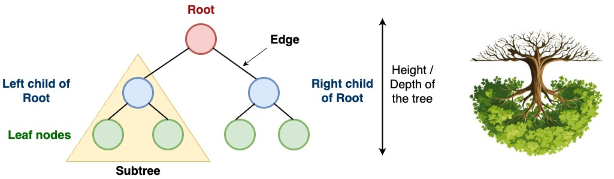
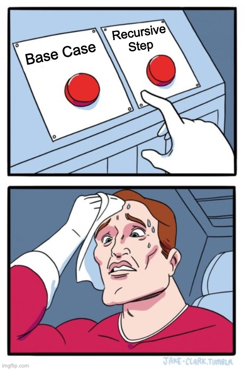
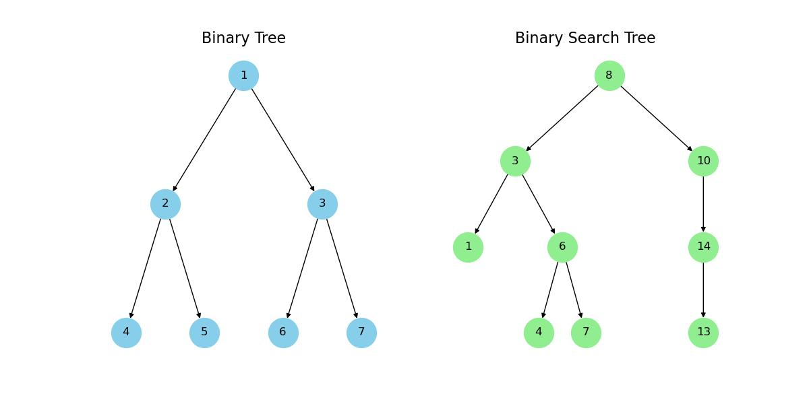

## Learning objectives {style="font-size: 0.85em;"}

```{python}
#| echo: false
# Hidden: imports, the org chart and the drawing helpers for the whole deck, kept in
# one place so the visible cells below contain only the code students should read.
import networkx as nx


def names(items):
    """["ada", "kelp", "nori"] -> "ada, kelp and nori"."""
    items = [str(x) for x in items]
    return items[0] if len(items) == 1 else ", ".join(items[:-1]) + " and " + items[-1]


def tree_layout(children, root, pad=0.5):
    """Where to draw every node and edge of a tree given as {node: [children]}. Leaves sit
    one unit apart, left to right, and each parent is centred over its children.
    Every edge is named by its child, since each child has exactly one parent."""
    pos, order, next_leaf = {}, [], [0]

    def place(node, depth):
        order.append(node)
        kids = children.get(node, [])
        for kid in kids:
            place(kid, depth + 1)
        if kids:
            x = sum(pos[k][0] for k in kids) / len(kids)
        else:
            x = next_leaf[0]
            next_leaf[0] += 1
        pos[node] = (x, -depth)

    place(root, 0)
    xs = [x for x, _ in pos.values()]
    ys = [y for _, y in pos.values()]
    return {"pos": pos,
            "nodes": [{"id": u, "x": pos[u][0], "y": pos[u][1]} for u in order],
            "edges": [{"child": c, "x1": pos[p][0], "y1": pos[p][1], "x2": pos[c][0], "y2": pos[c][1]}
                      for p in order for c in children.get(p, [])],
            "x_domain": [min(xs) - pad, max(xs) + pad],
            "y_domain": [min(ys) - pad, max(ys) + pad]}


def stack_boxes(stack, label=lambda u: u):
    """The call stack as a row of boxes, bottom on the left: the running call is orange (end),
    the calls waiting under it are light blue (wait)."""
    return [{"label": label(u), "cls": "end" if i == len(stack) - 1 else "wait"}
            for i, u in enumerate(stack)]


# The org chart: who reports to whom. The same dict as the visible pyodide cells.
reports = {"sky": ["otter", "clam"], "otter": ["kelp", "nori", "mochi"],
           "clam": ["bubbles", "pixel"], "nori": ["ada", "waffle"], "pixel": ["river"]}
ceo = "sky"
boss_of = {p: boss for boss, team in reports.items() for p in team}
org_tree = nx.Graph([(boss, p) for boss, team in reports.items() for p in team])
org_depth = nx.shortest_path_length(org_tree, ceo)
org_height = max(org_depth.values())
n_people = org_tree.number_of_nodes()
n_lines = org_tree.number_of_edges()
org_layout = tree_layout(reports, ceo)
org_pos = org_layout.pop("pos")
ojs_define(org_layout = org_layout)
```

```{pyodide}
#| include: false
# Hidden setup for the runnable cells: the drawing helpers for vee, the Node class, the
# org chart and the two binary trees, so a later cell still works when an earlier slide was skipped.
import math
import random
import sys

import matplotlib.pyplot as plt
import networkx as nx


def move_pen(x, y, angle, length):
    """The point you reach from (x, y) by moving length units in direction angle (0 is up)."""
    radians = math.radians(angle)
    return x + length * math.sin(radians), y + length * math.cos(radians)


SHAPES = {"square": "s", "hexagon": "h", "star": "*"}   # shape name -> matplotlib marker


def draw_shape(x, y, shape):
    """Draw an empty black shape at (x, y)."""
    plt.plot(x, y, marker=SHAPES[shape], markersize=15,
             markerfacecolor="none", markeredgecolor="k")


class Node:
    def __init__(self, data):
        self.data = data
        self.children = []

    def add_child(self, child_node):
        self.children.append(child_node)

    def print_tree(self, level=0):
        print("  " * level + str(self.data))
        for child in self.children:
            child.print_tree(level + 1)


reports = {"sky": ["otter", "clam"], "otter": ["kelp", "nori", "mochi"],
           "clam": ["bubbles", "pixel"], "nori": ["ada", "waffle"], "pixel": ["river"]}
people = {"sky": Node("sky")}
for boss, team in reports.items():
    for name in team:
        people[name] = Node(name)
        people[boss].add_child(people[name])
ceo = people["sky"]


def count_nodes(node):
    total = 1
    for child in node.children:
        total += count_nodes(child)
    return total


class BinaryTree:
    def __init__(self, item, left=None, right=None):
        self.item = item
        self.left = left
        self.right = right


tree = BinaryTree(1,
                  left=BinaryTree(2, BinaryTree(4), BinaryTree(5)),
                  right=BinaryTree(3, BinaryTree(6), BinaryTree(7)))
bst = BinaryTree(8,
                 left=BinaryTree(3, BinaryTree(1), BinaryTree(6, BinaryTree(4), BinaryTree(7))),
                 right=BinaryTree(10, right=BinaryTree(14, left=BinaryTree(13))))
```


::: {.incremental}
- Use the tree words: root, parent, child, leaf, subtree, height.
- Explain recursion: a base case and a recursive step.
- Explain the call stack, and why deep recursion raises a `RecursionError`.
- Trace a recursive function by hand.
- Write a recursive function, including one that walks a tree.
- Compare recursion and loops, and estimate their time and space.
- Search and insert in a binary search tree, and explain when it is $O(\log n)$ or $O(n)$.
:::

# How many people work here? {background-image="images/li_orgchart_openai.png" background-size="contain" background-position="right" style="font-size: 0.8em;"}

Your CEO wants the exact headcount by Friday.

There is no HR database. Each person only knows their own **direct reports**.

::: {.fragment}
How would you get the number? 🤔
:::

::: {.notes}
- Let them suggest. Walk around with a clipboard? Who do you ask first?
- Steer towards: the CEO asks each VP "how many people are in your team?", and each VP does the same.
- Don't name recursion yet. We come back to this question after the break.
:::

::: footer
Image generated by OpenAI GPT-image-2.5-sunburst
:::

```{python}
#| echo: false
# Hidden: the "draw the org chart" step-through on the next slide. The path and the cycle
# come from networkx; every colour role and sentence is worked out here, OJS only draws.
def org_roles(nodes=None, edges=None, labels=None, show_edges=True, extra=()):
    """Colour roles keyed by person (nodes) and by the child end of each line (edges)."""
    return {"node_roles": nodes or {}, "edge_roles": edges or {}, "labels": labels or {},
            "show_edges": show_edges, "extra": list(extra)}


def line_children(path):
    """The lines on a path, each named by its child end."""
    return [v if boss_of.get(v) == u else u for u, v in zip(path, path[1:])]


one_path = nx.shortest_path(org_tree, "ada", "bubbles")
second_boss = ("clam", "kelp")                      # what if kelp also reported to clam?
loop = nx.shortest_path(org_tree, "kelp", "clam")   # kelp, otter, sky, clam
extra_line = {"x1": org_pos["clam"][0], "y1": org_pos["clam"][1],
              "x2": org_pos["kelp"][0], "y2": org_pos["kelp"][1]}

draw_steps = [
    {**org_roles(show_edges=False),
     "say": f"{n_people} people work at the company. Who reports to whom?"},
    {**org_roles({ceo: "root"}),
     "say": f"Draw a line from each boss down to each direct report. The CEO, {ceo}, goes on top."},
    {**org_roles({u: "path" for u in one_path}, {c: "path" for c in line_children(one_path)}),
     "say": f"From ada to bubbles there is exactly one path: {' → '.join(one_path)}."},
    {**org_roles({u: "path" for u in loop}, {c: "path" for c in line_children(loop)}, extra=[extra_line]),
     "say": f"What if kelp also reported to clam? {' → '.join(loop + ['kelp'])} goes around in a loop: "
            "a cycle. Now kelp has two paths up to the CEO."},
]
for k, step in enumerate(draw_steps):
    step["count"] = f"Step {k} of {len(draw_steps) - 1}"
ojs_define(draw_steps = draw_steps)
```

## Draw the org chart {style="font-size: 0.8em;"}

```{ojs}
//| echo: false
// Draw only: a tree laid out in Python, with colour roles and labels from Python.
// Orange: running now or on a path. Light blue: waiting. Blue: done or in the subtree. Dark: root or parent.
draw_tree = (lay, s, {width = 860, height = 290, r = 14} = {}) => {
  const fill = {now: "#eb6834", path: "#eb6834", pick: "#eb6834", waiting: "#a9c8ef",
                done: "#2a78d6", friend: "#2a78d6", root: "#52514e", you: "#52514e", other: "#b8b6b0"};
  const stroke = {path: "#eb6834", found: "#2a78d6", friend: "#2a78d6", base: "#d9d8d4"};
  const labels = s.labels ?? {};
  const nodes = lay.nodes.map(d => ({...d, role: s.node_roles[d.id] ?? "other", label: labels[d.id] ?? d.id}))
                         .filter(d => d.role !== "hidden");
  const edges = s.show_edges === false ? [] :
    lay.edges.map(d => ({...d, role: s.edge_roles[d.child] ?? "base"})).filter(d => d.role !== "hidden");
  return Plot.plot({
    width, height, margin: 14, marginTop: 30,
    style: {fontSize: "16px", background: "transparent"},
    x: {axis: null, domain: lay.x_domain}, y: {axis: null, domain: lay.y_domain},
    marks: [
      Plot.link(edges, {x1: "x1", y1: "y1", x2: "x2", y2: "y2", stroke: d => stroke[d.role],
                        strokeWidth: d => d.role === "base" ? 2 : 4}),
      Plot.link(s.extra ?? [], {x1: "x1", y1: "y1", x2: "x2", y2: "y2", stroke: "#eb6834",
                                strokeWidth: 4, strokeDasharray: "8,6"}),
      Plot.dot(nodes, {x: "x", y: "y", r, fill: d => fill[d.role], stroke: "white", strokeWidth: 2}),
      Plot.text(nodes, {x: "x", y: "y", text: "label", dy: -(r + 10), fontWeight: "bold",
                        fill: "#0b0b0b", stroke: "white", strokeWidth: 5, paintOrder: "stroke"})
    ]
  });
}
```

```{ojs}
//| echo: false
viewof draw_step = Inputs.button([
  ["Back", i => Math.max(i - 1, 0)],
  ["Next step", i => Math.min(i + 1, draw_steps.length - 1)],
  ["Start over", () => 0]
], {value: 0})
```

```{ojs}
//| echo: false
{
  // Print and draw only: the sentence and colours were worked out in Python (draw_steps).
  const s = draw_steps[draw_step];
  return html`<div class="ojs-readout"><span class="sq-count">${s.count}</span> ${s.say}</div>
    ${draw_tree(org_layout, s)}`;
}
```

::: {.fragment}
Connected, with no cycles: exactly one path between any two people. That is a **tree**.
:::

::: {.notes}
- Step 2: ask them to find another path from ada to bubbles. There is none.
- Step 3: two bosses breaks it. In a tree, everyone has exactly one boss.
- Lecture 4: the lines BFS walked along also formed a tree.
:::

## What is a tree? {style="font-size: 0.85em;"}

A **tree** is a graph that is connected and has no cycles.

{fig-align="center" width="85%"}

::: {.fragment}
We draw it upside down: the root at the top, the leaves at the bottom.
:::

```{python}
#| echo: false
# Hidden: parent, children, subtree and depth of every person, for the "Tree words" slide.
def team_of(p):
    """p plus everyone below p: the subtree that starts at p."""
    return [p] + [d for kid in reports.get(p, []) for d in team_of(kid)]


word_views = {}
for p in org_layout["nodes"]:
    p = p["id"]
    team = team_of(p)
    kids = reports.get(p, [])
    nodes = {u: "friend" for u in team}
    if p in boss_of:
        nodes[boss_of[p]] = "you"
    nodes[p] = "pick"
    facts = ["the root, no parent" if p == ceo else f"parent {boss_of[p]}",
             f"children {names(kids)}" if kids else "no children, so a leaf",
             "subtree: the whole company" if p == ceo else f"subtree {names(team)}",
             f"depth {org_depth[p]}"]
    word_views[p] = {"node_roles": nodes, "edge_roles": {c: "friend" for c in team if c != p},
                     "say": f"{p}: " + ", ".join(facts) + "."}
ojs_define(word_views = word_views, word_choices = [d["id"] for d in org_layout["nodes"]])
```

## Tree words {style="font-size: 0.75em;"}

```{ojs}
//| echo: false
viewof word_pick = Inputs.select(word_choices, {value: "nori", label: "person"})
```

```{ojs}
//| echo: false
{
  // Print and draw only: every fact and colour was worked out in Python (word_views).
  const s = word_views[word_pick];
  return html`<div class="ojs-readout">${s.say}</div>${draw_tree(org_layout, s, {height: 240})}`;
}
```

::: {.incremental}
- Root: the top node, with no parent. The CEO.
- Parent: the node directly above (dark). Your boss.
- Children: the nodes directly below. Your direct reports.
- Leaf: a node with no children.
- Subtree: a node plus everything below it (blue). Every subtree is a **tree**.
- Height: edges on the longest path from the root down to a leaf. Here: `{python} org_height`.
- Balanced: at every node, the subtrees have about the same height.
:::

::: {.notes}
- Pick a leaf (kelp) and the root (sky) to contrast.
- A subtree is a team: clam's subtree is clam's whole department.
- Depth counts edges down from the root. Height is the largest depth.
:::

## iClicker: how many edges? {style="font-size: 0.8em;"}

A tree has $V$ nodes. How many edges does it have?

- \(A) $V - 1$
- \(B) $V$
- \(C) $V + 1$
- \(D) $\frac{V(V-1)}{2}$

::: {.fragment}
- Answer: **A**. Everyone except the CEO has exactly one line up to their boss.
- Add one edge: a cycle. Remove one: two pieces. A tree is the cheapest way to connect $V$ nodes.
:::

```{pyodide}
reports = {"sky": ["otter", "clam"], "otter": ["kelp", "nori", "mochi"],
           "clam": ["bubbles", "pixel"], "nori": ["ada", "waffle"], "pixel": ["river"]}

G = nx.Graph([(boss, name) for boss, team in reports.items() for name in team])
print("is it a tree?", nx.is_tree(G))   # connected and no cycles
print(G.number_of_nodes(), "people,", G.number_of_edges(), "reporting lines")
```

::: {.notes}
- Lecture 3: a complete graph has V(V − 1)/2 edges. A tree has V − 1. The two extremes of "connected".
:::

## Why trees? {style="font-size: 0.85em;"}

:::: {.columns}
::: {.column width="55%"}
::: {.incremental}
- File systems: folders inside folders.
- Org charts: each employee has one boss.
- Web pages: HTML tags nested inside tags.
- Machine learning: decision trees, random forests (DSCI 571, 573).
- Fast search: binary search trees (lecture 6), heaps, the B-trees inside databases.
:::
:::
::: {.column width="45%"}
```text
Root Folder
 ├── Documents
 │    ├── Resume.pdf
 │    └── Notes.txt
 └── Pictures
      ├── Vacation/
      │     └── beach.jpg
      └── profile.png
```
:::
::::

::: {.notes}
- A balanced binary search tree finds an item in O(log n), like binary search in lecture 2.
:::

## A tree in Python {style="font-size: 0.75em;"}

Each node stores its data and a list of its children.

```{pyodide}
class Node:
    def __init__(self, data):
        self.data = data      # the value stored in this node
        self.children = []    # the child nodes, empty for a leaf

    def add_child(self, child_node):
        self.children.append(child_node)

    def print_tree(self, level=0):
        print("  " * level + str(self.data))   # indent by level
        for child in self.children:
            child.print_tree(level + 1)          # each child's subtree, one level deeper
```

```{pyodide}
people = {"sky": Node("sky")}            # name -> Node, starting with the CEO
for boss, team in reports.items():
    for name in team:
        people[name] = Node(name)
        people[boss].add_child(people[name])

ceo = people["sky"]
ceo.print_tree()
```

::: {.fragment}
Look at `print_tree`: it calls **itself**. Hold that thought.
:::

::: {.notes}
- `networkx` treats a tree as just another graph. A `Node` class is the usual way to write one by hand.
- It works because every subtree is a tree: printing a team is printing the boss, then printing each smaller team.
:::

# A function that calls itself {style="font-size: 0.8em;"}

::: {.notes}
About 25 minutes for this section. Go slowly: this is the core of the lecture.
:::

## A random org chart {style="font-size: 0.7em;"}

Each V is a boss with 2 reports. At each tip: a person with no reports (a shape), or another boss (another V).

```{pyodide}
def vee(x=0, y=0, angle=0, length=1):
    """Draw a V. At the tip of each branch: a random shape, or another V."""
    for turn in [-6.4, 6.4]:                        # left branch, then right branch
        new_angle = angle + turn
        new_x, new_y = move_pen(x, y, new_angle, length)
        plt.plot([x, new_x], [y, new_y], "k")       # draw the branch

        shape = random.choice(["square", "hexagon", "star", "vee", "vee"])
        if shape == "vee":
            vee(new_x, new_y, new_angle, length)    # another V: vee calls itself
        else:
            draw_shape(new_x, new_y, shape)         # the branch ends here
```

```{pyodide}
random.seed(0)                # try other seeds!
plt.figure(figsize=(4, 4))
vee()
plt.axis("off")
plt.show()
```

::: {.notes}
- `move_pen` and `draw_shape` are small helpers from the lecture notes.
- `vee` never draws the whole tree. It draws one V and hands the rest to `vee`.
- Change the seed a few times live.
- Credit: idea from Paul Goldenberg, shown to us by Dan Garcia.
:::

## Question: what stops it? {style="font-size: 0.85em;"}

`vee` calls itself. Why doesn't it call itself forever?

::: {.fragment}
- The square, hexagon and star. They draw a shape and stop, with no more calls.
- Each V starts on average $2 \times \frac{2}{5} = 0.8$ new Vs. Less than 1, so the tree dies out.
- The case that stops is called the **base case**.
:::

::: {.notes}
- If the list were all "vee", it would never stop.
:::

## Functions that call functions {style="font-size: 0.8em;"}

Like the CEO asking a VP, who asks a manager.

```{pyodide}
def h():
    return 0

def g():
    return h() + 1   # call h, then add 1

def f():
    return g() + 1   # call g, then add 1

f()
```

::: {.fragment}
Once you know `g()` returns 1, forget how. To understand `f`, you only need **what** `g` returns.
:::

::: {.notes}
- Predict before running: 2.
- This "trust the answer" trick is what makes recursion easy to read later.
:::

## Who finishes first? {style="font-size: 0.8em;"}

Predict the order of the printout.

```{pyodide}
def h(n):
    print("start h, n =", n)
    print("end   h, n =", n)

def g(n):
    print("start g, n =", n)
    h(n - 1)
    print("end   g, n =", n)

def f(n):
    print("start f, n =", n)
    g(n - 1)
    print("end   f, n =", n)

f(5)
```

```{python}
#| echo: false
# Hidden: the two call stack step-throughs. Instrumented copies of the visible f, g, h (with
# f(5)) and of the recursive f (with f(3)) log every start and end, with the line they print.
def stack_steps(events):
    """One step per start or end. events: (kind, label, value, line, note)."""
    stack, lines, steps = [], [], [{"say": "Nothing has run yet.", "lines": [], "frames": [],
                                    "popped": "", "popped_cls": "sq-empty"}]
    for kind, label, value, line, note in events:
        popped = ""
        if kind == "call":
            caller = stack[-1] if stack else None
            say = f"{caller} calls {label}. {caller} waits, and {label} goes on top." if caller \
                else f"Call {label}. It goes on the stack."
            stack.append(label)
        else:
            stack.pop()
            popped = label + (f" → {value}" if value is not None else "")
            back = stack[-1] if stack else None
            say = (f"{label} ends" + (f" and returns {value}" if value is not None else "")
                   + ". It comes off the top. "
                   + (f"{back} carries on where it left off." if back else "The stack is empty: done."))
        lines.append(line)
        steps.append({"say": note + say,
                      "lines": [{"text": t, "cls": "new" if j == len(lines) - 1 else ""}
                                for j, t in enumerate(lines)],
                      "frames": [{"label": u, "cls": "end" if i == len(stack) - 1 else "wait",
                                  "tag": "◀ running" if i == len(stack) - 1 else ""}
                                 for i, u in enumerate(stack)],
                      "popped": popped, "popped_cls": "found" if popped else "sq-empty"})
    for k, step in enumerate(steps):
        step["count"] = f"Step {k} of {len(steps) - 1}"
    return steps


fgh_log = []

def h_logged(n):
    fgh_log.append(("call", f"h({n})", None, f"start h, n = {n}", ""))
    fgh_log.append(("return", f"h({n})", None, f"end   h, n = {n}", ""))

def g_logged(n):
    fgh_log.append(("call", f"g({n})", None, f"start g, n = {n}", ""))
    h_logged(n - 1)
    fgh_log.append(("return", f"g({n})", None, f"end   g, n = {n}", ""))

def f_logged(n):
    fgh_log.append(("call", f"f({n})", None, f"start f, n = {n}", ""))
    g_logged(n - 1)
    fgh_log.append(("return", f"f({n})", None, f"end   f, n = {n}", ""))

f_logged(5)


rec_log = []

def f_rec_logged(n):
    rec_log.append(("call", f"f({n})", None, f"start f, n = {n}", ""))
    if n == 0:
        rec_log.append(("return", "f(0)", 0, "end   f, n = 0, return 0 (base case)",
                        "Base case, no more calls. "))
        return 0
    value = f_rec_logged(n - 1) + 1
    rec_log.append(("return", f"f({n})", value, f"end   f, n = {n}, return {value}", ""))
    return value

f_rec_logged(3)

ojs_define(fgh_steps = stack_steps(fgh_log), rec_steps = stack_steps(rec_log))
```

## The call stack {style="font-size: 0.8em;"}

```{ojs}
//| echo: false
// Draw only: the printout, the stack and the sentence come from Python (fgh_steps, rec_steps).
draw_stack = s => html`<div class="ojs-readout"><span class="sq-count">${s.count}</span> ${s.say}</div>
  <div class="cs-wrap">
    <div><div class="ds-caption">printed so far</div>
      <div class="cs-console">${s.lines.map(l => html`<div class="${l.cls}">${l.text}</div>`)}</div></div>
    <div class="sq-lift">
      <div class="ds-box ${s.popped_cls}">${s.popped}</div>
      <div class="sq-stack tall">${s.frames.map(f =>
        html`<div class="ds-box ${f.cls}">${f.label}<span class="sq-tag right">${f.tag}</span></div>`)}</div>
      <div class="ds-caption">call stack</div>
    </div>
  </div>`
```

```{ojs}
//| echo: false
viewof fgh_step = Inputs.button([
  ["Back", i => Math.max(i - 1, 0)],
  ["Next step", i => Math.min(i + 1, fgh_steps.length - 1)],
  ["Start over", () => 0]
], {value: 0})
```

```{ojs}
//| echo: false
draw_stack(fgh_steps[fgh_step])
```

::: {.fragment}
`f` starts first but ends last: a **stack**, last in, first out (lecture 4).
:::

::: {.notes}
- Orange: the call running now. Light blue: calls waiting for an answer. Blue: the call that just ended.
- Each call gets its own `n`. f's n is still 5 when it carries on.
- Python keeps this stack for every program you run.
:::

## Same job, different names {style="font-size: 0.75em;"}

We are getting close to the punch line.

```{pyodide}
def f(n):
    if n == 0:
        return 0
    else:
        return g(n - 1) + 1

def g(n):
    if n == 0:
        return 0
    else:
        return h(n - 1) + 1

def h(n):
    if n == 0:
        return 0
    else:
        return i(n - 1) + 1   # we never wrote a function called i!

for n in range(4):
    print(f"f({n}) =", f(n))
```

::: {.fragment}
`f`, `g` and `h` do the **same** job. Should we write `i`, `j`, `k`, ... forever?
:::

::: {.notes}
- f(0), f(1), f(2) work. f(3) needs i, which doesn't exist: NameError.
- Like a CEO, a VP and a manager all doing the same thing: ask the next person, add 1.
:::

## A function that calls itself {style="font-size: 0.8em;"}

:::: {.columns}
::: {.column width="62%"}
```{pyodide}
def f(n):
    if n == 0:
        return 0              # base case: answer directly
    else:
        return f(n - 1) + 1   # recursive step: call f on a smaller input

f(3)
```

::: {.incremental}
- That is **recursion**: a function that calls itself.
- Base case: small enough to answer directly. It stops the calls.
- Recursive step: call itself on a smaller input, and use the answer.
- Each call must get closer to the base case.
:::
:::
::: {.column width="38%"}
{width="85%" fig-align="center"}
:::
::::

::: {.notes}
- Think of each call as a separate copy of f with its own n, just like f, g and h were.
:::

::: footer
Meme template: [Jake Clark](https://jake-clark.tumblr.com), via [imgflip](https://imgflip.com)
:::

## Watch it run {style="font-size: 0.8em;"}

```{pyodide}
def f(n):
    print("start f, n =", n)
    if n == 0:
        print("end   f, n = 0, return 0 (base case)")
        return 0
    else:
        value = f(n - 1) + 1
        print(f"end   f, n = {n}, return {value}")
        return value

f(3)
```

::: {.fragment}
Same pattern as `f`, `g` and `h`. Every call is now named `f`.
:::

## The call stack, again {style="font-size: 0.8em;"}

```{ojs}
//| echo: false
viewof rec_step = Inputs.button([
  ["Back", i => Math.max(i - 1, 0)],
  ["Next step", i => Math.min(i + 1, rec_steps.length - 1)],
  ["Start over", () => 0]
], {value: 0})
```

```{ojs}
//| echo: false
draw_stack(rec_steps[rec_step])
```

::: {.fragment}
The calls pile up until `n` hits 0. Then the answers come back, one at a time.
:::

::: {.notes}
- Ask: when f(0) returns 0, what does f(1) do with it? Adds 1 and returns.
- Four calls of f are waiting at the deepest point: f(3), f(2), f(1), f(0).
:::

## What if we never reach the base case? {style="font-size: 0.8em;"}

`f(-1)` calls `f(-2)`, which calls `f(-3)`, ... `n` never hits 0.

```{pyodide}
def f(n):
    if n == 0:
        return 0
    else:
        return f(n - 1) + 1

try:
    f(-1)
except RecursionError as error:   # catch the error, so we only see its message
    print("RecursionError:", error)

print("most calls allowed on the stack:", sys.getrecursionlimit())
```

::: {.incremental}
- Every waiting call takes memory on the stack. Without a limit: a **stack overflow**.
- Python stops first, at about 1,000 calls, with a `RecursionError`. A loop has no such limit.
:::

::: {.notes}
- In the org chart: a circular reporting line. kelp asks clam, clam asks kelp, and nobody ever answers.
- Yes, that is where the website Stack Overflow got its name.
:::

## iClicker: time and space of `f(n)` {style="font-size: 0.8em;"}

```{.python}
def f(n):
    if n == 0:
        return 0
    else:
        return f(n - 1) + 1
```

What are the time and space complexity of `f(n)` for $n \geq 0$?

- \(A) $O(1)$ time, $O(1)$ space
- \(B) $O(n)$ time, $O(1)$ space
- \(C) $O(n)$ time, $O(n)$ space
- \(D) $O(n^2)$ time, $O(n)$ space

::: {.fragment}
- Answer: **C**. $n + 1$ calls, each $O(1)$ work.
- Space: all $n + 1$ calls wait on the stack at the deepest point. Recursion uses memory even with no list.
:::

# Back to the CEO's question {background-image="images/li_orgchart_openai.png" background-size="contain" background-position="right" style="font-size: 0.8em;"}

Every subtree is a tree. So to answer a question about a tree:

::: {.incremental}
1. Ask each child's subtree (recursion).
2. Combine their answers with the current node.
:::

::: footer
Image generated by OpenAI GPT-image-2.5-sunburst
:::

```{python}
#| echo: false
# Hidden: the "count the whole company" step-through. An instrumented count_nodes walks the
# org chart exactly like the visible one and records the call stack and every answer.
def record_count(children, root):
    stack, answer, steps = [], {}, []

    def snap(say):
        top = stack[-1] if stack else None
        nodes = {u: "done" for u in answer}
        nodes.update({u: "waiting" for u in stack})
        if top:
            nodes[top] = "now"
        steps.append({"say": say, "node_roles": nodes,
                      "edge_roles": {u: "found" for u in answer if u != root},
                      "labels": {u: f"{u}: {answer[u]}" for u in answer},
                      "boxes": stack_boxes(stack)})

    def count(node):
        stack.append(node)
        kids = children.get(node, [])
        if not kids:
            answer[node] = 1
            snap(f"{node} has no reports, so {node} answers 1 right away. That is the base case.")
        else:
            snap(f"{node} asks {names(kids)}: how many people are in your team?")
            for kid in kids:
                count(kid)
            answer[node] = 1 + sum(answer[k] for k in kids)
            snap(f"{node} adds it up: 1 for {node}, plus "
                 f"{' + '.join(str(answer[k]) for k in kids)} = {answer[node]}.")
        stack.pop()

    steps.append({"say": f"The CEO, {root}, needs the headcount.", "node_roles": {},
                  "edge_roles": {}, "labels": {}, "boxes": []})
    count(root)
    steps[-1]["say"] += f" Done: {answer[root]} people, and nobody saw the whole chart."
    for k, step in enumerate(steps):
        step["count"] = f"Step {k} of {len(steps) - 1}"
    return steps


ojs_define(count_steps = record_count(reports, ceo))
```

## Count the whole company {style="font-size: 0.75em;"}

```{ojs}
//| echo: false
viewof count_step = Inputs.button([
  ["Back", i => Math.max(i - 1, 0)],
  ["Next step", i => Math.min(i + 1, count_steps.length - 1)],
  ["Start over", () => 0]
], {value: 0})
```

```{ojs}
//| echo: false
{
  // Draw only: the counting was done in Python (count_steps).
  const s = count_steps[count_step];
  const boxes = s.boxes.map(b => html`<div class="ds-box ${b.cls}">${b.label}</div>`);
  return html`<div class="ojs-readout"><span class="sq-count">${s.count}</span> ${s.say}</div>
    ${draw_tree(org_layout, s, {height: 270})}
    <div class="ds-row center"><span class="ds-caption">call stack (top on the right):</span>
      ${boxes.length ? boxes : html`<span class="ds-caption">empty</span>`}</div>`;
}
```

::: {.notes}
- Orange: asking or answering now. Light blue: waiting for answers. Blue: has answered, with the size of the team.
- The call stack is the chain of bosses waiting, from the CEO down to the person asked now.
- Python visits the people depth-first, like DFS in lecture 4.
:::

## Count it in code {style="font-size: 0.8em;"}

```{pyodide}
def count_nodes(node):
    total = 1                          # count this node
    for child in node.children:
        total += count_nodes(child)    # plus everyone in this child's subtree
    return total

count_nodes(ceo)
```

::: {.incremental}
- Where is the base case? A leaf has no children: the loop does nothing, and it returns 1.
- Every call is on a smaller subtree, so we always reach the leaves.
:::

## Question: how many levels? {style="font-size: 0.8em;"}

Write `height(node)`: the number of edges on the longest path from `node` down to a leaf.

Hint: what is the height of a leaf? If you know each child's height, what is yours?

```{pyodide}
def height(node):
    ...

print(height(ceo))   # should print 3
```

::: {.fragment}
```{.python}
def height(node):
    if not node.children:    # base case: a leaf has height 0
        return 0
    return 1 + max(height(child) for child in node.children)   # one edge down to the tallest subtree
```
:::

::: {.notes}
- Give them 3 minutes in pairs.
- sky → otter → nori → ada: 3 edges.
:::

# Binary search, revisited {style="font-size: 0.8em;"}

Find employee 212 in the sorted company directory. Lecture 2: keep cutting the rack in half.

## Two ways to write it {style="font-size: 0.7em;"}

:::: {.columns}
::: {.column width="50%"}
With a loop (lecture 2)

```{.python}
def binary_search_loop(data, key):
    low = 0
    high = len(data) - 1
    while low <= high:
        mid = (low + high) // 2
        if data[mid] == key:
            return True
        if key < data[mid]:
            high = mid - 1
        else:
            low = mid + 1
    return False
```
:::
::: {.column width="50%"}
With recursion

```{.python code-line-numbers="|2-5|7-11"}
def binary_search(data, key):
    if len(data) == 0:      # base case: nothing left
        return False
    if len(data) == 1:      # base case: one item left
        return data[0] == key

    mid = len(data) // 2
    if key < data[mid]:
        return binary_search(data[:mid], key)  # left half
    else:
        return binary_search(data[mid:], key)  # right half
```
:::
::::

::: {.fragment}
"Search the left half" is the same problem on a smaller list. No `low`, `high` or `while`.
:::

## Try it: recursive binary search {style="font-size: 0.75em;"}

```{pyodide}
def binary_search(data, key):
    if len(data) == 0:
        return False
    if len(data) == 1:
        return data[0] == key

    mid = len(data) // 2
    if key < data[mid]:
        return binary_search(data[:mid], key)
    else:
        return binary_search(data[mid:], key)

ids = [102, 117, 125, 138, 146, 151, 163, 170, 184, 199, 205, 212, 228, 236, 247, 259]
assert binary_search(ids, 212)        # in the middle somewhere
assert binary_search(ids, 102)        # the first ID
assert binary_search(ids, 259)        # the last ID
assert not binary_search(ids, 300)    # bigger than everything
assert not binary_search([], 5)       # empty list
print("all tests passed")
```

## Question: is it $O(\log n)$? {style="font-size: 0.85em;"}

How many times does `binary_search` call itself on $n$ IDs? Does that make it $O(\log n)$, like the loop?

::: {.fragment}
- About $\log_2 n$ calls: each one cuts the list in half.
- But look at `data[:mid]`. What does slicing do?
:::

```{python}
#| echo: false
# Hidden: the "photocopy" step-through on the next slide. An instrumented copy of the visible
# binary_search (same slicing, same ids and key) records each call's list and how many IDs
# it copies for the next call.
copy_ids = [102, 117, 125, 138, 146, 151, 163, 170, 184, 199, 205, 212, 228, 236, 247, 259]
copy_key = 212
copy_calls = []

def binary_search_logged(data, key, start=0):
    """start: where data begins in copy_ids, so each call can be drawn in place."""
    call = {"start": start, "data": data, "mid": None, "copied": 0, "found": False}
    copy_calls.append(call)
    if len(data) == 0:
        return False
    if len(data) == 1:
        call["found"] = data[0] == key
        return data[0] == key
    mid = len(data) // 2
    call["mid"] = mid
    if key < data[mid]:
        call["copied"] = mid
        return binary_search_logged(data[:mid], key, start)
    call["copied"] = len(data) - mid
    return binary_search_logged(data[mid:], key, start + mid)

binary_search_logged(copy_ids, copy_key)

copy_rows = []
for k, call in enumerate(copy_calls, start=1):
    boxes = []
    for slot in range(len(copy_ids)):
        i = slot - call["start"]
        if 0 <= i < len(call["data"]):
            cls = "found" if call["found"] else "end" if i == call["mid"] else ""
            boxes.append({"label": copy_ids[slot], "cls": cls})
        else:
            boxes.append({"label": "", "cls": "sq-empty"})
    copy_rows.append({"name": f"call {k}", "boxes": boxes,
                      "note": "found!" if call["found"] else f"copies {call['copied']}"})

copy_total = sum(c["copied"] for c in copy_calls)
copy_steps = [{"rows": [], "say": f"{len(copy_ids)} sorted IDs. Find {copy_key}."}]
for k, call in enumerate(copy_calls, start=1):
    n_here = len(call["data"])
    if call["found"]:
        copied = " + ".join(str(c["copied"]) for c in copy_calls if c["copied"])
        say = (f"Call {k} gets 1 ID: {copy_key}. Found! IDs copied in total: {copied} = {copy_total}, "
               f"about n = {len(copy_ids)}.")
    else:
        middle = call["data"][call["mid"]]
        side = "left" if copy_key < middle else "right"
        say = (f"Call {k} gets {'the list' if k == 1 else 'a copy'} of {n_here} IDs. The middle is {middle}, "
               f"so it copies the {side} {call['copied']} for the next call.")
    copy_steps.append({"rows": copy_rows[:k], "say": say})
for k, step in enumerate(copy_steps):
    step["count"] = f"Step {k} of {len(copy_steps) - 1}"
ojs_define(copy_steps = copy_steps)
```

## Every call makes a photocopy {style="font-size: 0.8em;"}

```{ojs}
//| echo: false
viewof copy_step = Inputs.button([
  ["Back", i => Math.max(i - 1, 0)],
  ["Next step", i => Math.min(i + 1, copy_steps.length - 1)],
  ["Start over", () => 0]
], {value: 0})
```

```{ojs}
//| echo: false
{
  // Draw only: every row, count and sentence was worked out in Python (copy_steps).
  const s = copy_steps[copy_step];
  const rows = s.rows.map(r => html`<div class="ds-row bs-copy"><span class="csr-name">${r.name}</span>
    ${r.boxes.map(b => html`<div class="ds-box ${b.cls}">${b.label}</div>`)}
    <span class="bs-note">${r.note}</span></div>`);
  return html`<div class="ojs-readout"><span class="sq-count">${s.count}</span> ${s.say}</div>${rows}`;
}
```

::: {.fragment}
- Copying costs $\frac{n}{2} + \frac{n}{4} + \dots \approx n$. So this version is $O(n)$, not $O(\log n)$. ⚠️
- The fix: pass `low` and `high` instead of a copy, like the loop. Then $O(\log n)$.
:::

::: {.notes}
- Orange: the middle ID of each call.
- Like photocopying half the directory before handing it to an assistant, instead of saying "look at pages 9 to 16".
- Recursion makes code shorter, but you still have to count what each line costs.
- The fixed version is a bonus slide.
:::

## Recursion or a loop? {style="font-size: 0.75em;"}

Anything you write with recursion, you can write with a loop. Pick the clearer one.

| | loop | recursion |
|---|---|---|
| how it repeats | `for` or `while` | the function calls itself |
| when it stops | the loop condition is `False` | it reaches the base case |
| extra memory | none | one spot on the stack per waiting call |
| limit in Python | none | about 1,000 calls deep |
| good for | the same step for each item | problems made of smaller copies: trees, binary search, fractals |

# Keep the directory sorted {background-image="images/li_orgchart_openai.png" background-size="contain" background-position="right" style="font-size: 0.8em;"}

New hires join every week. Binary search needs the directory sorted.

::: {.fragment}
`list.insert` keeps it sorted, but shifts every ID after the new one over: $O(n)$ per new hire.
:::

::: {.fragment}
Can a tree keep it sorted **and** fast to search? 🤔
:::

::: {.notes}
- About 25 minutes for the BST section.
- Lecture 4: `list.pop(0)` shifted everything left. Inserting in the middle shifts everything right, for the same reason.
:::

::: footer
Image generated by OpenAI GPT-image-2.5-sunburst
:::

## Binary trees {style="font-size: 0.75em;"}

A **binary tree**: every node has at most 2 children, `left` and `right`.

:::: {.columns}
::: {.column width="42%"}
{width="100%"}
:::
::: {.column width="58%"}
```{pyodide}
class BinaryTree:
    def __init__(self, item, left=None, right=None):
        self.item = item     # the value stored in this node
        self.left = left     # the left subtree, or None
        self.right = right   # the right subtree, or None

tree = BinaryTree(1,
                  left=BinaryTree(2, BinaryTree(4), BinaryTree(5)),
                  right=BinaryTree(3, BinaryTree(6), BinaryTree(7)))
print(tree.left.right.item)   # 2's right child
```
:::
::::

::: {.fragment}
`left` and `right` are binary trees too. The nesting in the code matches the picture.
:::

::: {.notes}
- Our org chart `Node` had a list of any number of children. A binary tree node has exactly two slots, and either one can be `None`.
:::

## Is it in the tree? {style="font-size: 0.8em;"}

An empty tree has nothing. Otherwise: is it here, on the left, or on the right?

```{pyodide}
def contains(node, item):
    if node is None:          # base case: an empty tree contains nothing
        return False
    if node.item == item:     # found it here
        return True
    return contains(node.left, item) or contains(node.right, item)   # look on both sides

print(contains(tree, 6), contains(tree, 100))
```

## iClicker: how fast is `contains`? {style="font-size: 0.8em;"}

A binary tree has $n$ nodes. What is the worst-case time complexity of `contains`?

- \(A) $O(1)$
- \(B) $O(\log n)$
- \(C) $O(n)$
- \(D) $O(n^2)$

::: {.fragment}
- Answer: **C**. The item could be anywhere, so we may check every node. No faster than a list.
- To do better, we need to know which **side** to look on.
:::

## Binary search tree {style="font-size: 0.8em;"}

A **binary search tree** (BST) follows one rule at every node:

::: {.incremental}
- everything in the left subtree is smaller, and
- everything in the right subtree is bigger.
:::

{width="72%" fig-align="center"}

::: {.fragment}
Check node 3 on the right: 1 below it on the left is smaller. 6, 4 and 7 on the right are bigger.
:::

::: {.notes}
- Both are binary trees. Only the right one is a BST.
- Items must be comparable with `<`. Numbers work, and so do strings: "apple" < "banana".
:::

## Search a BST {style="font-size: 0.75em;"}

Binary search again: smaller, go left. Bigger, go right. Never look at the other side.

```{pyodide}
bst = BinaryTree(8,
                 left=BinaryTree(3, BinaryTree(1), BinaryTree(6, BinaryTree(4), BinaryTree(7))),
                 right=BinaryTree(10, right=BinaryTree(14, left=BinaryTree(13))))

def bst_contains(node, item):
    if node is None:              # base case: fell off the tree, so it is not here
        return False
    print("visit", node.item)
    if item == node.item:         # base case: found it
        return True
    if item < node.item:
        return bst_contains(node.left, item)    # smaller: it can only be on the left
    else:
        return bst_contains(node.right, item)   # bigger: it can only be on the right

bst_contains(bst, 7)
```

::: {.notes}
- One recursive call runs each time, not two: that is the difference from `contains`.
:::

```{python}
#| echo: false
# Hidden: the BST step-throughs on the next slides (search, insert and the speed chart).
# Trees are built with the same insert rule as the notes; every path, position and
# sentence is worked out here, OJS only draws.
def bst_build(order):
    """Insert items one by one. Returns the children, the root, and one record per insert."""
    kids, root, records = {}, None, []
    for item in order:
        path, node, side = [], root, None
        while node is not None:
            path.append(node)
            side = "left" if item < node else "right"
            node = kids[node][side]
        kids[item] = {"left": None, "right": None}
        if path:
            kids[path[-1]][side] = item
        else:
            root = item
        records.append({"item": item, "path": path, "side": side})
    return kids, root, records


def bst_layout(kids, root, pad=0.6):
    """x = the item's rank in sorted order, y = minus its depth. Edges named by their child."""
    depth, parent, todo = {root: 0}, {}, [root]
    while todo:
        u = todo.pop()
        for c in (kids[u]["left"], kids[u]["right"]):
            if c is not None:
                depth[c], parent[c] = depth[u] + 1, u
                todo.append(c)
    rank = {u: i for i, u in enumerate(sorted(kids))}
    return {"nodes": [{"id": str(u), "x": rank[u], "y": -depth[u]} for u in kids],
            "edges": [{"child": str(c), "x1": rank[p], "y1": -depth[p], "x2": rank[c], "y2": -depth[c]}
                      for c, p in parent.items()],
            "x_domain": [-pad, len(kids) - 1 + pad],
            "y_domain": [-max(depth.values()) - pad, pad],
            "height": max(depth.values()), "parent": parent}


def path_edges(path, role):
    """The edges along a path from the root down, keyed by child."""
    return {str(c): role for c in path[1:]}


# Search: the BST from the notes, built by inserting in this order.
search_kids, search_root, _ = bst_build([8, 3, 10, 1, 6, 14, 4, 7, 13])
search_layout = bst_layout(search_kids, search_root)
search_layout.pop("parent")
search_steps = {}
for key in [7, 13, 5]:
    steps = [{"say": f"Search for {key}. Start at the root, {search_root}.",
              "node_roles": {}, "edge_roles": {}}]
    node, visited = search_root, []
    while node is not None:
        visited.append(node)
        roles = {str(u): "waiting" for u in visited}
        if key == node:
            roles[str(node)] = "done"
            steps.append({"say": f"Visit {node}: found! {len(visited)} of {len(search_kids)} nodes visited.",
                          "node_roles": roles, "edge_roles": path_edges(visited, "path")})
            break
        side = "left" if key < node else "right"
        nxt = search_kids[node][side]
        roles[str(node)] = "now"
        say = f"Visit {node}. {key} {'<' if side == 'left' else '>'} {node}, so go {side}"
        say += "." if nxt is not None else f", but {node} has no {side} child."
        steps.append({"say": say, "node_roles": roles, "edge_roles": path_edges(visited, "path")})
        node = nxt
    if visited[-1] != key:
        steps.append({"say": f"Fell off the tree: {key} is not here. {len(visited)} of "
                             f"{len(search_kids)} nodes visited.",
                      "node_roles": {str(u): "waiting" for u in visited},
                      "edge_roles": path_edges(visited, "path")})
    for k, step in enumerate(steps):
        step["count"] = f"Step {k} of {len(steps) - 1}"
    search_steps[key] = steps
ojs_define(search_view = {"layout": search_layout, "keys": list(search_steps), "steps": search_steps})

# Insert: the two orders from the question, each drawn where its final tree will be.
insert_views = {}
for order in [[8, 1, 13, 9, 5942], [1, 2, 3, 4, 5]]:
    kids, root, records = bst_build(order)
    lay = bst_layout(kids, root)
    parent = lay.pop("parent")
    name = ", ".join(map(str, order))
    steps = [{"say": f"Insert {name} into an empty tree.",
              "node_roles": {str(u): "hidden" for u in kids},
              "edge_roles": {str(u): "hidden" for u in kids}}]
    placed = []
    for rec in records:
        item, path = rec["item"], rec["path"]
        moves = [f"{item} {'<' if item < p else '>'} {p}, go {'left' if item < p else 'right'}" for p in path]
        say = (f"Insert {item}: the tree is empty, so {item} is the root." if not path
               else f"Insert {item}: " + ". ".join(moves) + f". Empty spot: {item} goes here.")
        placed.append(item)
        roles = {str(u): "hidden" for u in kids}
        roles.update({str(u): "other" for u in placed})
        roles.update({str(u): "path" for u in path})
        roles[str(item)] = "done"
        edges = {str(u): "hidden" for u in kids}
        edges.update({str(u): "base" for u in placed})
        edges.update(path_edges(path + [item], "path"))
        if path:
            edges[str(item)] = "found"
        steps.append({"say": say, "node_roles": roles, "edge_roles": edges})
    steps[-1]["say"] += (f" Height {lay['height']}: a stick. Searching it walks past every node."
                         if lay["height"] == len(order) - 1 else f" Height {lay['height']}: fairly balanced.")
    for k, step in enumerate(steps):
        step["count"] = f"Step {k} of {len(steps) - 1}"
    insert_views[name] = {"layout": lay, "steps": steps}
ojs_define(insert_view = {"orders": list(insert_views), "views": insert_views})

# Speed: worst-case nodes visited in a full balanced BST with k levels (n = 2^k - 1 items)
# versus the same items inserted in sorted order (a stick of n nodes).
speed = {}
for k in range(2, 21):
    n = 2 ** k - 1
    rows = [{"shape": "balanced", "visits": k, "label": f"{k:,} nodes"},
            {"shape": "sorted order: a stick", "visits": n, "label": f"{n:,} nodes"}]
    speed[k] = {"rows": rows, "x_max": n * 1.25,
                "say": f"{n:,} IDs. Worst case, a balanced BST visits {k} nodes. The stick visits all {n:,}."}
ojs_define(speed_view = speed)
```

## Question: which nodes does it visit? {style="font-size: 0.75em;"}

Predict first: `bst_contains(bst, 13)`? `bst_contains(bst, 5)`?

```{ojs}
//| echo: false
viewof search_key = Inputs.radio(search_view.keys, {value: 7, label: "search for"})
```

```{ojs}
//| echo: false
viewof search_step = Inputs.button([
  ["Back", i => Math.max(i - 1, 0)],
  ["Next step", i => Math.min(i + 1, search_view.steps[search_key].length - 1)],
  ["Start over", () => 0]
], {value: 0})
```

```{ojs}
//| echo: false
{
  // Draw only: the search was run in Python (search_view).
  const steps = search_view.steps[search_key];
  const s = steps[Math.min(search_step, steps.length - 1)];
  return html`<div class="ojs-readout"><span class="sq-count">${s.count}</span> ${s.say}</div>
    ${draw_tree(search_view.layout, s, {height: 260})}`;
}
```

::: {.fragment}
Each step goes **one level down**. The work depends on the tree's height, not on how many nodes it has.
:::

::: {.notes}
- Orange: the node we are at. Light blue: nodes visited on the way down (those calls are waiting on the stack). Blue: found.
- 13: 8, 10, 14, 13. 5: 8, 3, 6, 4, then 4 has no right child: not here.
:::

## Insert a new hire {style="font-size: 0.8em;"}

To insert, **search** for it. Fall off the tree? That empty spot is where it goes.

Start with an empty BST. Draw the tree after inserting, in this order:

1. `8, 1, 13, 9, 5942`
2. `1, 2, 3, 4, 5`

::: {.notes}
- 2 minutes on paper, then the next slide.
- Already in the tree? Do nothing: no duplicates, like a `set`.
- Students write `insert` themselves in lab 3.
:::

## Insert, step by step {style="font-size: 0.75em;"}

```{ojs}
//| echo: false
viewof insert_order = Inputs.radio(insert_view.orders, {value: insert_view.orders[0], label: "insert"})
```

```{ojs}
//| echo: false
viewof insert_step = Inputs.button([
  ["Back", i => Math.max(i - 1, 0)],
  ["Next step", i => Math.min(i + 1, insert_view.views[insert_order].steps.length - 1)],
  ["Start over", () => 0]
], {value: 0})
```

```{ojs}
//| echo: false
{
  // Draw only: every insert was done in Python (insert_view).
  const v = insert_view.views[insert_order];
  const s = v.steps[Math.min(insert_step, v.steps.length - 1)];
  return html`<div class="ojs-readout"><span class="sq-count">${s.count}</span> ${s.say}</div>
    ${draw_tree(v.layout, s, {height: 270})}`;
}
```

::: {.fragment}
Same items, different order, very different trees. Sorted order makes a stick.
:::

::: {.notes}
- Orange: the path walked down. Blue: the new node.
- Nodes are drawn left to right in sorted order, so a BST always reads small to big across the page.
:::

## How fast is a BST? {style="font-size: 0.75em;"}

Search and insert walk one path from the root down: $O(\text{height})$.

```{ojs}
//| echo: false
viewof speed_k = Inputs.range([2, 20], {value: 10, step: 1, label: "levels in a balanced tree"})
```

```{ojs}
//| echo: false
{
  // Draw only: every count was computed in Python (speed_view).
  const v = speed_view[speed_k];
  return html`<div class="ojs-readout">${v.say}</div>${Plot.plot({
    width: 860, height: 170, marginLeft: 190, marginRight: 140, marginBottom: 46,
    style: {fontSize: "16px", background: "transparent"},
    x: {label: "nodes visited, worst case →", labelAnchor: "center", grid: true, domain: [0, v.x_max]},
    y: {label: null, domain: v.rows.map(d => d.shape)},
    marks: [
      Plot.barX(v.rows, {y: "shape", x: "visits", rx: 4,
                         fill: d => d.shape === "balanced" ? "#b8b6b0" : "#2a78d6"}),
      Plot.text(v.rows, {y: "shape", x: "visits", text: "label", dx: 8, textAnchor: "start", fontWeight: "bold"}),
      Plot.ruleX([0])
    ]
  })}`;
}
```

::: {.incremental}
- Balanced: the height is about $\log_2 n$, so search and insert are $O(\log n)$.
- Inserted in sorted order: a stick, height $n - 1$, so $O(n)$. No better than a list.
- Real BSTs (red-black trees, AVL trees) rebalance after each insert, so they stay $O(\log n)$.
:::

::: {.notes}
- Slide to 20 levels: about a million IDs, 20 visits versus a million.
- Deleting from a BST is trickier, and we skip it.
:::

## Today's cheat sheet {style="font-size: 0.65em;"}

| function | calls per step | how deep | time | space (call stack) |
|---|---|---|---|---|
| `f(n)`: count down to 0 | 1 | $n$ | $O(n)$ | $O(n)$ |
| `count_nodes`: tree with $V$ nodes | one per child | the height | $O(V)$ | $O(\text{height})$ |
| `binary_search` with slicing | 1 | $\log n$ | $O(n)$ | $O(n)$ |
| `binary_search` with `low`, `high` | 1 | $\log n$ | $O(\log n)$ | $O(\log n)$ |
| `contains`: binary tree | 2 | the height | $O(n)$ | $O(\text{height})$ |
| `bst_contains`: BST | 1 | the height | $O(\text{height})$ | $O(\text{height})$ |

| data structure | search | insert | notes |
|---|---|---|---|
| binary tree | $O(n)$ | depends | no rule, so we may check every node |
| BST, balanced | $O(\log n)$ | $O(\log n)$ | keeps items sorted, keys need `<` |
| BST, inserted in sorted order | $O(n)$ | $O(n)$ | a stick, no better than a list |

## Today's takeaways {style="font-size: 0.8em;"}

::: {.incremental}
- A tree is a connected graph with no cycles: one path between any two nodes, $V - 1$ edges.
- Recursion: a function that calls itself on a smaller input. It needs a base case and a recursive step.
- Python tracks calls on a call stack. Recursion $n$ deep needs $O(n)$ space, and too deep raises a `RecursionError`.
- Trees are made of smaller trees, so recursion fits them: ask each subtree, then combine.
- A BST keeps smaller items on the left and bigger on the right, so search and insert walk one path: $O(\text{height})$.
- Balanced: $O(\log n)$. Inserted in sorted order: a stick, $O(n)$.
:::

# Questions?

## {background-image="images/move_u.jpg" background-size="contain" background-position="center"}

## (Bonus Slide) A BST keeps things sorted {style="font-size: 0.7em;"}

Left subtree, then the node, then the right subtree:

```{pyodide}
def in_order(node):
    if node is None:          # base case: an empty tree has no items
        return []
    return in_order(node.left) + [node.item] + in_order(node.right)

in_order(bst)
```

The items come out **sorted**, for free. A hash table can't do that (lecture 2).

| | hash table (`set`, `dict`) | balanced BST |
|---|---|---|
| search, insert | $O(1)$ on average | $O(\log n)$ |
| keys must be | hashable | comparable with `<` |
| keeps items in order? | no | yes |
| good for | "is $x$ in here?" | "smallest item", "all IDs between 100 and 200" |

::: {.notes}
- Python has no built-in BST, so for plain lookups use a `set` or `dict`.
- Databases (DSCI 513) use B-trees, close cousins of the BST, to find all rows between two dates without scanning the table.
:::

## (Bonus Slide) Question: two calls in binary search? {style="font-size: 0.8em;"}

```{.python}
def binary_search(data, key):
    if len(data) == 0:
        return False
    if len(data) == 1:
        return data[0] == key

    mid = len(data) // 2
    if key < data[mid]:
        return binary_search(data[:mid], key)
    else:
        return binary_search(data[mid:], key)
```

The name `binary_search` appears twice inside. Does it search both halves, like `contains` searches both sides of a tree?

::: {.fragment}
- No. Because of the `if`/`else`, only **one** call runs each time: a single path of about $\log_2 n$ calls.
- Count the calls that actually run, not the times the name appears. `bst_contains` works the same way.
:::

## (Bonus Slide) Binary search without copies {style="font-size: 0.75em;"}

Pass where to look, not a copy. Each call is $O(1)$, so the search is $O(\log n)$.

```{pyodide}
def binary_search(data, key, low=0, high=None):
    if high is None:
        high = len(data) - 1           # first call: search the whole list
    if low > high:                     # base case: nothing left
        return False

    mid = (low + high) // 2
    if data[mid] == key:               # base case: found it
        return True
    if key < data[mid]:
        return binary_search(data, key, low, mid - 1)    # left half, no copy
    else:
        return binary_search(data, key, mid + 1, high)   # right half, no copy

ids = [102, 117, 125, 138, 146, 151, 163, 170, 184, 199, 205, 212, 228, 236, 247, 259]
print(binary_search(ids, 212), binary_search(ids, 300))
```

## (Bonus Slide) For the lab: count the line {style="font-size: 0.75em;"}

Everyone stands in one line. The TA asks the person at the front:

*"How many people are in the line, from you to the back?"*

Everyone follows the same rule:

::: {.incremental}
- Nobody behind you? Answer 1. That is the **base case**.
- Otherwise, ask the person behind you the **same** question and raise your hand while you wait. When they answer, add 1 for yourself, tell the person who asked you, and lower your hand. That is the recursive step.
:::

::: {.fragment}
Watch the hands: the last hand up is the first hand down. The raised hands are the call stack.
:::

::: {.notes}
- Nobody looks at the whole line. Each person only talks to the person behind them.
- The question is the same every time, on a line that is one person shorter. So it always reaches the back.
- The answers travel forward: the back says 1, the next says 2, and so on, until the front says n.
:::

## (Bonus Slide) For the lab: count the line, in code {style="font-size: 0.75em;"}

```{.python}
def count_line(person):
    if person.behind is None:              # base case: the last person
        return 1
    return 1 + count_line(person.behind)   # same question, one person shorter
```

::: {.incremental}
- Each person is one call. Time: one question per person, $O(n)$. Space: up to $n$ hands up at once, $O(n)$.
- Round 2, the org chart: the TA asks each table lead, one at a time. Each lead asks each person at their table, one at a time, and answers 1 + the sum. That is `count_nodes`. How many hands are up at most?
- Round 3, break the base case: the last person answers 0 instead of 1. What number reaches the TA?
- Round 4, a loop: the last person asks the front person. What happens?
:::

::: {.notes}
- Round 2: at most 3 hands up (the TA, one lead, one person at a table): the height + 1, not the number of people.
- Round 3: n − 1. Everyone else still adds 1 for themselves, but the last person forgot to count themselves.
- Round 4: the front person asks the person behind them again, and so on forever. Nobody answers: a RecursionError. Stop it after one lap.
:::

## (Bonus Slide) For the lab: be the call stack {style="font-size: 0.75em;"}

:::: {.columns}
::: {.column width="45%"}
```{.python}
def f(n):
    if n == 0:
        return ""
    elif n == 3:
        return "b" + f(n - 1) + "c"
    else:
        return "a" + f(n - 1)
```
:::
::: {.column width="55%"}
Six people, one sticky note each. The first person is `f(5)`.

::: {.incremental}
1. Write your line of code on your note, with a blank: `"a" + ___`.
2. Stand up, and hand the next person a note that says `f(4)`. Stay standing: you are waiting.
3. `f(0)` is the base case: it writes `""` and passes it back.
4. Got a string back? Fill in your blank, pass the whole string back, and sit down.
:::
:::
::::

::: {.fragment}
The people standing are the call stack. The notes passed back are the return values. What reaches `f(5)`?
:::

::: {.notes}
- `f(3)` writes `"b" + ___ + "c"`. The answers come back in reverse: `""`, `"a"`, `"aa"`, `"baac"`, `"abaac"`, `"aabaac"`.
- Then ask the room for `f(-1)`: it never reaches 0 or 3. Stop after about 10 people: a RecursionError.
:::

## (Bonus Slide) For the lab: trace it on paper {style="font-size: 0.8em;"}

:::: {.columns}
::: {.column width="55%"}
Same `f` as the sticky notes.

**Without running the code**, fill in the table.

Tip: start small, then reuse your answers.
:::
::: {.column width="45%"}
| `n` | `f(n)` |
|---|---|
| 0 | |
| 1 | |
| 2 | |
| 3 | |
| 4 | |
| 5 | |
| -1 | |
:::
::::

## (Bonus Slide) Trace it on paper: answers {style="font-size: 0.8em;"}

:::: {.columns}
::: {.column width="50%"}
| `n` | `f(n)` |
|---|---|
| 0 | `""` |
| 1 | `"a"` |
| 2 | `"aa"` |
| 3 | `"baac"` |
| 4 | `"abaac"` |
| 5 | `"aabaac"` |
| -1 | `RecursionError` |
:::
::: {.column width="50%"}
```{pyodide}
def f(n):
    if n == 0:
        return ""
    elif n == 3:
        return "b" + f(n - 1) + "c"
    else:
        return "a" + f(n - 1)

for n in range(6):
    print(f"f({n}) = {f(n)!r}")
```
:::
::::

::: {.notes}
- f(4) = "a" + f(3) = "a" + "baac". Once you know f(3), you don't trace it again.
:::

## (Bonus Slide) For the lab: a harder trace {style="font-size: 0.8em;"}

```{.python}
def f(n):
    if n < 3:
        return 1
    if f(n - 1) > f(n - 2):
        return f(n - 2) - 1
    else:
        return f(n - 3) + 1
```

**Without running the code**, fill in `f(n)` for `n` from 0 to 8.

| `n` | 0 | 1 | 2 | 3 | 4 | 5 | 6 | 7 | 8 |
|---|---|---|---|---|---|---|---|---|---|
| `f(n)` | | | | | | | | | |

## (Bonus Slide) A harder trace: answers {style="font-size: 0.8em;"}

```{pyodide}
def f(n):
    if n < 3:
        return 1
    if f(n - 1) > f(n - 2):
        return f(n - 2) - 1
    else:
        return f(n - 3) + 1

for n in range(9):
    print(f"f({n}) = {f(n)}")
```

::: {.incremental}
- `f(3)`: is `f(2) > f(1)`? No, $1 = 1$. So `f(0) + 1 = 2`.
- `f(4)`: is `f(3) > f(2)`? Yes, $2 > 1$. So `f(2) - 1 = 0`.
:::
