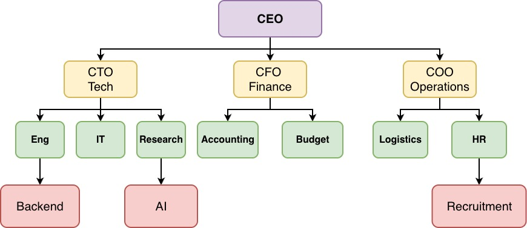
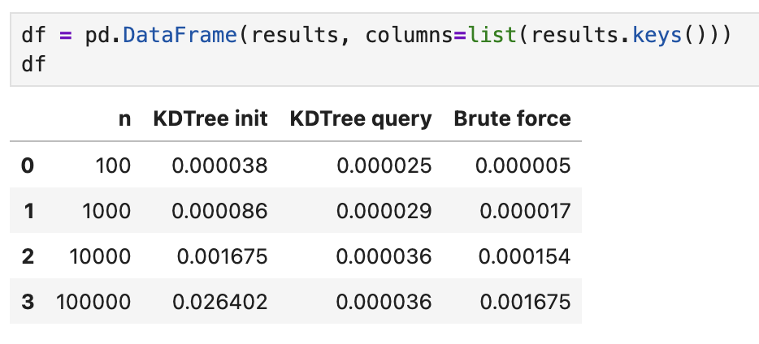

## Lecture 5 Review

- Recursion intro
```{.python}
def f(n):
    if n == 0:
        return 0
    else:
        return f(n-1) + 1
```
- Multiple recursive calls
```{.python}
def f(n):
    if n == 1 or n == 2:
        return 1
    else:
        return f(n-1) + f(n-2)
```

## Outline

- Recursive data structures
- Trees, binary search trees
- Nearest neighbours intro
- $k$-d trees
- Amortization

## Learning Objectives

* Implement a simple recursive data structure such as a linked list.
* Compare and contrast a binary search tree to a hash table.
* Select an appropriate algorithm for finding nearest neighbours.

## Motivation for recursion

- Last class we talked about recursive functions, which call themselves.
- We saw how this made the binary search code more elegant.
- Today we'll see a stronger motivation for recursive functions and recursive thinking.

## Recursive data structures

```{pyodide}
x = [[1, 2, 3], ["a", "b", "c"]]
x
```

- This is a list of lists.
- We have also seen dicts of dicts before.

## Recursive data structures

{width="600" fig-align="center"}

(Image attribution to Fanghong, from [Wikipedia article](https://en.wikipedia.org/wiki/Matryoshka_doll))

## Recursive data structures

```{pyodide}
class TreasureBox:

    def __init__(self, treasure):
        self.next = None # data type: TreasureBox
        self.treasure = treasure # data type: whatever

    def append_outer(self, treasure):

        new_box = TreasureBox(treasure)
        new_box.next = self
        return new_box

    def append_inner(self, treasure):

        if self.next is None:
            self.next = TreasureBox(treasure)
        else:
            self.next.append_inner(treasure)
        return self

    def get(self, depth):

        if depth == 0:
            return self.treasure

        if self.next is None:
            return None  # Index out of bounds

        return self.next.get(depth-1)
```

## Recursive data structures

```{pyodide}
box = TreasureBox("Initial box")

box = box.append_outer("Wrapped initial box")
box = box.append_outer("Wrapped the second box")
```

```{pyodide}
box.get(0)
```

```{pyodide}
box.get(1)
```

```{pyodide}
box.get(2)
```

```{pyodide}
box.get(3)
```

## Recursive data structures

```{pyodide}
box = TreasureBox("Initial box")

box = box.append_inner("Box in initial box")
box = box.append_inner("Box in the second box")
```

```{pyodide}
box.get(0)
```

```{pyodide}
box.get(1)
```

```{pyodide}
box.get(2)
```

```{pyodide}
box.get(3)
```

## Recursive data structures

```{.python}
class TreasureBox:

    def __init__(self, treasure):
        self.next = None # data type: TreasureBox
        self.treasure = treasure # data type: whatever

    def append_outer(self, treasure):

        new_box = TreasureBox(treasure)
        new_box.next = self
        return new_box

    def append_inner(self, treasure):

        if self.next is None:
            self.next = TreasureBox(treasure)
        else:
            self.next.append_inner(treasure)
        return self

    def get(self, depth):

        if depth == 0:
            return self.treasure

        if self.next is None:
            return None  # Index out of bounds

        return self.next.get(depth-1)
```

## Recursive data structures

```{.python code-line-numbers="3,7,13,21"}
class TreasureBox:

    def __init__(self, treasure):
        self.next = None # data type: TreasureBox
        self.treasure = treasure # data type: whatever

    def append_outer(self, treasure):

        new_box = TreasureBox(treasure)
        new_box.next = self
        return new_box

    def append_inner(self, treasure):

        if self.next is None:
            self.next = TreasureBox(treasure)
        else:
            self.next.append_inner(treasure)
        return self

    def get(self, depth):

        if depth == 0:
            return self.treasure

        if self.next is None:
            return None  # Index out of bounds

        return self.next.get(depth-1)
```

## Recursive data structures

```{.python code-line-numbers="3,4,5"}
class TreasureBox:

    def __init__(self, treasure):
        self.next = None # data type: TreasureBox
        self.treasure = treasure # data type: whatever

    def append_outer(self, treasure):

        new_box = TreasureBox(treasure)
        new_box.next = self
        return new_box

    def append_inner(self, treasure):

        if self.next is None:
            self.next = TreasureBox(treasure)
        else:
            self.next.append_inner(treasure)
        return self

    def get(self, depth):

        if depth == 0:
            return self.treasure

        if self.next is None:
            return None  # Index out of bounds

        return self.next.get(depth-1)
```

## Recursive data structures

```{.python code-line-numbers="7,8,9,10,11,12"}
class TreasureBox:

    def __init__(self, treasure):
        self.next = None # data type: TreasureBox
        self.treasure = treasure # data type: whatever

    def append_outer(self, treasure):

        new_box = TreasureBox(treasure)
        new_box.next = self
        return new_box

    def append_inner(self, treasure):

        if self.next is None:
            self.next = TreasureBox(treasure)
        else:
            self.next.append_inner(treasure)
        return self

    def get(self, depth):

        if depth == 0:
            return self.treasure

        if self.next is None:
            return None  # Index out of bounds

        return self.next.get(depth-1)
```

## Recursive data structures

```{.python code-line-numbers="13,14,15,16,17,18,19"}
class TreasureBox:

    def __init__(self, treasure):
        self.next = None # data type: TreasureBox
        self.treasure = treasure # data type: whatever

    def append_outer(self, treasure):

        new_box = TreasureBox(treasure)
        new_box.next = self
        return new_box

    def append_inner(self, treasure):

        if self.next is None:
            self.next = TreasureBox(treasure)
        else:
            self.next.append_inner(treasure)
        return self

    def get(self, depth):

        if depth == 0:
            return self.treasure

        if self.next is None:
            return None  # Index out of bounds

        return self.next.get(depth-1)
```

## Group Activity

```{pyodide}
box = TreasureBox("A")

box = box.append_inner("B")
box = box.append_outer("C")
box = box.append_outer("D")
box = box.append_inner("E")

box.get(3)
```

## Linked-list

- In computer science, this is called a [linked list](https://en.wikipedia.org/wiki/Linked_list).
- It's not just a nested data structure (list of lists); the definition of the data type itself is recursive.
    - What is a list? It contains stuff (including possibly lists).
    - What is a treasure box? It contains one thing, and _another treasure box_.

- Could we just implement this with lists?
    - Yes, if we decide each list contains 2 elements, an item and another list.
    - But using OOP we can make it more clear.

## Trees (recap)

{width="90%" fig-align="center"}

## Binary Tree

A binary tree is a tree where each node has at most 2 children.

```{pyodide}
class BinaryTree:

    def __init__(self, item):
        self.item = item
        self.left = None  # type = BinaryTree
        self.right = None # type = BinaryTree

    def insert(self, item):
        # pick a random side to insert on
        if item == self.item:
            return
        if item < self.item:
            if self.left is None:
                self.left = BinaryTree(item)
            else:
                self.left.insert(item)
        else:
            if self.right is None:
                self.right = BinaryTree(item)
            else:
                self.right.insert(item)

    def contains(self, item):
        if self.item == item:
            return True

        if self.left is not None:
            if self.left.contains(item):
                return True

        if self.right is not None:
            if self.right.contains(item):
                return True

        return False

    # We would want some more functions here, e.g. to add/remove things from the tree.
```

## Binary Tree

```{pyodide}
tree = BinaryTree("CEO")
tree.insert("CTO")
tree.insert("CFO")
tree.insert("COO")
```

```{pyodide}
tree.contains("Clown")
```

```{pyodide}
tree.contains("CTO")
```

```{pyodide}
type(tree)
```

```{pyodide}
type(tree.right)
```

## Binary search trees (BSTs)

- _Binary search tree_: for all nodes, all keys in its left subtree are smaller than its key, and all keys in its right subtree are larger than its key.

- Requirement to use BSTs: we must be able to compare keys.
- Compare this to a hash table: we need to be able to hash the keys.

## Binary search trees (BSTs)
- Example1: [8, 1, 13, 9, 5942]
- Example2: [1, 2, 3, 4, 5]

## Binary search trees (BSTs)

- Binary search trees (BSTs) can be slow if they become very unbalanced (think of adding numbers in increasing order).
- Industrial strength implementations automatically stay balanced and are still efficient.
- Deletion is more tricky and we won't cover it here.
- But the take-home message is that search/insert/delete all run in $O(\log n)$ time, which is pretty fast.

## Nearest neighbours intro

- A common problem (DSCI 571, 563, more) is to find the _nearest neighbours_ of a point.
- We can start in 2D:

```{pyodide}
import numpy as np
# Creating Data
n = 20
np.random.seed(1)
X = np.random.rand(n, 2)
X
```

## Nearest neighbours intro

```{pyodide}
import altair as alt
import pandas as pd

data = pd.DataFrame({'x0': X[:, 0], "x1" : X[:, 1]})
data['m0'] = .5
data['m1'] = .5

# Creating Plot
chart1 = alt.Chart(data).mark_circle(size=60).encode(
    x= alt.X('x0',
             axis=alt.Axis(grid=False)),
    y = alt.Y('x1',
             axis=alt.Axis(grid=False))).properties(width=700, height=600)

chart2 = alt.Chart(data).mark_circle().encode(
    x= alt.X('m0',
              axis=alt.Axis(title = "")),
    y = alt.Y('m1',
               axis=alt.Axis(title = "")),
    color = alt.value('red'),
    size = alt.value(50)
).properties(width=700, height=600)

chart1 + chart2
```

## Nearest neighbours intro

```{pyodide}
def nearest_neighbour(data, query):
    if query.ndim == 1:
        query = query[None]

    return np.argmin(np.sum((data - query)**2, axis=1))
```

## Nearest neighbours intro

```{pyodide}
query = np.array([0.5, 0.5])
nn = nearest_neighbour(X, query)
nn
```

```{pyodide}
X[8]
```

## Nearest neighbours intro

```{.python}
def nearest_neighbour(data, query):
    if query.ndim == 1:
        query = query[None]

    return np.argmin(np.sum((data - query)**2, axis=1))
```

::: {.incremental}

- **Question**
what is the time complexity of `nearest_neighbour` if we have $n$ points in $k$ dimensions?
    - $O(n)$
    - $O(k)$
    - $O(n^2k)$
    - $O(nk)$

- **Answer**: $O(nk)$, because we have to loop over all $n$ points, and computing the distance requires looping over the $k$ dimensions.
- This may be way too slow!

:::

## $k$-d trees

- Sometimes we speed things up with faster algorithms.
- But, as we've seen with trees and hash tables, sometime we speed things up with _better data structures_.
- One of the classic ways to speed up nearest neighbours is a data structure call the [$k$-d tree](https://en.wikipedia.org/wiki/K-d_tree).

## $k$-d trees

```{pyodide}
# You do not need to read/understand this code, but I think
# you shouldn't have any problem understanding it with a bit of time spent.

import numpy as np
import pandas as pd
import altair as alt

class KDTree:
    def __init__(self):
        self.location = None
        self.leftSubTree = None
        self.rightSubTree = None
        self.dim = None
        self.data = None

    def build(self, data, depth=0):
        nrows = data.shape[0]
        self.dim = depth % data.shape[1]
        self.data = data

        self.location = np.median(data[:, self.dim])

        if nrows == 1:
            return

        data = data[np.argsort(data[:, self.dim])]
        self.leftSubTree = KDTree()
        self.leftSubTree.build(data[:nrows//2], depth+1)
        self.rightSubTree = KDTree()
        self.rightSubTree.build(data[nrows//2:], depth+1)

    def approximateNearestNeighbour(self, query):
        if self.data.shape[0] == 1:
            return self.data[0]

        if query[self.dim] < self.location:
            return self.leftSubTree.approximateNearestNeighbour(query)
        else:
            return self.rightSubTree.approximateNearestNeighbour(query)

    def plot2d(self, depth=1, minx=0.0, maxx=1.0, miny=0.0, maxy=1.0, color_idx=0):
        """Plot the k-d tree with different colors for each splitting line, and larger plot size."""
        color_palette = [
            "#e41a1c", "#377eb8", "#4daf4a", "#984ea3",
            "#ff7f00", "#ffff33", "#a65628", "#f781bf", "#999999"
        ]
        color = color_palette[color_idx % len(color_palette)]

        # Base data (points)
        data = pd.DataFrame({'x0': self.data[:, 0], "x1": self.data[:, 1]})
        chart1 = (
            alt.Chart(data)
            .mark_circle(size=80)  # slightly larger points
            .encode(
                x=alt.X('x0', axis=alt.Axis(grid=False)),
                y=alt.Y('x1', axis=alt.Axis(grid=False))
            )
            .properties(width=400, height=400)
        )

        charts_list = [chart1]
        if depth == 0:
            return chart1

        if self.dim == 0:
            # vertical split line
            data2 = pd.DataFrame({'x0': [self.location, self.location], "x1": [miny, maxy]})
            chart2 = (
                alt.Chart(data2)
                .mark_line(color=color, strokeWidth=2)
                .encode(
                    x=alt.X('x0', axis=alt.Axis(grid=False)),
                    y=alt.Y('x1', axis=alt.Axis(grid=False))
                )
                .properties(width=400, height=400)
            )
            charts_list.append(chart2)

            if self.leftSubTree is not None:
                charts_list.append(self.leftSubTree.plot2d(
                    depth-1, minx=minx, maxx=self.location, miny=miny, maxy=maxy, color_idx=color_idx+1))
            if self.rightSubTree is not None:
                charts_list.append(self.rightSubTree.plot2d(
                    depth-1, minx=self.location, maxx=maxx, miny=miny, maxy=maxy, color_idx=color_idx+1))

        elif self.dim == 1:
            # horizontal split line
            data3 = pd.DataFrame({'x0': [minx, maxx], "x1": [self.location, self.location]})
            chart3 = (
                alt.Chart(data3)
                .mark_line(color=color, strokeWidth=2)
                .encode(
                    x=alt.X('x0', axis=alt.Axis(grid=False)),
                    y=alt.Y('x1', axis=alt.Axis(grid=False))
                )
                .properties(width=400, height=400)
            )
            charts_list.append(chart3)

            if self.leftSubTree is not None:
                charts_list.append(self.leftSubTree.plot2d(
                    depth-1, minx=minx, maxx=maxx, miny=miny, maxy=self.location, color_idx=color_idx+1))
            if self.rightSubTree is not None:
                charts_list.append(self.rightSubTree.plot2d(
                    depth-1, minx=minx, maxx=maxx, miny=self.location, maxy=maxy, color_idx=color_idx+1))

        return alt.layer(*charts_list).encode().properties(width=400, height=400)

```

## $k$-d trees

```{pyodide}
kdt = KDTree()
kdt.build(X)
kdt.plot2d(depth=1)
```

## $k$-d trees

```{pyodide}
kdt.approximateNearestNeighbour(np.array([1, 1]))
```

```{pyodide}
X[nearest_neighbour(X, np.array([1,1]))]
```

```{pyodide}
kdt.approximateNearestNeighbour(np.array([0.5, 0.5]))
```

```{pyodide}
X[nearest_neighbour(X, np.array([0.5,0.5]))]
```

## $k$-d trees

- Doesn't work perfectly here, but there is a fast correct algorithm, which is beyond the scope of the course.
  - See [`sklearn.neighbors.KDTree`](https://scikit-learn.org/stable/modules/generated/sklearn.neighbors.KDTree.html#sklearn.neighbors.KDTree).
- However, $k$-d trees get slow when the number of dimensions is large.

## Timing experiments

```{.python}
n_sizes = [100, 1000, 10_000, 100_000]

results = defaultdict(list)
results["n"] = n_sizes

d = 10

for n in n_sizes:
    print('n: ', n)
    X = np.random.rand(n, d)
    query = np.random.rand(1, d)

    print("  KDTree")
    time = %timeit -q -o -r 3 sklearn.neighbors.KDTree(X)
    results["KDTree init"].append(time.average)
    KDT = sklearn.neighbors.KDTree(X)

    time = %timeit -q -o -r 3 KDT.query(query)
    results["KDTree query"].append(time.average)

    print("  Brute force")
    time = %timeit -q -o -r 3 nearest_neighbour(X, query)
    results["Brute force"].append(time.average)
```

## Timing experiments

{width="80%" fig-align="center"}

## Amortization

Let's focus on $n=10000$, and $k=10$. Then,

- $k$-d tree initialization takes $\approx 4$ ms
- $k$-d tree query takes $\approx 0.1$ ms
- brute force search takes $\approx 1$ ms

**Question:** How many queries do we need to do such that the $k$-d tree is better?

## Other nearest neighbour approaches

- Note: there are other nearest neighbour approaches besides $k$-d trees, including some very fast approximate algorithms.
- In general, _you can often do something faster if the result can be slightly wrong_.
- There are approaches based on hashing instead of trees.
- Here are some resources:
  - [`sklearn.neighbours` documentation](https://scikit-learn.org/stable/modules/neighbors.html#nearest-neighbor-algorithms)
  - Approximate nearest neighbours, e.g. [locality-sensitive hashing](https://en.wikipedia.org/wiki/Locality-sensitive_hashing) (LSH), [this package](https://github.com/spotify/annoy).
