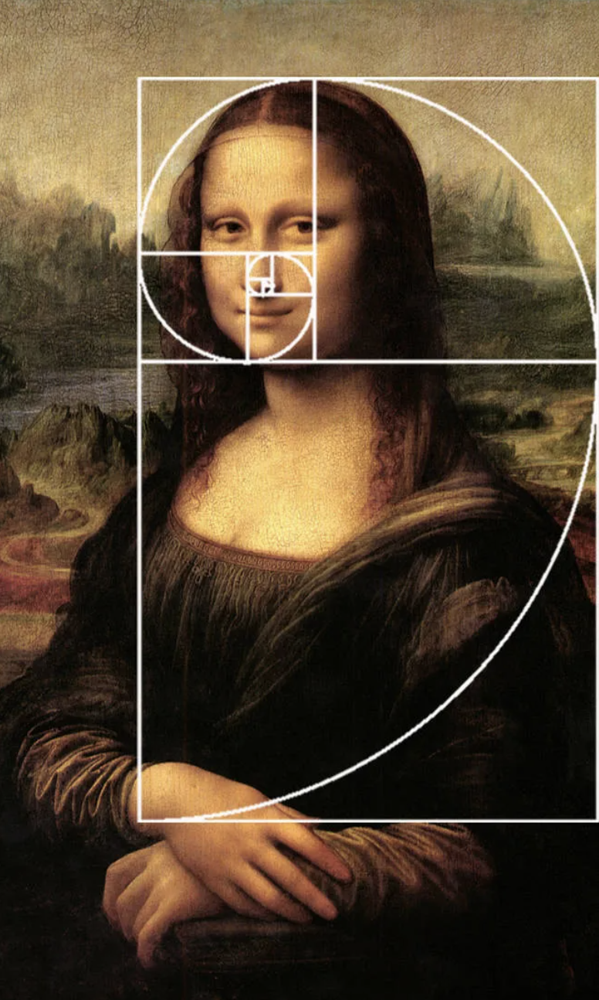

## What do these four have in common? 

```{python}
#| echo: false
# Hidden: imports and helpers for the whole deck, kept in one place so the visible
# cells below contain only the code students should read.
import sys
import timeit

import numpy as np
import scipy.spatial


def tree_layout(children, root, pad=0.5):
    """Where to draw every node and edge of a tree given as {node: [children]}. Leaves sit
    one unit apart, left to right, and each parent is centred over its children.
    Every edge is named by its child, since each child has exactly one parent."""
    pos, order, next_leaf = {}, [], [0]

    def place(node, depth):
        order.append(node)
        kids = children.get(node, [])
        for kid in kids:
            place(kid, depth + 1)
        if kids:
            x = sum(pos[k][0] for k in kids) / len(kids)
        else:
            x = next_leaf[0]
            next_leaf[0] += 1
        pos[node] = (x, -depth)

    place(root, 0)
    xs = [x for x, _ in pos.values()]
    ys = [y for _, y in pos.values()]
    return {"nodes": [{"id": u, "x": pos[u][0], "y": pos[u][1]} for u in order],
            "edges": [{"child": c, "x1": pos[p][0], "y1": pos[p][1], "x2": pos[c][0], "y2": pos[c][1]}
                      for p in order for c in children.get(p, [])],
            "x_domain": [min(xs) - pad, max(xs) + pad],
            "y_domain": [min(ys) - pad, max(ys) + pad]}


def stack_boxes(stack, label=lambda u: u):
    """The call stack as a row of boxes, bottom on the left: the running call is orange (end),
    the calls waiting under it are light blue (wait)."""
    return [{"label": label(u), "cls": "end" if i == len(stack) - 1 else "wait"}
            for i, u in enumerate(stack)]


def far(d):
    """0.24113 -> "0.241"."""
    return f"{d:.3f}"


# The playlist: the same 20 random points and query as the notes and the pyodide cells.
# Coordinate 0 is x (energy), coordinate 1 is y (danceability), both from 0 to 1.
# The query is the song that just finished playing.
rng = np.random.default_rng(1)
X = rng.random((20, 2))
query = np.array([0.5, 0.3])
axis_name = ["x", "y"]


def nearest_neighbour(data, query):
    """Same as the visible pyodide version: the row of data nearest to query."""
    squared_distances = np.sum((data - query) ** 2, axis=1)
    return np.argmin(squared_distances)
```

```{pyodide}
#| include: false
# Hidden setup for the runnable cells: f, the Node class, the songs and the k-d tree,
# so a later cell still works when an earlier slide was skipped.
import numpy as np


def f(n):
    if n == 1 or n == 2:
        return 1
    else:
        return f(n - 1) + f(n - 2)


class Node:
    def __init__(self, item):
        self.item = item
        self.next = None

    def push_front(self, item):
        new_node = Node(item)
        new_node.next = self
        return new_node

    def append(self, item):
        if self.next is None:
            self.next = Node(item)
        else:
            self.next.append(item)

    def get(self, i):
        if i == 0:
            return self.item
        if self.next is None:
            return None
        return self.next.get(i - 1)


rng = np.random.default_rng(1)
X = rng.random((20, 2))
query = np.array([0.5, 0.3])


def nearest_neighbour(data, query):
    squared_distances = np.sum((data - query) ** 2, axis=1)
    return np.argmin(squared_distances)


class KDTree:
    def __init__(self, points, depth=0):
        self.left = None
        self.right = None
        if len(points) == 1:
            self.point = points[0]
            return
        self.dim = depth % points.shape[1]
        points = points[np.argsort(points[:, self.dim])]
        mid = len(points) // 2
        self.split = points[mid, self.dim]
        self.left = KDTree(points[:mid], depth + 1)
        self.right = KDTree(points[mid:], depth + 1)

    def approx_nearest(self, query):
        if self.left is None:
            return self.point
        if query[self.dim] < self.split:
            return self.left.approx_nearest(query)
        else:
            return self.right.approx_nearest(query)


kdt = KDTree(X)
```

{height="215px"} {height="215px"} {height="215px"} {height="215px"}

::: {.fragment}
The same spiral shows up in Hokusai's Great Wave, Mona Lisa, in sunflower, in nautilus shell... What is this? Can we re-create it in python? 🤩
:::

::: footer
Images: [Artis Foundation](https://artisfoundation.org.uk/news/the-fibonacci-sequence-when-maths-arts-collide/) (Great Wave, Mona Lisa), [Cleveland Design](https://clevelanddesign.com/insights/the-nature-of-design-the-fibonacci-sequence-and-the-golden-ratio/) (sunflower), [EarthSky](https://earthsky.org/human-world/nautilus-shell-fibonacci-logarithmic-spiral-golden-spiral/) (nautilus)
:::


## Today's plan {background-image="images/lec06_print_shop.png" background-size="cover" background-position="right bottom" style="font-size: 0.8em;"}

::: {style="max-width: 80%;"}
| what we build | the question it answers |
|---|---|
| a recursive function: Fibonacci (*a function that calls a smaller copy of itself*) | How do we draw this spiral with code? |
| a recursive data structure: the linked list (*a list that holds a smaller list*) | How do we store a goose hunt in code? |
| a recursive data structure that splits in two: the $k$-d tree (*a tree that holds smaller trees*) | What should Spotify play next? |
:::

::: {.notes}
The thread for the whole lecture: a function that calls a smaller copy of itself, a list that holds a smaller list, a tree that holds smaller trees.
:::

::: footer
Image generated by OpenAI GPT-image-2.5-sunburst
:::

```{python}
#| echo: false
# Hidden: the "Draw the spiral" slide. Square 1 sits at (0, 0); each new square goes on the next
# side of the drawing, in turn: right, above, left, below, and its side is f (same code as the
# visible cell on the next slide). One quarter circle per square makes the spiral. With the shell
# switched on, the photo nature2.png goes behind the drawing with the eye of the spiral on the eye
# of the shell. Every square, arc point, label, image position and sentence is worked out here,
# OJS only draws.
def f(n):
    if n == 1 or n == 2:
        return 1
    else:
        return f(n - 1) + f(n - 2)


def place_squares(n):
    """Corner (x, y) and side of squares 1 to n."""
    squares = [(0, 0, 1)]
    left, bottom, right, top = 0, 0, 1, 1
    for i in range(2, n + 1):
        s = f(i)
        if i % 4 == 2:
            x, y = right, bottom
        elif i % 4 == 3:
            x, y = left, top
        elif i % 4 == 0:
            x, y = left - s, bottom
        else:
            x, y = left, bottom - s
        squares.append((x, y, s))
        left, bottom = min(left, x), min(bottom, y)
        right, top = max(right, x + s), max(top, y + s)
    return squares


spiral_max = 10
spiral_w, spiral_h, spiral_margin = 820, 360, 10
inner_w, inner_h = spiral_w - 2 * spiral_margin, spiral_h - 2 * spiral_margin
inner_aspect = inner_h / inner_w
where_words = {"right": "on the right", "above": "on top", "left": "on the left", "below": "underneath"}
squares, arc = [], []
minx = miny = maxx = maxy = 0
for i, (x, y, s) in enumerate(place_squares(spiral_max), start=1):
    side = ["left", "below", "right", "above"][i % 4]   # square 1 counts as "below"
    minx, miny, maxx, maxy = min(minx, x), min(miny, y), max(maxx, x + s), max(maxy, y + s)
    # The quarter circle: its centre is one corner of the square, and it joins the two corners
    # next to that one, so each arc starts where the last one ended.
    cx, cy, start = {"below": (x + s, y + s, 180), "right": (x, y + s, 270),
                     "above": (x, y, 0), "left": (x + s, y, 90)}[side]
    angles = np.radians(np.linspace(start, start + 90, 13))
    arc += [{"x": round(float(cx + s * np.cos(a)), 3), "y": round(float(cy + s * np.sin(a)), 3)}
            for a in angles]
    squares.append({"x1": x, "x2": x + s, "y1": y, "y2": y + s, "side": s, "where": side,
                    "box": (minx, miny, maxx, maxy), "arc_end": len(arc)})

# The eye of the spiral: the point the arcs wind into. Square k + 1's arc is square k's arc
# turned a quarter and stretched, so the eye is the point that this turn leaves in place
# (complex numbers: z -> a z + b, eye = b / (1 - a)).
p = [complex(arc[13 * k]["x"], arc[13 * k]["y"]) for k in [7, 8, 9]]
a_turn = (p[2] - p[1]) / (p[1] - p[0])
spiral_eye = (p[1] - a_turn * p[0]) / (1 - a_turn)

# The shell photo: 1054 x 818 pixels, eye of the shell at pixel (653, 537). Chosen by eye so the
# inner coils line up: 6 photo pixels per unit of square side, no rotation.
photo_w, photo_h, photo_eye_x, photo_eye_y, photo_px_per_unit = 1054, 818, 653, 537, 6
photo_cx = spiral_eye.real + (photo_w / 2 - photo_eye_x) / photo_px_per_unit
photo_cy = spiral_eye.imag - (photo_h / 2 - photo_eye_y) / photo_px_per_unit   # photo y points down
photo_box = (photo_cx - photo_w / 2 / photo_px_per_unit, photo_cy - photo_h / 2 / photo_px_per_unit,
             photo_cx + photo_w / 2 / photo_px_per_unit, photo_cy + photo_h / 2 / photo_px_per_unit)


def frame(box, pad_share):
    """Axis domains around box, with the same scale on both axes."""
    bx0, by0, bx1, by1 = box
    w, h = bx1 - bx0, by1 - by0
    pad = pad_share * max(w, h)
    w_show = max(w + 2 * pad, (h + 2 * pad) / inner_aspect)
    h_show = w_show * inner_aspect
    xc, yc = (bx0 + bx1) / 2, (by0 + by1) / 2
    return w_show, [xc - w_show / 2, xc + w_show / 2], [yc - h_show / 2, yc + h_show / 2]


def square_labels(n, w_show):
    """Side labels, only on squares big enough to hold one."""
    return [{"x": (q["x1"] + q["x2"]) / 2, "y": (q["y1"] + q["y2"]) / 2, "text": str(q["side"])}
            for q in squares[:n] if q["side"] / w_show > 0.04]


shell_say = ("Here is the same spiral on top of a real nautilus shell, with both centres on the same spot. "
             "The inner turns match. Further out, our spiral grows faster than the shell.")
spiral_view = []   # one entry per click: squares 1 to 10, then the shell
for n in range(1, spiral_max + 1):
    w_show, x_domain, y_domain = frame(squares[n - 1]["box"], 0.06)
    bx0, by0, bx1, by1 = squares[n - 1]["box"]
    both = (min(bx0, photo_box[0]), min(by0, photo_box[1]), max(bx1, photo_box[2]), max(by1, photo_box[3]))
    shell_w_show, shell_x_domain, shell_y_domain = frame(both, 0)
    px = inner_w / shell_w_show   # screen pixels per unit
    s = f(n)
    if n == 1:
        say = "Start with one small square. Each side is length of 1 unit. The blue curve is a quarter circle inside it."
    elif n == 2:
        say = "Add a second square on the right. Its sides are also length of 1 unit. Its quarter circle carries the curve on."
    else:
        say = (f"Square {n}: how long is each side? Add up the two squares before it: "
               f"{f(n - 2)} + {f(n - 1)} = {s}. It goes {where_words[squares[n - 1]['where']]}, "
               f"and it fits exactly.")
    step = {"say": say,
            "squares": [{**{k: q[k] for k in ["x1", "x2", "y1", "y2"]}, "role": "new" if k == n - 1 else "old"}
                        for k, q in enumerate(squares[:n])],
            "arc": arc[:squares[n - 1]["arc_end"]],
            "labels": square_labels(n, w_show), "x_domain": x_domain, "y_domain": y_domain, "photo": []}
    spiral_view.append(step)
    if n == spiral_max:   # one more click: the same drawing with the shell behind it
        spiral_view.append({**step, "say": shell_say, "labels": square_labels(n, shell_w_show),
                            "x_domain": shell_x_domain, "y_domain": shell_y_domain,
                            "photo": [{"x": round(photo_cx, 3), "y": round(photo_cy, 3),
                                       "width": round(photo_w / photo_px_per_unit * px, 1),
                                       "height": round(photo_h / photo_px_per_unit * px, 1)}]})
for k, step in enumerate(spiral_view):
    step["count"] = f"Step {k + 1} of {len(spiral_view)}"
ojs_define(spiral_view = spiral_view)
golden_ratios = ", ".join(f"{f(n + 1) / f(n):.3f}" for n in range(5, 10))
golden = f"{(1 + 5 ** 0.5) / 2:.3f}"
```

## Draw the spiral {style="font-size: 0.75em;"}

```{ojs}
//| echo: false
viewof spiral_step = Inputs.button([
  ["Back", i => Math.max(i - 1, 0)],
  ["Next", i => Math.min(i + 1, spiral_view.length - 1)],
  ["Start over", () => 0]
], {value: 0})
```

```{ojs}
//| echo: false
{
  // Draw only: every square, arc point, photo position and sentence was worked out in Python
  // (spiral_view). Orange: the newest square. Grey: earlier squares. Blue: the spiral.
  const view = spiral_view[spiral_step];
  const shell = view.photo.length > 0;
  const fill = {new: "#fdeee6", old: "#f2f1ee"}, stroke = {new: "#eb6834", old: "#b8b6b0"};
  return html`<div class="ojs-readout"><span class="sq-count">${view.count}</span> ${view.say}</div>${Plot.plot({
    width: 820, height: 360, margin: 10,
    style: {fontSize: "16px", background: "transparent"},
    x: {axis: null, domain: view.x_domain}, y: {axis: null, domain: view.y_domain},
    marks: [
      Plot.image(view.photo, {x: "x", y: "y", width: "width", height: "height",
                              src: () => "images/nature2.png", opacity: 0.85}),
      Plot.rect(view.squares, {x1: "x1", x2: "x2", y1: "y1", y2: "y2", fillOpacity: shell ? 0 : 1,
                               fill: d => fill[d.role], stroke: d => stroke[d.role], strokeWidth: 2}),
      Plot.line(view.arc, {x: "x", y: "y", stroke: "#2a78d6", strokeWidth: 4}),
      Plot.text(view.labels, {x: "x", y: "y", text: "text", fontWeight: "bold",
                              fill: shell ? "white" : "#52514e"})
    ]
  })}`;
}
```

::: {.fragment}
Long side ÷ short side: `{python} golden_ratios`, ... It settles at `{python} golden`, the **golden ratio**.
:::

::: footer
Shell photo: [EarthSky](https://earthsky.org/human-world/nautilus-shell-fibonacci-logarithmic-spiral-golden-spiral/)
:::

::: {.notes}
- The spiral is one quarter circle per square.
:::

## Recreating the spiral with Python code {style="font-size: 0.8em;"}

```{pyodide}
def f(n):
    """The side of square n in the spiral."""
    if n == 1 or n == 2:
        return 1                     # squares 1 and 2: side 1
    else:
        return f(n - 1) + f(n - 2)   # two recursive calls

f(3)
```

::: {.notes}
write f(1), f(2) f(3)

write the tree branching out, and f(5)


:::


```{python}
#| echo: false
# Hidden: the call tree step-through for f(5). An instrumented copy of the visible f builds
# the tree of calls as it runs and records the stack and every answer; OJS only draws.
def record_fib(n_top):
    children, label, value, stack, steps, times = {}, {}, {}, [], [], {}

    def snap(say):
        nodes = {u: "hidden" for u in label}
        nodes.update({u: "done" for u in value})
        nodes.update({u: "waiting" for u in stack})
        nodes[stack[-1]] = "now"
        steps.append({"say": say, "node_roles": nodes,
                      "labels": {u: f"{label[u]} = {value[u]}" if u in value else label[u] for u in label},
                      "seen": list(label), "done": list(value), "stack": list(stack)})

    def f(n):
        me = f"c{len(label)}"
        label[me] = f"f({n})"
        if stack:
            children.setdefault(stack[-1], []).append(me)
        caller = label[stack[-1]] if stack else None
        stack.append(me)
        times[n] = times.get(n, 0) + 1
        start = f"{caller} calls f({n})." if caller else f"We call f({n})."
        again = (f" We already worked out f({n}) earlier, but Python doesn't remember, so it does all "
                 "that work again." if times[n] > 1 and n > 2 else "")
        if n in (1, 2):
            value[me] = 1
            snap(f"{start} f({n}) is a base case, so it returns 1 right away.")
            result = 1
        else:
            snap(f"{start}{again} To answer, f({n}) needs f({n - 1}) + f({n - 2}). "
                 f"It asks f({n - 1}) first and waits.")
            a = f(n - 1)
            b = f(n - 2)
            result = value[me] = a + b
            snap(f"f({n}) now has both answers: {a} + {b} = {result}. It hands {result} back.")
        stack.pop()
        return result

    f(n_top)
    lay = tree_layout(children, "c0", pad=0.6)
    repeats = ", ".join(f"f({k}) {t} times" for k, t in sorted(times.items(), reverse=True) if t > 1)
    deepest = max(len(s["stack"]) for s in steps)
    steps[-1]["say"] += (f" That took {len(label)} calls, with repeats: {repeats}. At most {deepest} calls "
                         "were ever waiting at the same time.")
    out = [{"say": f"We call f({n_top}) to find how long each side of square {n_top} is. "
                   "Watch the calls grow into a tree.",
            "node_roles": {u: "hidden" for u in label}, "edge_roles": {}, "labels": {}, "boxes": []}]
    for s in steps:
        out.append({"say": s["say"], "labels": s["labels"],
                    "node_roles": {**{u: "hidden" for u in label}, **s["node_roles"]},
                    "edge_roles": {**{u: "hidden" for u in label},
                                   **{u: "base" for u in s["seen"]},
                                   **{u: "found" for u in s["done"]}},
                    "boxes": stack_boxes(s["stack"], lambda u: label[u])})
    for k, step in enumerate(out):
        step["count"] = f"Step {k} of {len(out) - 1}"
    return lay, out, deepest


fib_layout, fib_steps, fib_deepest = record_fib(5)
ojs_define(fib_layout = fib_layout, fib_steps = fib_steps)
```

## The call tree {style="font-size: 0.75em;"}

```{ojs}
//| echo: false
// Draw only: a tree laid out in Python, with colour roles and labels from Python.
// Orange: running now or on the path. Light blue: waiting. Blue: done or a group. Grey: other.
draw_tree = (lay, s, {width = 860, height = 280, r = 14} = {}) => {
  const fill = {now: "#eb6834", path: "#eb6834", waiting: "#a9c8ef", done: "#2a78d6", other: "#b8b6b0"};
  const stroke = {path: "#eb6834", found: "#2a78d6", base: "#d9d8d4"};
  const labels = s.labels ?? {};
  const nodes = lay.nodes.map(d => ({...d, role: s.node_roles[d.id] ?? "other", label: labels[d.id] ?? ""}))
                         .filter(d => d.role !== "hidden");
  const edges = lay.edges.map(d => ({...d, role: s.edge_roles[d.child] ?? "base"}))
                         .filter(d => d.role !== "hidden");
  return Plot.plot({
    width, height, margin: 14, marginTop: 30,
    style: {fontSize: "16px", background: "transparent"},
    x: {axis: null, domain: lay.x_domain}, y: {axis: null, domain: lay.y_domain},
    marks: [
      Plot.link(edges, {x1: "x1", y1: "y1", x2: "x2", y2: "y2", stroke: d => stroke[d.role],
                        strokeWidth: d => d.role === "base" ? 2 : 4}),
      Plot.dot(nodes, {x: "x", y: "y", r, fill: d => fill[d.role], stroke: "white", strokeWidth: 2}),
      Plot.text(nodes, {x: "x", y: "y", text: "label", dy: -(r + 10), fontWeight: "bold",
                        fill: "#0b0b0b", stroke: "white", strokeWidth: 5, paintOrder: "stroke"})
    ]
  });
}
```

```{ojs}
//| echo: false
viewof fib_step = Inputs.button([
  ["Back", i => Math.max(i - 1, 0)],
  ["Next step", i => Math.min(i + 1, fib_steps.length - 1)],
  ["Start over", () => 0]
], {value: 0})
```

```{ojs}
//| echo: false
{
  // Draw only: the calls were made and recorded in Python (fib_steps).
  const s = fib_steps[fib_step];
  const boxes = s.boxes.map(b => html`<div class="ds-box ${b.cls}">${b.label}</div>`);
  return html`<div class="ojs-readout"><span class="sq-count">${s.count}</span> ${s.say}</div>
    ${draw_tree(fib_layout, s, {height: 270})}
    <div class="ds-row center"><span class="ds-caption">call stack (top on the right):</span>
      ${boxes.length ? boxes : html`<span class="ds-caption">empty</span>`}</div>`;
}
```

::: {.fragment}
Who calls whom is a **tree**: the first call is the root, the base cases are the leaves.
:::

::: {.notes}

!! write n = 1, n = 2, function call = 1
n = 3, function call = 3
n = 4, function call = 5
n = 5, function call = 9
...


DFS order  --> call stack is DFS's stack.
- Point at the repeats: f(3) is worked out twice. That is the waste.


:::


## Fibonacci sequence {style="font-size: 0.7em;"}

```{pyodide}
print([f(n) for n in range(1, 11)])
```

::: {.incremental}
- These are the **Fibonacci** numbers: 1, 1, 2, 3, 5, 8, 13, ...
- Two base cases, because each square needs the two squares before it.
:::

::: {.fragment}
💡 Fun Fact: Leonardo of Pisa (known as Fibonacci) wrote these numbers down in 1202 as a puzzle, which is about breeding rabbits 🐇 🐇!


:::

::: footer
GIF from [Giphy](https://giphy.com/gifs/3oz8xLZ1qiYR43jYE8)
:::


```{python}
#| echo: false
# Hidden: the calls chart on the next slide. Calls made by f(n) for Fibonacci (this call plus
# every call in both branches, built up from the smaller n).
calls = {1: 1, 2: 1}
for n in range(3, 31):
    calls[n] = 1 + calls[n - 1] + calls[n - 2]
calls_view = {"rows": [{"n": n, "calls": calls[n]} for n in calls],
              "y_max": {n: calls[n] * 1.15 for n in calls},
              # labelled checkpoints on the Fibonacci line, every 5 steps
              "marks": [{"n": n, "calls": calls[n], "label": f"{calls[n]:,}"} for n in range(5, 31, 5)],
              "say": {n: f"For n = {n}, f(n) makes {calls[n]:,} call{'s' if calls[n] > 1 else ''}."
                      for n in calls}}
ojs_define(calls_view = calls_view)
```

## How fast is the growth of Fibonacci? {style="font-size: 0.75em;"}

```{ojs}
//| echo: false
viewof calls_n = Inputs.range([3, 30], {value: 10, step: 1, label: "n"})
```

```{ojs}
//| echo: false
{
  // Draw only: every count was computed in Python (calls_view).
  const v = calls_view;
  return html`<div class="ojs-readout">${v.say[calls_n]}</div>${Plot.plot({
    width: 820, height: 340, marginLeft: 100, marginRight: 50, marginTop: 30, marginBottom: 40,
    style: {fontSize: "16px", background: "transparent"},
    x: {label: "n →", domain: [1, calls_n]},
    y: {label: "calls", grid: true, domain: [0, v.y_max[calls_n]]},
    marks: [
      Plot.line(v.rows, {filter: d => d.n <= calls_n, x: "n", y: "calls", stroke: "#eb6834", strokeWidth: 3}),
      Plot.dot(v.rows, {filter: d => d.n === calls_n, x: "n", y: "calls", fill: "#eb6834", r: 5}),
      Plot.dot(v.marks, {filter: d => d.n <= calls_n, x: "n", y: "calls", fill: "#eb6834", r: 4}),
      Plot.text(v.marks, {filter: d => d.n <= calls_n, x: "n", y: "calls", text: "label",
                          dx: -8, dy: -12, textAnchor: "end", fill: "#eb6834", fontWeight: "bold"}),
      Plot.ruleY([0])
    ]
  })}`;
}
```

::: {.fragment}
2 calls per step, about $n$ levels deep: $O(2^n)$. Roughly, $k$ calls per step and $n$ levels: $O(k^n)$.
:::


## iClicker: space of Fibonacci {style="font-size: 0.8em;"}

Fibonacci `f(n)` takes $O(2^n)$ time. What is its space complexity?

- \(A) $O(2^n)$
- \(B) $O(n^2)$
- \(C) $O(n)$
- \(D) $O(1)$

::: {.fragment}
- Answer: **C**. Only the calls on the current path wait on the stack. A call's memory is freed when it returns.
- The longest path is about $n$ calls. For `f(5)` the stack was never taller than `{python} fib_deepest`.
:::

# Remember the goose hunt? {background-image="images/lec06_goose_hunt_otter.png" background-size="cover" background-position="right bottom" style="font-size: 0.8em;"}

At MDS orientation, each clue told you where to find the next one.

<div class="ds-row center ll-chain"><span class="ll-arrow">start →</span><div class="ds-box">clue 1</div><span class="ll-arrow">→</span><div class="ds-box">clue 2</div><span class="ll-arrow">→</span><div class="ds-box">clue 3</div><span class="ll-arrow">→</span><div class="ds-box">clue 4</div><span class="ll-arrow">→ the end</span></div>

::: {.incremental}
- Can you run straight to clue 4?
- How do you know you are done?
:::

::: {.notes}
- Clue 4: no. You only learn where clue 4 is by reading clue 3. To reach clue i, you follow i clues.
:::

::: footer
Image generated by OpenAI GPT-image-2.5-sunburst
:::

## A clue is a node {style="font-size: 0.8em;"}

<div class="ds-row center ll-chain"><span class="ll-arrow">head →</span><div class="ds-box">clue 1</div><span class="ll-arrow">→</span><div class="ds-box">clue 2</div><span class="ll-arrow">→</span><div class="ds-box">clue 3</div><span class="ll-arrow">→</span><div class="ds-box">clue 4</div><span class="ll-arrow">→ None</span></div>

::: {.incremental}
- Each clue holds one message, plus where to find the next clue.
- The last clue has no next clue. Its link is `None`: the end.
- We only hold on to the first clue, the **head**. Every other clue is found by following the links.
:::

::: {.fragment}
This is a **linked list**: each node holds one item and a link to the next node.
:::

::: {.notes}
- a clue is a node, "where to go next" is the link, "the end" is None.
- The organisers only need to hand out clue 1. That is the head.
:::

## The `Node` class {style="font-size: 0.65em;"}

```{.python code-line-numbers="|2-4|6-9|11-15|17-22"}
class Node:
    def __init__(self, item):
        self.item = item     # the data in this node, e.g. a clue
        self.next = None     # the next node, or None

    def push_front(self, item):
        new_node = Node(item)
        new_node.next = self          # the new node points to the old head
        return new_node               # the new node is the new head

    def append(self, item):
        if self.next is None:         # base case: the last node
            self.next = Node(item)
        else:
            self.next.append(item)    # recursive step: let the next node do it

    def get(self, i):
        if i == 0:                    # base case: it's this node
            return self.item
        if self.next is None:         # base case: no more nodes
            return None
        return self.next.get(i - 1)   # recursive step: one node on, one less to go
```

::: {.fragment}
`push_front`: a new first clue. `append`: a new last clue. `get(i)`: walk to clue `i`, counting from 0.
:::

::: {.notes}
- We only ever hold on to the head. Every other node is reached by following `next`.
- push_front hands out a new first clue that points to the old first clue. Nothing else changes.
- append walks to the last clue, then links a new one after it. get walks i clues.
- Inserting in the middle (the goose hunt question) works the same way: change one link.
:::

```{python}
#| echo: false
# Hidden: the linked list step-throughs on the next slides. Each script is replayed with the same
# rules as the Node class; every highlight and sentence is worked out here, OJS only draws.
def replay_nodes(script):
    nodes, steps = [], []

    def snap(code, say, cur=None, walked=0, new=None, result=""):
        steps.append({"code": code, "say": say, "result": result,
                      "boxes": [{"label": b, "cls": "end" if i == cur else "wait" if i < walked
                                 else "found" if i == new else ""} for i, b in enumerate(nodes)]})

    for op, arg in script:
        if op == "new":
            nodes = [arg]
            snap(f'head = Node("{arg}")', f'Make one node that holds "{arg}". Nothing comes after it yet, '
                                         "so its next is None.", new=0)
        elif op == "front":
            nodes.insert(0, arg)
            snap(f'head = head.push_front("{arg}")',
                 f'Make a new node "{arg}" and point it at the old first node. It becomes the new head. '
                 "That is one step, however long the list is.", new=0)
        elif op == "append":
            code = f'head.append("{arg}")'
            for i, b in enumerate(nodes):
                if i < len(nodes) - 1:
                    snap(code, f'We are at "{b}". There is a node after it, so we pass the job '
                               "along to that node.", cur=i, walked=i)
                else:
                    nodes.append(arg)
                    snap(code, f'"{b}" is the last node, because its next is None. Link the new node '
                               f'"{arg}" after it (the base case). We visited {i + 1} node{"s" if i else ""} to get here.',
                         cur=i, walked=i, new=i + 1)
                    break
        else:   # get
            code = f"head.get({arg})"
            for i, b in enumerate(nodes):
                left = arg - i
                if left == 0:
                    snap(code, f'get(0) at "{b}": i is 0, so this is the node we want. Return "{b}" '
                               "(the base case).",
                         cur=i, walked=i, result=f'returns "{b}"')
                    break
                if i == len(nodes) - 1:
                    snap(code, f'get({left}) at "{b}": there is no node after it, so return None '
                               "(the other base case).",
                         cur=i, walked=i, result="returns None")
                    break
                snap(code, f'get({left}) at "{b}": i is not 0 yet, so move one node on and ask it '
                           f"for get({left - 1}).", cur=i, walked=i)
    for k, step in enumerate(steps):
        step["count"] = f"Step {k + 1} of {len(steps)}"
    return steps


node_scripts = {
    "goose hunt": [("new", "library"), ("append", "pond"), ("front", "front desk"),
                   ("get", 2), ("get", 5)],
    "the question": [("new", "A"), ("append", "B"), ("front", "C"), ("front", "D"),
                     ("append", "E"), ("get", 3)],
}
ojs_define(node_view = {"names": list(node_scripts),
                        "steps": {k: replay_nodes(v) for k, v in node_scripts.items()}})

# The git wrap-up slide: three commits, then HEAD~2. Same replay, with the git command next to the
# Node method it matches.
git_script = [("new", "first commit"), ("front", "add f"), ("front", "draw spiral"), ("get", 2)]
git_commands = {"new": 'git commit -m "{}"', "front": 'git commit -m "{}"', "get": "git checkout HEAD~{}"}
node_code = {"new": 'head = Node("{}")', "front": 'head = head.push_front("{}")', "get": "head.get({})"}
git_lines = {node_code[op].format(arg): f"{git_commands[op].format(arg)}   is   {node_code[op].format(arg)}"
             for op, arg in git_script}
git_steps = replay_nodes(git_script)
for step in git_steps:
    step["code"] = git_lines[step["code"]]
ojs_define(git_view = git_steps)
```


## Question: what does it return? {style="font-size: 0.7em;"}

**Without running the code**, what does `head.get(2)` return? Howabout `head.get(5)`?

```{.python}
head = Node("Library")
head.append("Pond")
head = head.push_front("Front Desk")
head.get(2)

head.get(5)
```


::: {.fragment}

How about this? What does head.get(3) return?

```{.python}
head = Node("A")
head.append("B")
head = head.push_front("C")
head = head.push_front("D")
head.append("E")

head.get(3)
```
:::

::: {.fragment}
`"B"`. The list is D → C → A → B → E. Index 0 is D, so index 3 is B.
:::


## Watch the links {style="font-size: 0.75em;"}

```{ojs}
//| echo: false
viewof node_script = Inputs.radio(node_view.names, {value: "goose hunt", label: "replay"})
```

```{ojs}
//| echo: false
viewof node_step = Inputs.button([
  ["Back", i => Math.max(i - 1, 0)],
  ["Next step", i => Math.min(i + 1, node_view.steps[node_script].length - 1)],
  ["Start over", () => 0]
], {value: 0})
```

```{ojs}
//| echo: false
{
  // Draw only: every node, highlight and sentence was worked out in Python (node_view).
  const steps = node_view.steps[node_script];
  const s = steps[Math.min(node_step, steps.length - 1)];
  const chain = s.boxes.flatMap((b, i) => [
    ...(i > 0 ? [html`<span class="ll-arrow">→</span>`] : []),
    html`<div class="ds-box ${b.cls}">${b.label}</div>`]);
  return html`<div class="ll-code">${s.code}</div>
    <div class="ojs-readout"><span class="sq-count">${s.count}</span> ${s.say}</div>
    <div class="ds-row center ll-chain"><span class="ll-arrow">head →</span>${chain}<span class="ll-arrow">→ None</span></div>
    <div class="ojs-readout ll-result">${s.result}</div>`;
}
```


## Why is this "recursive"? {style="font-size: 0.8em;"}

Look at what a `Node` holds:

::: {.incremental}
- A `Node` is one item, plus another `Node` (or `None`).
- So a linked list is its first node, plus a **smaller linked list**.
- A tree (lecture 5) is one root node, plus children that are **smaller trees**.
- The functions follow the same shape. Base case: the last node, or `i == 0`. Recursive step: hand the job to `self.next`.
:::


## Question: linked list or `list`? {style="font-size: 0.75em;"}

A linked list has $n$ nodes. What is the time complexity of each?

| operation | linked list | Python `list` |
|---|---|---|
| add to the front (`push_front`, `lst.insert(0, x)`) | ? | ? |
| add to the end (`append`, `lst.append(x)`) | ? | ? |
| get item $i$ (`get(i)`, `lst[i]`) | ? | ? |

::: {.fragment}
| operation | linked list | Python `list` |
|---|---|---|
| add to the front | $O(1)$: one new node | $O(n)$: shift every item over |
| add to the end | $O(n)$: follow every link | $O(1)$, amortized (end of today) |
| get item $i$ | $O(i)$: follow $i$ links | $O(1)$ |
:::

::: {.notes}
- Back to the goose hunt: reaching clue i means reading i clues, so get(i) is O(i). Adding a new first clue is one new clue, so push_front is O(1).
- Neither wins at everything. Linked lists are fast at the front, Python lists at the end and at jumping anywhere.
- `deque` (lecture 4) is built from linked blocks: fast at both ends.
:::

## What would happen if we ran this? {style="font-size: 0.8em;"}

```{pyodide}
head = Node(0)
for i in range(1, 5000):
    head.append(i)
```

::: {.fragment}
Each `append` follows every link, one call per node. About 1,000 nodes deep: `RecursionError` (lecture 5).
:::

::: {.fragment}
```{.python}
def append(self, item):
    node = self
    while node.next is not None:   # follow the links with a loop
        node = node.next
    node.next = Node(item)
```

Recursion is a natural way to **think** about recursive data. A loop is sometimes safer to **write** in Python.
:::

## Where are linked lists used? {style="font-size: 0.75em;"}

```{ojs}
//| echo: false
viewof git_step = Inputs.range([1, git_view.length], {value: 1, step: 1, label: "step"})
```

```{ojs}
//| echo: false
{
  // Draw only: every node, highlight and sentence was worked out in Python (git_view).
  const s = git_view[git_step - 1];
  const chain = s.boxes.flatMap((b, i) => [
    ...(i > 0 ? [html`<span class="ll-arrow">→</span>`] : []),
    html`<div class="ds-box ${b.cls}">${b.label}</div>`]);
  return html`<div class="ll-code">${s.code}</div>
    <div class="ds-row center ll-chain"><span class="ll-arrow">HEAD →</span>${chain}<span class="ll-arrow">→ None</span></div>
    <div class="ojs-readout ll-result">${s.result}</div>`;
}
```

::: {.incremental}
- Git: each commit links to its parent, the commit before it. `git commit` is `push_front`.
- Blockchain: each block stores the id (hash) of the block before it.
:::

::: {.notes}
- Slide through: three commits, then HEAD~2 walks two links back. Git only keeps HEAD, the newest commit.
- git log starts at HEAD and follows the parent links until it reaches None.
- Why links fit git: every commit is added at the front, and we mostly look at the last few. Both are cheap in a linked list.
- Changing an old block in a blockchain changes its hash, which breaks the link from the next block. That is how tampering shows.
:::

# What would Spotify play next? {background-image="images/lec06_otter_spotify.png" background-size="auto 80%" background-position="right bottom" style="font-size: 0.8em;"}

Some musicians also use fibonacci sequence to create music (structure syllable counts), like Mozart's sonatas 🎹.

We are using Spotify to play Mozart's sonatas. Which one would Spotify suggest to play next? 🤔

::: {.fragment}
Spotify answers this for millions of listeners. 
:::

::: footer
Image generated by OpenAI GPT-image-2.5-sunburst
:::

```{python}
#| echo: false
# Hidden: the brute-force step-through on the next slide. Distances from the song that just played
# to the same 20 songs as the pyodide cells; every colour and sentence is worked out here.
dist = np.sqrt(np.sum((X - query) ** 2, axis=1))
nn_steps, best = [], None
for k in range(len(X) + 1):
    if k == 0:
        say = (f"Here are {len(X)} songs (grey) and the song that just played (dark star). "
               "We measure how far each song is from it.")
    else:
        i = k - 1
        new_best = best is None or dist[i] < dist[best]
        if new_best:
            best = i
        say = (f"Song {i} is {far(dist[i])} away. "
               + ("That's the closest so far!" if new_best
                  else f"Song {best} is still the closest ({far(dist[best])} away)."))
        if k == len(X):
            say += (f" We checked all {len(X)} songs, so song {best} sounds the most alike. "
                    f"That took {len(X)} distances for {len(X)} songs.")
    roles = ["checked" if j < k else "unchecked" for j in range(len(X))]
    lines = []
    if k > 0:
        roles[best] = "best"
        lines.append({"x2": float(X[best, 0]), "y2": float(X[best, 1]), "role": "best"})
        if k - 1 != best:
            roles[k - 1] = "now"
            lines.append({"x2": float(X[k - 1, 0]), "y2": float(X[k - 1, 1]), "role": "now"})
    nn_steps.append({"say": say, "roles": roles, "lines": lines})
ojs_define(songs = [{"id": i, "x": float(x), "y": float(y)} for i, (x, y) in enumerate(X)],
           played = [float(v) for v in query], nn_steps = nn_steps)
```

## Brute force: check every song {style="font-size: 0.75em;"}

:::: {.columns}
::: {.column width="45%"}
Spotify measured each song with 2 characteristics: $x$ (energy: calm to intense) and $y$ (danceability).

The distance between 2 songs $a$ and $b$:

$$\sqrt{(a_x - b_x)^2 + (a_y - b_y)^2}$$

```{ojs}
//| echo: false
viewof nn_k = Inputs.range([0, nn_steps.length - 1], {value: 0, step: 1, label: "songs checked"})
```

```{ojs}
//| echo: false
// Print only: the sentence was worked out in Python (nn_steps).
html`<div class="ojs-readout">${nn_steps[nn_k].say}</div>`
```
:::
::: {.column width="55%"}
```{ojs}
//| echo: false
// Draw only: the songs, the song that just played and a square map (same scale on both axes, so
// circles look round). Shared by the k-d tree slides too.
map_plot = (marks, {width = 400} = {}) => Plot.plot({
  width, height: width + 8, marginLeft: 50, marginRight: 18, marginBottom: 44, marginTop: 32,
  style: {fontSize: "16px", background: "transparent"},
  x: {label: "x: energy →", domain: [0, 1]}, y: {label: "↑ y: danceability", domain: [0, 1]},
  marks: [
    ...marks,
    Plot.dot([played], {x: d => d[0], y: d => d[1], r: 9, fill: "#52514e", symbol: "star"})
  ]
})
```

```{ojs}
//| echo: false
{
  // Draw only: distances and the closest so far were worked out in Python (nn_steps).
  const s = nn_steps[nn_k];
  const fill = {unchecked: "#b8b6b0", checked: "#a9c8ef", now: "#2a78d6", best: "#eb6834"};
  const rows = songs.map((d, i) => ({...d, role: s.roles[i]}));
  return map_plot([
    Plot.link(s.lines, {x1: played[0], y1: played[1], x2: "x2", y2: "y2",
                        stroke: d => d.role === "best" ? "#eb6834" : "#2a78d6", strokeWidth: 3}),
    Plot.dot(rows, {x: "x", y: "y", r: 6, fill: d => fill[d.role]})
  ]);
}
```
:::
::::

::: {.notes}
- Orange: the closest so far. Blue: the song we just checked. Dark star: the song that just played.
- Close on this map means similar: about as intense, about as danceable.
- Spotify really scored every song on features like these, from 0 to 1. It stopped sharing them with new apps in 2024.
- Slide all the way: every song gets a distance. No shortcuts.
:::

## Brute force in code {style="font-size: 0.75em;"}

```{pyodide}
def nearest_neighbour(data, query):
    # data - query subtracts the query from every row at once (numpy broadcasting)
    # we skip the square root: it doesn't change which distance is smallest
    squared_distances = np.sum((data - query) ** 2, axis=1)
    return np.argmin(squared_distances)   # the index of the smallest value

rng = np.random.default_rng(1)
X = rng.random((20, 2))          # 20 songs: x = energy, y = danceability
query = np.array([0.5, 0.3])     # the song that just played
nn = nearest_neighbour(X, query)
print("song", nn, "at", X[nn])
```

## iClicker: how fast is brute force? {style="font-size: 0.8em;"}

$n$ points, each with $k$ numbers (dimensions). Time complexity of `nearest_neighbour`?

- \(A) $O(n)$
- \(B) $O(k)$
- \(C) $O(n^2 k)$
- \(D) $O(nk)$

::: {.fragment}
- Answer: **D**. One distance per point, and each distance adds up $k$ squared differences.
- Fine for 20 songs. Not ok for millions of songs and millions of listeners.
:::

# Split the playlist {style="font-size: 0.8em;"}

Lecture 5: a BST throws away half the animals at each step. Lighter? Go left.

A song has **two** numbers. Can we still throw away half at each step?

::: {.notes}
About 17 minutes for k-d trees.
- "Is this song smaller?" makes no sense for a point. But "is its x smaller?" does.
:::

## The $k$-d tree {style="font-size: 0.8em;"}

To build one:

::: {.incremental}
1. Only one song? Stop: this is a leaf. (base case)
2. Pick a coordinate. Take turns at each level: $x$, $y$, $x$, $y$, ...
3. Split the songs at the **median** of that coordinate: a lower half and an upper half.
4. Build a $k$-d tree for each half. (recursive step)
:::

::: {.notes}
- k means the number of dimensions: 2 for our songs. Nothing to do with the k in k-nearest neighbours.
- Same shape as BinaryTree from lecture 5: every KDTree holds two smaller KDTrees.
:::

```{python}
#| echo: false
# Hidden: the k-d tree slides. The tree is built exactly like the KDTree class (sort on the
# coordinate, split at index len // 2); every node, split line, box and sentence is worked
# out here, OJS only draws. Boxes are [xmin, xmax, ymin, ymax].
kd_nodes, kd_children = {}, {}


def build(points, ids, depth, box):
    """Build the tree for these points (rows of X) and song numbers. Returns the node id."""
    me = f"k{len(kd_nodes)}"
    node = {"depth": depth, "box": box, "size": len(points), "ids": [int(i) for i in ids]}
    kd_nodes[me] = node
    if len(points) == 1:
        node["song"] = int(ids[0])
        return me
    dim = depth % 2
    order = np.argsort(points[:, dim])
    points, ids = points[order], ids[order]
    node["sorted"] = [int(i) for i in ids]
    mid = len(points) // 2
    split = float(points[mid, dim])
    if dim == 0:
        line = {"x1": split, "x2": split, "y1": box[2], "y2": box[3]}
        lo, hi = [box[0], split, box[2], box[3]], [split, box[1], box[2], box[3]]
    else:
        line = {"x1": box[0], "x2": box[1], "y1": split, "y2": split}
        lo, hi = [box[0], box[1], box[2], split], [box[0], box[1], split, box[3]]
    node.update(dim=dim, split=split, line={**line, "level": depth + 1})
    node["left"] = build(points[:mid], ids[:mid], depth + 1, lo)
    node["right"] = build(points[mid:], ids[mid:], depth + 1, hi)
    kd_children[me] = [node["left"], node["right"]]
    return me


kd_root = build(X, np.arange(len(X)), 0, [0.0, 1.0, 0.0, 1.0])
kd_layout = tree_layout(kd_children, kd_root, pad=0.8)


def is_split(u):
    return "dim" in kd_nodes[u]


def question(u):
    """The question a split node asks, e.g. "x < 0.51?"."""
    n = kd_nodes[u]
    return f"{axis_name[n['dim']]} < {n['split']:.2f}?"


def rect(box):
    return {"x1": box[0], "x2": box[1], "y1": box[2], "y2": box[3]}


# Build it, one split at a time: the same splits as the KDTree class, in the order its
# recursion makes them (a box, then all of its lower half, then all of its upper half).
root = kd_nodes[kd_root]
build_order = []


def visit(u):
    if is_split(u):
        build_order.append(u)
        visit(kd_nodes[u]["left"])
        visit(kd_nodes[u]["right"])


visit(kd_root)
kd_build = []
for k, u in enumerate(build_order + [None]):
    made = build_order[:k] if u is None else build_order[:k + 1]
    lines = [{**kd_nodes[v]["line"], "now": v == u} for v in made]
    roles, labels = {v: "other" for v in made}, {}
    for v in made:
        for c in (kd_nodes[v]["left"], kd_nodes[v]["right"]):
            if c not in made:
                roles[c] = "other"                 # a group of songs still waiting to be split
    if u is None:
        say = (f"Done: every box now holds just one song (a leaf). {len(build_order)} splits gave us "
               f"{len(X)} leaves.")
        song_roles, strip, box, axis = ["low"] * len(X), [], [], ""
    else:
        n = kd_nodes[u]
        d, srt, mid = n["dim"], n["sorted"], len(n["sorted"]) // 2
        axis = axis_name[d]
        roles[u] = "now"
        labels[u] = question(u)
        roles[n["left"]], roles[n["right"]] = "done", "waiting"   # blue: lower half, light blue: upper
        for c in (n["left"], n["right"]):
            labels[c] = str(kd_nodes[c]["size"])
        who = f"Start with all {n['size']} songs" if u == kd_root else f"This box has {n['size']} songs"
        above = n["size"] - mid - 1
        say = (f"{who}. On level {n['depth'] + 1} we split by {axis}. Sort the songs by {axis} and take the "
               f"middle value, the median: {n['split']:.2f} (orange). "
               + (f"The {mid} songs below it go" if mid > 1 else "The song below it goes")
               + " in the lower half (blue). The median"
               + (f" and the {above} song{'s' if above > 1 else ''} above it go" if above else " goes")
               + " in the upper half.")
        if k == 0:
            say += " Next, the lower half gets split the same way, and so on all the way down."
        song_roles = ["other"] * len(X)
        for j, i in enumerate(srt):
            song_roles[i] = "low" if j < mid else "median" if j == mid else "high"
        strip = [{"label": f"{X[i, d]:.2f}", "cls": "found" if j < mid else "end" if j == mid else "wait"}
                 for j, i in enumerate(srt)]
        box = [rect(n["box"])]
    edge_roles = {v: "hidden" for v in kd_nodes}
    edge_roles.update({v: "base" for v in roles if v != kd_root})
    kd_build.append({"say": say, "lines": lines, "roles": song_roles, "strip": strip, "axis": axis,
                     "box": box, "node_roles": {**{v: "hidden" for v in kd_nodes}, **roles},
                     "labels": labels, "edge_roles": edge_roles,
                     "count": f"Step {k + 1} of {len(build_order) + 1}"})
kd_lines = [n["line"] for n in kd_nodes.values() if "line" in n]
ojs_define(kd_view = {"layout": kd_layout, "lines": kd_lines}, kd_build = kd_build)

def circle(r, points=73):
    """The circle of radius r around the song that just played, as a closed line."""
    t = np.linspace(0, 2 * np.pi, points)
    return [{"x": float(query[0] + r * np.cos(a)), "y": float(query[1] + r * np.sin(a))} for a in t]


# Search: walk down the tree for the song that just played, like approx_nearest, one step per question.
walk, path, u = [], [], kd_root
while is_split(u):
    n = kd_nodes[u]
    path.append(u)
    side = "left" if query[n["dim"]] < n["split"] else "right"
    axis = axis_name[n["dim"]]
    walk.append({"box": rect(n["box"]), "line": [n["line"]], "rings": [], "now": u,
                 "say": (f"{question(u)} The song that just played has {axis} = {query[n['dim']]:.2f}, "
                         f"{'so yes: go left' if side == 'left' else 'so no: go right'}.")})
    u = n[side]
leaf, tree_pick = u, kd_nodes[u]["song"]
true_pick = int(nearest_neighbour(X, query))
ring = lambda p, role: {"x": float(X[p, 0]), "y": float(X[p, 1]), "role": role}
walk.append({"box": rect(kd_nodes[leaf]["box"]), "line": [], "now": leaf, "rings": [ring(tree_pick, "tree")],
             "say": f"We reach a leaf: song {tree_pick}, {far(dist[tree_pick])} away. "
                    f"That took only {len(path)} questions instead of {len(X)} distances."})
if tree_pick != true_pick:
    walk.append({"box": rect(root["box"]), "line": [root["line"]], "now": leaf,
                 "rings": [ring(tree_pick, "tree"), ring(true_pick, "true")],
                 "say": f"But song {true_pick} is even closer, only {far(dist[true_pick])} away (green). "
                        f"It sits just across the first line. The walk chose one side and never checked the other."})
    # Why it missed: the true answer is inside the circle through the walk's answer, across the root line.
    assert (query[root["dim"]] < root["split"]) != (X[true_pick, root["dim"]] < root["split"])
    walk.append({"box": rect(root["box"]), "line": [root["line"]], "now": leaf,
                 "rings": [ring(tree_pick, "tree"), ring(true_pick, "true")], "circle": circle(dist[tree_pick]),
                 "say": f"Why did we miss it? Any song closer than song {tree_pick} has to sit inside this "
                        f"circle. The circle crosses the line {axis_name[root['dim']]} = {root['split']:.2f}, "
                        f"and song {true_pick} is inside the circle, on the side we never visited."})
for k, step in enumerate(walk):
    step.setdefault("circle", [])
    on_path = path[:path.index(step["now"]) + 1] if step["now"] in path else path + [leaf]
    step["node_roles"] = {v: "path" for v in on_path}
    step["node_roles"][step["now"]] = "now"
    step["edge_roles"] = {v: "path" for v in on_path[1:]}
    step["labels"] = {v: question(v) for v in on_path if is_split(v)}
    if step["now"] == leaf:
        step["labels"][leaf] = f"song {tree_pick}"
    step["count"] = f"Step {k + 1} of {len(walk)}"
ojs_define(kd_walk = walk)

# Look across the line: the exact search, as scikit-learn does it. Walk down first, then on
# the way back up, look across a line only if it is closer than the best song so far.
exact_steps, checked, best = [], [], {"song": None}


def snap(say, line=None, role=None, region=None):
    roles = ["unchecked"] * len(X)
    for c in checked:
        roles[c] = "checked"
    roles[best["song"]] = "best"
    exact_steps.append({"say": say, "roles": roles, "circle": circle(dist[best["song"]]),
                        "line": [line] if line else [], "role": role,
                        "region": [rect(region)] if region else []})


def search(u):
    n = kd_nodes[u]
    if not is_split(u):
        p = n["song"]
        checked.append(p)
        if best["song"] is None:
            best["song"] = p
            snap(f"First, walk down like before and reach song {p}, {far(dist[p])} away. "
                 "Any closer song has to sit inside this circle.")
        elif dist[p] < dist[best["song"]]:
            best["song"] = p
            snap(f"On the other side: song {p}, {far(dist[p])} away. That's closer! The circle gets smaller.")
        else:
            snap(f"On the other side: song {p}, {far(dist[p])} away. Not closer, so nothing changes.")
        return
    near, away = (n["left"], n["right"]) if query[n["dim"]] < n["split"] else (n["right"], n["left"])
    search(near)
    gap = abs(query[n["dim"]] - n["split"])
    where = (f"Go back up to the line {axis_name[n['dim']]} = {n['split']:.2f}. "
             f"It is {far(gap)} from the song that just played")
    count = kd_nodes[away]["size"]
    if gap < dist[best["song"]]:
        snap(f"{where}, so the circle crosses it. A closer song could be on the other side, so we look there.",
             n["line"], "check", kd_nodes[away]["box"])
        search(away)
    else:
        snap(f"{where}, so the circle doesn't reach it. Nothing on the other side can be closer, "
             f"so we skip {'that song' if count == 1 else f'those {count} songs'}.",
             n["line"], "skip", kd_nodes[away]["box"])


search(kd_root)
assert best["song"] == true_pick
snap(f"Done: song {true_pick}, {far(dist[true_pick])} away. That's the right answer, and we only "
     f"measured {len(checked)} distances instead of {len(X)}.")
for k, step in enumerate(exact_steps):
    step["count"] = f"Step {k + 1} of {len(exact_steps)}"
n_checked = len(checked)
ojs_define(exact_steps = exact_steps)
```

## Build it, one split at a time {style="font-size: 0.7em;"}

```{ojs}
//| echo: false
viewof kd_bstep = Inputs.button([
  ["Back", i => Math.max(i - 1, 0)],
  ["Next step", i => Math.min(i + 1, kd_build.length - 1)],
  ["Finish", () => kd_build.length - 1],
  ["Start over", () => 0]
], {value: 0})
```

```{ojs}
//| echo: false
{
  // Draw only: every split, colour and sentence was worked out in Python (kd_build).
  // Blue: lower half. Orange: the median. Light blue: upper half. Grey: other boxes.
  const s = kd_build[kd_bstep];
  const fill = {low: "#2a78d6", median: "#eb6834", high: "#a9c8ef", other: "#d9d8d4"};
  const rows = songs.map((d, i) => ({...d, role: s.roles[i]}));
  const strip = s.strip.map(b => html`<div class="ds-box ${b.cls}">${b.label}</div>`);
  return html`<div class="ojs-readout"><span class="sq-count">${s.count}</span> ${s.say}</div>
    <div class="kd-wrap">${map_plot([
      Plot.rect(s.box, {x1: "x1", x2: "x2", y1: "y1", y2: "y2", fill: "#f2f1ee"}),
      Plot.link(s.lines, {x1: "x1", y1: "y1", x2: "x2", y2: "y2", strokeWidth: d => d.now ? 3 : 1.5,
                          stroke: d => d.now ? "#eb6834" : "#8a8880"}),
      Plot.dot(rows, {x: "x", y: "y", r: 6, fill: d => fill[d.role]})
    ], {width: 360})}${draw_tree(kd_view.layout, s, {width: 480, height: 300, r: 7})}</div>
    <div class="ds-row bs-copy">${strip.length ? html`<span class="ds-caption">sorted by ${s.axis}:</span>` : ""}${strip}</div>`;
}
```

::: {.fragment}
Every split is a node in a **binary tree**. A BST asks "lighter?". A $k$-d tree asks "$x$ smaller?", then "$y$ smaller?".
:::

::: {.notes}
- Each click is one call of the recursive build: sort the box on its coordinate, cut at the median, then build the lower half completely before the upper half. Same order as the Fibonacci call tree.
- The row at the bottom is the box's songs, sorted on this level's coordinate. The orange one is the median: it goes to the upper half, like points[mid:] in the code on the next slide.
- On the tree: orange is the split being made. Its two children have the same colours as the halves on the map: blue for the lower half, light blue for the upper half, with how many songs each holds. Grey: splits already made, and groups still waiting.
- Press Finish to see all the boxes.
:::

## The `KDTree` class {style="font-size: 0.7em;"}

```{.python code-line-numbers="|5-7|9-13|14-15|17-23"}
class KDTree:
    def __init__(self, points, depth=0):
        self.left = None
        self.right = None
        if len(points) == 1:                  # base case: a leaf holds one point
            self.point = points[0]
            return

        self.dim = depth % points.shape[1]    # which coordinate: 0, 1, 0, 1, ... (x, y, x, y)
        points = points[np.argsort(points[:, self.dim])]   # sort on that coordinate
        mid = len(points) // 2
        self.split = points[mid, self.dim]    # the median
        self.left = KDTree(points[:mid], depth + 1)    # recursive step: lower half
        self.right = KDTree(points[mid:], depth + 1)   # and upper half

    def approx_nearest(self, query):
        if self.left is None:                 # base case: a leaf
            return self.point
        if query[self.dim] < self.split:
            return self.left.approx_nearest(query)    # lower side of the line
        else:
            return self.right.approx_nearest(query)   # upper side
```

::: {.fragment}
`approx_nearest` walks down like `bst_contains`: compare one coordinate, go left or right.
:::

## Search: walk down the tree {style="font-size: 0.75em;"}

```{ojs}
//| echo: false
viewof kd_step = Inputs.button([
  ["Back", i => Math.max(i - 1, 0)],
  ["Next step", i => Math.min(i + 1, kd_walk.length - 1)],
  ["Start over", () => 0]
], {value: 0})
```

```{ojs}
//| echo: false
{
  // Draw only: the walk was done in Python (kd_walk).
  const s = kd_walk[kd_step];
  return html`<div class="ojs-readout"><span class="sq-count">${s.count}</span> ${s.say}</div>
    <div class="kd-wrap">${map_plot([
      Plot.rect([s.box], {x1: "x1", x2: "x2", y1: "y1", y2: "y2", fill: "#dbe8f8"}),
      Plot.link(kd_view.lines, {x1: "x1", y1: "y1", x2: "x2", y2: "y2", stroke: "#d9d8d4", strokeWidth: 1.5}),
      Plot.link(s.line, {x1: "x1", y1: "y1", x2: "x2", y2: "y2", stroke: "#eb6834", strokeWidth: 3}),
      Plot.line(s.circle, {x: "x", y: "y", stroke: "#eb6834", strokeWidth: 2}),
      Plot.dot(songs, {x: "x", y: "y", r: 5, fill: "#2a78d6"}),
      Plot.dot(s.rings, {x: "x", y: "y", r: 13, strokeWidth: 3, fill: "none",
                         stroke: d => d.role === "tree" ? "#eb6834" : "#0b8a3a"})
    ], {width: 380})}${draw_tree(kd_view.layout, s, {width: 470, height: 330, r: 7})}</div>`;
}
```

::: {.fragment}
Often close enough: the second most similar song is still a fine next song. But not always the closest.
:::

::: {.notes}
- Light blue: the box we are still searching. Orange line: the question we are asking. On the tree: the path walked so far.
- Orange ring: the tree's answer. Green ring: the song that truly sounds most alike.
- The last step is the key picture: the circle crosses a line, so a closer song could be on the other side. Next slide uses exactly that test.
:::

## How scikit-learn fixes it {style="font-size: 0.75em;"}

```{ojs}
//| echo: false
viewof exact_step = Inputs.button([
  ["Back", i => Math.max(i - 1, 0)],
  ["Next step", i => Math.min(i + 1, exact_steps.length - 1)],
  ["Start over", () => 0]
], {value: 0})
```

:::: {.columns}
::: {.column width="40%"}
Any closer song must be **inside the circle**.

So on the way back up, look across a line only if the circle crosses it.

```{ojs}
//| echo: false
// Print only: the sentence was worked out in Python (exact_steps).
html`<div class="ojs-readout"><span class="sq-count">${exact_steps[exact_step].count}</span>
  ${exact_steps[exact_step].say}</div>`
```
:::
::: {.column width="60%"}
```{ojs}
//| echo: false
{
  // Draw only: the exact search was run in Python (exact_steps).
  const s = exact_steps[exact_step];
  const fill = {unchecked: "#b8b6b0", checked: "#a9c8ef", best: "#eb6834"};
  const rows = songs.map((d, i) => ({...d, role: s.roles[i]}));
  return map_plot([
    Plot.rect(s.region, {x1: "x1", x2: "x2", y1: "y1", y2: "y2",
                         fill: s.role === "check" ? "#dbe8f8" : "#eeede9"}),
    Plot.link(kd_view.lines, {x1: "x1", y1: "y1", x2: "x2", y2: "y2", stroke: "#d9d8d4", strokeWidth: 1.5}),
    Plot.link(s.line, {x1: "x1", y1: "y1", x2: "x2", y2: "y2", strokeWidth: 3,
                       stroke: s.role === "check" ? "#eb6834" : "#52514e",
                       strokeDasharray: s.role === "check" ? null : "6,4"}),
    Plot.line(s.circle, {x: "x", y: "y", stroke: "#eb6834", strokeWidth: 2}),
    Plot.dot(rows, {x: "x", y: "y", r: 6, fill: d => fill[d.role]})
  ], {width: 440});
}
```
:::
::::

::: {.notes}
- Orange dot: the closest song so far, and the circle has that radius. Light blue: songs we measured. Grey: never measured.
- Light blue box: the side we look at. Grey box with a dashed line: the side we skip.
- The rule is the same at every line: is the line closer than the best song so far?
- scikit-learn measures the distance to a whole box, not just to its line. Same idea, and it skips even more.
- Here: `{python} n_checked` distances instead of 20. With millions of songs, most boxes are far outside the circle, so the saving is huge. scikit-learn does this for us.
:::

## The exact answer {style="font-size: 0.75em;"}

```{pyodide}
import sklearn.neighbors

kdt = KDTree(X)
print("our walk:    ", kdt.approx_nearest(query))
print("brute force: ", X[nearest_neighbour(X, query)])

sk_tree = sklearn.neighbors.KDTree(X)              # scikit-learn's k-d tree
distance, index = sk_tree.query([query], k=1)      # the k nearest points to each query
print("scikit-learn:", X[index[0, 0]])
```

::: {.incremental}
- scikit-learn's `KDTree` looks across a line only when the circle crosses it. Exact, and still fast.
- ⚠️ $k$-d trees work best with few dimensions. Spotify really describes each song with hundreds of numbers (an embedding). Then the circle crosses almost every line, so it checks almost every point.
:::

::: {.notes}
- `KDTree` here is our class, defined in a hidden cell with the same code as the class slide.
- That is why Spotify built its own library, Annoy: approximate nearest neighbours, very fast, allowed to be slightly wrong. Meta's FAISS does the same.
- Lesson: if a slightly wrong answer is OK, you can often go much faster. The second most similar song is still a fine next song.
:::

```{python}
#| echo: false
# Hidden: the timings for the next slides. Same code as the bonus slide "The timing code".
n_sizes = [100, 1_000, 10_000, 100_000, 1_000_000]
timing_rng = np.random.default_rng(0)
results = {"n": [], "build": [], "query": [], "brute force": []}   # milliseconds

for n in n_sizes:
    data = timing_rng.random((n, 2))   # n random songs, 2 numbers each
    q = timing_rng.random(2)           # one random query
    tree = scipy.spatial.KDTree(data)
    # min of 3 repeats; number = how many times to run it in each repeat
    build = min(timeit.repeat(lambda: scipy.spatial.KDTree(data), number=1, repeat=3))
    query_time = min(timeit.repeat(lambda: tree.query(q), number=100, repeat=3)) / 100
    brute = min(timeit.repeat(lambda: nearest_neighbour(data, q), number=10, repeat=3)) / 10
    for name, t in [("n", n), ("build", build * 1e3), ("query", query_time * 1e3),
                    ("brute force", brute * 1e3)]:
        results[name].append(t)

```

```{python}
#| echo: false
# Hidden: the timing chart on the next slide, from the timings above.
timing_rows = [{"n": n, "ms": results[name][i], "what": name}
               for name in ["build", "query", "brute force"] for i, n in enumerate(results["n"])]
timing_labels = [{"n": results["n"][-1], "ms": results[name][-1], "what": name,
                  "label": f"{name}: {results[name][-1]:,.2f} ms"} for name in ["build", "query", "brute force"]]
ojs_define(timing_view = {"rows": timing_rows, "labels": timing_labels})
```

## How does each one grow? {style="font-size: 0.75em;"}

```{ojs}
//| echo: false
// Draw only: every time was measured in Python (timing_view). Both axes are log scale.
Plot.plot({
  width: 860, height: 300, marginLeft: 60, marginRight: 190, marginBottom: 44,
  style: {fontSize: "16px", background: "transparent"},
  x: {type: "log", label: "number of points n →", labelAnchor: "center",
      ticks: [100, 1000, 10000, 100000, 1000000], tickFormat: ","},
  y: {type: "log", label: "↑ milliseconds", grid: true, tickFormat: "~g"},
  color: {domain: ["brute force", "build", "query"], range: ["#2a78d6", "#eb6834", "#8a8880"]},
  marks: [
    Plot.line(timing_view.rows, {x: "n", y: "ms", stroke: "what", strokeWidth: 3}),
    Plot.dot(timing_view.rows, {x: "n", y: "ms", fill: "what", r: 4}),
    Plot.text(timing_view.labels, {x: "n", y: "ms", text: "label", fill: "what", dx: 10,
                                   textAnchor: "start", fontWeight: "bold"})
  ]
})
```

::: {.incremental}
- Brute force: 10 times the points, about 10 times slower. $O(n)$.
- Query with the tree: barely moves. About $\log_2 n$ levels: roughly $O(\log n)$.
- Build: a bit faster than $n$: about $O(n \log n)$. Why: bonus slides.
:::

::: {.notes}
- Timed with SciPy's k-d tree, which works like scikit-learn's. The code is on a bonus slide.
- Small n: brute force wins, the tree's overhead costs more than it saves.
- So which is better? It depends on how many queries you run. Next section.
:::

# Pay up front, save later {style="font-size: 0.8em;"}

::: {.incremental}
- Sort once, then binary search many times (lecture 2).
- Build a $k$-d tree of the songs once, then answer every listener fast.
:::

::: {.fragment}
The up-front cost is **amortized** (spread out) over all the operations that follow.
:::

::: {.notes}
About 10 minutes for amortization.
- Discover Weekly works like this: Spotify does the heavy work once a week, then every listener's playlist is ready.
:::

```{python}
#| echo: false
# Hidden: the break-even slider on the next slide, from the timings at n = 100,000.
# Total time for m queries both ways, for every m the slider can take.
i100k = results["n"].index(100_000)
B, q_ms, b_ms = results["build"][i100k], results["query"][i100k], results["brute force"][i100k]
m_star = B / (b_ms - q_ms)
m_max = max(10, int(np.ceil(m_star * 3)))
brute_kind, tree_kind = "brute force", "build the tree, then query"
amort_rows = ([{"m": m, "ms": round(m * b_ms, 3), "what": brute_kind} for m in range(m_max + 1)]
              + [{"m": m, "ms": round(B + m * q_ms, 3), "what": tree_kind} for m in range(m_max + 1)])
amort_say = {}
for m in range(m_max + 1):
    brute, tree = m * b_ms, B + m * q_ms
    winner = "The tree is faster." if tree < brute else "Brute force is faster."
    amort_say[m] = (f"{m} quer{'y' if m == 1 else 'ies'}: brute force takes {brute:.1f} ms. The tree takes "
                    f"{tree:.1f} ms ({B:.1f} ms to build it, plus {m} × {q_ms:.3f} ms to ask). {winner}")
ojs_define(amort_view = {"rows": amort_rows, "m_star": round(float(m_star), 2), "m_max": m_max,
                         "say": amort_say, "kinds": [brute_kind, tree_kind]})
amort_text = f"about {m_star:.0f} queries"
```

## When does the tree pay off? {style="font-size: 0.75em;"}

100,000 songs. Building the tree costs time once. After that, every query is cheaper.

```{ojs}
//| echo: false
viewof amort_m = Inputs.range([0, amort_view.m_max], {value: 0, step: 1, label: "queries"})
```

```{ojs}
//| echo: false
{
  // Draw only: every total was measured or computed in Python (amort_view).
  const v = amort_view;
  return html`<div class="ojs-readout">${v.say[amort_m]}</div>${Plot.plot({
    width: 820, height: 230, marginLeft: 60, marginBottom: 44, marginTop: 30,
    style: {fontSize: "16px", background: "transparent"},
    x: {label: "number of queries m →", labelAnchor: "center"},
    y: {label: "↑ total milliseconds", grid: true},
    color: {domain: v.kinds, range: ["#2a78d6", "#eb6834"], legend: true, swatchSize: 16},
    marks: [
      Plot.line(v.rows, {x: "m", y: "ms", stroke: "what", strokeWidth: 3}),
      Plot.dot(v.rows, {filter: d => d.m === amort_m, x: "m", y: "ms", fill: "what", r: 6}),
      Plot.ruleX([v.m_star], {stroke: "#52514e", strokeDasharray: "6,4"}),
      Plot.ruleY([0])
    ]
  })}`;
}
```

::: {.fragment}
The lines cross at $B + m q = m b$, so the tree wins once $m > \frac{B}{b - q}$: `{python} amort_text` here.
:::

::: {.notes}
- B: build time, q: one query with the tree, b: one brute-force query. All measured on the timing slide.
- Slide from 0: at first brute force is cheaper, because the tree has not paid for its build yet. The dashed line is where they cross.
- Millions of listeners, each asking many times a day: build the tree.
:::

```{python}
#| echo: false
# Hidden: the chart on the "Every append, counted" slide. CPython's real list growth, read with
# sys.getsizeof like the visible cell; a resize copies every item already in the list.
lst, append_rows = [], []
for i in range(100):
    before = sys.getsizeof(lst)
    lst.append(i)
    resized = sys.getsizeof(lst) != before
    cost = 1 + (len(lst) - 1 if resized else 0)   # write the new item, plus copy the old ones
    append_rows.append({"n": len(lst), "cost": cost, "kind": "resize: copy everything" if resized else "use spare room"})
total = sum(r["cost"] for r in append_rows)
running = 0
for r in append_rows:
    running += r["cost"]
    r["average"] = running / r["n"]
n_resize = sum(r["kind"].startswith("resize") for r in append_rows)
ojs_define(append_view = {"rows": append_rows,
                          "say": f"100 appends, and the list ran out of room {n_resize} times. "
                                 f"All the work adds up to {total}, so each append costs about "
                                 f"{total / 100:.1f} on average."})
```

## Why `list.append` is fast {style="font-size: 0.7em;"}

A list keeps spare room at the end. When it runs out, Python moves to a **bigger** block and copies every item: one slow $O(n)$ append.

```{pyodide}
import sys

lst = []
last_size = sys.getsizeof(lst)
for i in range(100):
    lst.append(i)
    size = sys.getsizeof(lst)          # memory used by the list, in bytes
    if size != last_size:              # only print when the list grew
        print(f"length {len(lst):>3}: {size} bytes")
        last_size = size
```

## Every append, counted {style="font-size: 0.75em;"}

```{ojs}
//| echo: false
{
  // Draw only: the cost of every append was worked out in Python (append_view).
  const v = append_view;
  return html`<div class="ojs-readout">${v.say}</div>${Plot.plot({
    width: 860, height: 260, marginLeft: 50, marginBottom: 40,
    style: {fontSize: "16px", background: "transparent"},
    x: {label: "list length after the append →", labelAnchor: "center"},
    y: {label: "↑ work", grid: true},
    color: {domain: ["use spare room", "resize: copy everything"], range: ["#b8b6b0", "#eb6834"],
            legend: true, swatchSize: 16},
    marks: [
      Plot.rectY(v.rows, {x1: d => d.n - 0.4, x2: d => d.n + 0.4, y: "cost", fill: "kind"}),
      Plot.line(v.rows, {x: "n", y: "average", stroke: "#2a78d6", strokeWidth: 3}),
      Plot.ruleY([0])
    ]
  })}`;
}
```

::: {.fragment}
The resizes get rarer as the list grows. Blue line: the average stays small. That's **amortized** $O(1)$.
:::

::: {.notes}
- If the room doubled each time, the copying would be 1 + 2 + 4 + ... + n < 2n: O(n) total for n appends, O(1) each on average. Python grows by a bit less than double, same idea. The bonus slide shows why it is less than 2n.
- Lecture 2: a hash table resize works the same way.
- The pyodide printout comes from the browser's Python, so its byte sizes can differ from the chart.
:::

## Today's cheat sheet {style="font-size: 0.6em;"}

| function | calls per step | how deep | time | space (call stack) |
|---|---|---|---|---|
| `f(n)`: count down to 0 | 1 | $n$ | $O(n)$ | $O(n)$ |
| Fibonacci | 2 | $n$ | $O(2^n)$ | $O(n)$ |

| data structure | search | add | notes |
|---|---|---|---|
| linked list | $O(n)$ | $O(1)$ at the front, $O(n)$ at the end | each node holds one item and a link to the next |
| BST, balanced | $O(\log n)$ | $O(\log n)$ | keeps items sorted |
| hash table (`set`, `dict`) | $O(1)$ on average | amortized $O(1)$ | keys must be hashable, no order |
| nearest neighbour, brute force | $O(nk)$ per query | none | no setup needed |
| $k$-d tree | about $O(\log n)$ per query, few dimensions | build: about $O(n \log n)$ | worth it for many queries |

## Today's takeaways {style="font-size: 0.8em;"}

::: {.incremental}
- More recursive calls per step can mean exponential time: Fibonacci is $O(2^n)$, but only $O(n)$ space.
- A recursive data structure is defined in terms of itself: a node links to a node (goose hunt clues, git history), a tree holds trees.
- Functions on it follow its shape. Base case: the smallest piece. Recursive step: hand the job to the next piece.
- Brute-force nearest neighbours is $O(nk)$ per query. A $k$-d tree splits at medians and makes queries fast in few dimensions.
- Amortization: pay once up front, or now and then, so that many operations are cheap on average.
:::

# Questions?

<center>{width="600"}</center>

::: footer
[GIPHY](https://media.giphy.com/media/v1.Y2lkPWVjZjA1ZTQ3bHRmM2IzM2FqcWo5OWVnd3A3NnIyOGhkY2U4c2s2YnhmN2hpamJ4byZlcD12MV9naWZzX3NlYXJjaCZjdD1n/MlNCRVUrm5dwTflpTo/giphy.gif)
:::

## (Bonus Slide) Two calls in the code? {style="font-size: 0.8em;"}

```{.python}
def bst_contains(node, item):
    if node is None:
        return False
    if item == node.item:
        return True
    if item < node.item:
        return bst_contains(node.left, item)
    else:
        return bst_contains(node.right, item)
```

`bst_contains` from lecture 5 also has two recursive calls in the code. Is it $O(2^n)$?

::: {.fragment}
- No. Because of the `if`/`else`, only **one** call runs each time: a single path down the tree.
- Count the calls that actually run, not the times the name appears.
:::

## (Bonus Slide) Try the linked list yourself {style="font-size: 0.8em;"}

```{pyodide}
head = Node("A")
head.append("B")
head = head.push_front("C")
head = head.push_front("D")
head.append("E")

for i in range(6):
    print(i, head.get(i))   # i = 5: there is no 6th node
```

::: {.notes}
- `Node` is defined in a hidden cell with the same code as the class slide.
- Ask them to add a line, then predict the printout again.
:::

```{python}
#| echo: false
# Hidden: the bonus slide "Building a k-d tree, level by level", from the same tree as the build
# step-through. Each box gets the song slots [lo, lo + size), lower half on the left, so each level
# is one row of boxes. A box that is split costs about its size (find its median, split it);
# a leaf costs nothing. Every box, label and sentence is worked out here, OJS only draws.
slot = {}


def place_slots(u, lo):
    slot[u] = lo
    n = kd_nodes[u]
    if "dim" in n:
        place_slots(n["left"], lo)
        place_slots(n["right"], lo + kd_nodes[n["left"]]["size"])


place_slots(kd_root, 0)
n_songs = len(X)
work_levels = max(n["depth"] for n in kd_nodes.values() if "dim" in n) + 1
work_rows, work_totals, work_say, running = [], [], {}, 0
for d in range(work_levels):
    level_work, boxes = 0, 0
    for u, n in kd_nodes.items():
        split_here = n["depth"] == d and "dim" in n
        leaf_by_now = "dim" not in n and n["depth"] <= d
        if split_here or leaf_by_now:
            work_rows.append({"level": d + 1, "x1": slot[u] + 0.08, "x2": slot[u] + n["size"] - 0.08,
                              "xc": slot[u] + n["size"] / 2, "role": "split" if split_here else "leaf",
                              "label": str(n["size"]) if split_here else ""})
        if split_here:
            level_work += n["size"]
            boxes += 1
    running += level_work
    work_totals.append({"level": d + 1, "x": n_songs + 0.4, "text": f"work {level_work}"})
    say = (f"Level {d + 1}: {boxes} box{'es' if boxes > 1 else ''} to split, with {level_work} of the "
           f"{n_songs} songs between them. Splitting a box costs about as much as the number of songs in it, "
           f"so this level costs about {level_work}. Total so far: {running}.")
    if d == work_levels - 1:
        say += (f" No level costs more than n = {n_songs}, and there are {work_levels} levels, so the total "
                f"is at most {n_songs} × {work_levels} = {n_songs * work_levels}. log₂ {n_songs} is about "
                f"{np.log2(n_songs):.1f}, so that is about n log₂ n.")
    work_say[d + 1] = say
ojs_define(work_view = {"rows": work_rows, "totals": work_totals, "levels": work_levels,
                        "n": n_songs, "say": work_say})
```

## (Bonus Slide) Building a $k$-d tree, level by level {style="font-size: 0.75em;"}

Splitting a box costs about its size: find its median, then split it.

```{ojs}
//| echo: false
viewof work_level = Inputs.range([1, work_view.levels], {value: 1, step: 1, label: "levels"})
```

```{ojs}
//| echo: false
{
  // Draw only: every box and sentence was worked out in Python (work_view).
  // Blue: a box split on this level, with its size. Grey: already a leaf, no more work.
  const v = work_view;
  const rows = v.rows.filter(d => d.level <= work_level);
  return html`<div class="ojs-readout">${v.say[work_level]}</div>${Plot.plot({
    width: 860, height: 76 + 44 * v.levels, marginLeft: 70, marginRight: 90, marginBottom: 50,
    style: {fontSize: "16px", background: "transparent"},
    x: {domain: [0, v.n], label: "the songs, one slot each →", labelAnchor: "center", labelOffset: 42},
    y: {domain: [v.levels + 0.5, 0.5], label: "level", ticks: v.levels, tickFormat: d => `${d}`},
    marks: [
      Plot.rect(rows, {x1: "x1", x2: "x2", y1: d => d.level - 0.38, y2: d => d.level + 0.38,
                       fill: d => d.role === "split" ? "#2a78d6" : "#d9d8d4"}),
      Plot.text(rows, {x: "xc", y: "level", text: "label", fill: "white", fontWeight: "bold"}),
      Plot.text(v.totals.filter(d => d.level <= work_level),
                {x: "x", y: "level", text: "text", textAnchor: "start", fill: "#eb6834", fontWeight: "bold"})
    ]
  })}`;
}
```

::: {.fragment}
Each level costs at most $n$. There are about $\log_2 n$ levels. So the build costs about $n \log_2 n$.
:::

::: {.notes}
- Same 20 songs and the same tree as "Build it, one split at a time". Each row is one level of the recursion.
- The boxes on a level never overlap, so together they hold at most all n songs. Leaves drop out (grey), so lower levels cost less.
- "About its size" needs a way to find a median without sorting: quickselect, two slides on.
:::

## (Bonus Slide) Why is building $O(n \log n)$? {style="font-size: 0.6em;"}

Let $c$ be the cost per point of finding a box's median and splitting it, so a box of $m$ points costs $c \cdot m$.

::: {.fragment}
1. On one level, the boxes don't overlap, so their sizes $m_1, m_2, \dots$ add up to at most $n$:
$$c \cdot m_1 + c \cdot m_2 + \dots = c \cdot (m_1 + m_2 + \dots) \le c \cdot n$$
:::

::: {.fragment}
2. Each split halves a box. After $\ell$ levels, a box holds about $\frac{n}{2^\ell}$ points.
:::

::: {.fragment}
3. The splitting stops when a box holds one point, after $L$ levels:
$$\frac{n}{2^L} = 1 \quad\Longrightarrow\quad 2^L = n \quad\Longrightarrow\quad L = \log_2 n$$
:::

::: {.fragment}
4. Add up all $L$ levels, each at most $c \cdot n$:
$$T \le L \cdot c \cdot n = \log_2 n \cdot c \cdot n = O(n \log n)$$
:::

::: {.fragment}
⚠️ Our `KDTree` class sorts each box instead, which costs $c \cdot m \log_2 m$. Each level then costs up to $c \cdot n \log_2 n$, so our build is $O(n \log^2 n)$. Libraries find the median without a full sort.
:::

::: {.notes}
- Step 1 is the key one: work per level is bounded by n because every point is in exactly one box on each level.
- Step 2 is why the median matters: splitting at the median keeps the two halves the same size, so the tree has log₂ n levels.
- The ⚠️ point: np.argsort on every box is simple to read, but sorts more than needed. scikit-learn partitions around the median instead.
:::

```{python}
#| echo: false
# Hidden: the bonus slide "Quickselect". Find the median x of the 20 songs (the 11th smallest,
# index 10: the same median the KDTree root splits at) without sorting. The pivot is a random
# value still in play (fixed seed, so the slide is the same every time). Every colour and
# sentence is worked out here, OJS only draws.
def ordinal(k):
    return f"{k}{'th' if 10 <= k % 100 <= 20 else {1: 'st', 2: 'nd', 3: 'rd'}.get(k % 10, 'th')}"


xs = X[:, 0]
target = len(xs) // 2
pivot_rng = np.random.default_rng(0)
in_play, k, work, rounds, found = list(range(len(xs))), target, 0, 0, False
qs_steps = [{"say": f"We want the median of these {len(xs)} x values, without sorting them. That is the "
                    f"{ordinal(target + 1)} smallest, the same median the k-d tree's first split uses.",
             "boxes": [{"label": f"{v:.2f}", "cls": ""} for v in xs]}]
while not found:
    rounds += 1
    pivot = in_play[int(pivot_rng.integers(len(in_play)))]
    smaller = [i for i in in_play if xs[i] < xs[pivot]]
    larger = [i for i in in_play if xs[i] > xs[pivot]]
    work += len(in_play) - 1
    offset = target - k                       # values already thrown away below the median
    cls = {i: "out" for i in range(len(xs))}
    cls.update({i: "found" for i in smaller})
    cls.update({i: "wait" for i in larger})
    cls[pivot] = "end"
    r = len(smaller)
    say = (f"Round {rounds}: pick a random value from the {len(in_play)} still in play: {xs[pivot]:.2f} "
           f"(orange), the pivot. Compare the other {len(in_play) - 1} with it: {r} {'is' if r == 1 else 'are'} "
           f"smaller (blue) and {len(larger)} {'is' if len(larger) == 1 else 'are'} larger (light blue). "
           f"So the pivot is the {ordinal(offset + r + 1)} smallest overall.")
    if k < r:
        say += f" We want the {ordinal(target + 1)}, so we keep only the smaller ones."
        in_play = smaller
    elif k > r:
        say += f" We want the {ordinal(target + 1)}, so we keep only the larger ones."
        in_play, k = larger, k - r - 1
    else:
        say += " That's the median, so we're done."
        found = True
    say += f" Comparisons so far: {work}."
    qs_steps.append({"say": say, "boxes": [{"label": f"{v:.2f}", "cls": cls[i]} for i, v in enumerate(xs)]})
assert xs[pivot] == kd_nodes[kd_root]["split"]
qs_steps[-1]["say"] += (f" Sorting all {len(xs)} values first would cost about n log₂ n, which is about "
                        f"{len(xs) * np.log2(len(xs)):.0f}.")
for i, step in enumerate(qs_steps):
    step["count"] = f"Step {i + 1} of {len(qs_steps)}"
ojs_define(qs_steps = qs_steps)
```

## (Bonus Slide) Quickselect: the median without sorting {style="font-size: 0.75em;"}

Pick a pivot, split the values around it, then keep only the side that holds the median.

```{ojs}
//| echo: false
viewof qs_step = Inputs.button([
  ["Back", i => Math.max(i - 1, 0)],
  ["Next step", i => Math.min(i + 1, qs_steps.length - 1)],
  ["Start over", () => 0]
], {value: 0})
```

```{ojs}
//| echo: false
{
  // Draw only: every round was worked out in Python (qs_steps).
  // Orange: the pivot. Blue: smaller. Light blue: larger. Dashed grey: thrown away.
  const s = qs_steps[qs_step];
  return html`<div class="ojs-readout"><span class="sq-count">${s.count}</span> ${s.say}</div>
    <div class="ds-row bs-copy">${s.boxes.map(b => html`<div class="ds-box ${b.cls}">${b.label}</div>`)}</div>`;
}
```

::: {.fragment}
Like quicksort, but it only follows **one** side. Like `bst_contains`: two branches in the code, one call runs.
:::

::: {.notes}
- The values are the x (energy) of our 20 songs, in their original order.
- Each round compares every value still in play with the pivot once, then throws away the side that cannot hold the median.
- The pivot is picked at random, as real libraries do, so a bad pivot every round is very unlikely.
:::

## (Bonus Slide) Why is quickselect $O(n)$ on average? {style="font-size: 0.58em;"}

A round with $m$ values in play makes $m - 1 < m$ comparisons.

::: {.fragment}
1. Suppose each pivot lands near the middle, so each round keeps about half: $n, \frac{n}{2}, \frac{n}{4}, \dots, 1$ values.
:::

::: {.fragment}
2. Total comparisons: $S < n + \frac{n}{2} + \frac{n}{4} + \dots + 1 = n \cdot G$, where $G = 1 + \frac{1}{2} + \frac{1}{4} + \dots + \frac{1}{2^L}$ and $\frac{n}{2^L} = 1$.
:::

::: {.fragment}
3. Same trick as the doubling slide: double every term, then take $G$ away.
$$
\begin{aligned}
2G &= 2 + 1 + \tfrac{1}{2} + \dots + \tfrac{1}{2^{L-1}} \\
G &= \phantom{2 + {}} 1 + \tfrac{1}{2} + \dots + \tfrac{1}{2^{L-1}} + \tfrac{1}{2^L} \\
2G - G &= 2 - \tfrac{1}{2^L} && 1, \tfrac{1}{2}, \dots, \tfrac{1}{2^{L-1}} \text{ cancel} \\
G &= 2 - \tfrac{1}{2^L} < 2 && \text{since } 2G - G = G
\end{aligned}
$$
:::

::: {.fragment}
4. So $S < n \cdot G < 2n$: $O(n)$.
:::

::: {.fragment}
⚠️ If the pivot were always the smallest value, each round would drop just one: $(n - 1) + (n - 2) + \dots + 1 = \frac{n(n - 1)}{2} = O(n^2)$. A random pivot makes this very unlikely.
:::

::: {.notes}
- With truly random pivots a round keeps about 3/4 of the values on average, not 1/2. The same trick gives n · (1 + 3/4 + 9/16 + ...) < 4n: still O(n).
- This is why each box in the k-d tree build costs about its size, c · m.
:::

## (Bonus Slide) The timing code {style="font-size: 0.65em;"}

The code behind "How does each one grow?". It ran when the slides were built.

```{python}
#| echo: true
#| eval: false
n_sizes = [100, 1_000, 10_000, 100_000, 1_000_000]
timing_rng = np.random.default_rng(0)
results = {"n": [], "build": [], "query": [], "brute force": []}   # milliseconds

for n in n_sizes:
    data = timing_rng.random((n, 2))   # n random songs, 2 numbers each
    q = timing_rng.random(2)           # one random query
    tree = scipy.spatial.KDTree(data)
    # min of 3 repeats; number = how many times to run it in each repeat
    build = min(timeit.repeat(lambda: scipy.spatial.KDTree(data), number=1, repeat=3))
    query_time = min(timeit.repeat(lambda: tree.query(q), number=100, repeat=3)) / 100
    brute = min(timeit.repeat(lambda: nearest_neighbour(data, q), number=10, repeat=3)) / 10
    for name, t in [("n", n), ("build", build * 1e3), ("query", query_time * 1e3),
                    ("brute force", brute * 1e3)]:
        results[name].append(t)

for row in zip(*results.values()):
    print(f"n = {row[0]:>9,}:  build {row[1]:8.2f} ms   query {row[2]:6.3f} ms   brute force {row[3]:8.3f} ms")
```

```{python}
#| echo: false
# Hidden: print the timings that the code above produced (it ran in a hidden cell earlier).
for row in zip(*results.values()):
    print(f"n = {row[0]:>9,}:  build {row[1]:8.2f} ms   query {row[2]:6.3f} ms   brute force {row[3]:8.3f} ms")
```

## (Bonus Slide) Why does doubling cost less than $2n$? {style="font-size: 0.75em;"}

A list that doubles its room copies $1, 2, 4, \dots, n$ items over all its resizes. Call the total $S$.

::: {.fragment}
Same trick as lecture 5: double every term, then take $S$ away.

$$
\begin{aligned}
2S &= \phantom{1 + {}} 2 + 4 + \dots + n + 2n \\
S &= 1 + 2 + 4 + \dots + n \\
2S - S &= 2n - 1 && \text{2, 4, ..., n cancel} \\
S &= 2n - 1 && \text{since } 2S - S = S
\end{aligned}
$$
:::

::: {.fragment}
- $S < 2n$: all the copying for $n$ appends is $O(n)$ in total.
- Spread over $n$ appends, that is $O(1)$ each on average: **amortized** $O(1)$. ✅
:::

::: {.notes}
- Lecture 5's bonus: halving gave n/2 + n/4 + ... + 1 = n − 1. Doubling is the same sum read the other way, plus the last n.
- Python grows the list by about 1.125 times, not 2. The total is still a fixed multiple of n, so still amortized O(1).
:::
