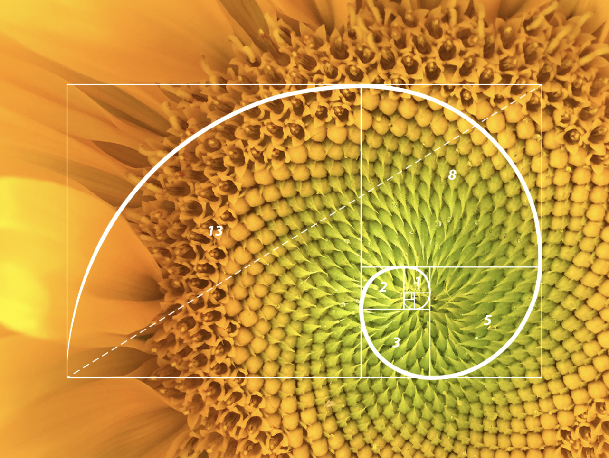

## Housekeeping 🏠 

::: {.incremental}
- New: no more points taken off for the number of attempts in live coding quizzes.
- This week's coding quiz is about **recursion**.
- Before the quiz, try the first 2 easy recursion coding questions in "Practice 5: Recursion, Trees, Linked Lists and k-d Trees" on PL.
- Feeling that lab is harder than lecture is normal.
:::

::: {.notes}
- there is a difference between thinking you learnt something in theory and implementing it yourself and applying it. The second one is when you actually learn.
- So the moment the lab feels hard is not a sign that you are behind. it means you are learning
:::

# How many ways up the Grouse Grind? {background-image="images/lec07_title_grind.png" background-size="cover" background-position="right bottom" style="font-size: 0.8em;"}

```{python}
#| echo: false
# Hidden: imports and helpers for the whole deck, kept in one place so the visible
# cells below contain only the code students should read.
import functools
import math
import timeit


def climb(n):
    """Same as the visible pyodide climb: ways to climb n stairs, 1 or 2 at a time."""
    if n == 1:
        return 1
    if n == 2:
        return 2
    return climb(n - 1) + climb(n - 2)


def naive_calls(n):
    """How many calls climb(n) makes in total: this call plus every call in both branches.
    climb(1) and climb(2) are base cases: one call each. calls[0] is unused."""
    calls = [0, 1, 1]
    for k in range(3, n + 1):
        calls.append(1 + calls[k - 1] + calls[k - 2])
    return calls[n]


def tree_layout(children, root, pad=0.5):
    """Where to draw every node and edge of a tree given as {node: [children]}. Leaves sit
    one unit apart, left to right, and each parent is centred over its children.
    Every edge is named by its child, since each child has exactly one parent."""
    pos, order, next_leaf = {}, [], [0]

    def place(node, depth):
        order.append(node)
        kids = children.get(node, [])
        for kid in kids:
            place(kid, depth + 1)
        if kids:
            x = sum(pos[k][0] for k in kids) / len(kids)
        else:
            x = next_leaf[0]
            next_leaf[0] += 1
        pos[node] = (x, -depth)

    place(root, 0)
    xs = [x for x, _ in pos.values()]
    ys = [y for _, y in pos.values()]
    return {"nodes": [{"id": u, "x": pos[u][0], "y": pos[u][1]} for u in order],
            "edges": [{"child": c, "x1": pos[p][0], "y1": pos[p][1], "x2": pos[c][0], "y2": pos[c][1]}
                      for p in order for c in children.get(p, [])],
            "x_domain": [min(xs) - pad, max(xs) + pad],
            "y_domain": [min(ys) - pad, max(ys) + pad]}


def all_paths(n):
    """Every way to climb n stairs, as a list of steps (1s and 2s). The ways that start with
    a 1-stair step come first, then the ways that start with a 2-stair step."""
    if n == 0:
        return [[]]
    if n == 1:
        return [[1]]
    return [[1] + p for p in all_paths(n - 1)] + [[2] + p for p in all_paths(n - 2)]


def hop_rows(paths, how=lambda row, j, first: "natural"):
    """One row per path: an arrow per step, a dot on every stair it lands on, and the path
    as a label. how(row, j, first) gives each step's look (first is True for the first step): "natural" (blue for a 1-stair
    step, orange for a 2-stair step), "grey" or "faint". A row with only faint steps is faint."""
    arrows, dots, labels = [], [], []
    for r, path in enumerate(paths):
        looks = [how(r, j, j == 0) for j in range(len(path))]
        row_role = "faint" if all(look == "faint" for look in looks) else "on"
        x = 0
        dots.append({"x": 0, "y": r, "role": row_role})
        for s, look in zip(path, looks):
            role = ("one" if s == 1 else "two") if look == "natural" else look
            arrows.append({"x1": x, "x2": x + s, "y": r, "role": role})
            x += s
            dots.append({"x": x, "y": r, "role": row_role})
        labels.append({"y": r, "text": str(path), "role": row_role})
    return arrows, dots, labels
```

```{pyodide}
#| include: false
# Hidden setup for the runnable cells: every climb function in the deck, so a later cell
# still works when an earlier slide was skipped.
import functools
import sys


def climb(n):
    if n == 1:
        return 1
    if n == 2:
        return 2
    return climb(n - 1) + climb(n - 2)


def climb_memo(n, memo=None):
    if memo is None:
        memo = {}
    if n == 1:
        return 1
    if n == 2:
        return 2
    if n in memo:
        return memo[n]
    memo[n] = climb_memo(n - 1, memo) + climb_memo(n - 2, memo)
    return memo[n]


@functools.lru_cache(maxsize=None)
def climb_cached(n):
    if n == 1:
        return 1
    if n == 2:
        return 2
    return climb_cached(n - 1) + climb_cached(n - 2)


def climb_table(n):
    if n <= 1:
        return 1
    dp = [0] * (n + 1)
    dp[0], dp[1] = 1, 1
    for i in range(2, n + 1):
        dp[i] = dp[i - 1] + dp[i - 2]
    return dp[n]
```

::: {style="max-width: 55%;"}
The Grouse Grind in North Vancouver: about **2,830 stairs** up the mountain.

::: {.incremental}
- You climb 1 or 2 stairs at a time.
- How many different ways are there to reach the top?
- Order matters: 1 then 2 is different from 2 then 1.
:::
:::

::: footer
Image generated by OpenAI GPT-image-2.5-sunburst. Stair count: [Grouse Mountain](https://www.grousemountain.com/grouse-grind)
:::

## iClicker: make a guess {style="font-size: 0.8em;"}

How many different ways are there to climb 2,830 stairs, 1 or 2 at a time?

- \(A) About 2,830
- \(B) About 8 million
- \(C) About as many as the atoms in the universe ($10^{80}$)
- \(D) Far more than the atoms in the universe

::: {.notes}
The answer is D, and we print it on the "Climb the whole Grind" slide.
:::

# Start small {style="font-size: 0.8em;"}

2,830 stairs is too many to count by hand. What about 1 stair? 2 stairs? 5 stairs?

::: {.notes}
TIPs: when you are given a hard problem, first think about the base case, think about what happens when n is 0, 1, 2...
:::

```{python}
#| echo: false
# Hidden: the "Count the ways" step-through. Every way to climb 1 to 5 stairs, one row per
# way, with an arrow per step; every arrow, dot, tick and sentence is worked out here.
count_view = []
counts = []
for n in range(1, 6):
    paths = all_paths(n)
    arrows, dots, labels = hop_rows(paths)
    counts.append(len(paths))
    say = f"{n} stair{'s' if n > 1 else ''}: {len(paths)} way{'s' if len(paths) > 1 else ''}."
    # The table under the chart: one column per staircase counted so far.
    tally = [{"stairs": k + 1, "ways": c} for k, c in enumerate(counts)]
    count_view.append({"arrows": arrows, "dots": dots, "labels": labels, "notes": [], "rules": [],
                       "ticks": list(range(n + 1)), "say": say, "count": f"{n} of 5",
                       "tally": tally})
ojs_define(count_view = count_view)
```

## Count the ways {style="font-size: 0.75em;"}

```{ojs}
//| echo: false
// Draw only: every arrow, dot and label was worked out in Python.
// Blue: a 1-stair step. Orange: a 2-stair step. Grey: not in focus. Faint: covered up.
draw_hops = (v, {marginRight = 30} = {}) => {
  const stroke = {one: "#2a78d6", two: "#eb6834", grey: "#b8b6b0", faint: "#eeede9"};
  const ink = {on: "#52514e", faint: "#d9d8d4"};
  return Plot.plot({
    width: 860, height: 300, marginLeft: 150, marginRight, marginTop: 14, marginBottom: 40,
    style: {fontSize: "16px", background: "transparent"},
    x: {domain: [0, 5], ticks: v.ticks, tickFormat: "d", label: "stair →", labelAnchor: "right"},
    y: {axis: null, domain: [7.6, -0.6]},
    marks: [
      Plot.ruleY(v.rules, {stroke: "#b8b6b0", strokeDasharray: "6,4"}),
      Plot.arrow(v.arrows, {x1: "x1", x2: "x2", y1: "y", y2: "y", bend: true, insetStart: 6, insetEnd: 6,
                            stroke: d => stroke[d.role], strokeWidth: 3, headLength: 8}),
      Plot.dot(v.dots, {x: "x", y: "y", r: 4, fill: d => ink[d.role]}),
      Plot.text(v.labels, {x: 0, y: "y", text: "text", dx: -14, textAnchor: "end", fill: d => ink[d.role]}),
      Plot.text(v.notes, {x: 5, y: "y", text: "text", dx: 16, textAnchor: "start", fontWeight: "bold",
                          fill: "#0b0b0b", lineHeight: 1.2})
    ]
  });
}
```

```{ojs}
//| echo: false
viewof count_step = Inputs.button([
  ["Back", i => Math.max(i - 1, 0)],
  ["Add a stair", i => Math.min(i + 1, count_view.length - 1)],
  ["Start over", () => 0]
], {value: 0})
```

```{ojs}
//| echo: false
{
  const v = count_view[count_step];
  return html`<div class="ojs-readout"><span class="sq-count">${v.count}</span> ${v.say}
    Stair 0 is the ground. <span class="notify">Blue</span>: climb 1 stair.
    <span class="match">Orange</span>: climb 2 stairs.</div>${draw_hops(v)}
    <div class="ojs-readout">Number of ways for every staircase we have counted so far:</div>
    <table class="ojs-readout" style="width: auto;">
      <tr><td>number of stairs</td>${v.tally.map(d => html`<td style="text-align: center;">${d.stairs}</td>`)}</tr>
      <tr><td>number of ways to climb them</td>${v.tally.map(d => html`<td style="text-align: center;">${d.ways}</td>`)}</tr>
    </table>`;
}
```

::: {.fragment}
1, 2, 3, 5, 8: the Fibonacci numbers from the spiral in lecture 6!
:::

```{python}
#| echo: false
# Hidden: the "Draw the spiral" slide. Square 1 sits at (0, 0); each new square goes on the next
# side of the drawing, in turn: right, above, left, below, and its side is f (same code as the
# visible cell on the next slide). One quarter circle per square makes the spiral. With the shell
# switched on, the photo nature2.png goes behind the drawing with the eye of the spiral on the eye
# of the shell. Every square, arc point, label, image position and sentence is worked out here,
# OJS only draws.
# Copied from lecture 6 for the recap. Wrapped in a function so its short names (n, s, p, ...)
# stay out of the shared kernel.
def build_spiral_view():
    import numpy as np

    def f(n):
        if n == 1 or n == 2:
            return 1
        else:
            return f(n - 1) + f(n - 2)


    def place_squares(n):
        """Corner (x, y) and side of squares 1 to n."""
        squares = [(0, 0, 1)]
        left, bottom, right, top = 0, 0, 1, 1
        for i in range(2, n + 1):
            s = f(i)
            if i % 4 == 2:
                x, y = right, bottom
            elif i % 4 == 3:
                x, y = left, top
            elif i % 4 == 0:
                x, y = left - s, bottom
            else:
                x, y = left, bottom - s
            squares.append((x, y, s))
            left, bottom = min(left, x), min(bottom, y)
            right, top = max(right, x + s), max(top, y + s)
        return squares


    spiral_max = 10
    spiral_w, spiral_h, spiral_margin = 820, 360, 10
    inner_w, inner_h = spiral_w - 2 * spiral_margin, spiral_h - 2 * spiral_margin
    inner_aspect = inner_h / inner_w
    where_words = {"right": "on the right", "above": "on top", "left": "on the left", "below": "underneath"}
    squares, arc = [], []
    minx = miny = maxx = maxy = 0
    for i, (x, y, s) in enumerate(place_squares(spiral_max), start=1):
        side = ["left", "below", "right", "above"][i % 4]   # square 1 counts as "below"
        minx, miny, maxx, maxy = min(minx, x), min(miny, y), max(maxx, x + s), max(maxy, y + s)
        # The quarter circle: its centre is one corner of the square, and it joins the two corners
        # next to that one, so each arc starts where the last one ended.
        cx, cy, start = {"below": (x + s, y + s, 180), "right": (x, y + s, 270),
                         "above": (x, y, 0), "left": (x + s, y, 90)}[side]
        angles = np.radians(np.linspace(start, start + 90, 13))
        arc += [{"x": round(float(cx + s * np.cos(a)), 3), "y": round(float(cy + s * np.sin(a)), 3)}
                for a in angles]
        squares.append({"x1": x, "x2": x + s, "y1": y, "y2": y + s, "side": s, "where": side,
                        "box": (minx, miny, maxx, maxy), "arc_end": len(arc)})

    # The eye of the spiral: the point the arcs wind into. Square k + 1's arc is square k's arc
    # turned a quarter and stretched, so the eye is the point that this turn leaves in place
    # (complex numbers: z -> a z + b, eye = b / (1 - a)).
    p = [complex(arc[13 * k]["x"], arc[13 * k]["y"]) for k in [7, 8, 9]]
    a_turn = (p[2] - p[1]) / (p[1] - p[0])
    spiral_eye = (p[1] - a_turn * p[0]) / (1 - a_turn)

    # The shell photo: 1054 x 818 pixels, eye of the shell at pixel (653, 537). Chosen by eye so the
    # inner coils line up: 6 photo pixels per unit of square side, no rotation.
    photo_w, photo_h, photo_eye_x, photo_eye_y, photo_px_per_unit = 1054, 818, 653, 537, 6
    photo_cx = spiral_eye.real + (photo_w / 2 - photo_eye_x) / photo_px_per_unit
    photo_cy = spiral_eye.imag - (photo_h / 2 - photo_eye_y) / photo_px_per_unit   # photo y points down
    photo_box = (photo_cx - photo_w / 2 / photo_px_per_unit, photo_cy - photo_h / 2 / photo_px_per_unit,
                 photo_cx + photo_w / 2 / photo_px_per_unit, photo_cy + photo_h / 2 / photo_px_per_unit)


    def frame(box, pad_share):
        """Axis domains around box, with the same scale on both axes."""
        bx0, by0, bx1, by1 = box
        w, h = bx1 - bx0, by1 - by0
        pad = pad_share * max(w, h)
        w_show = max(w + 2 * pad, (h + 2 * pad) / inner_aspect)
        h_show = w_show * inner_aspect
        xc, yc = (bx0 + bx1) / 2, (by0 + by1) / 2
        return w_show, [xc - w_show / 2, xc + w_show / 2], [yc - h_show / 2, yc + h_show / 2]


    def square_labels(n, w_show):
        """Side labels, only on squares big enough to hold one."""
        return [{"x": (q["x1"] + q["x2"]) / 2, "y": (q["y1"] + q["y2"]) / 2, "text": str(q["side"])}
                for q in squares[:n] if q["side"] / w_show > 0.04]


    shell_say = ("Here is the same spiral on top of a real nautilus shell, with both centres on the same spot. "
                 "The inner turns match. Further out, our spiral grows faster than the shell.")
    spiral_view = []   # one entry per click: squares 1 to 10, then the shell
    for n in range(1, spiral_max + 1):
        w_show, x_domain, y_domain = frame(squares[n - 1]["box"], 0.06)
        bx0, by0, bx1, by1 = squares[n - 1]["box"]
        both = (min(bx0, photo_box[0]), min(by0, photo_box[1]), max(bx1, photo_box[2]), max(by1, photo_box[3]))
        shell_w_show, shell_x_domain, shell_y_domain = frame(both, 0)
        px = inner_w / shell_w_show   # screen pixels per unit
        s = f(n)
        if n == 1:
            say = "Start with one small square. Each side is length of 1 unit. The blue curve is a quarter circle inside it."
        elif n == 2:
            say = "Add a second square on the right. Its sides are also length of 1 unit. Its quarter circle carries the curve on."
        else:
            say = (f"Square {n}: how long is each side? Add up the two squares before it: "
                   f"{f(n - 2)} + {f(n - 1)} = {s}. It goes {where_words[squares[n - 1]['where']]}, "
                   f"and it fits exactly.")
        step = {"say": say,
                "squares": [{**{k: q[k] for k in ["x1", "x2", "y1", "y2"]}, "role": "new" if k == n - 1 else "old"}
                            for k, q in enumerate(squares[:n])],
                "arc": arc[:squares[n - 1]["arc_end"]],
                "labels": square_labels(n, w_show), "x_domain": x_domain, "y_domain": y_domain, "photo": []}
        spiral_view.append(step)
        if n == spiral_max:   # one more click: the same drawing with the shell behind it
            spiral_view.append({**step, "say": shell_say, "labels": square_labels(n, shell_w_show),
                                "x_domain": shell_x_domain, "y_domain": shell_y_domain,
                                "photo": [{"x": round(photo_cx, 3), "y": round(photo_cy, 3),
                                           "width": round(photo_w / photo_px_per_unit * px, 1),
                                           "height": round(photo_h / photo_px_per_unit * px, 1)}]})
    for k, step in enumerate(spiral_view):
        step["count"] = f"Step {k + 1} of {len(spiral_view)}"
    golden_ratios = ", ".join(f"{f(n + 1) / f(n):.3f}" for n in range(5, 10))
    golden = f"{(1 + 5 ** 0.5) / 2:.3f}"
    return spiral_view, golden_ratios, golden


spiral_view, golden_ratios, golden = build_spiral_view()
ojs_define(spiral_view = spiral_view)
```

## Recap: draw the spiral {style="font-size: 0.7em;"}

```{ojs}
//| echo: false
viewof spiral_step = Inputs.button([
  ["Back", i => Math.max(i - 1, 0)],
  ["Next", i => Math.min(i + 1, spiral_view.length - 1)],
  ["Start over", () => 0]
], {value: 0})
```

```{ojs}
//| echo: false
{
  // Draw only: every square, arc point, photo position and sentence was worked out in Python
  // (spiral_view). Orange: the newest square. Grey: earlier squares. Blue: the spiral.
  const view = spiral_view[spiral_step];
  const shell = view.photo.length > 0;
  const fill = {new: "#fdeee6", old: "#f2f1ee"}, stroke = {new: "#eb6834", old: "#b8b6b0"};
  return html`<div class="ojs-readout"><span class="sq-count">${view.count}</span> ${view.say}</div>${Plot.plot({
    width: 820, height: 360, margin: 10,
    style: {fontSize: "16px", background: "transparent"},
    x: {axis: null, domain: view.x_domain}, y: {axis: null, domain: view.y_domain},
    marks: [
      Plot.image(view.photo, {x: "x", y: "y", width: "width", height: "height",
                              src: () => "images/nature2.png", opacity: 0.85}),
      Plot.rect(view.squares, {x1: "x1", x2: "x2", y1: "y1", y2: "y2", fillOpacity: shell ? 0 : 1,
                               fill: d => fill[d.role], stroke: d => stroke[d.role], strokeWidth: 2}),
      Plot.line(view.arc, {x: "x", y: "y", stroke: "#2a78d6", strokeWidth: 4}),
      Plot.text(view.labels, {x: "x", y: "y", text: "text", fontWeight: "bold",
                              fill: shell ? "white" : "#52514e"})
    ]
  })}`;
}
```

::: {.fragment}
{height="215px"} {height="215px"} {height="215px"} 
:::

::: footer
Images: [Artis Foundation](https://artisfoundation.org.uk/news/the-fibonacci-sequence-when-maths-arts-collide/) (Great Wave, Mona Lisa), [Cleveland Design](https://clevelanddesign.com/insights/the-nature-of-design-the-fibonacci-sequence-and-the-golden-ratio/) (sunflower), [EarthSky](https://earthsky.org/human-world/nautilus-shell-fibonacci-logarithmic-spiral-golden-spiral/) (nautilus)
:::


## Recap: Fibonacci python code from lecture 6 {style="font-size: 0.8em;"}

```{pyodide}
def f(n):
    """The side of square n in the spiral."""
    if n == 1 or n == 2:
        return 1                     # squares 1 and 2: side 1
    else:
        return f(n - 1) + f(n - 2)   # two recursive calls

print([f(n) for n in range(1, 11)])
```

::: {.incremental}
- These are the **Fibonacci** numbers: 1, 1, 2, 3, 5, 8, 13, ...
- Two base cases, because each square needs the two squares before it.
:::

```{python}
#| echo: false
# Hidden: the "Think about the first move" step-through. The 8 ways to climb 5 stairs, the ways
# that start with a 1-stair step first; each step says which arrows are in focus.
lm_paths = all_paths(5)
lm_group = [1 if p[0] == 1 else 2 for p in lm_paths]
n_one, n_two = lm_group.count(1), lm_group.count(2)
rows_one = [r for r, g in enumerate(lm_group) if g == 1]
rows_two = [r for r, g in enumerate(lm_group) if g == 2]
note_one = {"y": sum(rows_one) / len(rows_one), "text": f"the {n_one} ways\nto climb 4 stairs"}
note_two = {"y": sum(rows_two) / len(rows_two), "text": f"the {n_two} ways\nto climb 3 stairs"}


def lm_look(focus):
    """focus(group, first) -> "natural", "grey" or "faint", turned into a hop_rows look."""
    return lambda r, j, first: focus(lm_group[r], first)


lm_plan = [
    (f"All {len(lm_paths)} ways to climb 5 stairs. Look at the first step of each way: "
     "it can only be a 1-stair step or a 2-stair step.",
     lambda g, first: "natural", []),
    (f"{n_one} ways start with a 1-stair step.",
     lambda g, first: ("natural" if first else "grey") if g == 1 else "faint", []),
    (f"Cover that first step. You stand on stair 1 with 4 stairs left: the old problem, "
     f"one size smaller. These are exactly the {n_one} ways to climb 4 stairs.",
     lambda g, first: ("faint" if first else "natural") if g == 1 else "faint", [note_one]),
    (f"The other {n_two} ways start with a 2-stair step.",
     lambda g, first: ("faint" if first else "grey") if g == 1 else ("natural" if first else "grey"), [note_one]),
    (f"Cover it. You stand on stair 2 with 3 stairs left: the {n_two} ways to climb 3 stairs.",
     lambda g, first: ("faint" if first else "grey") if g == 1 else ("faint" if first else "natural"),
     [note_one, note_two]),
    (f"Every way starts with exactly one of the two, so ways(5) = ways(4) + ways(3) = "
     f"{n_one} + {n_two} = {n_one + n_two}.",
     lambda g, first: "natural", [note_one, note_two]),
]
lm_view = []
for k, (say, focus, notes) in enumerate(lm_plan):
    arrows, dots, labels = hop_rows(lm_paths, lm_look(focus))
    lm_view.append({"arrows": arrows, "dots": dots, "labels": labels, "notes": notes,
                    "rules": [max(rows_one) + 0.5], "ticks": list(range(6)), "say": say,
                    "count": f"Step {k + 1} of {len(lm_plan)}"})
ojs_define(lm_view = lm_view)
```

## Think about the first move {style="font-size: 0.75em;"}

```{ojs}
//| echo: false
viewof lm_step = Inputs.button([
  ["Back", i => Math.max(i - 1, 0)],
  ["Next", i => Math.min(i + 1, lm_view.length - 1)],
  ["Start over", () => 0]
], {value: 0})
```

```{ojs}
//| echo: false
{
  const v = lm_view[lm_step];
  return html`<div class="ojs-readout"><span class="sq-count">${v.count}</span> ${v.say}</div>
    ${draw_hops(v, {marginRight: 200})}`;
}
```

::: {.fragment}
$$\text{ways}(n) = \text{ways}(n-1) + \text{ways}(n-2)$$
:::

## From the first move to code {style="font-size: 0.7em;"}

```{pyodide}
def climb(n):
    """Number of ways to climb n stairs, 1 or 2 stairs at a time."""
    if n == 1:
        return 1                          # base case: 1 stair, [1]
    if n == 2:
        return 2                          # base case: 2 stairs, [1, 1] or [2]
    return climb(n - 1) + climb(n - 2)    # first move: 1 stair or 2 stairs

print([climb(n) for n in range(1, 11)])
```

::: {.incremental}
- Two base cases, 1 stair and 2 stairs, because each staircase needs the two below it.
- The same as Fibonacci from lecture 6, shifted by one: `climb(n)` is `f(n + 1)`.
- What is the Big O time complexity of this algorithm?
    - It's exponential: each call makes 2 more calls, about $n$ levels deep. --> $O(2^n)$
:::

# Why is it so slow? {style="font-size: 0.8em;"}

```{python}
#| echo: false
# Hidden: the "Where does the time go?" step-through. The call tree of climb(5), with each
# repeated question and everything under it highlighted in turn; OJS only draws.
def call_tree(n):
    """The call tree of the visible climb(n): {node: [children]} and the stair k of each node."""
    children, k_of = {}, {}

    def go(k, parent):
        me = f"c{len(k_of)}"
        k_of[me] = k
        if parent is not None:
            children.setdefault(parent, []).append(me)
        if k > 2:   # climb(1) and climb(2) are base cases
            go(k - 1, me)
            go(k - 2, me)

    go(n, None)
    return children, k_of


def under(children, node):
    """Every node below node in the tree."""
    out = []
    for kid in children.get(node, []):
        out += [kid] + under(children, kid)
    return out


rep_children, rep_k = call_tree(5)
rep_layout = tree_layout(rep_children, "c0", pad=0.6)
rep_labels = {u: f"climb({k})" for u, k in rep_k.items()}
rep_total = len(rep_k)
rep_distinct = len(set(rep_k.values()))


def rep_snapshot(say, node_roles):
    edge_roles = {u: {"rep": "hot", "sub": "hot", "faint": "faint"}.get(r, "base") for u, r in node_roles.items()}
    return {"say": say, "labels": rep_labels, "node_roles": node_roles, "edge_roles": edge_roles}


rep_steps = [rep_snapshot(f"climb(5) asks climb(4) and climb(3). They ask smaller stairs, and so on, "
                          f"down to the base cases. {rep_total} calls in total.",
                          {u: "other" for u in rep_k})]
for k in [3, 2, 1]:
    roots = [u for u in rep_k if rep_k[u] == k]
    inside = {v for u in roots for v in under(rep_children, u)}
    roles = {u: "rep" if u in roots else "sub" if u in inside else "other" for u in rep_k}
    say = f"climb({k}) is worked out {len(roots)} times."
    if k > 2:
        say += " Each time, every call under it runs again too."
    rep_steps.append(rep_snapshot(say, roles))
first = {}
for u in rep_k:   # nodes are numbered in the order the calls happen
    first.setdefault(rep_k[u], u)
rep_steps.append(rep_snapshot(
    f"{rep_total} calls, but only {rep_distinct} different questions: climb(1) to climb(5). "
    "If we remembered each answer, we would only need to work each one out once.",
    {u: "first" if first[rep_k[u]] == u else "faint" for u in rep_k}))
for k, step in enumerate(rep_steps):
    step["count"] = f"Step {k + 1} of {len(rep_steps)}"
ojs_define(rep_layout = rep_layout, rep_steps = rep_steps)
```

## Where does the time go? Rememebr the "Call tree" from last lecture? {style="font-size: 0.75em;"}

```{ojs}
//| echo: false
// Draw only: a tree laid out in Python, with colour roles and labels from Python.
// Orange: a repeated question (light orange: the calls under it), or the call running now.
// Light blue: waiting. Blue: answered from the memo, or the first time a question is asked.
// Grey: other calls. Faint: calls we would not need.
draw_tree = (lay, s, {width = 860, height = 280, r = 14} = {}) => {
  const fill = {now: "#eb6834", rep: "#eb6834", sub: "#f6c3ad", waiting: "#a9c8ef", memo: "#2a78d6",
                first: "#2a78d6", done: "#b8b6b0", other: "#b8b6b0", faint: "#eeede9"};
  const stroke = {hot: "#eb6834", base: "#d9d8d4", faint: "#f2f1ee"};
  const labels = s.labels ?? {};
  const nodes = lay.nodes.map(d => ({...d, role: s.node_roles[d.id] ?? "other", label: labels[d.id] ?? ""}))
                         .filter(d => d.role !== "hidden");
  const edges = lay.edges.map(d => ({...d, role: s.edge_roles[d.child] ?? "base"}))
                         .filter(d => d.role !== "hidden");
  return Plot.plot({
    width, height, margin: 14, marginTop: 30,
    style: {fontSize: "16px", background: "transparent"},
    x: {axis: null, domain: lay.x_domain}, y: {axis: null, domain: lay.y_domain},
    marks: [
      Plot.link(edges, {x1: "x1", y1: "y1", x2: "x2", y2: "y2", stroke: d => stroke[d.role],
                        strokeWidth: d => d.role === "hot" ? 4 : 2}),
      Plot.dot(nodes, {x: "x", y: "y", r, fill: d => fill[d.role], stroke: "white", strokeWidth: 2}),
      Plot.text(nodes, {x: "x", y: "y", text: "label", dy: -(r + 10), fontWeight: "bold",
                        fill: d => d.role === "faint" ? "#c9c7c1" : "#0b0b0b",
                        stroke: "white", strokeWidth: 5, paintOrder: "stroke"})
    ]
  });
}
```

```{ojs}
//| echo: false
viewof rep_step = Inputs.button([
  ["Back", i => Math.max(i - 1, 0)],
  ["Next", i => Math.min(i + 1, rep_steps.length - 1)],
  ["Start over", () => 0]
], {value: 0})
```

```{ojs}
//| echo: false
{
  const s = rep_steps[rep_step];
  return html`<div class="ojs-readout"><span class="sq-count">${s.count}</span> ${s.say}</div>
    ${draw_tree(rep_layout, s, {height: 300})}`;
}
```

::: {.notes}
- write down the call tree on my notepad
:::

```{python}
#| echo: false
# Hidden: the "How often is each stair worked out?" chart. For climb(n), how many times
# climb(k) is called, for every k: each call to climb(m), m > 2, calls climb(m - 1) and climb(m - 2) once.
solved_view = {}
for n in range(5, 31):
    times = [0] * (n + 1)   # times[0] is unused: there is no climb(0)
    times[n] = 1
    for m in range(n, 2, -1):
        times[m - 1] += times[m]
        times[m - 2] += times[m]
    solved_view[n] = {"rows": [{"k": k, "times": times[k]} for k in range(1, n + 1)],
                      "ticks": [1] + list(range(5, n + 1, 5)),
                      "say": (f"climb({n}) works out climb(2) {times[2]:,} times and climb(1) {times[1]:,} times. "
                              f"There are only {n} different questions, climb(1) to climb({n}), "
                              f"but {sum(times):,} calls.")}
ojs_define(solved_view = solved_view)
```

## How often is each stair worked out? {style="font-size: 0.75em;"}

```{ojs}
//| echo: false
viewof solved_n = Inputs.range([5, 30], {value: 10, step: 1, label: "stairs n"})
```

```{ojs}
//| echo: false
{
  // Draw only: every count was computed in Python (solved_view).
  const v = solved_view[solved_n];
  return html`<div class="ojs-readout">${v.say}</div>${Plot.plot({
    width: 820, height: 300, marginLeft: 90, marginTop: 30, marginBottom: 44,
    style: {fontSize: "16px", background: "transparent"},
    x: {type: "band", ticks: v.ticks, label: "k, in climb(k) →", labelAnchor: "right"},
    y: {grid: true, label: "↑ times worked out"},
    marks: [
      Plot.barY(v.rows, {x: "k", y: "times", fill: "#eb6834"}),
      Plot.ruleY([0])
    ]
  })}`;
}
```

::: {.fragment}
The same small questions come up again and again: **overlapping subproblems**.
:::

## How long would the Grind take? {style="font-size: 0.8em;"}

```{python}
import timeit

measured = {}                                              # stairs -> seconds
for n in [25, 30, 35]:
    measured[n] = timeit.timeit(lambda: climb(n), number=1)   # run climb(n) once
    print(f"climb({n}): {measured[n]:.3f} seconds")
```

```{python}
#| echo: false
# Hidden: the growth and projection on this slide. It uses `measured` from the visible cell above
# and the call counts, so every number matches the times printed above.
# Growth: count calls instead of timing them, because call counts never change between runs.
calls_jump = naive_calls(30) / naive_calls(25)   # about the same jump for every 5 more stairs
per_stair = calls_jump ** (1 / 5)
# The jumps in the printed times, worked out from the rounded numbers students can see.
shown = {n: max(round(measured[n], 3), 0.001) for n in measured}
time_jumps = (f"{shown[30]:.3f} / {shown[25]:.3f} ≈ {shown[30] / shown[25]:.1f} and "
              f"{shown[35]:.3f} / {shown[30]:.3f} ≈ {shown[35] / shown[30]:.1f}")
growth_say = (f"Every 5 more stairs makes about {calls_jump:.0f} times as many calls, "
              f"so one more stair is about {per_stair:.1f} times the work.")
per_call = measured[35] / naive_calls(35)


def how_long(s):
    """Seconds -> "about 3 hours"."""
    for unit, size in [("years", 365.25 * 24 * 3600), ("days", 24 * 3600), ("hours", 3600), ("minutes", 60)]:
        if s >= 2 * size:
            return f"about {s / size:,.0f} {unit}"
    return f"about {s:.0f} seconds"


age_of_universe = 13.8e9 * 365.25 * 24 * 3600   # seconds
grind_zeros = math.floor(math.log10(naive_calls(2830)) + math.log10(per_call) - math.log10(age_of_universe))
assert grind_zeros > 80   # more universe lifetimes than atoms in the universe (about 10^80)
assert naive_calls(2830) > 10**80   # more calls than atoms in the universe
time_50 = how_long(per_call * naive_calls(50))
time_100 = how_long(per_call * naive_calls(100))
```

::: {.incremental}
- `{python} growth_say`
- The times jump by roughly that much: `{python} time_jumps`. Timing wobbles because of which computer you run it from.
- 50 stairs: `{python} time_50`. 100 stairs: `{python} time_100`.
- 2,830 stairs: it would never finish! The total number of calls is more than the number of atoms in the universe. Even if we had started when the universe began, it would take more than 10^`{python} grind_zeros`^ lifetimes of the universe. 🤯
:::

# Write it down {background-image="images/lec07_otter_chalk.png" background-size="cover" background-position="right bottom" style="font-size: 0.8em;"}

::: {style="max-width: 55%;"}
::: {.incremental}
- The first time you count how many unique ways to reach a stair, write that number down on that stair with a chalk.
- Next time someone asks you how many unique ways to get to the next stair, read the chalk on the 2 previous stairs and add them up!
- This is **memoization**: store each answer of a function, so it is only computed once.
:::
:::

::: {.notes}
- "Memo" as in a memo pad, a note to yourself. Not "memorization".
:::

::: footer
Image generated by OpenAI GPT-image-2.5-sunburst
:::

## Memoization in code {style="font-size: 0.8em;"}

```{pyodide}
def climb_memo(n, memo=None):
    if memo is None:
        memo = {}                     # the chalk marks: stairs -> unique ways to reach them
    if n == 1:
        return 1                      # base case: 1 stair
    if n == 2:
        return 2                      # base case: 2 stairs
    if n in memo:
        return memo[n]                # already chalked: read it
    memo[n] = climb_memo(n - 1, memo) + climb_memo(n - 2, memo)   # work it out once, chalk it
    return memo[n]

print(climb_memo(30))
```

::: {.fragment}
Same recurrence as `climb`, plus two lines: check the memo, and write to the memo.
:::


```{python}
#| echo: false
# Hidden: the "Watch the memo" step-through. An instrumented copy of the visible climb_memo
# (same order: base case, then the memo, then work it out) builds the tree of calls as it runs
# and records the stack and the memo; OJS only draws. The memo table has one column per stair:
# stairs 1 and 2 are base cases, never stored; the others fill in as the memo is written.
def record_memo(n_top):
    children, label, value, stack, steps, memo, hits = {}, {}, {}, [], [], {}, set()

    def snap(say, read=None, wrote=None):
        roles = {u: "hidden" for u in label}
        roles.update({u: "done" for u in value})
        roles.update({u: "waiting" for u in stack})
        roles[stack[-1]] = "now"
        roles.update({u: "memo" for u in hits})
        steps.append({"say": say,
                      "labels": {u: f"{label[u]} = {value[u]}" if u in value else label[u] for u in label},
                      "node_roles": roles,
                      "memo": memo_cells(read, wrote)})

    def memo_cells(read=None, wrote=None):
        """One cell per stair for the memo table, with its text and colour class."""
        cells = []
        for k in range(1, n_top + 1):
            if k <= 2:
                cells.append({"stair": k, "text": "base case, not stored", "cls": "base"})
            else:
                cells.append({"stair": k, "text": str(memo[k]) if k in memo else "",
                              "cls": "end" if k == wrote else "found" if k == read else ""})
        return cells

    def go(k):
        me = f"c{len(label)}"
        label[me] = f"climb({k})"
        caller = label[stack[-1]] if stack else None
        if stack:
            children.setdefault(stack[-1], []).append(me)
        stack.append(me)
        start = f"{caller} asks climb({k})." if caller else f"We call climb({k})."
        if k <= 2:   # climb(1) and climb(2) are base cases
            value[me] = k
            snap(f"{start} A base case: {k} way{'s' if k > 1 else ''}.")
        elif k in memo:
            value[me] = memo[k]
            hits.add(me)
            snap(f"{start} Stair {k} is already in the memo: {memo[k]}. Read it, no more calls.", read=k)
        else:
            snap(f"{start} Stair {k} is not in the memo yet, so it asks climb({k - 1}) first.")
            a = go(k - 1)
            b = go(k - 2)
            memo[k] = value[me] = a + b
            snap(f"climb({k}) = {a} + {b} = {a + b}. Write it in the memo.", wrote=k)
        stack.pop()
        return value[me]

    start_cells = memo_cells()   # before the first call: nothing stored yet
    go(n_top)
    steps[-1]["say"] += f" That took {len(label)} calls instead of {naive_calls(n_top)}."
    lay = tree_layout(children, "c0", pad=0.6)
    out = [{"say": f"We call climb_memo({n_top}). The memo starts empty.", "labels": {},
            "node_roles": {u: "hidden" for u in label}, "memo": start_cells}] + steps
    for s in out:
        s["edge_roles"] = {u: "hidden" if r == "hidden" else "base" for u, r in s["node_roles"].items()}
    for k, s in enumerate(out):
        s["count"] = f"Step {k} of {len(out) - 1}"
    return lay, out


memo_layout, memo_steps = record_memo(5)
ojs_define(memo_layout = memo_layout, memo_steps = memo_steps)
```

## Watch the memo {style="font-size: 0.9em;"}

```{ojs}
//| echo: false
viewof memo_step = Inputs.button([
  ["Back", i => Math.max(i - 1, 0)],
  ["Next step", i => Math.min(i + 1, memo_steps.length - 1)],
  ["Start over", () => 0]
], {value: 0})
```

```{ojs}
//| echo: false
{
  // Draw only: the calls were made and recorded in Python (memo_steps).
  // Memo table: orange = just written, blue = just read, grey = base case (never stored).
  const s = memo_steps[memo_step];
  return html`<div class="ojs-readout"><span class="sq-count">${s.count}</span> ${s.say}</div>
    ${draw_tree(memo_layout, s, {height: 250})}
    <table class="ojs-readout memo-table" style="width: auto;">
      <tr><td>stair n</td>${s.memo.map(d => html`<td style="text-align: center;">${d.stair}</td>`)}</tr>
      <tr><td>memo[n]</td>${s.memo.map(d => html`<td class="${d.cls}" style="text-align: center;">${d.text}</td>`)}</tr>
    </table>`;
}
```


```{python}
#| echo: false
# Hidden: the "Count the calls" chart. Calls made by the plain climb(n) and by climb_memo(n),
# counted by running an instrumented copy of climb_memo.
def memo_calls(n):
    count = [0]

    def go(k, memo):
        count[0] += 1
        if k <= 2:   # base cases: climb(1) = 1, climb(2) = 2
            return k
        if k in memo:
            return memo[k]
        memo[k] = go(k - 1, memo) + go(k - 2, memo)
        return memo[k]

    go(n, {})
    return count[0]


plain_kind, memo_kind = "plain recursion", "with a memo"
calls_rows = ([{"n": n, "calls": naive_calls(n), "what": plain_kind} for n in range(1, 36)]
              + [{"n": n, "calls": memo_calls(n), "what": memo_kind} for n in range(1, 36)])
calls_view = {"rows": calls_rows, "kinds": [plain_kind, memo_kind],
              "y_max": {n: naive_calls(n) * 1.1 for n in range(1, 36)},
              "say": {n: f"{n} stairs: plain recursion makes {naive_calls(n):,} calls. "
                         f"With a memo: {memo_calls(n):,} calls." for n in range(1, 36)}}
ojs_define(calls_view = calls_view)
```

## Count the calls {style="font-size: 0.75em;"}

```{ojs}
//| echo: false
viewof calls_n = Inputs.range([2, 35], {value: 10, step: 1, label: "stairs n"})
```

```{ojs}
//| echo: false
{
  // Draw only: every count was computed in Python (calls_view).
  const v = calls_view;
  return html`<div class="ojs-readout">${v.say[calls_n]}</div>${Plot.plot({
    width: 820, height: 300, marginLeft: 100, marginRight: 30, marginTop: 30, marginBottom: 40,
    style: {fontSize: "16px", background: "transparent"},
    x: {label: "stairs n →", domain: [1, calls_n]},
    y: {label: "↑ calls", grid: true, domain: [0, v.y_max[calls_n]]},
    color: {domain: v.kinds, range: ["#eb6834", "#2a78d6"], legend: true, swatchSize: 16},
    marks: [
      Plot.line(v.rows, {filter: d => d.n <= calls_n, x: "n", y: "calls", stroke: "what", strokeWidth: 3}),
      Plot.dot(v.rows, {filter: d => d.n === calls_n, x: "n", y: "calls", fill: "what", r: 5}),
      Plot.ruleY([0])
    ]
  })}`;
}
```

::: {.notes}
The blue line looks flat, but it grows too: 2n - 3 calls.
:::

## iClicker: how fast is `climb_memo`? {style="font-size: 0.8em;"}

What is the time complexity of `climb_memo(n)`?

- \(A) $O(2^n)$
- \(B) $O(n^2)$
- \(C) $O(n)$
- \(D) $O(1)$

::: {.fragment}
- Answer: **C**. Each stair from 3 to $n$ is worked out once, with $O(1)$ work each time. Every other call reads the memo.
- Space is $O(n)$ too: $n$ entries in the memo, and up to $n$ calls waiting on the stack.
:::

## Python can do it for you {style="font-size: 0.7em;"}

```{pyodide}
import functools

@functools.lru_cache(maxsize=None)    # remember every answer
def climb_cached(n):
    if n == 1:
        return 1
    if n == 2:
        return 2
    return climb_cached(n - 1) + climb_cached(n - 2)

print(climb_cached(30))
print(climb_cached.cache_info())
```

::: {.incremental}
- The decorator wraps the plain `climb` code: no memo variable to write.
- **Caching**: storing data to use later. **Memoization** is caching the answers of a function.
- lru = least recently used: with a `maxsize`, a full cache forgets the answer used longest ago. `maxsize=None`: never forget.
- What do hits and misses mean? 
:::

```{python}
#| echo: false
# Hidden: the hits and misses quoted on the "Reading cache_info()" slide, counted by running
# a cached climb for 5 and for 30 stairs, so the text matches what the cells print.
def cache_counts(n):
    @functools.lru_cache(maxsize=None)
    def go(k):
        if k <= 2:
            return k
        return go(k - 1) + go(k - 2)

    go(n)
    info = go.cache_info()
    return info.hits, info.misses


small_hits, small_misses = cache_counts(5)
big_hits, big_misses = cache_counts(30)
```

## Reading `cache_info()` for `climb(5)` {style="font-size: 0.8em;"}

Same function on 5 stairs. It prints a line only when it has to work something out.

```{pyodide}
@functools.lru_cache(maxsize=None)
def climb_loud(n):
    print(f"working out climb({n})")   # only runs on a miss
    if n == 1:
        return 1
    if n == 2:
        return 2
    return climb_loud(n - 1) + climb_loud(n - 2)

climb_loud(5)
print(climb_loud.cache_info())
```

::: {.incremental}
- **Miss**: "I missed this in my memo!", the answer is not stored yet, so the function body runs. Each stair is worked out once: `{python} small_misses` misses.
- **Hit**: the answer is already stored, so Python reads it and the body never runs. climb(4) asks climb(2), climb(5) asks climb(3): `{python} small_hits` hits.
- `{python} small_misses + small_hits` calls in total, the same calls as in "Watch the memo".
:::

## iClicker: call it again {style="font-size: 0.8em;"}

We run `climb_cached(30)` a second time. What does `cache_info()` show now?

- \(A) misses go up by 30
- \(B) hits go up by 1, misses stay the same
- \(C) the cache is emptied first
- \(D) an error

::: {.fragment}
- Answer: **B**. The answer for 30 is already stored, so it is one lookup: no new misses.
- `cache_info()` is a running total since the function was defined. Hits go from `{python} big_hits` to `{python} big_hits + 1`; the `{python} big_misses` misses are still the ones from the first run.

```{pyodide}
climb_cached(30)
print(climb_cached.cache_info())
```
:::


# Back to the Grind {style="font-size: 0.8em;"}

Memoization is fast. Let's climb all 2,830 stairs.

```{pyodide}
climb_memo(2830)
```

::: {.incremental}
- `RecursionError`! 
- 2,830 calls stacked up. Python stops at about 1,000 (the call stack, lecture 6).
- Can we get the answer without a tall call stack?
:::


## Can we raise the recursion limit? {style="font-size: 0.8em;"}

::: {.incremental}

```{.python}
import sys
sys.setrecursionlimit(5000)
```

- This raises the limit **only for the Python process that is running now**: your script and every module it imports.
- It is not saved anywhere, not for your computer and not for the virtual environment. The next run of the script, or a restarted kernel, starts again at 1,000.
- Set it very high and each extra call still costs memory. On Python 3.10 and older, it could even crash Python instead of raising a `RecursionError`.
- The safer fix: don't stack 2,830 calls at all.
:::

::: {.notes}
- Why older Python could crash: up to 3.10, every Python call also used space on the C stack, whose size is set by the operating system. A high limit could run out of C stack before Python noticed, so the program died with a segfault.
- Since 3.11, most calls from one Python function to another no longer use the C stack, so deep recursion in plain Python mostly just uses more memory. 3.12 added a separate guard for C level recursion, and 3.14 checks the real C stack directly.
- A crash is still possible when the recursion goes through C code: `repr` or `json` or `pickle` on a deeply nested object, or a C extension.
:::

# Start at the bottom {background-image="images/lec07_otter_summit.png" background-size="cover" background-position="right bottom" style="font-size: 0.8em;"}

::: {style="max-width: 55%;"}
::: {.incremental}
- Top-down asks from the top stair and works its way down.
- Instead, start on the ground and walk up. Chalk every stair on the way.
- When you reach a stair, the two stairs below it are already chalked: add them up.
- This is **tabulation**, or bottom-up: fill a table from the smallest question up.
:::
:::

::: footer
Image generated by OpenAI GPT-image-2.5-sunburst
:::

```{python}
#| echo: false
# Hidden: the "Fill the table" step-through. dp for 8 stairs drawn as a staircase, filled in the
# same order as the visible climb_table; every stair, colour and sentence is worked out here.
fill_n = 8
dp = [None] * (fill_n + 1)


def fill_snapshot(say, new=(), read=()):
    stairs = [{"x1": i + 0.06, "x2": i + 0.94, "y2": i + 1,
               "role": "new" if i in new else "read" if i in read else "empty" if dp[i] is None else "filled",
               "value": "" if dp[i] is None else str(dp[i]), "tag": f"dp[{i}]", "x": i + 0.5}
              for i in range(fill_n + 1)]
    return {"say": say, "stairs": stairs}


fill_steps = [fill_snapshot(f"dp has one slot per stair, 0 to {fill_n}. Nothing is chalked yet.")]
dp[0], dp[1] = 1, 1
fill_steps.append(fill_snapshot("Base cases: 1 way to stand on the ground (stair 0), 1 way to reach stair 1.",
                                new=(0, 1)))
for i in range(2, fill_n + 1):
    dp[i] = dp[i - 1] + dp[i - 2]
    say = f"Stair {i}: dp[{i}] = dp[{i - 1}] + dp[{i - 2}] = {dp[i - 1]} + {dp[i - 2]} = {dp[i]}."
    if i == fill_n:
        say += f" There are {dp[i]} ways to climb {fill_n} stairs."
    fill_steps.append(fill_snapshot(say, new=(i,), read=(i - 1, i - 2)))
for k, s in enumerate(fill_steps):
    s["count"] = f"Step {k} of {len(fill_steps) - 1}"
ojs_define(fill_steps = fill_steps)
```

## Fill the table {style="font-size: 0.75em;"}

```{ojs}
//| echo: false
viewof fill_step = Inputs.button([
  ["Back", i => Math.max(i - 1, 0)],
  ["Next stair", i => Math.min(i + 1, fill_steps.length - 1)],
  ["Start over", () => 0]
], {value: 0})
```

```{ojs}
//| echo: false
{
  // Draw only: every stair, value and sentence was worked out in Python (fill_steps).
  // Orange: the stair we just chalked. Blue: the two stairs it adds. Grey: chalked earlier.
  const s = fill_steps[fill_step];
  const fill = {new: "#eb6834", read: "#2a78d6", filled: "#e4e2dc", empty: "#fcfcfb"};
  const ink = {new: "#eb6834", read: "#2a78d6", filled: "#52514e", empty: "#52514e"};
  return html`<div class="ojs-readout"><span class="sq-count">${s.count}</span> ${s.say}</div>${Plot.plot({
    width: 820, height: 330, marginLeft: 20, marginRight: 20, marginTop: 34, marginBottom: 34,
    style: {fontSize: "16px", background: "transparent"},
    x: {axis: null, domain: [0, 9]}, y: {axis: null, domain: [0, 9.6]},
    marks: [
      Plot.rect(s.stairs, {x1: "x1", x2: "x2", y1: 0, y2: "y2", fill: d => fill[d.role],
                            stroke: d => d.role === "empty" ? "#b8b6b0" : fill[d.role],
                            strokeDasharray: "5,4", strokeWidth: 1.5}),
      Plot.text(s.stairs, {x: "x", y: "y2", text: "value", dy: -14, fontSize: 22, fontWeight: "bold",
                           fill: d => ink[d.role]}),
      Plot.text(s.stairs, {x: "x", y: 0, text: "tag", dy: 16, fill: "#52514e"})
    ]
  })}`;
}
```

::: {.notes}
- Each stair only looks down at the two stairs below it, and they are always ready. No recursion, no stack.
- Why dp[0] = 1 here, when climb had base cases 1 and 2: it is a shortcut so the loop can start at stair 2. dp[2] = dp[1] + dp[0] = 1 + 1 = 2, the same as our base case. One way to climb 0 stairs: stand still.
:::

## Climb the whole Grind {style="font-size: 0.8em;"}

```{pyodide}
def climb_table(n):
    if n <= 1:
        return 1
    dp = [0] * (n + 1)          # dp[i] = ways to reach stair i
    dp[0], dp[1] = 1, 1         # base cases
    for i in range(2, n + 1):   # walk up, smallest stair first
        dp[i] = dp[i - 1] + dp[i - 2]   # both already filled in
    return dp[n]

ways = climb_table(2830)
print(len(str(ways)), "digits:", ways)
```

::: {.fragment}
- The opening iClicker: **D**. A 592-digit number. The atoms in the universe: about 80 digits.
:::

::: {.notes}
- Python ints have no size limit, so this works. In numpy, int64 would overflow after about 90 stairs.
- Time O(n): one loop over the stairs. No recursion, so no RecursionError.
:::

## iClicker: space of `climb_table` {style="font-size: 0.8em;"}

What is the space complexity of `climb_table(n)`?

- \(A) $O(1)$
- \(B) $O(\log n)$
- \(C) $O(n)$
- \(D) $O(2^n)$

::: {.fragment}
- Answer: **C**. The table `dp` has $n + 1$ slots.
- But look at the loop: stair `i` only reads `dp[i - 1]` and `dp[i - 2]`. Do we need the rest?
:::

## Keep only two stairs {style="font-size: 0.8em;"}

```{pyodide}
def climb_two(n):
    below2, below1 = 1, 1                          # ways(0), ways(1)
    for _ in range(2, n + 1):
        below2, below1 = below1, below1 + below2   # move up one stair
    return below1

print(climb_two(2830) == climb_table(2830))
```

::: {.fragment}
Still $O(n)$ time, but now $O(1)$ space: a hiker who only remembers the last two stairs.
:::

::: {.notes}
- Strictly, the numbers themselves grow (592 digits), so each number takes more memory. In this course we count each number as O(1).
:::

# Dynamic programming {style="font-size: 0.8em;"}

What we just did has a name: **dynamic programming** (DP). Solve each smaller question once, store the answer, and reuse it.

::: {.incremental}
- DP fits a problem with two properties:
  - **Overlapping subproblems**: the same smaller questions come up again and again (`climb(3)` inside `climb(5)`, twice).
  - **Optimal substructure**: the answer is built from the answers to smaller questions: ways(n) = ways(n − 1) + ways(n − 2).
- Binary search has no overlap: it never looks at the same half twice. Plain recursion is enough there.
:::

::: {.notes}
- Fun fact on the name: Richard Bellman, 1950s. "Programming" meant planning (as in "linear programming"), not writing code. He picked "dynamic" because it sounded impressive to the people funding him.
:::

## Top-down or bottom-up? {style="font-size: 0.8em;"}

| | top-down (memoization) | bottom-up (tabulation) |
|---|---|---|
| starts from | the top stair, $n$ | the ground, the base cases |
| how | recursion + a memo | a loop that fills a table |
| which stairs | only the ones it needs | every stair up to $n$ |
| 2,830 stairs | ❌ `RecursionError` | ✅ |

::: {.fragment}
Both are $O(n)$ time. Top-down is often easier to write first: it is the recurrence plus a memo.
:::

## Where else is DP used? {style="font-size: 0.8em;"}

::: {.incremental}
- `git diff`: the smallest set of line changes between two files.
- Autocorrect: the fewest letter edits from "teh" to "the" (edit distance, next lecture).
- DNA: lining up two gene sequences.
- Resizing an image without squashing faces (this week's lab).
:::

## iClicker: which one needs DP? {style="font-size: 0.8em;"}

Which problem is a good fit for dynamic programming?

- \(A) Find the largest number in a list
- \(B) Binary search for a key in a sorted list
- \(C) Count the paths from the top left to the bottom right of a grid, moving only right or down
- \(D) Reverse a string

::: {.fragment}
- Answer: **C**. Last move: you arrived from the left or from above, so paths(r, c) = paths(r − 1, c) + paths(r, c − 1). The same cells are asked again and again.
:::

::: {.notes}
- Draw a 3 by 3 grid on the notepad and fill in the counts, starting with 1s along the top row and left column.
:::

## A recipe for DP problems {style="font-size: 0.55em;"}

| step | ask yourself | climbing stairs |
|---|---|---|
| 1. Check DP fits | Does the same smaller question come up again and again? | `climb(5)` asks `climb(3)` twice |
| 2. Define the subproblem | What does one entry of my table mean, in words? | `dp[i]` = ways to reach stair `i` |
| 3. Write the recurrence | How does `dp[i]` use smaller entries? Think about the **first choice**. | first move 1 or 2: `dp[i] = dp[i-1] + dp[i-2]` |
| 4. Set the base cases | Which smallest entries can I answer directly? | `dp[0] = 1`, `dp[1] = 1` |
| 5. Choose top-down or bottom-up | Recursion + memo, or a loop that fills the table in order? | bottom-up, `i` from 2 to `n` |
| 6. Find the answer | Which entry answers the original question? | `dp[n]` |
| 7. Analyze | Time = subproblems × work each. Space = table (+ call stack). | $O(n)$ time, $O(n)$ space |
| 8. Test, then optimize | Check small inputs by hand. Keep only what you need. | 1, 1, 2, 3, 5, 8 ✅, keep two: $O(1)$ |

::: {.notes}
- Steps 2 and 3 are the hard part. If you can't write a recurrence, try a different definition of the subproblem.
- Write the recurrence in words or math before writing code.
:::

## iClicker: 1, 2 or 3 stairs {style="font-size: 0.8em;"}

Now you can climb 1, 2 **or 3** stairs at a time. Which recurrence counts the ways?

- \(A) ways(n) = ways(n − 1) + ways(n − 2)
- \(B) ways(n) = ways(n − 1) + ways(n − 2) + ways(n − 3)
- \(C) ways(n) = 3 × ways(n − 1)
- \(D) ways(n) = ways(n − 3)

::: {.fragment}
- Answer: **B**. The first move is 1, 2 or 3 stairs. Base cases: ways(0) = 1, ways(1) = 1, ways(2) = 2.
:::

::: {.notes}
- Same recipe, only step 3 and step 4 change. Try it in code on the bonus slide.
:::

## Today's cheat sheet {style="font-size: 0.65em;"}

| approach | how it works | time | space |
|---|---|---|---|
| plain recursion | `climb(n - 1) + climb(n - 2)`, recomputing shared questions | $O(2^n)$ | $O(n)$ call stack |
| `@functools.lru_cache` | Python memoizes the plain function for you | $O(n)$ | $O(n)$ cache + call stack |
| top-down DP (memoization) | recursion, plus a memo checked before each computation | $O(n)$ | $O(n)$ memo + call stack |
| bottom-up DP (tabulation) | a loop fills a table from the base cases up | $O(n)$ | $O(n)$ table |
| keep only two values | bottom-up, but only the last two entries | $O(n)$ | $O(1)$ |

Fibonacci has the same complexities: `climb(n)` is `f(n + 1)`.

## Today's takeaways {style="font-size: 0.8em;"}

::: {.incremental}
- Plain recursion can be exponentially slow when it solves the same smaller questions again and again: **overlapping subproblems**.
- Memoization stores each answer the first time, and reads it after that. `@functools.lru_cache` does it for you.
- Top-down = recursion + memo. Bottom-up = a loop + a table, with no recursion limit.
- DP trades memory for time. If each entry only needs the last few, keep just those.
- New DP problem: think about the **first choice**, write the recurrence, set the base cases, choose an order.
:::

# Questions?

<center><iframe src="https://giphy.com/embed/XjxFpkbJaLGpPTwnl4" width="480" height="274" style="" frameBorder="0" class="giphy-embed" allowFullScreen></iframe></center>

::: footer
[via GIPHY](https://giphy.com/gifs/disneystudios-lilo-and-stitch-walt-disney-studios-lilostitch-XjxFpkbJaLGpPTwnl4)
:::

## {background-image="images/move_u.jpg" background-size="contain" background-position="center"}

## (Bonus Slide) Try it: 1, 2 or 3 stairs {style="font-size: 0.8em;"}

Change `climb_table` so you can climb 1, 2 or 3 stairs at a time. Check: 4 stairs should give 7 ways.

```{pyodide}
def climb3(n):
    if n <= 1:
        return 1
    dp = [0] * (n + 1)
    dp[0], dp[1] = 1, 1
    # your code here: dp[2], then the loop
    return dp[n]

print([climb3(n) for n in range(1, 8)])   # expect [1, 2, 4, 7, 13, 24, 44]
```

::: {.notes}
- Solution: dp[2] = 2, then for i in range(3, n + 1): dp[i] = dp[i - 1] + dp[i - 2] + dp[i - 3].
:::

## (Bonus Slide) The cheapest way up {style="font-size: 0.8em;"}

Each stair has a cost (how tiring it is). Start on the ground, climb 1 or 2 stairs at a time. What is the cheapest total cost to stand on the top stair?

```{pyodide}
def cheapest_climb(cost):
    """cost[i] = cost of standing on stair i + 1. Returns the cheapest total to reach the top."""
    n = len(cost)
    best = [0] * (n + 1)              # best[i] = cheapest total to stand on stair i
    best[1] = cost[0]
    for i in range(2, n + 1):         # last move: from stair i - 1 or from stair i - 2
        best[i] = cost[i - 1] + min(best[i - 1], best[i - 2])
    return best[n]

print(cheapest_climb([3, 1, 4, 1, 5, 9, 2, 6]))
```

::: {.notes}
- Same "last move" idea, but with min instead of a sum. This is optimal substructure: the cheapest way to stair i goes through the cheapest way to stair i - 1 or i - 2.
- Next lecture's edit distance works the same way, on a 2D table.
:::

## (Bonus Slide) Why not `memo={}`? {style="font-size: 0.8em;"}

A default value is made **once**, when the function is defined. Every call shares it.

```{pyodide}
def add_item(item, items=[]):
    items.append(item)
    return items

print(add_item("a"))
print(add_item("b"))   # a fresh list? no: the same list as last time
```

::: {.notes}
- For climb_memo, a shared memo gives the right answers (stair counts never change), but it keeps growing forever, like lru_cache. For most functions this is a bug, so use None and create the dict inside.
:::

## (Bonus Slide) A memo as a list {style="font-size: 0.8em;"}

```{pyodide}
def climb_memo_list(n):
    memo = [-1] * (n + 1)          # -1 means "not worked out yet"

    def ways(k):
        if k == 1:
            return 1
        if k == 2:
            return 2
        if memo[k] == -1:          # not chalked yet: work it out
            memo[k] = ways(k - 1) + ways(k - 2)
        return memo[k]

    return ways(n)

print(climb_memo_list(30))
```

::: {.notes}
- -1 is a sentinel: counts are never negative, so it can't be mistaken for an answer. None works too.
- The inner function sees memo from the outer function, so each top-level call gets a fresh memo.
:::

```{python}
#| echo: false
# Hidden: the call counts on the "1.6^n" bonus slide, from naive_calls.
growth_rows = [{"n": n, "calls": naive_calls(n)} for n in range(2, 9)]
growth_ratio = f"{naive_calls(30) / naive_calls(29):.2f}"
growth_calls = ", ".join(f"{r['calls']}" for r in growth_rows)
```

## (Bonus Slide) Why about $1.6^n$, not $2^n$? {style="font-size: 0.8em;"}

::: {.incremental}
- Each call makes 2 more calls, about $n$ levels deep: at most $1 + 2 + 4 + \dots + 2^n = 2^{n+1} - 1$ calls. So $O(2^n)$.
- But the `n - 2` branch is shorter than the `n - 1` branch. Calls for $n$ = 2 to 8: `{python} growth_calls`.
- Each extra stair multiplies the calls by about `{python} growth_ratio`, the golden ratio from lecture 6. $O(2^n)$ is an upper bound; the tight bound is about $O(1.62^n)$.
:::

## (Bonus Slide) Cache to a file with `joblib` {style="font-size: 0.8em;"}

`lru_cache` keeps answers in memory, so they are gone when Python stops. `joblib` can keep them in a file.

```{.python}
import joblib

memory = joblib.Memory("cache_folder", verbose=0)

@memory.cache
def climb_saved(n):
    if n == 1:
        return 1
    if n == 2:
        return 2
    return climb_saved(n - 1) + climb_saved(n - 2)
```

::: {.notes}
- Useful for slow steps in a data pipeline (loading or cleaning a big file): the next run of your script reads the saved answer.
- Not runnable in the browser: it writes files to disk.
:::

## (Bonus Slide) Recursive calls inside a loop {style="font-size: 0.8em;"}

How many times does `looprec(4)` print `Hello!`? What is its Big O?

```{pyodide}
def looprec(n):
    print("Hello!")
    print("N: ", n)
    for i in range(n):        # n recursive calls, not 1 or 2
        looprec(n - 1)

looprec(2)                    # start small: count the Hello! lines
```

::: {.incremental}
- `looprec(0)`: the loop is empty. 1 `Hello!`.
- `looprec(1)`: its own `Hello!`, plus 1 call to `looprec(0)`. 1 + 1 = 2.
- `looprec(2)`: its own `Hello!`, plus 2 calls to `looprec(1)`. 1 + 2 × 2 = 5.
:::

::: {.notes}
- Run looprec(0), looprec(1), looprec(2) live and count the Hello! lines with the class before revealing each bullet.
- The new thing compared with climb: the number of recursive calls depends on n.
:::

```{python}
#| echo: false
# Hidden: the "(Bonus Slide) Draw the calls" step-through. The call tree of looprec(4), shown one
# level at a time, with how many calls each level has; OJS only draws.
lr_n = 4


def looprec_tree(n):
    """The call tree of looprec(n): {node: [children]} and the depth of each node."""
    children, depth = {}, {}

    def go(k, parent, d):
        me = f"r{len(depth)}"
        depth[me] = d
        if parent is not None:
            children.setdefault(parent, []).append(me)
        for _ in range(k):   # the loop: k calls to looprec(k - 1)
            go(k - 1, me, d + 1)

    go(n, None, 0)
    return children, depth


lr_children, lr_depth = looprec_tree(lr_n)
lr_layout = tree_layout(lr_children, "r0", pad=0.6)
lr_x_left, lr_x_right = lr_layout["x_domain"]

# Calls on each level: level d has n × (n - 1) × ... × (n - d + 1) calls.
lr_count = [sum(1 for d in lr_depth.values() if d == level) for level in range(lr_n + 1)]
lr_product = ["1"] + [" × ".join(str(lr_n - j) for j in range(d)) for d in range(1, lr_n + 1)]
lr_level_text = [p if p == str(c) else f"{p} = {c}" for p, c in zip(lr_product, lr_count)]


def lr_snapshot(say, shown_to, final=False):
    roles = {u: ("all" if final else "new" if d == shown_to else "old")
             for u, d in lr_depth.items() if d <= shown_to}
    levels = [{"y": -d, "left": f"looprec({lr_n - d})", "right": f"{lr_level_text[d]} call{'s' if lr_count[d] > 1 else ''}",
               "x_left": lr_x_left, "x_right": lr_x_right} for d in range(shown_to + 1)]
    return {"say": say, "roles": roles, "levels": levels}


lr_steps = [lr_snapshot(f"looprec({lr_n}) is called once. It prints Hello! once, then its loop "
                        f"calls looprec({lr_n - 1}) {lr_n} times.", 0)]
for d in range(1, lr_n + 1):
    k = lr_n - d + 1   # the calls on the level above are looprec(k), and each makes k calls
    who = f"The 1 call" if lr_count[d - 1] == 1 else f"Each of the {lr_count[d - 1]} calls"
    say = (f"{who} to looprec({k}) makes {k} call{'s' if k > 1 else ''} "
           f"to looprec({k - 1}): {lr_level_text[d]} calls.")
    if d == lr_n:
        say += " looprec(0) has an empty loop, so it stops."
    lr_steps.append(lr_snapshot(say, d))
lr_total = sum(lr_count)
lr_steps.append(lr_snapshot(f"Every call prints Hello! once. Add up the levels: "
                            f"{' + '.join(str(c) for c in lr_count)} = {lr_total} Hello!", lr_n, final=True))
for k, s in enumerate(lr_steps):
    s["count"] = f"Step {k + 1} of {len(lr_steps)}"
ojs_define(lr_layout = lr_layout, lr_steps = lr_steps)
```

## (Bonus Slide) Draw the calls {style="font-size: 0.75em;"}

```{ojs}
//| echo: false
viewof lr_step = Inputs.button([
  ["Back", i => Math.max(i - 1, 0)],
  ["Next", i => Math.min(i + 1, lr_steps.length - 1)],
  ["Start over", () => 0]
], {value: 0})
```

```{ojs}
//| echo: false
{
  // Draw only: the tree, levels and sentences were worked out in Python (lr_steps).
  // Orange: the level just added. Grey: earlier levels. Blue: every call, at the end.
  const v = lr_steps[lr_step];
  const fill = {new: "#eb6834", old: "#b8b6b0", all: "#2a78d6"};
  return html`<div class="ojs-readout"><span class="sq-count">${v.count}</span> ${v.say}</div>${Plot.plot({
    width: 860, height: 300, marginLeft: 110, marginRight: 190, marginTop: 20, marginBottom: 20,
    style: {fontSize: "16px", background: "transparent"},
    x: {axis: null, domain: lr_layout.x_domain}, y: {axis: null, domain: lr_layout.y_domain},
    marks: [
      Plot.link(lr_layout.edges.filter(d => v.roles[d.child]),
                {x1: "x1", y1: "y1", x2: "x2", y2: "y2", stroke: "#d9d8d4", strokeWidth: 1.5}),
      Plot.dot(lr_layout.nodes.filter(d => v.roles[d.id]),
               {x: "x", y: "y", r: 5, fill: d => fill[v.roles[d.id]]}),
      Plot.text(v.levels, {x: "x_left", y: "y", text: "left", textAnchor: "end", dx: -10, fill: "#52514e"}),
      Plot.text(v.levels, {x: "x_right", y: "y", text: "right", textAnchor: "start", dx: 10,
                           fontWeight: "bold", fill: "#0b0b0b"})
    ]
  })}`;
}
```

::: {.notes}
- Each dot is one call, and each call prints Hello! once, so counting Hello! is counting dots.
- Pause on each level and ask: how many calls will the next level have?
- Point at the pattern on the right: each level multiplies by one less, 4, then 3, then 2, then 1.
:::

```{python}
#| echo: false
# Hidden: the counting table on "(Bonus Slide) Count without drawing", from the same rule
# looprec follows: its own Hello!, plus n calls to looprec(n - 1).
lr_calls = [1]
for n in range(1, lr_n + 1):
    lr_calls.append(1 + n * lr_calls[n - 1])
lr_rule_table = "| n | its own Hello! + n × Hello! of looprec(n − 1) | Hello! printed by looprec(n) |\n|---|---|---|\n"
lr_rule_table += f"| 0 | 1 (empty loop) | {lr_calls[0]} |\n"
for n in range(1, lr_n + 1):
    lr_rule_table += f"| {n} | 1 + {n} × {lr_calls[n - 1]} | {lr_calls[n]} |\n"
```

## (Bonus Slide) Count without drawing {style="font-size: 0.8em;"}

```{python}
#| echo: false
#| output: asis
# Hidden: prints the table built above for this slide.
print(lr_rule_table)
```

::: {.incremental}
- Each row only needs the row above it: $\text{calls}(n) = 1 + n \times \text{calls}(n-1)$.
- So `looprec(4)` prints `Hello!` **`{python} lr_calls[lr_n]`** times, the same as the tree.
:::

::: {.notes}
- Part A of the practice question. Students who got it wrong often counted only the bottom level (24) or used 2^n.
:::

```{python}
#| echo: false
# Hidden: the growth table on "(Bonus Slide) Why O(n!)?": total calls of looprec(n) next to n!,
# 2^n and n^2, and the ratio calls ÷ n!, which settles at e.
lr_big = [1]
for n in range(1, 13):
    lr_big.append(1 + n * lr_big[n - 1])
lr_growth_table = "| n | calls of looprec(n) | n! | calls ÷ n! | 2^n | n^2 |\n|---|---|---|---|---|---|\n"
for n in [2, 4, 6, 8, 10, 12]:
    lr_growth_table += (f"| {n} | {lr_big[n]:,} | {math.factorial(n):,} | {lr_big[n] / math.factorial(n):.3f} "
                        f"| {2 ** n:,} | {n ** 2} |\n")
lr_e = f"{math.e:.3f}"
```

## (Bonus Slide) Why $O(n!)$? {style="font-size: 0.75em;"}

```{python}
#| echo: false
#| output: asis
# Hidden: prints the table built above for this slide.
print(lr_growth_table)
```

::: {.incremental}
- The bottom level alone has $n \times (n-1) \times \dots \times 1 = n!$ calls. So at least $n!$.
- The levels above are smaller: $n!/1!$, $n!/2!$, ... Adding them all gives less than about $2.72 \times n!$.
- calls ÷ n! settles at `{python} lr_e` (the number $e$): a constant. So the answer is $O(n!)$, option (d).
- $2^n$ and $n^2$ fall far behind: they are too small to be an upper bound.
:::

::: {.notes}
- Part B of the practice question.
- The math: level d has n!/(n − d)! calls, so the total is n! × (1/0! + 1/1! + 1/2! + ... + 1/n!), and that sum is less than e.
- Intuition: each level is a fraction of the level below it, so the bottom level dominates.
- Why not O(n^n)? n^n is an upper bound too, but not the tightest: each level multiplies by one less, not by n.
:::
