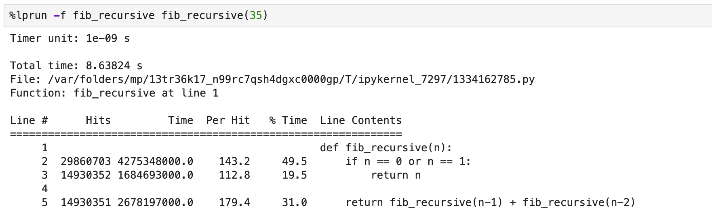
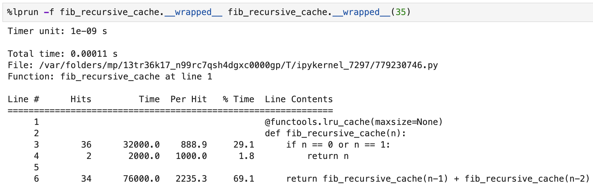
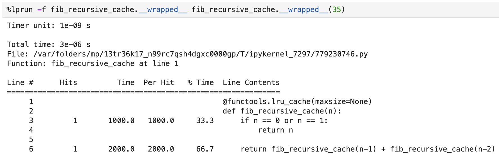
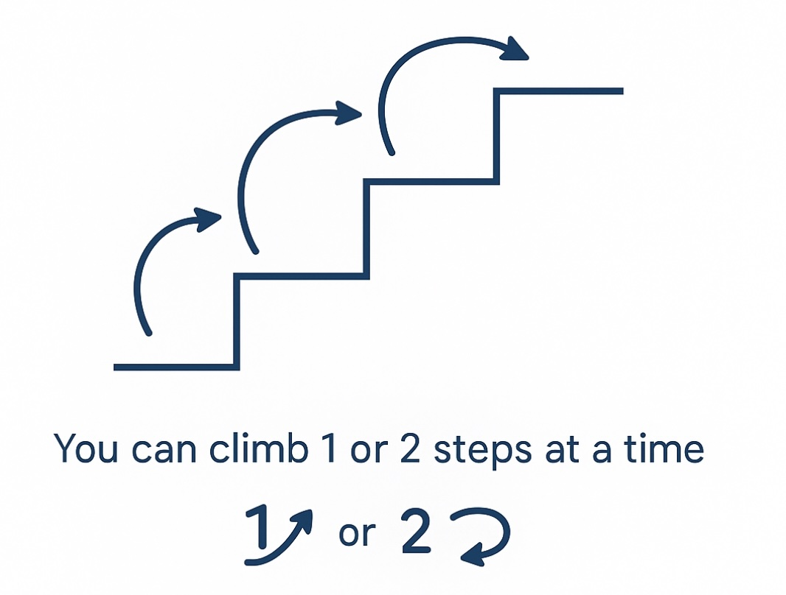

## Lecture 6 Review

- Recursive data structures
- Linked lists, binary search trees (BST)
- Nearest neighbours intro and $k$-d trees
- Amortization

## Outline

- Caching and memoization
- Intro to Dynamic Programming
- Bottom-Up/Top-Down

## Learning objectives

- Identify cases of repeated or redundant computation and address the issues with caching or memoization.
- Describe the basic idea of dynamic programming.
- Identify problems when dynamic programming is applicable.
- Implement simple dynamic programming algorithms.

## Recursion review
```python
def fib_recursive(n):
    if n == 1 or n == 2:
        return 1
    else:
        return fib_recursive(n-1) + fib_recursive(n-2)
```

. . .

<br>

```python
%timeit -n3 -r3 fib_recursive(30)
```

## Caching & memoization
```{.python}
def fib_memoized(n, memo=dict()):

    # Check cache
    if n in memo:
        return memo[n]

    if n == 0 or n == 1:
        return n

    memo[n] = fib_memoized(n-1, memo) + fib_memoized(n-2, memo)

    return memo[n]
```

## Caching & memoization
```{.python code-line-numbers="1,"}
def fib_memoized(n, memo=dict()):

    # Check cache
    if n in memo:
        return memo[n]

    if n == 0 or n == 1:
        return n

    memo[n] = fib_memoized(n-1, memo) + fib_memoized(n-2, memo)

    return memo[n]
```

## Caching & memoization
```{.python code-line-numbers="3,4,5"}
def fib_memoized(n, memo=dict()):

    # Check cache
    if n in memo:
        return memo[n]

    if n == 0 or n == 1:
        return n

    memo[n] = fib_memoized(n-1, memo) + fib_memoized(n-2, memo)

    return memo[n]
```

## Caching & memoization
```python
def fib_memoized(n, memo=dict()):

    # Check cache
    if n in memo:
        return memo[n]

    if n == 0 or n == 1:
        return n

    memo[n] = fib_memoized(n-1, memo) + fib_memoized(n-2, memo)

    return memo[n]
```

. . .

<br>

```python
%timeit -n1 -r1 fib_memoized(30)
```

## Caching & memoization
To solve the problem of redundant computation, we can use two key concepts: **caching** and **memoization**.

- **Caching** the practice of storing data for later use.

- **Memoization** is a specific form of caching that involves storing the results of function calls.

- **Python cache:** In Python's context, the term "caching" is frequently used interchangeably with "memoization", which can be confusing.

- Python has built-in decorators like `functools.lru_cache`, which implement memoization but use the term "cache."

## Caching & memoization

```python
@functools.lru_cache(maxsize=None)
def fib_recursive_cache(n):
    if n == 0 or n == 1:
        return n

    return fib_recursive_cache(n-1) + fib_recursive_cache(n-2)
```

. . .

<br>

```python
%timeit -n1 -r1 fib_recursive_cache(30)
```

## Caching & memoization

{width="80%" fig-align="center"}
{width="80%" fig-align="center"}

## Caching & memoization

- **Question:** What happens if I re-run the line-profiler on `fib_recursive_cache`?

. . .

{width="80%" fig-align="center"}

## Caching & memoization
- Use the `joblib` library to store the cache in a file instead of RAM
```python
memory = joblib.Memory("/tmp", verbose=0)
@memory.cache
def fib_recursive_cache2(n):
    if n == 0 or n == 1:
        return n

    return fib_recursive_cache2(n-1) + fib_recursive_cache2(n-2)
```
<br>
```python
%timeit -n1 -r1 fib_recursive_cache2(35)
```

## Intro to Dynamic programming

- Dynamic programming (DP) is a powerful technique for solving problems that can be broken down into simpler subproblems whose solutions can be reused.

- The two essential properties that make a problem amenable to dynamic programming are:
    - **Overlapping subproblems** — the space of subproblems is small and the same subproblems are solved repeatedly.
    - **Optimal substructure** — the optimal solution to the problem can be composed of optimal solutions to its subproblems.

## Intro to Dynamic programming
- **First approach: top-down** or recursion + memoization, which starts by solving the big problem and then breaks it down into smaller subproblems. The memoized solution of the fibonacci sequence falls under the "top-down" category of dynamic programing.
- **Second approach: bottom-up** or iterative tabulation, which, instead of starting with the full problem, it begins with the smallest subproblems and gradually builds up to the bigger ones.

## Intro to Dynamic programming
- Example: Climbing Stairs (Counting Paths)

    - **Problem.** There are _n_ stairs. You may climb **1** or **2** steps at a time.
    - **Question:** How many **distinct** ways can you reach the top? (Distinct means order matters: `[1,2]` differs from `[2,1]`.)

{width="45%" fig-align="center"}

## Climbing Stairs (Counting Paths)

**n = 1 → 1 way**
- `[1]`

**n = 2 → 2 ways**
- `[1,1]`
- `[2]`

**n = 3 → 3 ways**
- `[1,1,1]`
- `[1,2]`
- `[2,1]`

{width="45%" fig-align="center"}

. . .

**n = 4 → 5 ways**
- `[1,1,1,1]`
- `[1,1,2]`
- `[1,2,1]`
- `[2,1,1]`
- `[2,2]`

## Climbing Stairs (Counting Paths)

**n = 1 → 1 way**
- `[1]`

**n = 2 → 2 ways**
- `[1,1]`
- `[2]`

**n = 3 → 3 ways**
- `[1,1,1]`
- `[1,2]`
- `[2,1]`

**n = 4 → 5 ways**
- `[1,1,1,1]`
- `[1,1,2]`
- `[1,2,1]`
- `[2,1,1]`
- `[2,2]`

**Edge case.** Define `ways(0) = 1` (the empty climb).

- **Key idea**

To reach stair _n_, the last move is either a 1-step from _n−1_ or a 2-step from _n−2_. So

$$
\mathrm{ways}(n)=\mathrm{ways}(n-1)+\mathrm{ways}(n-2),\qquad
\mathrm{ways}(0)=1,\ \mathrm{ways}(1)=1.
$$

These counts are Fibonacci numbers (shifted by one).

## Intro to Dynamic programming

- **Why DP?**
    <!-- - **Optimal substructure**: Ways to reach stair `n` = ways to reach `n-1` **plus** ways to reach `n-2`. -->
    - **Overlapping subproblems**: Computing `ways(4)` calls `ways(3)` and `ways(2)`, and `ways(3)` also calls `ways(2)` again.

{width="45%" fig-align="center"}

*Source:* [favtutor.com](https://favtutor.com/blogs/climbing-stairs-problem)

## Intro to Dynamic programming
:::{.columns}
::: {.column width="50%"}
- Example: Fibonacci Sequence
    - We've already seen the top-down approach
:::
::: {.column width="50%"}
```{mermaid}
graph TD
    A["fib(4)"] --> B["fib(3)"]
    A --> C["fib(2)"]
    B --> D["fib(2)"]
    B --> E["fib(1)"]
    %% Highlight the B node
    style C fill:#ffcccc,stroke:#ff0000,stroke-width:2px
    style D fill:#ffcccc,stroke:#ff0000,stroke-width:2px
```
:::
:::
```python
def fib_memoized(n, memo=dict()):

    # Check cache
    if n in memo:
        return memo[n]

    if n == 0 or n == 1:
        return n

    memo[n] = fib_memoized(n-1, memo) + fib_memoized(n-2, memo)

    return memo[n]
```

## Intro to Dynamic programming
- Example: Fibonacci Sequence
    - We can do this iteratively as well (bottom-up):

```python
def fib_iterative(n):

    f = np.zeros(n+1, dtype=int)

    f[1] = 1

    for i in range(2,n+1):
        f[i] = f[i-1] + f[i-2]

    return f[-1]
```

## Intro to Dynamic programming
- Example: Fibonacci Sequence
    - Can the bottom-up approach be more space effecient?

. . .
```python
def fib_iterative(n):
    if n <= 1:
        return n

    a, b = 1, 1  # fib_iterative(0), fib_iterative(1)
    for _ in range(2, n + 1):
        a, b = b, a + b  # shift the window forward

    return b
```

## Comparing Approaches

::: {style="font-size: 0.8em;"}
| Problem      | Approach                  | Time Complexity | Space Complexity | Comments                                      |
|--------------|--------------------------|-----------------|------------------|-----------------------------------------------|
| **Fibonacci**| Naive recursion          | $O(2^n)$        | $O(n)$          | Exponential recomputation                     |
|              | Memoization (top-down)   | $O(n)$          | $O(n)$           | Caches results, avoids redundancy             |
|              | Tabulation (bottom-up)   | $O(n)$          | $O(n)$           | Iterative, no recursion overhead              |
|              | Space-opt. tabulation    | $O(n)$          | $O(1)$           | Only last two values kept                     |
:::

## Optimal substructure
- Example: Find the **minimum cost path** in a weighted graph
from a **source** node to a **destination** node.

- Subproblem Breakdown

    1. Compute the minimum cost from the **source** to each **intermediate** node.
    2. Compute the minimum cost from each **intermediate** node to the **destination**.

## DP Problem‑Solving Template

::: {style="font-size: 0.8em;"}

When solving a problem with dynamic programming:

1. **Identify subproblems:** Break the problem into smaller, reusable pieces (e.g., prefixes, suffixes, or states).
2. **Set base cases:** Define the simplest cases and their outputs to anchor your solution.
3. **Write the recurrence:** Express each subproblem in terms of smaller ones.
4. **Choose a strategy:** Use **top-down** (recursion + memoization) or **bottom-up** (iterative tabulation).
5. **Implement & test:** Code the solution, initialize base cases, and check with small examples.
6. **Optimize space:** Store only what’s needed—sometimes just a few previous states.

:::
