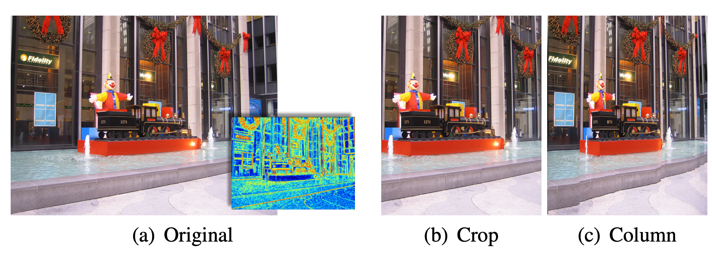

## This is the last lecture of the class! 🎉 {background-image="images/lec08_title_jump.png" background-size="cover" background-position="right bottom" style="font-size: 0.8em;"}

::: {.incremental}
- CONGRATULATIONS on making it through DSCI 512!
- Lecture recordings have been released (well, most of them...)
- Quiz 2 will cover only week 3+4 content (we will not test **optimization**), practice quiz coming soon (HIGHLY recommend doing this!)
- Live coding retakes are available until November 6th (next Friday) 5pm. 
- [Grokking Algorithm](https://learning.oreilly.com/library/view/grokking-algorithms-second/9781633438538/OEBPS/Text/11.html) is a great book for self-study!
:::

::: footer
Image generated by OpenAI GPT-image-2.5-sunburst.
:::

# Your photo doesn't fit {background-image="images/lec08_title_seam.png" background-size="cover" background-position="right bottom" style="font-size: 0.8em;"}

```{python}
#| echo: false
# Hidden: imports and helpers for the whole deck, kept in one place so the visible
# cells below contain only the code students should read.
import base64
import io
import time

import numpy as np
from IPython.display import Markdown
from PIL import Image
from scipy.ndimage import convolve

def image_energy(image):
    """The lab's energy: (right - left)^2 + (below - above)^2, added up over R, G and B."""
    dy = np.array([-1, 0, 1])[:, None, None]
    dx = np.array([-1, 0, 1])[None, :, None]
    energy_img = convolve(image, dx) ** 2 + convolve(image, dy) ** 2
    return np.sum(energy_img, axis=2)


# The 5 by 5 grid on every seam slide: a tiny pixel picture of the English Bay photo (a sail top right,
# the sun on the left, the sea, the otter on its rock bottom left, sand), and its energy with the
# lab's function, scaled so the largest is 9 and rounded. Picked so that greedy misses the best seam
# and the best seam is unique. The same numbers as the pyodide `energy`.
toy_hex = [["c2e1ff", "92b1d8", "92b1d8", "fffffa", "ffffff"],
           ["ff7c48", "aeccf3", "98b7de", "fffff9", "fffffc"],
           ["3c8ae8", "2775d3", "2a78d6", "3583e1", "2674d2"],
           ["f9e6bb", "946334", "a77647", "ffedc2", "e4d1a6"],
           ["eedbb0", "8b8882", "7e7b75", "f7e4b9", "dac79c"]]
toy_picture = np.array([[[int(h[i:i + 2], 16) / 255 for i in (0, 2, 4)] for h in row] for row in toy_hex])
toy_energy = image_energy(toy_picture)
toy = np.rint(9 * toy_energy / toy_energy.max()).astype(int)
toy_rows, toy_cols = toy.shape
assert toy.tolist() == [[6, 1, 2, 2, 0], [7, 5, 2, 8, 7], [3, 5, 3, 0, 1], [9, 5, 7, 7, 5], [2, 3, 3, 2, 0]]
# Each pixel's colour faded toward white, drawn behind its number in every grid.
toy_tint = [["#%02x%02x%02x" % tuple(np.rint(255 * (0.45 * p + 0.55)).astype(int)) for p in row]
            for row in toy_picture]


def seam_table(energy):
    """The lab's CME table: a column of inf on each side, then each cell adds the
    cheapest of the 3 cells above it (same loops as the visible find_vertical_seam)."""
    nrows, ncols = energy.shape
    CME = np.full((nrows, ncols + 2), np.inf)
    CME[:, 1:-1] = energy
    for i in range(1, nrows):
        for j in range(1, ncols + 1):
            CME[i, j] += min(CME[i - 1, j - 1], CME[i - 1, j], CME[i - 1, j + 1])
    return CME


def backtrack(CME):
    """The lab's backtracking: cheapest bottom cell, then the cheapest of the 3 above, up to the top.
    Returns the seam (image columns) and, per row from the bottom, the columns it compared."""
    nrows = CME.shape[0]
    seam = np.zeros(nrows, dtype=int)
    seam[-1] = np.argmin(CME[-1, :])
    looked = {nrows - 1: list(range(1, CME.shape[1] - 1))}
    for i in range(nrows - 2, -1, -1):
        j = seam[i + 1]
        looked[i] = [j - 1, j, j + 1]
        seam[i] = j + np.argmin(CME[i, j - 1:j + 2]) - 1
    return seam - 1, looked


def fast_seam(energy):
    """Same seam as seam_table + backtrack, with the inner loop vectorized (PrairieLearn Lab 4 Question 13).
    Only used to carve the photo quickly."""
    nrows, ncols = energy.shape
    CME = np.full((nrows, ncols + 2), np.inf)
    CME[:, 1:-1] = energy
    for i in range(1, nrows):
        above = CME[i - 1]
        CME[i, 1:-1] += np.minimum(np.minimum(above[:-2], above[1:-1]), above[2:])
    return backtrack(CME)[0]


def fmt(v):
    """A cell value as printed on the slides: whole numbers, inf as the symbol."""
    return "∞" if np.isinf(v) else str(int(v))


def grid_view(values, roles=None, path=(), path_role="none", pad=False, say="", count=""):
    """One picture of the toy grid for the OJS draw_grid helper. values is a 2D array (with the inf
    columns when pad=True, drawn at column -1 and toy_cols). roles maps (row, col) to a colour role;
    every other cell is "plain" (or "pad" for inf). path is a list of (row, col) to join with a line."""
    roles = roles or {}
    shift = 1 if pad else 0
    cells = []
    for r in range(values.shape[0]):
        for k in range(values.shape[1]):
            c = k - shift
            default = "pad" if (pad and c in (-1, toy_cols)) else "plain"
            cells.append({"r": r, "c": c, "text": fmt(values[r, k]), "role": roles.get((r, c), default),
                          "px": toy_tint[r][c] if 0 <= c < toy_cols else None})
    left, right = (-1.6, toy_cols + 0.6) if pad else (-0.6, toy_cols - 0.4)
    return {"cells": cells, "path": [{"r": r, "c": c} for r, c in path], "path_role": path_role,
            "cols": [{"c": c, "text": f"col {c}"} for c in range(toy_cols)],
            "rows": [{"r": r, "text": f"row {r}"} for r in range(toy_rows)],
            "x_domain": [left, right], "say": say, "count": count}


def to_url(pixels):
    """A float RGB (or grey) image in 0..1 as a small WebP data URL for an  tag."""
    img = Image.fromarray((np.clip(pixels, 0, 1) * 255).astype(np.uint8))
    buf = io.BytesIO()
    img.save(buf, format="WEBP", quality=80)
    return "data:image/webp;base64," + base64.b64encode(buf.getvalue()).decode()


def sci(x):
    """A big whole number for inline text on a slide: with commas up to a trillion, else
    'about 10^k' as LaTeX. Markdown, so Quarto renders the math instead of escaping it."""
    if x < 10**12:
        return Markdown(f"{x:,}")
    return Markdown(f"about $10^{{{len(str(x)) - 1}}}$")
```

```{pyodide}
#| include: false
# Hidden setup for the runnable cells: numpy, the toy energy grid and every function in the
# deck, so a later cell still works when an earlier slide was skipped.
import numpy as np

energy = np.array([[6, 1, 2, 2, 0],
                   [7, 5, 2, 8, 7],
                   [3, 5, 3, 0, 1],
                   [9, 5, 7, 7, 5],
                   [2, 3, 3, 2, 0]])


def cheapest_to(energy, row, col):
    if col < 0 or col >= energy.shape[1]:
        return np.inf
    if row == 0:
        return energy[row, col]
    return energy[row, col] + min(
        cheapest_to(energy, row - 1, col - 1),
        cheapest_to(energy, row - 1, col),
        cheapest_to(energy, row - 1, col + 1),
    )


def find_vertical_seam(energy):
    nrows, ncols = energy.shape
    CME = np.zeros((nrows, ncols + 2))
    CME[:, 0] = np.inf
    CME[:, -1] = np.inf
    CME[:, 1:-1] = energy
    for i in range(1, nrows):
        for j in range(1, ncols + 1):
            CME[i, j] += min(CME[i - 1, j - 1], CME[i - 1, j], CME[i - 1, j + 1])
    seam = np.zeros(nrows, dtype=int)
    seam[-1] = np.argmin(CME[-1, :])
    for i in range(nrows - 2, -1, -1):
        delta = np.argmin(CME[i, seam[i + 1] - 1 : seam[i + 1] + 2]) - 1
        seam[i] = seam[i + 1] + delta
    return seam - 1


def greedy_coins(coins, amount):
    used = []
    for coin in sorted(coins, reverse=True):
        while amount >= coin:
            used.append(coin)
            amount -= coin
    return used


def min_coins(coins, amount):
    dp = [np.inf] * (amount + 1)
    dp[0] = 0
    for a in range(1, amount + 1):
        for c in coins:
            if c <= a:
                dp[a] = min(dp[a], 1 + dp[a - c])
    return dp[amount]
```

```{ojs}
//| echo: false
// Draw only: the toy energy grid. Every cell, value, colour role and line comes from Python
// (grid_view). Orange: the seam, or the cell just filled in. Blue: greedy, or the cells being
// compared. Grey: the inf columns, or a broken seam. Plain cells show their pixel's
// faded colour (d.px), so the grid stays linked to the tiny picture. v.over (optional) is a few
// cells drawn on top of the grid with their own line v.over_path, for the brute force step-throughs.
draw_grid = (v, {width = 620, height = 330} = {}) => {
  const over = v.over ?? [];
  const fill = {plain: "#fcfcfb", faint: "#fcfcfb", pad: "#f2f1ee", read: "#dbe8f8", pick: "#2a78d6",
                new: "#eb6834", filled: "#e4e2dc", seam: "#eb6834", greedy: "#2a78d6", bad: "#b8b6b0"};
  const ink = {plain: "#0b0b0b", faint: "#c9c7c1", pad: "#8a8880", read: "#0b0b0b", pick: "#ffffff",
               new: "#ffffff", filled: "#0b0b0b", seam: "#ffffff", greedy: "#ffffff", bad: "#ffffff"};
  const line = {seam: "#eb6834", greedy: "#2a78d6", bad: "#8a8880", none: "none"};
  return Plot.plot({
    width, height, marginTop: 34, marginLeft: 66, marginRight: 10, marginBottom: 6,
    style: {fontSize: "16px", background: "transparent"},
    x: {axis: null, domain: v.x_domain}, y: {axis: null, domain: [4.55, -0.55]},
    marks: [
      Plot.rect(v.cells, {x1: d => d.c - 0.46, x2: d => d.c + 0.46, y1: d => d.r - 0.44, y2: d => d.r + 0.44,
                          fill: d => (d.role === "plain" && d.px) ? d.px : fill[d.role], rx: 4,
                          stroke: d => d.role === "read" ? "#2a78d6" : "#d9d8d4", strokeWidth: 2}),
      Plot.line(v.path, {x: "c", y: "r", stroke: line[v.path_role], strokeWidth: 4, strokeOpacity: 0.45,
                         strokeDasharray: v.path_role === "bad" ? "6,5" : undefined}),
      Plot.text(v.cells.filter(d => ["plain", "faint", "pad"].includes(d.role)),
                {x: "c", y: "r", text: "text", fill: d => ink[d.role], fontSize: 20}),
      Plot.text(v.cells.filter(d => !["plain", "faint", "pad"].includes(d.role)),
                {x: "c", y: "r", text: "text", fill: d => ink[d.role], fontSize: 20, fontWeight: "bold"}),
      Plot.rect(over, {x1: d => d.c - 0.46, x2: d => d.c + 0.46, y1: d => d.r - 0.44, y2: d => d.r + 0.44,
                       fill: d => fill[d.role], rx: 4, stroke: "#d9d8d4", strokeWidth: 2}),
      Plot.line(v.over_path ?? [], {x: "c", y: "r", stroke: line[v.over_path_role ?? "none"], strokeWidth: 4,
                                    strokeOpacity: 0.45}),
      Plot.text(over, {x: "c", y: "r", text: "text", fill: d => ink[d.role], fontSize: 20, fontWeight: "bold"}),
      Plot.text(v.cols, {x: "c", y: -0.5, text: "text", dy: -14, fill: "#8a8880"}),
      Plot.text(v.rows, {x: v.x_domain[0], y: "r", text: "text", textAnchor: "end", dx: -6, fill: "#8a8880"})
    ]
  });
}
```


::: {style="max-width: 55%;"}
You took a wide photo at English Bay. Every app wants a different shape.

::: {.incremental}
- A post wants it square. A phone wallpaper wants it tall. A website banner wants it short.
- How would you make it fit?
:::
:::


::: footer
Image generated by OpenAI GPT-image-2.5-sunburst.
:::

```{python}
#| echo: false
# Hidden: every picture of the English Bay photo for "Make it smaller", "Crop or squash?",
# "Remove the dullest pixels?" and "Back to English Bay". The photo, shrunk to 480 x 320, made
# narrower five ways. Each removal method repeats: find the energy (the lab's), remove one pixel per
# row, start again. Seam carving uses the same DP and backtracking as the visible code (inner loop
# vectorized, PrairieLearn Lab 4 Question 13, so the photo takes about a second).
# Every picture is a small WebP data URL made here; OJS only picks one.
photo_w, photo_h = 480, 320
photo = np.asarray(Image.open("images/lec08_english_bay_boats.png").convert("RGB")
                   .resize((photo_w, photo_h), Image.LANCZOS), dtype=float) / 255
carve_ks = [0, 40, 80, 120, 160]
orange = np.array([235, 104, 52]) / 255


def resized(pixels, w, h):
    """The picture stretched or shrunk to w x h (what every app does by default)."""
    img = Image.fromarray((np.clip(pixels, 0, 1) * 255).astype(np.uint8))
    return np.asarray(img.resize((w, h), Image.LANCZOS), dtype=float) / 255


def cheapest_column(energy):
    """The column with the smallest total energy, the same column in every row."""
    return np.full(energy.shape[0], np.argmin(energy.sum(axis=0)))


def cheapest_pixels(energy):
    """The cheapest pixel in each row, each row on its own."""
    return np.argmin(energy, axis=1)


def remove_again_and_again(image, ks, pick, energy_of, stop_when=None):
    """Remove one pixel per row, ks[-1] times. pick(energy) gives the column to remove in every row.
    Returns the picture after each k in ks, and a mask of the original pixels removed so far.
    stop_when(mask), if given, stops early and also keeps the picture at that k."""
    h, w = image.shape[:2]
    rows_h = np.arange(h)
    current, where = image.copy(), np.tile(np.arange(w), (h, 1))   # original column of every pixel left
    gone = np.zeros((h, w), dtype=bool)
    pictures, masks = {0: image}, {0: gone.copy()}
    for k in range(1, ks[-1] + 1):
        cols = pick(energy_of(current, where))
        gone[rows_h, where[rows_h, cols]] = True
        keep = np.ones((h, current.shape[1]), dtype=bool)
        keep[rows_h, cols] = False
        current = current[keep].reshape(h, -1, 3)
        where = where[keep].reshape(h, -1)
        done = stop_when is not None and stop_when(gone)
        if k in ks or done:
            pictures[k], masks[k] = current, gone.copy()
        if done:
            break
    return pictures, masks


def marked(image, mask, colour=orange):
    """The picture with the removed pixels painted orange."""
    out = image.copy()
    out[mask] = colour
    return out


def photo_energy_of(current, where):
    """Plain energy: every pixel counts as it is."""
    return image_energy(current)


column_pics, column_gone = remove_again_and_again(photo, carve_ks, cheapest_column, photo_energy_of)
pixel_pics, pixel_gone = remove_again_and_again(photo, carve_ks, cheapest_pixels, photo_energy_of)
carve_start = time.perf_counter()
seam_pics, seam_gone = remove_again_and_again(photo, carve_ks, fast_seam, photo_energy_of)
carve_seconds = time.perf_counter() - carve_start
carve_time = f"{carve_seconds:.1f}"

original_url = to_url(photo)
carve_methods = ["crop", "squash", "whole columns", "one pixel per row", "seam carve"]
carve_view = {m: {} for m in carve_methods}
for k in carve_ks:
    size = f"{photo_w - k} × {photo_h}"
    lo, hi = k // 2, photo_w - (k - k // 2)
    crop_mask = np.zeros((photo_h, photo_w), dtype=bool)
    crop_mask[:, :lo] = True
    crop_mask[:, hi:] = True
    if k == 0:
        sayings = {m: f"The original photo: {size}. Remove some columns with the slider." for m in carve_methods}
    else:
        sayings = {
            "crop": f"Crop: {k} columns cut off the two edges. Now {size}. Whatever is near the edges is cut: the log, the umbrella, then a boat.",
            "squash": f"Squash: every column is {k / photo_w:.0%} thinner, the otter too. Now {size}.",
            "whole columns": f"Remove the {k} cheapest whole columns. Now {size}. "
                             "Every column crosses a boat or something on the sand, so even the cheapest ones cut through the otter.",
            "one pixel per row": f"Remove the cheapest pixel in each row, {k} times. Now {size}. "
                                 "Each row shifts by a different amount: the otter and the boats are torn apart.",
            "seam carve": f"Seam carve: {k} seams removed, each through the quietest pixels. Now {size}. "
                          "The otter, the boats and the lifeguard chair stay whole.",
        }
    results = {"crop": (crop_mask, photo[:, lo:hi]),
               "squash": (None, resized(photo, photo_w - k, photo_h)),
               "whole columns": (column_gone[k], column_pics[k]),
               "one pixel per row": (pixel_gone[k], pixel_pics[k]),
               "seam carve": (seam_gone[k], seam_pics[k])}
    for m, (mask, result) in results.items():
        carve_view[m][k] = {"left": original_url if mask is None else to_url(marked(photo, mask)),
                            "right": to_url(result), "width": photo_w - k, "say": sayings[m]}

# "Make it smaller": the whole photo scaled down, both sides by the same amount.
scale_ps = [100, 75, 50, 25]
scale_view = {}
for p in scale_ps:
    w, h = round(photo_w * p / 100), round(photo_h * p / 100)
    scale_view[p] = {"url": to_url(resized(photo, w, h)), "width": w,
                     "say": f"{p}%: {w} × {h}. Width ÷ height = {w / h:.2f}. Smaller, but still not square."}
ojs_define(carve_view = carve_view, carve_ks = carve_ks, scale_view = scale_view, scale_ps = scale_ps)
```

## Make it smaller? {style="font-size: 0.75em;"}

```{ojs}
//| echo: false
viewof scale_p = Inputs.range([25, 100], {step: 25, value: 100, label: "size (%)"})
```

```{ojs}
//| echo: false
{
  // Draw only: the pictures and the sentence were made in Python (scale_view).
  // Same scale as the photo (480 px wide = 480 on the page), the target square drawn in grey.
  const v = scale_view[scale_p];
  return html`<div class="ojs-readout">${v.say}</div>
  <div style="display: flex; gap: 40px; align-items: flex-end; justify-content: center;">
    <figure style="margin: 0;">
      <figcaption class="ds-caption">the photo, scaled</figcaption></figure>
    <figure style="margin: 0;"><div style="width: 320px; height: 320px; border: 3px dashed #b8b6b0;"></div>
      <figcaption class="ds-caption">the square the app wants</figcaption></figure>
  </div>`;
}
```

::: {.fragment}
Scaling changes the **size**, not the shape. To make it square, something has to go.
:::

::: {.notes}
- Slide from 100 down to 25. The width and height shrink together, so the ratio stays 1.50 at every size.
- This is what "resize" does in most apps when you keep the aspect ratio locked.
:::

::: footer
Photo: image generated by OpenAI GPT-image-2.5-sunburst.
:::

## Crop or squash? {style="font-size: 0.75em;"}

```{ojs}
//| echo: false
viewof fit_method = Inputs.radio(["crop", "squash"], {value: "crop", label: "make it narrower by"})
viewof fit_k = Inputs.range([0, 160], {step: 40, value: 0, label: "columns to remove"})
```

```{ojs}
//| echo: false
// Draw only: both pictures and the sentence were made in Python (carve_view).
// Left: the original, with what gets removed painted orange. Right: the result, same scale.
carve_pair = v => html`<div class="ojs-readout">${v.say}</div>
  <div style="display: flex; gap: 24px; align-items: flex-start; justify-content: center;">
    <figure style="margin: 0;">
      <figcaption class="ds-caption">what gets removed (orange)</figcaption></figure>
    <figure style="margin: 0;">
      <figcaption class="ds-caption">the result</figcaption></figure>
  </div>`
```

```{ojs}
//| echo: false
carve_pair(carve_view[fit_method][fit_k])
```

::: {.notes}
- Start on crop, slide to 160: the log, the umbrella and half of the left boat are cut. Switch to squash at 160: the otter looks thin.
- The photo is 480 × 320, so removing 160 columns makes it square.
- Ask: crop throws away the edges, squash takes a little from everywhere. What if we took pixels only from places nobody would miss?
- PrairieLearn Lab 4 Question 5 asks students to compare a cropped and a seam-carved picture.
:::

::: footer
Photo: image generated by OpenAI GPT-image-2.5-sunburst. Examples: [MIT 18.S191 lecture](https://youtu.be/rpB6zQNsbQU?t=762)
:::

```{python}
#| echo: false
# Hidden: the "Which pixels matter?" slide. The lab's energy of the same 480 x 320 photo, as a
# grey picture: square root so the faint sea ripples still show, scaled to the 99th percentile.
photo_energy = image_energy(photo)
energy_scale = np.percentile(photo_energy, 99)
energy_grey = np.sqrt(np.clip(photo_energy / energy_scale, 0, 1))
energy_view = {"photo": original_url, "energy": to_url(np.repeat(energy_grey[:, :, None], 3, axis=2))}
ojs_define(energy_view = energy_view)
```

## Which pixels matter? {style="font-size: 0.75em;"}

```{ojs}
//| echo: false
viewof energy_show = Inputs.radio(["photo", "energy"], {value: "photo", label: "show"})
```

::: {style="display: flex; gap: 30px; align-items: center;"}
::: {style="flex: 0 0 auto;"}
```{ojs}
//| echo: false
// Draw only: both pictures were made in Python (energy_view).
html``
```
:::
::: {style="flex: 1;"}
::: {.incremental}
- A pixel's **energy**: how different it is from its neighbours.
- energy = (right − left)² + (below − above)², added up over red, green and blue.
- Sky and sea: low. The outlines of the otter and the boats: high.
- Bright = people would notice. Dark = safe to remove.
:::
:::
:::

::: {.notes}
- This is the `energy` function the lab gives you. No need to know how `convolve` works (it comes back in DSCI 572).
- A pixel in the middle of the sky looks just like its neighbours, so removing it changes almost nothing.
:::

::: footer
Photo: image generated by OpenAI GPT-image-2.5-sunburst. Examples: [MIT 18.S191 lecture](https://youtu.be/rpB6zQNsbQU?t=762)
:::

## Remove the dullest pixels? {style="font-size: 0.75em;"}

```{ojs}
//| echo: false
viewof dull_method = Inputs.radio(["whole columns", "one pixel per row"], {value: "whole columns", label: "remove the cheapest"})
viewof dull_k = Inputs.range([0, 160], {step: 40, value: 0, label: "columns to remove"})
```

```{ojs}
//| echo: false
carve_pair(carve_view[dull_method][dull_k])
```

::: {.fragment}
A column is too stiff, single pixels are too loose. We need a cut that bends but stays **connected**.
:::

::: {.notes}
- Two natural ideas. Both find the energy again after every removal.
- Whole columns: slide to 160. The boats sit above the gaps on the sand, so no column is quiet from top to bottom: every column crosses something. The cuts go through the otter, which ends up a thin stick on a shrunken rock.
- A column cannot bend around anything: it has to go straight through whatever is in its way. Removing whole columns only works on a photo with empty strips from top to bottom.
- A whole row is the same idea turned sideways, with the same problem once no row is quiet from side to side.
- One pixel per row: slide to 160. Each row loses pixels in different places, so neighbouring rows no longer line up, and the otter tears into stripes. This is figure 2(e) in the paper.
- Next: a path in between, one pixel per row, but each step can only move one column.
:::

::: footer
Photo: image generated by OpenAI GPT-image-2.5-sunburst. Figure 2 of [Avidan and Shamir, 2007](https://dl.acm.org/doi/pdf/10.1145/3596711.3596776). Examples: [MIT 18.S191 lecture](https://youtu.be/rpB6zQNsbQU?t=762)
:::


## Whole columns in a busier photo {style="font-size: 0.75em;"}

{width="100%" fig-alt="Figure 2 of the seam carving paper: (a) a photo of a toy train and a fountain in front of a building, with its energy map; (b) the photo cropped; (c) the photo with its cheapest whole columns removed, where the straight fountain ledge has become a staircase."}

::: {.fragment}
Look at the fountain ledge in (c): a straight line has turned into **steps**. Every column crosses an edge somewhere.
:::

::: {.notes}
- Our English Bay photo was kind to whole columns: lots of quiet sky and sand. This photo from the paper has detail almost everywhere.
- (a) is the original, with its energy map in the corner: bright edges everywhere, so no column is quiet from top to bottom.
- (b) crop: the left of the scene is gone. (c) whole columns: each removed column cuts through the long diagonal ledge, and each cut leaves a step.
- Same lesson as the last slide: a column cannot bend around anything.
:::

::: footer
Figure 2 of [Avidan and Shamir, 2007](https://dl.acm.org/doi/pdf/10.1145/3596711.3596776)
:::


# Seam carving {style="font-size: 0.8em;"}

A path of quiet pixels from top to bottom that can bend around the otter, but never breaks.

::: {.notes}
- Today's answer: seam carving (Avidan and Shamir, 2007), the idea behind "Content-Aware Scale" in Photoshop. It is also Lab 4.
:::

::: footer
Paper: [Avidan and Shamir, 2007. Seam carving for content-aware image resizing](https://dl.acm.org/doi/pdf/10.1145/3596711.3596776). Examples: [MIT 18.S191 lecture](https://youtu.be/rpB6zQNsbQU?t=762)
:::

```{python}
#| echo: false
# Hidden: the "What is a seam?" step-through. Three paths through the toy grid: two seams and one
# path that jumps two columns. Costs and the check are worked out here.
def seam_ok(cols):
    """A seam: one pixel per row, and each step moves at most one column."""
    return all(abs(a - b) <= 1 for a, b in zip(cols, cols[1:]))


def seam_cost(cols):
    return int(sum(toy[r, c] for r, c in enumerate(cols)))


def seam_terms(cols):
    return " + ".join(str(toy[r, c]) for r, c in enumerate(cols))


seam_examples = [[2, 2, 2, 2, 2], [1, 2, 3, 3, 2], [0, 0, 2, 2, 2]]
what_seam = [grid_view(toy, say=f"English Bay as a tiny photo, {toy_rows} rows by {toy_cols} columns. "
                                "Each number is that pixel's energy (scaled to 0 to 9).")]
# The tiny photo itself, each pixel drawn as a 40 x 40 block, shown next to the grid.
toy_picture_url = to_url(np.repeat(np.repeat(toy_picture, 40, axis=0), 40, axis=1))
for cols in seam_examples:
    path = list(enumerate(cols))
    if seam_ok(cols):
        say = f"✅ A seam: one pixel per row, each step moves at most one column. Total energy: {seam_terms(cols)} = {seam_cost(cols)}."
        what_seam.append(grid_view(toy, {p: "seam" for p in path}, path, "seam", say=say))
    else:
        jump = next(r for r in range(1, len(cols)) if abs(cols[r] - cols[r - 1]) > 1)
        say = f"❌ Not a seam: from row {jump - 1} to row {jump} it jumps {abs(cols[jump] - cols[jump - 1])} columns."
        what_seam.append(grid_view(toy, {p: "bad" for p in path}, path, "bad", say=say))
for k, v in enumerate(what_seam):
    v["count"] = f"{k} of {len(what_seam) - 1}"
ojs_define(what_seam = what_seam, toy_picture_url = toy_picture_url)
```

## What is a seam? {style="font-size: 0.75em;"}

```{ojs}
//| echo: false
viewof seam_step = Inputs.button([
  ["Back", i => Math.max(i - 1, 0)],
  ["Next path", i => Math.min(i + 1, what_seam.length - 1)],
  ["Start over", () => 0]
], {value: 0})
```

```{ojs}
//| echo: false
{
  const v = what_seam[seam_step];
  return html`<div class="ojs-readout"><span class="sq-count">${v.count}</span> ${v.say}</div>
  <div style="display: flex; gap: 30px; align-items: center; justify-content: center;">
    <figure style="margin: 0;">
      <figcaption class="ds-caption">the tiny photo</figcaption></figure>
    ${draw_grid(v, {width: 560})}
  </div>`;
}
```

::: {.fragment}
A **vertical seam**: one pixel in every row, top to bottom, each step down-left, straight down or down-right. Remove it, and every row is one pixel shorter.
:::

::: {.notes}
- Start on the tiny photo: the sun, the sail and the otter's edges have big numbers, the flat sky, sea and sand small ones. The faded colours behind the numbers are the same pixels.
- Energy measures change between neighbours, so the middle of a flat patch scores low, even inside the sail.
- The seam must be connected, otherwise removing it tears the picture: the rows would shift by different amounts and edges would break.
- Our goal: the seam with the smallest total energy.
:::

::: footer
Tiny photo: from an image generated by OpenAI GPT-image-2.5-sunburst. Examples: [MIT 18.S191 lecture](https://youtu.be/rpB6zQNsbQU?t=762)
:::

## iClicker: just walk downhill? {style="font-size: 0.8em;"}

Start at the cheapest pixel in the top row. Then always step to the cheapest of the (up to) 3 pixels below. Does this always find the cheapest seam?

- \(A) Yes, always
- \(B) Only if the image is square
- \(C) No, it can miss the cheapest seam
- \(D) Only if every energy is different

::: {.notes}
- Collect answers, don't reveal. The next slide walks it on the toy grid.
- This "best looking next step" strategy is called greedy.
:::

```{python}
#| echo: false
# Hidden: the "Greedy vs the best seam" step-through. Greedy starts at the cheapest top pixel and
# always steps to the cheapest pixel below; the best seam comes from the DP table (seam_table).
greedy = [int(np.argmin(toy[0]))]
greedy_steps = [grid_view(toy, {(0, greedy[0]): "greedy"}, [(0, greedy[0])], "greedy",
                          say=f"Greedy starts at the cheapest top pixel: {toy[0, greedy[0]]} in col {greedy[0]}.")]
for r in range(1, toy_rows):
    c = greedy[-1]
    options = [cc for cc in (c - 1, c, c + 1) if 0 <= cc < toy_cols]
    pick = min(options, key=lambda cc: toy[r, cc])
    greedy.append(pick)
    roles = {(rr, cc): "greedy" for rr, cc in enumerate(greedy)}
    roles.update({(r, cc): "read" for cc in options if cc != pick})
    looked = ", ".join(str(toy[r, cc]) for cc in options)
    greedy_steps.append(grid_view(toy, roles, list(enumerate(greedy)), "greedy",
                                  say=f"Row {r}: the pixels below are {looked}. Greedy takes {toy[r, pick]}."))
greedy_cost = seam_cost(greedy)
greedy_steps[-1]["say"] += f" Total: {seam_terms(greedy)} = {greedy_cost}."
best_seam = [int(c) for c in backtrack(seam_table(toy))[0]]
best_cost = seam_cost(best_seam)
greedy_steps.append(grid_view(toy, {(r, c): "seam" for r, c in enumerate(best_seam)},
                              list(enumerate(greedy)), "greedy",
                              say=f"The best seam (orange): {seam_terms(best_seam)} = {best_cost}. "
                                  f"Greedy (blue line) paid {greedy_cost}."))
for k, v in enumerate(greedy_steps):
    v["count"] = f"Step {k} of {len(greedy_steps) - 1}"
ojs_define(greedy_steps = greedy_steps)
```

## Greedy vs the best seam {style="font-size: 0.75em;"}

```{ojs}
//| echo: false
viewof greedy_step = Inputs.button([
  ["Back", i => Math.max(i - 1, 0)],
  ["Next step", i => Math.min(i + 1, greedy_steps.length - 1)],
  ["Start over", () => 0]
], {value: 0})
```

```{ojs}
//| echo: false
{
  const v = greedy_steps[greedy_step];
  return html`<div class="ojs-readout"><span class="sq-count">${v.count}</span> ${v.say}</div>${draw_grid(v)}`;
}
```

::: {.fragment}
iClicker answer: **C**. A cheap step now can lead into expensive rows later. We have to compare whole seams.
:::

::: {.fragment}
Taking the best-looking step now and never undoing it is a **greedy** algorithm.
:::

::: {.notes}
- More on greedy after the course evaluations: it is not always wrong.
- Point at the tiny photo: greedy starts at the 0 in the corner of the sail, then has to go down through the sail. It never looks back, and pays `{python} greedy_cost`.
- The best seam starts at a 1, more than greedy's 0, but it slips down between the sail and the otter: `{python} best_cost`.
:::

::: footer
Examples: [MIT 18.S191 lecture](https://youtu.be/rpB6zQNsbQU?t=762)
:::

```{python}
#| echo: false
# Hidden: the "Brute force" slides. Exact seam counts for the toy grid and the 480 x 320 photo,
# with a counting DP on whole numbers: like the stairs, add the counts of the 3 pixels above.
def count_seams(nrows, ncols):
    ways = [1] * ncols
    for _ in range(1, nrows):
        ways = [sum(ways[max(c - 1, 0):c + 2]) for c in range(ncols)]
    return sum(ways)


n_toy_seams = count_seams(toy_rows, toy_cols)
n_photo_seams = count_seams(photo_h, photo_w)
count_toy, count_photo = sci(n_toy_seams), sci(n_photo_seams)
```

```{python}
#| echo: false
# Hidden: the "Brute force: try every seam" and "One question, asked again and again" step-throughs. Every seam of the
# toy grid, leftmost first, the way brute force lists them. Each step is the seam being checked
# (blue cells, drawn on top of the grid) and orange cells; OJS only looks a step up by its number.
def all_seams(nrows, ncols):
    seams = [[c] for c in range(ncols)]
    for _ in range(1, nrows):
        seams = [s + [c] for s in seams for c in (s[-1] - 1, s[-1], s[-1] + 1) if 0 <= c < ncols]
    return seams


def checking(cols, answer, answer_on_top):
    """The seam being checked (blue cells, blue line) and an answer path (orange cells). Where the
    two share a cell, answer_on_top says which colour shows."""
    blue = {(r, c) for r, c in enumerate(cols)}
    orange = {(r, c) for r, c in enumerate(answer)}
    shown = ([(rc, "greedy") for rc in blue - orange] + [(rc, "seam") for rc in orange - blue]
             + [(rc, "seam" if answer_on_top else "greedy") for rc in blue & orange])
    return {"over": [{"r": r, "c": c, "text": fmt(toy[r, c]), "role": role} for (r, c), role in shown],
            "over_path": [{"r": r, "c": c} for r, c in enumerate(cols)], "over_path_role": "greedy"}


every_seam = all_seams(toy_rows, toy_cols)
assert len(every_seam) == n_toy_seams
assert min(seam_cost(s) for s in every_seam) == best_cost

# "Try every seam": orange is the cheapest seam found so far.
try_steps, cheapest = {}, every_seam[0]
for k, cols in enumerate(every_seam, start=1):
    if seam_cost(cols) < seam_cost(cheapest):
        cheapest = cols
    say = (f"Seam {k} of {n_toy_seams} (blue): {seam_terms(cols)} = {seam_cost(cols)}. "
           f"Cheapest so far (orange): {seam_cost(cheapest)}.")
    if k == n_toy_seams:
        say += f" Done: every seam checked, and the best is {seam_cost(cheapest)}."
    try_steps[k] = {**checking(cols, cheapest, answer_on_top=False), "say": say}
try_base = grid_view(toy)

# "One question, asked again and again": only the seams through one pixel. Orange is the
# cheapest way from the top down to that pixel, the answer every one of these seams needs.
pin_r, pin_c = 2, 1
through = [s for s in every_seam if s[pin_r] == pin_c]
n_through = len(through)
n_top = len({tuple(s[:pin_r + 1]) for s in through})
n_bottom = len({tuple(s[pin_r:]) for s in through})
top_best = min({tuple(s[:pin_r + 1]) for s in through}, key=seam_cost)
top_terms, top_cost = seam_terms(top_best), seam_cost(top_best)
assert top_cost == seam_table(toy)[pin_r, pin_c + 1]
pin_steps = {}
for k, cols in enumerate(through, start=1):
    say = (f"Seam {k} of {n_through} through row {pin_r}, col {pin_c} (blue): total {seam_cost(cols)}. "
           f"Each one needs the cheapest way down to that pixel (orange): {top_terms} = {top_cost}.")
    pin_steps[k] = {**checking(cols, top_best, answer_on_top=True), "say": say}
pin_base = grid_view(toy)
ojs_define(try_steps = try_steps, try_base = try_base, try_steps_n = n_toy_seams,
           pin_steps = pin_steps, pin_base = pin_base, pin_steps_n = n_through)
```

## Brute force: try every seam {style="font-size: 0.75em;"}

```{ojs}
//| echo: false
viewof try_k = Inputs.range([1, try_steps_n], {step: 1, value: 1, label: "seam number"})
```

```{ojs}
//| echo: false
{
  // Draw only: every cell, line and sentence comes from Python (try_steps).
  const v = {...try_base, ...try_steps[try_k]};
  return html`<div class="ojs-readout">${v.say}</div>${draw_grid(v)}`;
}
```

::: {.fragment}
Check every seam, keep the cheapest. Always right, but how many seams are there?
:::

::: {.notes}
- Drag the slider slowly for the first few seams, then fast to the end. The orange seam only changes when a cheaper seam turns up.
- The best total is the same as on the last slide. Brute force is guaranteed to find it, greedy was not.
:::

::: footer
Examples: [MIT 18.S191 lecture](https://youtu.be/rpB6zQNsbQU?t=762)
:::

## Brute force in code {style="font-size: 0.75em;"}

`cheapest_to(energy, row, col)`: the cheapest seam from the top row down to pixel `(row, col)`.

```{pyodide}
def cheapest_to(energy, row, col):
    if col < 0 or col >= energy.shape[1]:
        return np.inf                        # off the image: min never picks it
    if row == 0:
        return energy[row, col]              # base case: the top row
    return energy[row, col] + min(           # last move: from one of the 3 pixels above
        cheapest_to(energy, row - 1, col - 1),
        cheapest_to(energy, row - 1, col),
        cheapest_to(energy, row - 1, col + 1),
    )

bottom = energy.shape[0] - 1
print(min(cheapest_to(energy, bottom, col) for col in range(energy.shape[1])))
```

::: {.fragment}
Each call makes 3 more calls, $N$ rows deep, for each of the $M$ bottom pixels: about $M \cdot 3^N$ calls. $O(M \cdot 3^N)$.
:::

::: {.fragment}
Our 5 × 5 grid has `{python} count_toy` seams. The 480 × 320 photo has `{python} count_photo`.
:::

::: {.notes}
- Same "last move" idea as the stairs, with 3 choices instead of 2.
- Counting the seams is itself a counting DP, like the stairs: the seams ending at a pixel = the sum of the seams ending at the 3 pixels above it.
- PrairieLearn Lab 4 Question 6(a) counts the seams from one pixel, Question 6(b) asks for this time complexity, and Question 7 times it. The lab's `fvs` builds the whole seam as a list and copies it on every call (`seam + [col]`), which adds up to N more work per call, so O(N · M · 3^N) is also a fine upper bound. Either way: exponential in the height N.
- Live: change `energy` to `np.random.rand(12, 10)` and run. It takes seconds. Every extra row is about 3 times slower.
:::

::: footer
Examples: [MIT 18.S191 lecture](https://youtu.be/rpB6zQNsbQU?t=762)
:::

## One pixel, many seams {style="font-size: 0.8em;"}

How many of the `{python} count_toy` seams pass through the pixel in row 2, col 1 (energy `{python} int(toy[2, 1])`)?

::: {.notes}
- Ask the room, no iClicker. Take a few guesses, then go to the next slide to reveal.
- Hint if they are stuck: how many ways down to that pixel? How many ways on from it?
:::

## One question, asked again and again {style="font-size: 0.75em;"}

```{ojs}
//| echo: false
viewof pin_k = Inputs.range([1, pin_steps_n], {step: 1, value: 1, label: "seam number"})
```

```{ojs}
//| echo: false
{
  // Draw only: every cell, line and sentence comes from Python (pin_steps).
  const v = {...pin_base, ...pin_steps[pin_k]};
  return html`<div class="ojs-readout">${v.say}</div>${draw_grid(v)}`;
}
```

::: {.fragment}
Answer: `{python} n_top * n_bottom`. `{python} n_top` ways down to it, times `{python} n_bottom` ways on from it.
:::

::: {.fragment}
Brute force works out `cheapest_to(energy, 2, 1)` again for every one: an **overlapping subproblem**. So write the answer on the pixel once, like the chalk on the stairs.
:::

::: {.notes}
- Drag the slider: the blue seam changes, but the orange answer to "cheapest way down to row 2, col 1" never does.
- This is exactly why plain recursive Fibonacci and climb were slow.
:::

::: footer
Examples: [MIT 18.S191 lecture](https://youtu.be/rpB6zQNsbQU?t=762)
:::

```{python}
#| echo: false
# Hidden: the "Fill the table" step-through. The same loops as seam_table (and the visible
# find_vertical_seam), one snapshot per cell. Each step also stores where "Next row" jumps to.
fill_rows, fill_cols = toy_rows, toy_cols + 2
fill_table = np.full((fill_rows, fill_cols), np.nan)
fill_table[:, 0] = np.inf
fill_table[:, -1] = np.inf
fill_table[0, 1:-1] = toy[0]


def fill_values():
    """What the table shows now: filled cells and inf, and each unfilled cell's own energy, faint."""
    shown = fill_table.copy()
    blank = np.isnan(shown)
    shown[blank] = np.hstack([np.zeros((fill_rows, 1)), toy, np.zeros((fill_rows, 1))])[blank]
    return shown, blank


def fill_snapshot(say, new=(), read=()):
    shown, blank = fill_values()
    roles = {}
    for r in range(fill_rows):
        for k in range(1, fill_cols - 1):
            roles[(r, k - 1)] = "faint" if blank[r, k] else "filled"
    roles.update({(r, k - 1): "read" for r, k in read})
    roles.update({(r, k - 1): "new" for r, k in new})
    return grid_view(shown, roles, pad=True, say=say)


fill_steps = [fill_snapshot("Row 0 is the base case: the cheapest seam to a top pixel is just its own energy. "
                            "Pad both sides with ∞.", new=[(0, k) for k in range(1, fill_cols - 1)])]
fill_row_of = [0]
for i in range(1, fill_rows):
    for j in range(1, fill_cols - 1):
        above = fill_table[i - 1, j - 1:j + 2]
        fill_table[i, j] = toy[i, j - 1] + above.min()
        say = (f"Row {i}, col {j - 1}: {toy[i, j - 1]} + min({', '.join(fmt(a) for a in above)}) "
               f"= {fmt(fill_table[i, j])}.")
        fill_steps.append(fill_snapshot(say, new=[(i, j)], read=[(i - 1, j - 1), (i - 1, j), (i - 1, j + 1)]))
        fill_row_of.append(i)
best_total = int(np.min(fill_table[-1, 1:-1]))
fill_steps[-1]["say"] += f" Done. The smallest number in the bottom row, {best_total}, is the cheapest seam."
assert np.array_equal(fill_table, seam_table(toy))
# "Next row": finish the row we are on; if it is already finished, fill the whole next row.
row_last = {r: max(k for k, rr in enumerate(fill_row_of) if rr == r) for r in set(fill_row_of)}
fill_next_row = [row_last[row] if k < row_last[row] else row_last[min(row + 1, fill_rows - 1)]
                 for k, row in enumerate(fill_row_of)]
for k, v in enumerate(fill_steps):
    v["count"] = f"Step {k} of {len(fill_steps) - 1}"
ojs_define(fill_steps = fill_steps, fill_next_row = fill_next_row)
```

## Fill the table {style="font-size: 0.75em;"}

```{ojs}
//| echo: false
viewof fill_step = Inputs.button([
  ["Back", i => Math.max(i - 1, 0)],
  ["Next cell", i => Math.min(i + 1, fill_steps.length - 1)],
  ["Next row", i => fill_next_row[i]],
  ["Start over", () => 0]
], {value: 0})
```

```{ojs}
//| echo: false
{
  const v = fill_steps[fill_step];
  return html`<div class="ojs-readout"><span class="sq-count">${v.count}</span> ${v.say}
    <span class="match">Orange</span>: just filled in. <span class="notify">Blue</span>: the 3 cells above it.</div>${draw_grid(v, {width: 720})}`;
}
```

::: {.fragment}
The lab calls this table `CME`, the **cumulative minimum energy**: the cheapest seam from the top down to each pixel.
:::

::: {.notes}
- Each cell = its own energy + the cheapest of the 3 cells above it.
- Compare with the stairs: same shape, `min` instead of `+`, and 3 options instead of 2.
- Click "Next cell" for row 1, then "Next row" for the rest.
- Every cell above is already filled when we need it, because we go top to bottom.
:::

::: footer
Examples: [MIT 18.S191 lecture](https://youtu.be/rpB6zQNsbQU?t=762)
:::

## Why pad with ∞? {style="font-size: 0.8em;"}

The table has an extra column of ∞ on the left and on the right. Why ∞, and not 0?

::: {.fragment}
- With 0, `min` would pick the padding and the seam would walk off the image. `min` never picks ∞, so a pixel on the edge only really has 2 choices, with no extra `if`.
:::

::: {.notes}
- Ask the room, no iClicker.
- This is PrairieLearn Lab 4 Question 8(b).
- Same trick as `return np.inf` in `cheapest_to` when we fall off the image.
:::

# Follow the breadcrumbs {background-image="images/lec08_otter_breadcrumbs.png" background-size="cover" background-position="right bottom"}

::: {style="max-width: 55%;"}
::: {.incremental}
- The table says the cheapest seam costs `{python} best_total`.
- But which pixels are in it? The table only kept totals.
- Walk back up: "Which of the 3 cells above did I come from?" The cheapest one.
:::
:::

::: footer
Image generated by OpenAI GPT-image-2.5-sunburst.
:::

```{python}
#| echo: false
# Hidden: the "Walk back up" step-through. The filled table from seam_table, and the same
# backtracking as the visible code (backtrack): one row per step, from the bottom up.
bt_table = seam_table(toy)
bt_seam, bt_looked = backtrack(bt_table)
bt_steps = [grid_view(bt_table, {(r, c): "filled" for r in range(toy_rows) for c in range(toy_cols)}, pad=True,
                      say="The filled table. Each cell is the cheapest seam from the top down to that pixel.")]
seam_so_far = ["_"] * toy_rows
for i in range(toy_rows - 1, -1, -1):
    roles = {(r, c): "filled" for r in range(toy_rows) for c in range(toy_cols)}
    roles.update({(i, k - 1): "read" for k in bt_looked[i] if 0 < k < toy_cols + 1})
    roles.update({(r, int(bt_seam[r])): "seam" for r in range(i, toy_rows)})
    looked = ", ".join(fmt(bt_table[i, k]) for k in bt_looked[i])
    seam_so_far[i] = str(bt_seam[i])
    if i == toy_rows - 1:
        say = f"Start at the cheapest cell in the bottom row: {fmt(bt_table[i, bt_seam[i] + 1])} in col {bt_seam[i]}."
    else:
        say = (f"Row {i}, the 3 cells above col {bt_seam[i + 1]}: {looked}. "
               f"The cheapest, {fmt(bt_table[i, bt_seam[i] + 1])}, is in col {bt_seam[i]}.")
    say += f" seam = [{', '.join(seam_so_far)}]."
    path = [(r, int(bt_seam[r])) for r in range(i, toy_rows)]
    bt_steps.append(grid_view(bt_table, roles, path, "seam", pad=True, say=say))
bt_steps[-1]["say"] += " Done: the same seam we saw before."
for k, v in enumerate(bt_steps):
    v["count"] = f"Step {k} of {len(bt_steps) - 1}"
ojs_define(bt_steps = bt_steps)
```

## Walk back up {style="font-size: 0.75em;"}

```{ojs}
//| echo: false
viewof bt_step = Inputs.button([
  ["Back", i => Math.max(i - 1, 0)],
  ["Next row up", i => Math.min(i + 1, bt_steps.length - 1)],
  ["Start over", () => 0]
], {value: 0})
```

```{ojs}
//| echo: false
{
  const v = bt_steps[bt_step];
  return html`<div class="ojs-readout"><span class="sq-count">${v.count}</span> ${v.say}</div>${draw_grid(v, {width: 720})}`;
}
```

::: {.fragment}
**Backtracking**: start from the answer at the end of the table, and walk back through the choices that produced it.
:::

::: {.notes}
- Why does this work? Each cell's value was its energy + the smallest cell above it. So the smallest cell above is exactly where its cheapest seam came from.
- We build the seam backwards, from row 4 up to row 0.
- Ask: why not skip the table, start at the smallest energy in the bottom row and walk up to the smallest energy above? That is greedy again, just upwards. A small energy is cheap on its own; a small CME value is the cheapest whole path to the top. The forward pass does the hard work, backtracking only reads it off.
- "Backtracking" has a second meaning you may meet elsewhere: searching by trying a choice and undoing it when it fails (Sudoku, the N queens puzzle). In this course it means walking back through a DP table.
:::

::: footer
Examples: [MIT 18.S191 lecture](https://youtu.be/rpB6zQNsbQU?t=762)
:::

## Seam carving in code {style="font-size: 0.7em;"}

```{.python code-line-numbers="|4-8|10-13|15-21|23"}
def find_vertical_seam(energy):
    nrows, ncols = energy.shape

    # CME: cumulative minimum energy, with a column of inf on each side
    CME = np.zeros((nrows, ncols + 2))
    CME[:, 0] = np.inf
    CME[:, -1] = np.inf
    CME[:, 1:-1] = energy

    # forward pass: fill the table row by row, from the top
    for i in range(1, nrows):
        for j in range(1, ncols + 1):
            CME[i, j] += min(CME[i - 1, j - 1], CME[i - 1, j], CME[i - 1, j + 1])

    # backtracking: start at the cheapest cell in the bottom row, walk up
    seam = np.zeros(nrows, dtype=int)
    seam[-1] = np.argmin(CME[-1, :])
    for i in range(nrows - 2, -1, -1):
        # argmin gives 0, 1 or 2: subtract 1 to get the step -1, 0 or +1
        delta = np.argmin(CME[i, seam[i + 1] - 1 : seam[i + 1] + 2]) - 1
        seam[i] = seam[i + 1] + delta

    return seam - 1    # undo the shift from the inf column on the left
```

::: {.notes}
- This is the lab's `SeamCarveDP.find_vertical_seam` (PrairieLearn Lab 4 Question 8), written as a plain function.
- PrairieLearn Lab 4 Questions 11 to 13: make the forward pass faster by replacing the `j` loop with numpy (vectorizing); Question 13 writes the vectorized loop. The algorithm stays the same.
- The `-1` in `delta` and the `-1` on the last line are two different things: the first turns 0, 1, 2 into a step, the second undoes the padding.
- The last line: column 0 of the image is column 1 of CME, because of the padding.
:::

```{python}
#| echo: false
# Hidden: the expected output for the notes of "Try it yourself", and what happens when the
# energy of the best seam's pixel in row 2 changes to 9 (same table and backtracking as the visible code).
try_seam = str(backtrack(seam_table(toy))[0])
bump_c = int(backtrack(seam_table(toy))[0][2])
bump_from = int(toy[2, bump_c])
toy_9 = toy.copy()
toy_9[2, bump_c] = 9
seam_9 = backtrack(seam_table(toy_9))[0]
try_seam_9 = str(seam_9)
try_cost_9 = int(toy_9[np.arange(toy_rows), seam_9].sum())
```

## Try it yourself {style="font-size: 0.75em;"}

```{pyodide}
def find_vertical_seam(energy):
    nrows, ncols = energy.shape
    CME = np.zeros((nrows, ncols + 2))
    CME[:, 0] = np.inf                               # inf on each side
    CME[:, -1] = np.inf
    CME[:, 1:-1] = energy
    for i in range(1, nrows):                        # forward pass
        for j in range(1, ncols + 1):
            CME[i, j] += min(CME[i - 1, j - 1], CME[i - 1, j], CME[i - 1, j + 1])
    seam = np.zeros(nrows, dtype=int)                # backtracking
    seam[-1] = np.argmin(CME[-1, :])
    for i in range(nrows - 2, -1, -1):
        delta = np.argmin(CME[i, seam[i + 1] - 1 : seam[i + 1] + 2]) - 1
        seam[i] = seam[i + 1] + delta
    return seam - 1

seam = find_vertical_seam(energy)
print("seam:", seam, " total energy:", energy[np.arange(len(seam)), seam].sum())
```

::: {.notes}
- Demo it myself, no student work time. Students can try it after class.
- Expected: seam `{python} try_seam`, total `{python} best_cost`.
- Live: in `energy`, change row 2, col `{python} bump_c` (on the seam) from `{python} bump_from` to 9. Ask the room where the seam goes now, then run it. (It moves to `{python} try_seam_9`, total `{python} try_cost_9`.)
:::

::: footer
Examples: [MIT 18.S191 lecture](https://youtu.be/rpB6zQNsbQU?t=762)
:::

```{python}
#| echo: false
# Hidden: the "How fast?" slider. For a square n x n image: the calls the brute-force cheapest_to
# makes (counted exactly with the same rules: each call that is on the image and below the top row
# makes 3 more calls), and the cells the DP table fills (n x n).
def brute_calls(n):
    calls = [[1] * (n + 2) for _ in range(n)]          # calls[row][col + 1]; off the image = 1 call
    for r in range(1, n):
        for c in range(n):
            calls[r][c + 1] = 1 + calls[r - 1][c] + calls[r - 1][c + 1] + calls[r - 1][c + 2]
    return sum(calls[n - 1][1:n + 1])


speed_ns = list(range(2, 31))
speed_rows = [{"n": n, "method": "brute force", "work": brute_calls(n)} for n in speed_ns]
speed_rows += [{"n": n, "method": "DP table", "work": n * n} for n in speed_ns]
speed_say = {n: f"A {n} × {n} image: brute force makes {brute_calls(n):,} calls. "
                f"The DP table fills {n * n:,} cells." for n in speed_ns}
ojs_define(speed_rows = speed_rows, speed_say = speed_say)
```

## iClicker: how fast is `find_vertical_seam`? {style="font-size: 0.8em;"}

For an image with $N$ rows and $M$ columns:

- \(A) $O(N + M)$
- \(B) $O(NM)$
- \(C) $O(M \cdot 3^N)$
- \(D) $O(N^2 M^2)$

::: {.fragment}
- Answer: **B**. The forward pass fills $N \times M$ cells, each with a `min` of 3. Backtracking is $N$ more steps. Space: the $N \times M$ table.
:::

::: {.notes}
- PrairieLearn Lab 4 Question 8(c). Question 8(d) asks about space, and Question 9 times it.
:::

## How fast? {style="font-size: 0.75em;"}

```{ojs}
//| echo: false
viewof speed_n = Inputs.range([2, 30], {step: 1, value: 10, label: "image size n × n"})
```

```{ojs}
//| echo: false
{
  // Draw only: every count and the sentence come from Python (speed_rows, speed_say).
  // Orange: brute force (grows exponentially). Blue: the DP table.
  const colour = {"brute force": "#eb6834", "DP table": "#2a78d6"};
  const here = speed_rows.filter(d => d.n === speed_n);
  return html`<div class="ojs-readout">${speed_say[speed_n]}</div>${Plot.plot({
    width: 820, height: 350, marginLeft: 70, marginRight: 110, marginBottom: 48,
    style: {fontSize: "16px", background: "transparent"},
    x: {label: "image size n →", domain: [2, 30], labelAnchor: "center", labelOffset: 40},
    y: {type: "log", label: "↑ steps (log scale)", grid: true, tickFormat: "~e"},
    marks: [
      Plot.line(speed_rows, {x: "n", y: "work", stroke: d => colour[d.method], strokeWidth: 3}),
      Plot.ruleX([speed_n], {stroke: "#b8b6b0", strokeDasharray: "6,4"}),
      Plot.dot(here, {x: "n", y: "work", fill: d => colour[d.method], r: 6}),
      Plot.text(speed_rows.filter(d => d.n === 30), {x: "n", y: "work", text: "method", dx: 8,
                textAnchor: "start", fill: d => colour[d.method], fontWeight: "bold"})
    ]
  })}`;
}
```

::: {.notes}
- Each grid line is 10 times more steps. The orange line is straight on a log scale: exponential.
- A 30 × 30 image is still tiny. The photo was 480 × 320.
:::

## Back to English Bay {style="font-size: 0.75em;"}

```{ojs}
//| echo: false
viewof carve_method = Inputs.radio(["crop", "squash", "whole columns", "one pixel per row", "seam carve"],
                                   {value: "seam carve", label: "make it narrower by"})
viewof carve_k = Inputs.range([0, 160], {step: 40, value: 0, label: "columns to remove"})
```

```{ojs}
//| echo: false
carve_pair(carve_view[carve_method][carve_k])
```

::: {.notes}
- Seam carve at 160: square, nothing important lost. Then flick through the other four at 160 for the contrast.
- Point at the orange lines on the left in seam carve mode: each is one seam, a wiggly line from top to bottom through the sky, the sea and the sand.
- Each seam is one call to `find_vertical_seam`, then the energy is found again on the narrower photo. 160 seams took `{python} carve_time` seconds when these slides were built.
:::

::: footer
Photo: image generated by OpenAI GPT-image-2.5-sunburst. Seam carving: [Avidan and Shamir, 2007](https://dl.acm.org/doi/pdf/10.1145/3596711.3596776). Examples: [MIT 18.S191 lecture](https://youtu.be/rpB6zQNsbQU?t=762)
:::

```{python}
#| echo: false
# Hidden: the "Does it always work?" slide. Starry Night shrunk to 480 wide, then made narrower by seam
# carving (same energy, DP and backtracking as the English Bay photo) or by squashing. Its energy is
# drawn on the same grey scale as the photo's, so the two energy pictures can be compared.
starry = np.asarray(Image.open("images/starry_night.png").convert("RGB"), dtype=float) / 255
starry_w = 480
starry_h = round(starry_w * starry.shape[0] / starry.shape[1])
starry = resized(starry, starry_w, starry_h)
starry_ks = [0, 80, 160, 240]
starry_pics, starry_gone = remove_again_and_again(starry, starry_ks, fast_seam, photo_energy_of)
starry_energy = image_energy(starry)
starry_grey = np.sqrt(np.clip(starry_energy / energy_scale, 0, 1))
energy_times = np.median(starry_energy) / np.median(photo_energy)
starry_times = f"{energy_times:.0f}"
starry_url = to_url(starry)
starry_view = {"energy": {}, "seam carve": {}, "squash": {}}
for k in starry_ks:
    size = f"{starry_w - k} × {starry_h}"
    starry_view["energy"][k] = {
        "left": starry_url, "right": to_url(np.repeat(starry_grey[:, :, None], 3, axis=2)), "width": starry_w,
        "say": f"Its energy, on the same scale as the English Bay photo: bright almost everywhere. "
               f"The typical pixel has {starry_times} times the energy of a typical pixel in the photo."}
    if k == 0:
        sayings = {m: f"The painting: {size}. Remove some columns with the slider." for m in ("seam carve", "squash")}
    else:
        sayings = {"seam carve": f"Seam carve: {k} seams removed. Now {size}. There are no quiet pixels, so every seam "
                                 "cuts through brush strokes: the stars go out of shape, the cypress breaks up.",
                   "squash": f"Squash: every column is {k / starry_w:.0%} thinner. Now {size}. Thinner, but every swirl is still whole."}
    starry_view["seam carve"][k] = {"left": to_url(marked(starry, starry_gone[k])), "right": to_url(starry_pics[k]),
                                    "width": starry_w - k, "say": sayings["seam carve"]}
    starry_view["squash"][k] = {"left": starry_url, "right": to_url(resized(starry, starry_w - k, starry_h)),
                                "width": starry_w - k, "say": sayings["squash"]}
ojs_define(starry_view = starry_view)
```

## Does it always work? {style="font-size: 0.75em;"}

```{ojs}
//| echo: false
viewof starry_method = Inputs.radio(["seam carve", "squash", "energy"], {value: "seam carve", label: "show"})
viewof starry_k = Inputs.range([0, 240], {step: 80, value: 0, label: "columns to remove"})
```

```{ojs}
//| echo: false
carve_pair(starry_view[starry_method][starry_k])
```

::: {.fragment}
Seam carving needs somewhere **quiet** to cut. When every pixel matters, a plain squash can look better.
:::

::: {.notes}
- Keep it quick, about 1 minute. Show, don't discuss.
- Seam carve at 240, then squash at 240: the squashed stars are ovals, but the seam-carved stars are broken.
- If time: show "energy", bright everywhere compared with the dark sky and sea of the English Bay photo.
- The algorithm still finds the cheapest seam. The cheapest seam is just not cheap. A correct algorithm can still give a bad result when its idea of "important" does not fit the picture.
:::

::: footer
The Starry Night, Vincent van Gogh, 1889. Image: [Van Gogh: The Immersive Experience](https://www.vangoghexhibit.ca/art-that-moves-van-goghs-journey-to-vincent-in-a-nutshell/). Examples: [MIT 18.S191 lecture](https://youtu.be/rpB6zQNsbQU?t=762)
:::

```{python}
#| echo: false
# Hidden: the "Remove the people" slide. The English Bay photo with two people on the beach, 480 x 320.
# The people were cut out by a segmentation model (scripts/segment_people.py), saved as a mask image.
# Their pixels get a very negative energy, so the cheapest seam always goes through them.
# Carve (same DP and backtracking as before) until no pixel of the people is left.
people_photo = resized(np.asarray(Image.open("images/lec08_english_bay_boats_people.png").convert("RGB"),
                                  dtype=float) / 255, photo_w, photo_h)
people_mask = np.asarray(Image.open("images/lec08_english_bay_boats_people_mask.png").convert("L")
                         .resize((photo_w, photo_h), Image.BILINEAR)) > 0


def energy_without_people(current, where):
    """The lab's energy, with every pixel still on a person set very negative."""
    energy = image_energy(current)
    energy[people_mask[np.arange(photo_h)[:, None], where]] = -1e6
    return energy


def people_all_gone(gone):
    return not (people_mask & ~gone).any()


# First run: how many seams until the people are gone. Second run: keep 5 pictures on the way there.
people_n = max(remove_again_and_again(people_photo, [0, photo_w // 2], fast_seam, energy_without_people,
                                      stop_when=people_all_gone)[1])
people_ks = sorted({round(people_n * f) for f in (0, 0.25, 0.5, 0.75, 1)})
people_pics, people_gone = remove_again_and_again(people_photo, people_ks, fast_seam, energy_without_people)
assert people_all_gone(people_gone[people_n])
blue = np.array([42, 120, 214]) / 255
people_view = {}
for k in people_ks:
    left = people_photo.copy()
    still_there = people_mask & ~people_gone[k]
    left[still_there] = 0.5 * left[still_there] + 0.5 * blue
    left[people_gone[k]] = orange
    if k == 0:
        say = "The people, cut out by a segmentation model (blue). Their pixels get energy −1,000,000, so every cheapest seam goes through them."
    elif k < people_n:
        say = f"{k} seams removed. Each one takes the cheapest path, and the cheapest path always crosses a person."
    else:
        say = f"{k} seams removed: no pixel of the people is left. The people are gone, the otter and the lifeguard chair stay."
    people_view[k] = {"left": to_url(left), "right": to_url(people_pics[k]), "width": photo_w - k, "say": say}
ojs_define(people_view = people_view, people_ks = people_ks)
```

## Remove the people {style="font-size: 0.75em;"}

Two strangers walked into your shot. Can seam carving remove them?

```{ojs}
//| echo: false
viewof people_i = Inputs.range([0, people_ks.length - 1], {step: 1, value: 0, label: "step"})
```

```{ojs}
//| echo: false
carve_pair(people_view[people_ks[people_i]])
```

::: {.fragment}
Same algorithm, new energy: make what you want gone the **cheapest**.
:::

::: {.notes}
- Keep it quick, about 1 minute. Slide straight to the end, then reveal the one line.
- The idea: a very negative energy. The DP then finds the cheapest seam, and the cheapest seam is the one through the people.
- The opposite works too: a very high energy on the otter protects it, no seam will cross it.
- The paper (figure 11) does this, then adds seams back so the photo returns to its original width.
- The blue shape is not drawn by hand: a pretrained segmentation model (Mask R-CNN) found the exact pixels of each person. Only those pixels get the negative energy, so the seams follow the outline of the people instead of a whole rectangle. In an app, you tap the person or paint over them with your finger.
:::

::: footer
Photo: image generated by OpenAI GPT-image-2.5-sunburst. Figure 11 of [Avidan and Shamir, 2007](https://dl.acm.org/doi/pdf/10.1145/3596711.3596776). Examples: [MIT 18.S191 lecture](https://youtu.be/rpB6zQNsbQU?t=762)
:::


# Course evaluations {background-image="images/lec08_title_jump.png" background-size="cover" background-position="right bottom" style="font-size: 0.8em;"}

::: {.incremental}
- Let's take 10 minutes to complete the course evaluations on Canvas!
:::

# So many choices: which one is best? {background-image="images/lec08_schedule_board.png" background-size="auto 60%" background-position="right bottom" style="font-size: 0.8em;"}

::: {style="max-width: 55%;"}
::: {.incremental}
- The cheapest seam in a photo.
- The fewest LinkedIn connections between you and ada (lecture 4).
- The fewest coins for 36 cents of change.
- What do these have in common?
:::
:::

::: {.notes}
- Let them talk for a minute. The answer: each one picks the best option out of a huge number of options. That is optimization.
:::

::: footer
Image generated by OpenAI GPT-image-2.5-sunburst.
:::

## Four questions for any optimization problem {style="font-size: 0.6em;"}

| ask | the seam | LinkedIn (BFS) | making change |
|---|---|---|---|
| What do we choose? | one column per row | a path from you to ada | how many of each coin |
| What is the score? | total energy | number of connections | number of coins |
| Bigger or smaller? | minimize | minimize | minimize |
| What are the rules? | each step moves at most one column | each step follows a connection | the coins add up to exactly 36 cents |

::: {.incremental}
- The choices are the **decision variables**. The score is the **objective**. The rules are the **constraints**.
- An option that follows every rule is **feasible**. We want the best feasible one.
:::

::: {.notes}
- Finding the best option is optimization. Writing these four answers down for a real problem is called formulating it, and it is often the hardest part.
- PrairieLearn Lab 4 Question 14 practises this on a restaurant menu: name the parts, count the options for brute force, and see what one more rule does.
- In math: minimize f(x) over x in S, where S is the set of feasible options. The best option is written x*, its score f(x*).
- BFS only finds the fewest connections. If the edges had weights (travel times), the fewest edges might not be the fastest: then you need Dijkstra's algorithm.
:::

# Is greedy always wrong? {style="font-size: 0.8em;"}

You print your carved photo at a kiosk on the beach. It owes you 36 cents. Coins: 25, 10, 5 and 1.

::: {.fragment}
Greedy rule: take the biggest coin that fits, and never put it back.

```{pyodide}
def greedy_coins(coins, amount):
    used = []
    for coin in sorted(coins, reverse=True):   # biggest coin first
        while amount >= coin:                  # take it while it fits
            used.append(coin)
            amount -= coin
    return used

print(greedy_coins([25, 10, 5, 1], 36))
```
:::

::: {.fragment}
25 + 10 + 1: 3 coins. No two coins make 36, so greedy found the best answer ✅
:::

::: {.notes}
- Canada dropped the penny in 2013. Pretend the kiosk still has some.
- Greedy failed on the seam. Here it works. So what is different?
:::

## DP: try every last coin {style="font-size: 0.75em;"}

`dp[a]` = the fewest coins that make `a` cents. The last coin was some `c`, so `dp[a] = 1 + min(dp[a - c])` over every coin.

```{pyodide}
def min_coins(coins, amount):
    dp = [np.inf] * (amount + 1)    # inf: cannot make it (yet)
    dp[0] = 0                       # base case: 0 cents, 0 coins
    for a in range(1, amount + 1):  # bottom up: smaller amounts first
        for c in coins:             # try every coin as the last one
            if c <= a:
                dp[a] = min(dp[a], 1 + dp[a - c])
    return dp[amount]

print("greedy:", greedy_coins([4, 3, 1], 6))
print("DP:    ", min_coins([4, 3, 1], 6))
```

::: {.fragment}
Greedy commits to **one** coin. DP compares every last coin, using stored answers. Counting the stairs used `+`, the cheapest seam and the fewest coins use `min`.
:::

::: {.notes}
- Same six steps as last week: subproblem dp[a], recurrence, base case dp[0] = 0, order a = 1 up to amount, answer dp[amount].
- np.inf, like the seam padding: min never picks it, and 1 + inf is still inf. Try min_coins([3], 2).
- Optimal substructure: if the best way to make 6 ends with a 3, the rest must be the best way to make 3.
- Time: O(amount × number of coins).
:::

# Greedy or not? {style="font-size: 0.8em;"}

Once you can spot greedy, you see it everywhere.

## Are decision trees greedy? {style="font-size: 0.8em;"}

In DSCI 571 you train a **decision tree**: pick the yes/no question that best splits the data at the root ("is age > 30?"), then do the same at each child, and never go back.

Is the trained tree always the best possible tree?

::: {.fragment}
- No. It is greedy: a great first split can lead to poor splits later, like the 4 cent coin.
- Finding the truly best tree is NP-hard, so greedy is a deliberate trade-off: a good tree, fast, with no guarantee.
:::

::: {.notes}
- Ask the room, no iClicker, to save time.
- It is a tree, like in lecture 5.
- NP-hard: no known algorithm finds the best tree quickly; the number of trees explodes even faster than the number of seams.
:::

## Choosing a strategy {style="font-size: 0.75em;"}

| strategy | how it decides | best answer guaranteed? |
|---|---|---|
| brute force | tries every option | yes, but only tiny problems finish |
| greedy | best-looking step now, never undone | only with the greedy-choice property |
| dynamic programming | best answer to every subproblem, stored and reused | yes, with overlapping subproblems and optimal substructure |
| gradient descent | small step downhill | only if the function is convex |

::: {.notes}
- Today: greedy seam ❌, brute force seam too slow, DP seam ✅. Greedy coins: ✅ with 25, 10, 5, 1, ❌ with 1, 3, 4. DP coins ✅.
- Decision trees: greedy on purpose, because the exact answer is too hard.
- Gradient descent: one sentence only. It walks downhill in small steps, so it can get stuck in a dip that is not the lowest point.
:::


## Today's takeaways {style="font-size: 0.8em;"}

::: {.incremental}
- Seam carving shrinks a photo by removing the cheapest connected seam, again and again.
- `CME`: each cell = its own energy + the cheapest of the 3 cells above it. Pad with ∞ so `min` ignores the edges. Brute force is $O(M \cdot 3^N)$, the DP table is $O(NM)$.
- **Backtracking** recovers the choices: start at the best cell at the end, and walk back through the table.
- Optimization: decision variables, objective, constraints, minimize or maximize.
- Greedy takes the best-looking step and never undoes it. Fast, but only guaranteed best with the greedy-choice property (25, 10, 5, 1 yes; 1, 3, 4 no).
- DP for optimization: the same recipe as counting, with `min` instead of `+`.
- Removing seams one at a time, decision trees and gradient descent are all greedy in spirit.
:::

## What we learned in DSCI 512 {style="font-size: 0.8em;"}

::: {.incremental}
- Time and space complexity: Big O by counting steps, and by measuring with profiling.
- Python's data structures: lists, dicts, sets and tuples, and the hash tables behind dicts and sets.
- Stacks, queues, graphs and sparse matrices. Searching graphs with BFS and DFS.
- Recursion and recursive data structures: trees, binary search trees, linked lists and k-d trees.
- Dynamic programming: memoization, tables and backtracking.
- A first look at optimization: greedy, dynamic programming and gradient descent.
:::

## What we did not cover {style="font-size: 0.8em;"}

- Sorting algorithms (merge sort, quicksort)
- Divide and conquer
- Other ways to speed up Python: JIT compilers (Numba), Cython, PyPy
- Parallel and distributed computing
- Linear programming and solvers like PuLP

::: {.notes}
- Point to the cheatsheets on the course website: [math](../math.html) and [Python](../python.html).
:::

# Questions? {background-image="images/lec08_fall_goodbye.png" background-size="cover" background-position="bottom"}

If not, I will see you in 2 weeks! Have a lovely break!

::: {style="height: 180px;"}
:::

::: {.footer .footer-on-image}
Image generated by OpenAI GPT-image-2.5-sunburst.
:::
